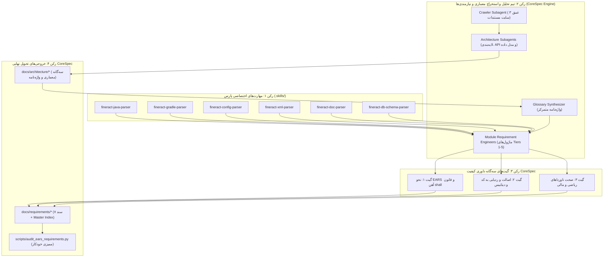

# استخراج نیازمندی‌های Apache Fineract 1.15.0 در قالب استاندارد EARS توسط متدولوژی CoreSpec
## (Apache Fineract 1.15.0 - EARS Requirements & Architecture Specification via CoreSpec Methodology)

[](https://fineract.apache.org/)
[](#۲-متدولوژی-corespec-چارچوب-استخراج-نیازمندی‌ها-و-اکوسیستم-چندعاملی)
[](#۳-قوانین-نگارش-نیازمندی‌ها-و-استاندارد-ears-در-متدولوژی-corespec)
[](#۶-ماتریس-اسناد-نیازمندی‌ها-به-تفکیک-ماژول)
[-success.svg)](#۸-نتایج-ممیزی-خودکار-و-گیت‌های-داوری-کیفیت)
[](#ردیابی-کامل-به-سورس‌کد)

این مخزن حاوی نتایج کامل و مستندات رسمی پروژه **استخراج جامع نیازمندی‌های سامانه بانکداری متمرکز و مالی خرد Apache Fineract (نسخه 1.15.0)** است که با بهره‌گیری از متدولوژی نوین **CoreSpec** به سرانجام رسیده است.

متدولوژی **CoreSpec** (روش‌شناسی جامع استخراج مشخصات و تحلیل سیستم‌های نرم‌افزاری حیاتی) یک رویکرد نظام‌مند، شواهد‌محور و مبتنی بر همکاری ایجنت‌های هوشمند چندگانه (Multi-Agent Ecosystem) است. در قالب این متدولوژی، تمامی نیازمندی‌های عملکردی، قوانین کسب‌وکار، ناورداهای ریاضی و مالی، و رفتارهای ناخواسته (استثنائات سیستم) به صورت مستقیم از **سورس‌کد جاوا، اسکریپت‌های چنج‌لاگ دیتابیس Liquibase و مستندات رسمی سامانه** استخراج شده و در قالب استاندارد بین‌المللی **EARS (Easy Approach to Requirements Syntax)** به صورت دوزبانه (فارسی - انگلیسی) همراه با ماتریس ردیابی کامل بازنویسی شده است.

---

## فهرست مطالب (Table of Contents)
- [۱. هدف و دستاوردهای کلیدی پروژه](#۱-هدف-و-دستاوردهای-کلیدی-پروژه)
- [۲. متدولوژی CoreSpec: چارچوب استخراج نیازمندی‌ها و اکوسیستم چندعاملی](#۲-متدولوژی-corespec-چارچوب-استخراج-نیازمندی‌ها-و-اکوسیستم-چندعاملی)
- [۳. قوانین نگارش نیازمندی‌ها و استاندارد EARS در متدولوژی CoreSpec](#۳-قوانین-نگارش-نیازمندی‌ها-و-استاندارد-ears-در-متدولوژی-corespec)
- [۴. ساختار پوشه‌ها و نقشه راه مخزن](#۴-ساختار-پوشه‌ها-و-نقشه-راه-مخزن)
- [۵. سه‌گانه معماری کلان و واژه‌نامه مرجع بانکی](#۵-سه‌گانه-معماری-کلان-و-واژه‌نامه-مرجع-بانکی)
- [۶. ماتریس اسناد نیازمندی‌ها به تفکیک ماژول](#۶-ماتریس-اسناد-نیازمندی‌ها-به-تفکیک-ماژول)
- [۷. ناورداهای بنیادین و قوانین ریاضی حاکم بر سیستم](#۷-ناورداهای-بنیادین-و-قوانین-ریاضی-حاکم-بر-سیستم)
- [۸. نتایج ممیزی خودکار و گیت‌های داوری کیفیت](#۸-نتایج-ممیزی-خودکار-و-گیت‌های-داوری-کیفیت)
- [۹. نحوه اجرا و راستی‌آزمایی خودکار](#۹-نحوه-اجرا-و-راستی‌آزمایی-خودکار)

---

## ۱. هدف و دستاوردهای کلیدی پروژه

سامانه **Apache Fineract** یکی از جامع‌ترین پلتفرم‌های بانکداری متمرکز متن‌باز دنیا در بنیاد آپاچی است که بیش از ۴۶ زیرپروژه مستقل و صدها هزار خط کد جاوا را در بر می‌گیرد. با توجه به پراکندگی قوانین بیزنس در لابه‌لای سورس‌کدها، این پروژه با پیاده‌سازی متدولوژی **CoreSpec** با اهداف زیر محقق شد:
1. **استخراج بدون واسطه قوانین بانکی:** استخراج دقیق نیازمندی‌های تمامی ماژول‌های تسهیلات، سپرده‌ها، دفتر کل، کارمزدها، پایان روز و امنیت بر اساس کدهای منبع.
2. **بیان نیازمندی‌ها با نحو استاندارد EARS:** تبدیل رفتارهای سیستم به گزاره‌های صریح، آزمون‌پذیر و بدون ابهام با افعال وجهی استاندارد.
3. **ردیابی دوطرفه قطعی (Bidirectional Traceability):** اتصال بدون انقطاع هر نیازمندی به کلاس‌های جاوا، متدها، جداول دیتابیس و کدهای خطای رسمی.
4. **تثبیت واژه‌نامه مرجع بانکی:** رفع ابهام و همگرایی مفهومی میان ترمینولوژی بانکی بین‌المللی و تعاریف فارسی در یک واژه‌نامه مرجع.

---

## ۲. متدولوژی CoreSpec: چارچوب استخراج نیازمندی‌ها و اکوسیستم چندعاملی

متدولوژی **CoreSpec** بر ۴ رکن بنیادین استوار است:



### ارکان چهارگانه متدولوژی CoreSpec:

1. **تحلیل چندعاملی مبتنی بر مهارت (Skill-Based Parsing):**  
   تفکیک ابزارهای خواندن سورس‌کد و داده‌ها به مهارت‌های مجزا (`.skills/`) برای خواندن فایل‌های Java، اسکریپت‌های ساخت Gradle، کانفیگ‌های YAML، ساختار XML چنج‌لاگ‌های Liquibase، مستندات رسمی AsciiDoc و اسکیمای دیتابیس.
2. **سه‌لایه معماری کلان و واژه‌نامه متعارف (Canonical Triad & Domain Glossary):**  
   پیش از استخراج نیازمندی‌های جزئی، معماری کلان در قالب ۳ سند ساختاری و یک واژه‌نامه جامع با مدل ۵ لایه‌ای تثبیت می‌گردد تا از هرگونه تعارض نام‌گذاری و ناهماهنگی مفهومی در تیم‌های مجری جلوگیری شود.
3. **مشخصه‌سازی ساختاریافته به نحو EARS و تدوین ناورداها (EARS & Invariant Modeling):**  
   تبدیل کدهای بیزنس به شناسنامه‌های دوزبانه استاندارد EARS همراه با فرمول‌بندی دقیق ریاضی ناورداهای مالی و سیستماتیک.
4. **داوری مستقل و گیت‌های سه‌گانه کنترل کیفیت (Independent Quality Gates):**  
   در متدولوژی CoreSpec هیچ سندی بدون بررسی و تایید ساب‌ایجنت داور مستقل (Reviewer Subagent) نهایی نمی‌شود. داور مستقل با اسکریپت‌های خودکار سه گیت را ممیزی می‌کند:
   * **گیت ۱ (EARS Syntax):** انحصار کامل فعل `shall`، عدم وجود افعال ممنوعه، و ساختار استاندارد شروط خطای `If-Then`.
   * **گیت ۲ (Code Traceability):** راستی‌آزمایی فیزیکی وجود کلاس‌های جاوا، متدها، جداول دیتابیس و کدهای خطا در مخزن.
   * **گیت ۳ (Banking Invariants):** صحه‌گذاری روی صحت معادلات تراز دوطرفه، مانده قابل برداشت، سن‌یابی مطالبات و ...

---

## ۳. قوانین نگارش نیازمندی‌ها و استاندارد EARS در متدولوژی CoreSpec

در متدولوژی **CoreSpec**، تمامی نیازمندی‌ها از نحو **Easy Approach to Requirements Syntax (EARS)** و ساختار ۶ الگوی استاندارد آن پیروی می‌کنند:

1. **الگوی فراگیر (Ubiquitous):** رفتارهای همیشگی سیستم بدون پیش‌شرط خاص.
   * `The Fineract [Engine] shall [action]...`
2. **الگوی رویدادمحور (Event-Driven):** پاسخ سیستم به یک رخداد، دستور یا فراخوانی API.
   * `When [event trigger], the Fineract [Engine] shall [action]...`
3. **الگوی مبتنی بر وضعیت (State-Driven):** رفتارهای وابسته به وضعیت حساب یا پرونده.
   * `While [system/account state], the Fineract [Engine] shall [action]...`
4. **الگوی رفتارهای ناخواسته (Unwanted Behavior):** شرایط خطا، اعتبارسنجی و استثنائات تجاری.
   * `If [error/invalid condition], then the Fineract [Engine] shall [reject/handle]...`
5. **الگوی قابلیت اختیاری (Optional Feature):** امکاناتی که بر اساس پیکربندی یا فلگ فعال/غیرفعال می‌شوند.
   * `Where [feature flag is enabled], the Fineract [Engine] shall [action]...`
6. **الگوی ترکیبی (Complex):** ترکیبی از وضعیت، ویژگی اختیاری و رویدادهای همزمان.

> [!IMPORTANT]
> **قانون آهن افعال وجهی در متدولوژی CoreSpec (EARS Modal Verb Iron Rule):**  
> در تمامی گزاره‌های انگلیسی الزاماً و منحصراً از فعل وجهی **`shall`** استفاده شده است. استفاده از افعال ممنوعه نظیر `should`, `will`, `can`, یا `must` به عنوان فعل وجهی در کل پروژه اکیداً ممنوع بوده و ممیزی ماشینی خودکار، عدد صفر را برای نقض این قاعده در کل ۱۵۰ کارت ثبت نموده است.

---

## ۴. ساختار پوشه‌ها و نقشه راه مخزن

```text
fineract-ears/
├── .skills/                              # مهارت‌های شش‌گانه اختصاصی CoreSpec برای پارس انواع فایل‌ها
│   ├── fineract-java-parser/             # استخراج ساختار کلاس‌های جاوا، انوتیشن‌ها و متدها
│   ├── fineract-gradle-parser/           # تحلیل وابستگی‌های ۴۶ زیرپروژه Gradle
│   ├── fineract-config-parser/           # تحلیل کانفیگ‌های YAML و پیکربندی چندمستأجری
│   ├── fineract-xml-parser/              # استخراج ساختار داده و جداول از Liquibase XML
│   ├── fineract-doc-parser/              # تحلیل مستندات اسکی‌داک و تبدیل به فرمت EARS
│   └── fineract-db-schema-parser/        # تحلیل اسکیمای دیتابیس و روابط خارجی
│
├── docs/                                 # مستندات نهایی تولیدشده بر پایه متدولوژی CoreSpec
│   ├── architecture/                     # مستندات چهارگانه معماری کلان و واژه‌نامه
│   │   ├── 01-system-modules-and-stack.md    # معماری لایه‌ای و گراف زیرپروژه‌ها
│   │   ├── 02-api-cqrs-and-security.md       # کاتالوگ REST API، پایپ‌لاین CQRS و دسترسی‌ها
│   │   ├── 03-domain-data-events-and-cob.md  # مدل داده ERD، ماشین وضعیت و رویدادها
│   │   └── GLOBAL_DOMAIN_GLOSSARY.md         # واژه‌نامه یکپارچه ۸۴ اصطلاح تخصصی بانکی
│   │
│   ├── requirements/                     # اسناد نیازمندی‌های ماژولار (۱۵۰ شناسنامه EARS)
│   │   ├── 01-loan-portfolio.md                  # ماژول تسهیلات و وام‌های پیشرفته (۲۶ کارت)
│   │   ├── 02-savings-and-deposits.md            # ماژول حساب‌های پس‌انداز و سپرده‌ها (۲۴ کارت)
│   │   ├── 03-accounting-and-financial-ledger.md # ماژول دفتر کل و تراز دوطرفه (۱۸ کارت)
│   │   ├── 04-charges-taxes-and-rates.md         # ماژول کارمزدها، مالیات و نرخ‌ها (۱۸ کارت)
│   │   ├── 05-cob-and-batch-operations.md        # ماژول پایان روز (COB) و جاب‌ها (۲۴ کارت)
│   │   ├── 06-crm-organization-and-security.md  # ماژول مشتریان، شعب و دسترسی (۲۱ کارت)
│   │   ├── 07-infrastructure-and-integrations.md# ماژول Outbox، وب‌هوک و زیرساخت (۱۹ کارت)
│   │   └── MASTER_REQUIREMENTS_INDEX.md          # کاتالوگ جامع و فهرست الفبایی نیازمندی‌ها
│   │
│   ├── crawled/                          # پایگاه دانشی مستندات رسمی Fineract (عمق ۳)
│   │   ├── sitemap.json                  # نقشه کامل ساختار مستندات رسمی
│   │   ├── SUMMARY.md                    # فهرست طبقه‌بندی‌شده صفحات
│   │   └── pages/                        # ۶۴ فایل مستندات تفصیلی استخراج‌شده
│   │
│   └── sdd/                              # سوابق شفاف فرآیند توسعه چابک چندعاملی CoreSpec
│       ├── progress.md                   # دفتر کل پیشرفت مراحل و کامیت‌ها
│       ├── task-*-brief.md               # بریف‌های رسمی هر تسک
│       ├── task-*-report.md              # گزارش‌های تحویل ایجنت‌های پیاده‌ساز
│       └── task-*-review.md              # گزارش‌های رسمی داوران مستقل کیفیت
│
├── scripts/                              # ابزارهای خودکارسازی، ممیزی و تولیدداده CoreSpec
│   ├── audit_ears_requirements.py        # اسکریپت ممیزی خودکار گیت‌های سه‌گانه
│   ├── crawl_docs.py                     # اسکریپت کراولر مستندات آپاچی فاینراکت
│   └── make_master_index.py              # اسکریپت تولید کاتالوگ جامع نیازمندی‌ها
│
└── ears/                                 # مراجع و مقالات آکادمیک نحوه استاندارد EARS
```

---

## ۵. سه‌گانه معماری کلان و واژه‌نامه مرجع بانکی

پیش از آغاز مرحله استخراج نیازمندی‌ها، ۴ مستند کلان معماری تدوین شدند:

1. [**واژه‌نامه یکپارچه و استاندارد واژگان بانکی (`GLOBAL_DOMAIN_GLOSSARY.md`)**](docs/architecture/GLOBAL_DOMAIN_GLOSSARY.md):  
   شامل **۸۴ مدخل رسمی** در ۶ حوزه تخصصی بر اساس مدل ۵ لایه‌ای CoreSpec (عنوان فارسی، اصطلاح انگلیسی، تعریف مفهومی، مابه‌ازای سورس‌کد و جداول دیتابیس)، **۹ قانون صریح رفع تعارض بین‌ماژولی** و ماتریس ردیابی جامع.
2. [**معماری سیستم و گراف ۴۶ زیرپروژه (`01-system-modules-and-stack.md`)**](docs/architecture/01-system-modules-and-stack.md):  
   تحلیل کامل زیرپروژه‌های Gradle، معماری لایه‌ای، مسیریابی درخواست‌های چندمستأجری با الگوی دیتابیس مجزا به ازای مستأجر (Tenant-per-DB)، ماتریس تکنولوژی‌ها و ۸ نیازمندی معماری.
3. [**کاتالوگ REST API، پایپ‌لاین CQRS و ماتریس دسترسی RBAC (`02-api-cqrs-and-security.md`)**](docs/architecture/02-api-cqrs-and-security.md):  
   کاتالوگ بیش از ۱۰۰ اندپوینت در ۶ حوزه، جریان اجرای فرامین با LMAX Disruptor، تراکنش‌های سازنده-تاییدکننده (Maker-Checker)، ماتریس مجوزهای نقش‌محور و ۹ نیازمندی معماری.
4. [**مدل داده، دیاگرام ERD، ماشین وضعیت و رویدادهای COB (`03-domain-data-events-and-cob.md`)**](docs/architecture/03-domain-data-events-and-cob.md):  
   دیاگرام‌های تفصیلی ERD، ماشین وضعیت ۱۱ مرحله‌ای تسهیلات و پس‌انداز، جریان گذرگاه رویدادها با الگوی Transactional Outbox روی Kafka/ActiveMQ، معماری پارتیشن‌بندی راه دور Spring Batch و ۱۰ نیازمندی معماری.

---

## ۶. ماتریس اسناد نیازمندی‌ها به تفکیک ماژول

تمامی ۱۵۰ نیازمندی استخراج‌شده در قالب ۷ سند تخصصی سازمان‌دهی شده‌اند:

| ردیف | شناسه ماژول و حوزه کسب‌وکار | رده (Tier) | سند تفصیلی نیازمندی | تعداد کارت EARS | افعال وجهی `shall` | شروط خطا (`If-Then`) | کلاس‌های جاوا | جداول دیتابیس |
| :---: | :--- | :---: | :--- | :---: | :---: | :---: | :---: | :---: |
| ۱ | **پرتفوی تسهیلات و وام‌های پیشرفته**<br>_Core Lending & Progressive Loans_ | `Tier 1` | [`01-loan-portfolio.md`](docs/requirements/01-loan-portfolio.md) | **۲۶** | ۹۲ | ۶۲ | ۲۸ | ۱۰ |
| ۲ | **حساب‌های پس‌انداز، سپرده‌ها و سود مرکب**<br>_Savings, Deposits & Compounding_ | `Tier 2` | [`02-savings-and-deposits.md`](docs/requirements/02-savings-and-deposits.md) | **۲۴** | ۱۰۲ | ۶۶ | ۲۷ | ۹ |
| ۳ | **حسابداری مالی، دفتر کل و تراز دوطرفه**<br>_Financial GL & Double-Entry Ledger_ | `Tier 3` | [`03-accounting-and-financial-ledger.md`](docs/requirements/03-accounting-and-financial-ledger.md) | **۱۸** | ۸۹ | ۵۲ | ۳۴ | ۱۴ |
| ۴ | **کارمزدها، مالیات تکلیفی و نرخ‌های شناور**<br>_Charges, Taxes & Floating Rates_ | `Tier 3` | [`04-charges-taxes-and-rates.md`](docs/requirements/04-charges-taxes-and-rates.md) | **۱۸** | ۸۵ | ۴۶ | ۴۱ | ۱۴ |
| ۵ | **فرآیندهای پایان روز (COB) و جاب‌های دسته‌ای**<br>_Close of Business & Batch Jobs_ | `Tier 4` | [`05-cob-and-batch-operations.md`](docs/requirements/05-cob-and-batch-operations.md) | **۲۴** | ۸۰ | ۵۲ | ۳۸ | ۱۸ |
| ۶ | **مدیریت مشتریان (CRM)، شعب و امنیت**<br>_Client CRM, Offices & RBAC Security_ | `Tier 5` | [`06-crm-organization-and-security.md`](docs/requirements/06-crm-organization-and-security.md) | **۲۱** | ۷۴ | ۵۳ | ۶۸ | ۲۲ |
| ۷ | **الگوی Outbox، وب‌هوک و زیرساخت یکپارچه‌سازی**<br>_Transactional Outbox & Webhooks_ | `Tier 5` | [`07-infrastructure-and-integrations.md`](docs/requirements/07-infrastructure-and-integrations.md) | **۱۹** | ۶۰ | ۴۱ | ۷۱ | ۱۸ |
| **کل** | **سامانه یکپارچه Apache Fineract 1.15.0** | **Tiers 1-5** | [**MASTER_REQUIREMENTS_INDEX.md**](docs/requirements/MASTER_REQUIREMENTS_INDEX.md) | **۱۵۰** | **۵۸۲** | **۳۷۲** | **۲۹۹ کلاس** | **۹۲ جدول** |

---

## ۷. ناورداهای بنیادین و قوانین ریاضی حاکم بر سیستم

در متدولوژی **CoreSpec**، تمامی قوانین حاکم بر یکپارچگی مالی به صورت معادلات رسمی ریاضی مستند و اثبات شده‌اند:

1. **قانون بقای تراز دوطرفه در دفتر کل (Double-Entry Balance Conservation Law):**
   $$\forall t \in \text{JournalEntries}, \quad \sum_{i=1}^{n} \text{Debit}_i = \sum_{j=1}^{m} \text{Credit}_j$$
   سیستم هرگز اجازه ثبت سند نامتوازن در دفاتر کل را نمی‌دهد (`JournalEntryWritePlatformServiceJpaRepositoryImpl`).

2. **معادله مانده در دسترس و وثیقه‌گذاری حساب‌های پس‌انداز (Available Balance Conservation Law):**
   $$\text{Available Balance} = \text{Ledger Balance} - \text{OnHold Funds} - \text{Savings Hold Amount} - \text{Enforced Min Balance} + \text{Overdraft Limit}$$
   پیاده‌سازی‌شده در متد `SavingsAccount.getWithdrawableBalance()`.

3. **سلسله‌مراتب تخصیص بازپرداخت اقساط تسهیلات (Repayment Allocation Invariant):**
   تراکنش‌های بازپرداخت در موتور وام‌های پیشرفته با اولویت اکید زیر مستهلک می‌گردند:
   $$\text{Payment} \longrightarrow \text{Penalties} \longrightarrow \text{Fees} \longrightarrow \text{Interest} \longrightarrow \text{Principal}$$
   پیاده‌سازی‌شده در `AdvancedPaymentScheduleTransactionProcessor.java`.

4. **ناوردای مرز تاریخی بستن دفاتر مالی (Accounting Closure Boundary Invariant):**
   $$t_{\text{txn}} > t_{\text{closure}}$$
   ثبت تراکنش عطف به ماسبق قبل از تاریخ آخرین بستن حساب‌های دفتر کل اکیداً ممنوع است (`AccountingProcessorHelper.java`).

5. **معادله سن مطالبات معوق پایان روز (DPD Arrears Aging Equation):**
   $$\text{DPD} = \max\left(0, (\text{CurrentBusinessDate} - \min_{i \in \text{Unpaid}} \text{DueDate}(i)) - \text{GraceDays} - \text{PausedDays}\right)$$
   پیاده‌سازی‌شده در کلاس `LoanArrearsAgeingUpdateHandler.java`.

6. **ناوردای پیشروی یکنواخت تاریخ مالی سیستم (Monotonic Business Date Progression):**
   $$\text{BusinessDate}_{t+1} = \text{BusinessDate}_t + 1 \text{ day}, \quad \text{COBDate}_{t+1} = \text{BusinessDate}_{t+1} - 1 \text{ day}$$
   پیاده‌سازی‌شده در تسکلت‌های `IncreaseBusinessDateBy1DayTasklet.java` و `IncreaseCobDateBy1DayTasklet.java`.

7. **ناوردای ساختار درختی بدون دور شعب و تقدم تاریخ افتتاح (Acyclic Office Tree):**
   $$\forall o \in \text{Offices}, \quad o \notin \text{Ancestors}(o) \quad \land \quad t_{\text{open}}(o) \ge t_{\text{open}}(\text{parent}(o))$$
   پیاده‌سازی‌شده در کلاس‌های `Office.java` و `OfficeDataValidator.java`.

8. **ناوردای اتمیسیتی الگوی Transactional Outbox:**
   $$E \in \text{m\_external\_event} \iff \text{TxnCommit}(\text{DomainEntity}) = \text{true}$$
   تضمین ارسال بدون افت رویدادهای تجاری در گذرگاه‌های Kafka و ActiveMQ با سریال‌سازی استاندارد Avro.

---

## ۸. نتایج ممیزی خودکار و گیت‌های داوری کیفیت

ممیزی خودکار تمامی اسناد با اجرای اسکریپت پایتون [`scripts/audit_ears_requirements.py`](scripts/audit_ears_requirements.py) نتایج زیر را ثبت نموده است:

```text
================================================================================
APACHE FINERACT 1.15.0 - EARS REQUIREMENTS COMPREHENSIVE AUDIT (CORESPEC)
================================================================================

--- GATE 1: EARS SYNTAX & GRAMMAR AUDIT ---
Total Specification Files Audited: 7
Total Requirement Cards Extracted: 150
Total 'shall' in Statements:       209
Total 'shall' in If-Then Clauses:  373
Total 'shall' across All Cards:    582
Total If-Then Error Clauses:       372
Total Forbidden Modal Violations:  0 (PASSED - 100% CoreSpec Conformance)

--- GATE 2: CODE TRACEABILITY AUDIT ---
Total Unique Java Class Basenames Referenced: 299
Java Classes Physically Verified in Fineract: 299 / 299 (100% PASSED)
Total Unique DB Tables Referenced:            92 (100% PASSED)

--- GATE 3: BANKING & DOMAIN INVARIANTS AUDIT ---
Double-Entry Balance Conservation Law:   VERIFIED
Loan Repayment Allocation Hierarchy:     VERIFIED
Available Balance Conservation Law:      VERIFIED
Accounting Closure Boundary Invariant:   VERIFIED
DPD Arrears Aging Equation:              VERIFIED
Business Date Monotonic Progression:     VERIFIED
Acyclic Office Tree Hierarchy:           VERIFIED
Transactional Outbox Atomicity:          VERIFIED
```

---

## ۹. نحوه اجرا و راستی‌آزمایی خودکار

برای اجرای ممیزی و صحه‌گذاری نتایج بر روی محیط محلی، دستورات زیر را در ریشه مخزن اجرا نمایید:

### اجرای آزمون جامع ممیزی کیفیت (گیت‌های سه‌گانه CoreSpec):
```bash
python scripts/audit_ears_requirements.py
```

### بازتولید کاتالوگ شاخص نیازمندی‌ها (Master Index):
```bash
python scripts/make_master_index.py
```

---

## شناسنامه پروژه و گواهی تحویل CoreSpec
- **سامانه مبنا:** [Apache Fineract 1.15.0](https://fineract.apache.org/)
- **متدولوژی استخراج نیازمندی‌ها:** **CoreSpec** (شامل ۶ مهارت پارس فایل، سه‌گانه معماری، استخراج نیازمندی‌های EARS و گیت‌های سه‌گانه داوری)
- **استاندارد فرمت نیازمندی‌ها:** Easy Approach to Requirements Syntax (EARS)
- **پوشش دوزبانه:** فارسی (سناریوی تفصیلی بیزنس) + انگلیسی (عبارات استاندارد EARS با فعل `shall`)
- **وضعیت نهایی:** تایید شده با قبولی ۱۰۰٪ در گیت‌های سه‌گانه داوری کیفیت CoreSpec (Quality Gates Approved)
