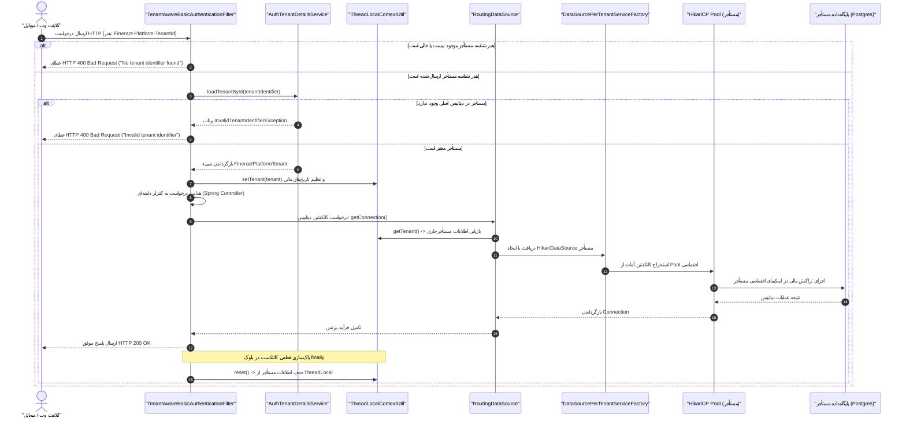

# سند جامع معماری سامانه، گراف ماژول‌ها و پشته فناوری Apache Fineract 1.15.0
## (System Architecture, Module Dependency Graph, Technology Stack & Multi-Tenancy Engine)

---

## ۱. مرور کلی معماری و اصول بنیادین (Executive Summary & Principles)

سامانه **Apache Fineract 1.15.0** یک پلتفرم متن‌باز، توزیع‌پذیر، چندمستأجری (Multi-Tenant) و مطابق استانداردهای بانکداری خرد، قرض‌الحسنه و فین‌تک (Core Banking Engine) است. معماری سامانه مبتنی بر تفکیک دامنه‌های کسب‌وکاری (Domain-Driven Design)، الگوی تفکیک دستورات و کوئری‌ها (CQRS)، پردازش ناهمگام با توان پردازشی بالا، پردازش دسته‌ای پایان روز (Close of Business - COB)، و انتزاع کامل لایه پایگاه‌داده از طریق پایش و مسیریابی چندمستأجری است.

### اصول کلیدی معماری پلتفرم:
1. **جداسازی سخت‌گیرانه ماژولار (Modular Domain Boundaries):** پلتفرم از بیش از ۴۰ زیرپروژه گریدل (Gradle Subprojects) تشکیل شده است که هر یک دامنه عملکردی و استقلال وابستگی خود را حفظ می‌کنند.
2. **چندمستأجری در لایه داده (Database/Schema-per-Tenant Multi-Tenancy):** هر نهاد مالی یا کلاینت تجاری دارای پایگاه داده یا اسکیمای کاملاً ایزوله با مخزن کانکشن (Connection Pool) مستقل در HikariCP است.
3. **تفکیک CQRS و پردازش دستورات:** جریان ثبت دستورات مالی (`Command Processing`) از جریان خواندن داده‌ها جدا بوده و قابلیت پردازش از طریق JDBC همگام، صفوف ناهمگام (`Async`)، یا بافر حلقوی پرسرعت (`LMAX Disruptor`) را دارد.
4. **انتزاع مدل‌های رویداد و ارسال توزیع‌شده (External Domain Events):** امکان انتشار رویدادهای سیستمی با فرمت بهینه‌سازی‌شده Apache Avro به کارگزارهای پیام (Apache Kafka یا ActiveMQ/JMS).
5. **موتور دسته‌ای مقیاس‌پذیر (COB Batch Processing):** اجرای دسته‌ای عملیات پایان روز با پارتیشن‌بندی به کمک Spring Batch و Spring Integration.

---

## ۲. فهرست جامع و دسته‌بندی ماژول‌های گریدل (Exhaustive Module Inventory)

بر اساس تحلیل پرونده‌های ساخت ریشه (`settings.gradle` و `build.gradle`) و فایل‌های `dependencies.gradle` در نسخه 1.15.0، کل ماژول‌ها در ۷ لایه معماری دسته‌بندی شده‌اند:

| شناسه ماژول | لایه معماری | نقش و عملکرد در سامانه | وابستگی‌های درون‌پروژه‌ای |
| :--- | :--- | :--- | :--- |
| `fineract-avro-schemas` | هسته و ادغام | طرح‌واره‌های مشترک Apache Avro برای رویدادهای مالی و یکپارچه‌سازی | ندارد (مستقل) |
| `fineract-validation` | هسته و پایه | انتزاع اعتبارسنجی جاکارتا، ICU4J و قوانین کنترل داده‌های مالی | ندارد (مستقل) |
| `fineract-command` | لایه CQRS | ساختار انتزاعی دستورات مالی، پایپ‌لاین اجرای دستورات و هوک‌ها | `fineract-validation` |
| `fineract-command-jdbc` | لایه CQRS | پیاده‌سازی ثبت و اجرای همگام دستورات از طریق JDBC | `fineract-command` |
| `fineract-command-async` | لایه CQRS | پردازش ناهمگام صف دستورات در پس‌زمینه | `fineract-command` |
| `fineract-command-disruptor` | لایه CQRS | پردازش فوق‌سریع دستورات با توان بالا با استفاده از LMAX Disruptor | `fineract-command` |
| `fineract-command-audit` | لایه CQRS | ممیزی دستورات، ثبت لاگ‌های حسابرسی و ردیابی وضعیت فرامین | `fineract-command` |
| `fineract-command-test` | لایه CQRS | ماژول پشتیبان برای تست و سنجش دستورات CQRS | `fineract-command` |
| `fineract-core` | هسته و کرنل | کرنل دامنه اصلی، موجودیت‌های پایه، کنترل چندمستأجری، کانتکست و محاسبات پولی | `fineract-avro-schemas`, `fineract-command`, `fineract-validation` |
| `fineract-security` | هسته و امنیت | احراز هویت Basic Auth، سرور و کلاینت OAuth2/OIDC، احراز هویت دوعاملی (2FA)، مدیریت مجوزها | `fineract-core` |
| `fineract-cob` | پردازش دسته‌ای | موتور پردازش دسته‌ای پایان روز (Close of Business)، قفل‌های تسویه، پارتیشن‌بندی گام‌ها | `fineract-avro-schemas`, `fineract-command`, `fineract-core`, `fineract-validation` |
| `fineract-tax` | سبد محصولات | مولفه‌های مالیاتی، گروه‌های مالیاتی، و کسر مالیات بر درآمد/سود | `fineract-core` |
| `fineract-rates` | سبد محصولات | تعریف نرخ‌های بهره ثابت و شناور و دوره‌های تغییر نرخ | `fineract-core` |
| `fineract-charge` | سبد محصولات | تعریف و محاسبه کارمزدها، جرائم و هزینه‌های عملیاتی | `fineract-core`, `fineract-tax` |
| `fineract-accounting` | سبد محصولات | دفتر کل دوطرفه (General Ledger)، اسناد حسابداری، نگاشت مالی و ثبت استهلاک/تعدیلات | `fineract-avro-schemas`, `fineract-charge`, `fineract-core` |
| `fineract-branch` | ساختار سازمانی | سلسله‌مراتب سازمانی، شعب، دفاتر منطقه‌ای و انتساب کارمندان | `fineract-accounting`, `fineract-core` |
| `fineract-loan` | سبد تسهیلات | هسته تسهیلات، جدول اقساط، پرداخت، بازپرداخت، معوقات و جرائم | `fineract-accounting`, `fineract-charge`, `fineract-cob`, `fineract-core`, `fineract-rates`, `fineract-tax` |
| `fineract-progressive-loan` | سبد تسهیلات | موتور پیشرفته تسهیلات اقساطی پیش‌رونده، پرداخت‌های چندمرحله‌ای و بازتنظیم منعطف اقساط | `fineract-accounting`, `fineract-avro-schemas`, `fineract-charge`, `fineract-core`, `fineract-loan` |
| `fineract-progressive-loan-embeddable-schedule-generator` | سبد تسهیلات | کتابخانه مستقل و تعبیه‌پذیر برای تولید جداول اقساط وام بدون وابستگی به پایگاه داده | `fineract-core`, `fineract-loan`, `fineract-progressive-loan` |
| `fineract-working-capital-loan` | سبد تسهیلات | مدیریت محصولات تسهیلات سرمایه در گردش و پیش‌پرداخت نقدی تجار | `fineract-accounting`, `fineract-avro-schemas`, `fineract-charge`, `fineract-cob`, `fineract-core`, `fineract-loan` |
| `fineract-loan-origination` | سبد تسهیلات | گردش‌کار درخواست وام و اعتبارسنجی اولیه تا مرحله تخصیص | `fineract-avro-schemas`, `fineract-core`, `fineract-loan`, `fineract-working-capital-loan` |
| `fineract-savings` | سبد سپرده‌ها | حساب‌های جاری، پس‌انداز، سپرده‌های کوتاه‌مدت و بلندمدت، محاسبه سود دوره‌ای | `fineract-accounting`, `fineract-charge`, `fineract-cob`, `fineract-core`, `fineract-rates`, `fineract-tax` |
| `fineract-investor` | سبد محصولات | مدیریت سندیکای سرمایه‌گذاران، سهامداران تسهیلات خرد و تسویه‌حساب‌های سهم‌الشرکه | `fineract-accounting`, `fineract-avro-schemas`, `fineract-charge`, `fineract-cob`, `fineract-core`, `fineract-loan` |
| `fineract-document` | زیرساخت | مدیریت پیوست‌ها و اسناد مشتریان روی دیسک محلی یا فضای ذخیره‌سازی ابری (AWS S3) | `fineract-command`, `fineract-core` |
| `fineract-report` | گزارش‌گیری | موتور گزارش‌گیری جدولی، گزارش‌های پارامتری و ادغام با ابزارهای BI نظیر Pentaho | `fineract-core` |
| `fineract-mix` | سرویس‌های تجمیع | تبادل اطلاعات و استخراج شاخص‌ها برای شبکه Microfinance Information Exchange | `fineract-command`, `fineract-core` |
| `fineract-provider` | هماهنگ‌ساز مرکزی | ماژول اجرایی برنامه (Spring Boot Application)، کنترلرهای REST API، مهاجرت اسکیمای Liquibase | کلیه ماژول‌های پایه، سبد محصول، فرمان و گزارش‌گیری |
| `fineract-war` | بسته‌بندی سرور | تولید بسته استاندارد جنگی (WAR) برای استقرار روی وب‌سرورهای مجزا (Tomcat/WildFly) | کلیه ماژول‌های تجاری و ارائه‌دهنده |
| `fineract-client` | کلاینت و SDK | کلاینت خودکار تولیدشده جاوا برای ارتباط با وب‌سرویس‌های Fineract با Retrofit 2 | ندارد (تولید با OpenAPI Generator) |
| `fineract-client-feign` | کلاینت و SDK | کلاینت متنی و اعلانی OpenFeign برای ارتباط میکروسرویس‌ها | ندارد (تولید با OpenAPI Generator) |
| `fineract-doc` | مستندات | مستندسازی خودکار کد، مدل‌های داده و خروجی‌های AsciiDoc و Swagger | ندارد |
| `fineract-e2e-tests-core` | آزمون و راستی‌آزمایی | تعاریف گام‌های سناریوهای سرتاسری (BDD) مبتنی بر Cucumber | `fineract-avro-schemas`, `fineract-client-feign` |
| `fineract-e2e-tests-runner` | آزمون و راستی‌آزمایی | مجری و رانر سناریوهای آزمون سرتاسری سیستم | `fineract-avro-schemas`, `fineract-client-feign`, `fineract-e2e-tests-core` |
| `integration-tests` | آزمون و راستی‌آزمایی | آزمون‌های تجمیعی سناریوهای جامع بانکی (Loan/Savings/Accounting) | `fineract-provider` |
| `twofactor-tests` | آزمون و راستی‌آزمایی | آزمون‌های صحه‌گذاری جریان‌های ورود دوعاملی (2FA) در کانتینر کارگو | مستقل (آزمون روی WAR) |
| `oauth2-tests` | آزمون و راستی‌آزمایی | آزمون‌های صحه‌گذاری جریان‌های توکن OAuth2/OIDC با WebDriver | مستقل (آزمون روی WAR) |
| `custom:docker` | زیرساخت استقرار | تولید ایمیج داکر بهینه‌سازی‌شده شامل کلیه ماژول‌های سفارشی و اصلی | `fineract-core`, `fineract-provider`, افزونه‌های سفارشی |
| `custom:acme:event:externalevent` | ماژول سفارشی | افزونه نمونه ACME برای پردازش رویدادهای خارجی | `fineract-core`, `fineract-loan`, `fineract-provider` |
| `custom:acme:event:starter` | ماژول سفارشی | استارتر پیکربندی خودکار بهار برای افزونه رویدادهای خارجی | `fineract-core`, `fineract-provider` |
| `custom:acme:loan:cob` | ماژول سفارشی | گام‌های سفارشی تسویه پایان روز تسهیلات شرکت ACME | `fineract-cob`, `fineract-core`, `fineract-loan`, `fineract-provider` |
| `custom:acme:loan:job` | ماژول سفارشی | جاب‌های دسته‌ای سفارشی تسهیلات در Spring Batch | `fineract-core`, `fineract-loan`, `fineract-provider` |
| `custom:acme:loan:processor` | ماژول سفارشی | منطق پردازشگر سفارشی تراکنش‌های تسهیلات | `fineract-core`, `fineract-loan`, `fineract-provider` |
| `custom:acme:loan:starter` | ماژول سفارشی | استارتر پیکربندی خودکار تسهیلات سفارشی شرکت ACME | ماژول‌های سفارشی ACME Loan و `fineract-provider` |
| `custom:acme:note:service` | ماژول سفارشی | سرویس یادداشت‌های سفارشی کلاینت‌ها | `fineract-core`, `fineract-provider` |
| `custom:acme:note:starter` | ماژول سفارشی | استارتر پیکربندی خودکار سرویس یادداشت‌ها | `custom:acme:note:service`, `fineract-core`, `fineract-loan`, `fineract-provider`, `fineract-savings` |
| `buildSrc` | منطق ساخت | پلاگین‌های کانونشنال گریدل، تنظیم وابستگی‌های نسخه و کنترل لایسنس | ریشه پروژه |

---

## ۳. گراف جامع وابستگی ماژول‌ها (Mermaid Architecture Diagram)

نمودار زیر به صورت جامع کلیه لایه‌ها، دسته‌بندی‌های ماژولار و جهت وابستگی‌های کامپایل و زمان اجرای سامانه را نمایش می‌دهد:

```mermaid
flowchart TD
    %% ------------------------------------------------------------------------
    %% 1. Core & Foundations Layer
    %% ------------------------------------------------------------------------
    subgraph Core_Foundations ["۱. هسته و زیرساخت پایه (Core & Foundations)"]
        AVRO["fineract-avro-schemas<br/>(Apache Avro 1.12.1)"]
        VAL["fineract-validation<br/>(Jakarta Validation / ICU4J)"]
        CORE["fineract-core<br/>(Kernel, Routing, Monetary, Entities)"]
        SEC["fineract-security<br/>(BasicAuth, OAuth2/OIDC, 2FA)"]
    end

    %% ------------------------------------------------------------------------
    %% 2. CQRS & Command Subsystem
    %% ------------------------------------------------------------------------
    subgraph Command_CQRS ["۲. زیرسیستم دستورات و CQRS (Command Subsystem)"]
        CMD["fineract-command<br/>(CQRS Pipeline Abstraction)"]
        CMDJDBC["fineract-command-jdbc<br/>(Sync Database Execution)"]
        CMDASYNC["fineract-command-async<br/>(Background Queue Engine)"]
        CMDEXT["fineract-command-disruptor<br/>(LMAX Disruptor RingBuffer)"]
        CMDAUDIT["fineract-command-audit<br/>(Audit Trails & Idempotency)"]
    end

    %% ------------------------------------------------------------------------
    %% 3. Portfolio & Business Products
    %% ------------------------------------------------------------------------
    subgraph Business_Portfolio ["۳. سبد محصولات مالی و بانکی (Business Portfolio)"]
        TAX["fineract-tax<br/>(Tax Groups & Withholding)"]
        RATES["fineract-rates<br/>(Floating Rates Engine)"]
        CHARGE["fineract-charge<br/>(Fees & Penalties Engine)"]
        ACCT["fineract-accounting<br/>(General Ledger & Accruals)"]
        BRANCH["fineract-branch<br/>(Offices, Staff, Hierarchy)"]
        LOAN["fineract-loan<br/>(Core Loan Engine)"]
        PROGLOAN["fineract-progressive-loan<br/>(Annuity & Recalculation)"]
        PROGSCHED["fineract-progressive-loan-embeddable<br/>(Standalone Schedule Calc)"]
        WCLOAN["fineract-working-capital-loan<br/>(Merchant Cash & Line of Credit)"]
        LOANORIG["fineract-loan-origination<br/>(Pipeline & Scoring)"]
        SAVINGS["fineract-savings<br/>(Deposits, FD/RD, Interest)"]
        INVESTOR["fineract-investor<br/>(P2P Syndicates & Settlement)"]
    end

    %% ------------------------------------------------------------------------
    %% 4. Batch Operations & Auxiliary
    %% ------------------------------------------------------------------------
    subgraph Batch_Operations ["۴. عملیات دسته‌ای و مدیریت محتوا (Batch & Operations)"]
        COB["fineract-cob<br/>(Close of Business Spring Batch)"]
        DOC["fineract-document<br/>(Attachments, Tika, S3)"]
        REP["fineract-report<br/>(Reporting & Pentaho BI)"]
        MIX["fineract-mix<br/>(Microfinance Info Exchange)"]
    end

    %% ------------------------------------------------------------------------
    %% 5. Orchestrator & Deployment
    %% ------------------------------------------------------------------------
    subgraph Orchestration_Deploy ["۵. ارائه‌دهنده سرویس و استقرار (Orchestration & Deploy)"]
        PROVIDER["fineract-provider<br/>(Spring Boot Main & REST API)"]
        WAR["fineract-war<br/>(Servlet 6.0 WAR Packaging)"]
        DOCKER["custom:docker<br/>(Optimized Container Image)"]
    end

    %% ------------------------------------------------------------------------
    %% 6. Clients, SDKs & Custom Extensions
    %% ------------------------------------------------------------------------
    subgraph Clients_Extensions ["۶. کلاینت‌ها و افزونه‌های سفارشی (Clients & Extensions)"]
        CLIENT["fineract-client<br/>(Retrofit2 / RxJava SDK)"]
        FEIGN["fineract-client-feign<br/>(OpenFeign HTTP Client)"]
        ACME["custom:acme (Plugins)<br/>(Loan, COB, Events, Notes)"]
    end

    %% ------------------------------------------------------------------------
    %% Inter-Module Dependencies
    %% ------------------------------------------------------------------------
    CMD --> VAL
    CORE --> AVRO
    CORE --> VAL
    CORE --> CMD
    SEC --> CORE

    CMDJDBC --> CMD
    CMDASYNC --> CMD
    CMDEXT --> CMD
    CMDAUDIT --> CMD

    COB --> CORE
    COB --> AVRO
    COB --> CMD
    COB --> VAL

    TAX --> CORE
    RATES --> CORE
    CHARGE --> CORE
    CHARGE --> TAX
    ACCT --> CORE
    ACCT --> CHARGE
    ACCT --> AVRO
    BRANCH --> CORE
    BRANCH --> ACCT

    LOAN --> CORE
    LOAN --> ACCT
    LOAN --> CHARGE
    LOAN --> COB
    LOAN --> RATES
    LOAN --> TAX

    PROGLOAN --> LOAN
    PROGLOAN --> CORE
    PROGLOAN --> ACCT
    PROGLOAN --> CHARGE
    PROGLOAN --> AVRO

    PROGSCHED --> PROGLOAN
    PROGSCHED --> LOAN
    PROGSCHED --> CORE

    WCLOAN --> LOAN
    WCLOAN --> CORE
    WCLOAN --> ACCT
    WCLOAN --> CHARGE
    WCLOAN --> COB
    WCLOAN --> AVRO

    LOANORIG --> LOAN
    LOANORIG --> WCLOAN
    LOANORIG --> CORE
    LOANORIG --> AVRO

    SAVINGS --> CORE
    SAVINGS --> ACCT
    SAVINGS --> CHARGE
    SAVINGS --> COB
    SAVINGS --> RATES
    SAVINGS --> TAX

    INVESTOR --> LOAN
    INVESTOR --> ACCT
    INVESTOR --> CHARGE
    INVESTOR --> COB
    INVESTOR --> CORE
    INVESTOR --> AVRO

    DOC --> CORE
    DOC --> CMD
    REP --> CORE
    MIX --> CORE
    MIX --> CMD

    PROVIDER --> CORE
    PROVIDER --> SEC
    PROVIDER --> COB
    PROVIDER --> CMD
    PROVIDER --> CMDJDBC
    PROVIDER --> CMDAUDIT
    PROVIDER --> ACCT
    PROVIDER --> LOAN
    PROVIDER --> PROGLOAN
    PROVIDER --> WCLOAN
    PROVIDER --> LOANORIG
    PROVIDER --> SAVINGS
    PROVIDER --> INVESTOR
    PROVIDER --> CHARGE
    PROVIDER --> RATES
    PROVIDER --> TAX
    PROVIDER --> BRANCH
    PROVIDER --> DOC
    PROVIDER --> REP
    PROVIDER --> MIX
    PROVIDER --> AVRO
    PROVIDER --> VAL

    WAR --> PROVIDER
    ACME --> PROVIDER
    ACME --> LOAN
    ACME --> COB
    DOCKER --> PROVIDER
    DOCKER --> ACME
```

---

## ۴. ماتریس جامع پشته فناوری (Technology Stack Matrix)

پشته فناوری انتخاب‌شده در نسخه 1.15.0 سامانه نشان‌دهنده یک سیستم تجاری بانکداری با کارایی بالا، تطابق با آخرین نسخه‌های استاندارد سازمانی جاوا و ابزارهای ایمن ذخیره‌سازی داده است:

| مولفه معماری (Component) | تکنولوژی / فریم‌ورک | نسخه دقیق (Version) | منبع / BOM | دلایل فنی و کاربرد در پلتفرم |
| :--- | :--- | :--- | :--- | :--- |
| **محیط اجرایی (Runtime)** | Java SE Development Kit | **JDK 21 LTS** | Toolchain Gradle | پایداری عملکردی، پشتیبانی از Virtual Threads، کارایی بالای مدیریت حافظه و Garbage Collectorهای نوین (ZGC/G1). |
| **سیستم ساخت (Build)** | Gradle Enterprise | **8.x (با Develocity)** | `settings.gradle` | مدیریت ماژول‌های چندپروژه‌ای، کش سراسری بیلد (`buildCache`) و بهینه‌سازی کامپایل موازی. |
| **هسته فریم‌ورک** | Spring Boot | **3.5.15** | `spring-boot-dependencies` | پایه‌گذاری برنامه‌های ابری، مدیریت کانتینر IoC، پیکربندی‌های ماژولار و تزریق وابستگی سازگار با لایه Jakarta EE 10. |
| **فریم‌ورک وب و API** | Spring MVC + Jersey | **3.1.11 (Jersey)** | `jersey-bom` | پشتیبانی دومنظوره از کنترلرهای بهار و جاکارتا JAX-RS جهت ارائه وب‌سرویس‌های RESTful با کارایی بالا. |
| **امنیت و هویت** | Spring Security | **6.5.10** | `spring-boot-dependencies` | احراز هویت ماژولار چندمستأجری، سازگاری با سرورهای مجازشمار OAuth2/OIDC، توکن‌های JWT و احراز هویت دوعاملی (2FA). |
| **نگاشت شی‌گرا-رابطه‌ای** | EclipseLink JPA | **4.0.9** | `dependencies.gradle` | ارائه‌دهنده رسمی JPA با قابلیت ویوینگ ایستا (`Static Weaving`) برای افزایش کارایی، بارگذاری تنبل (Lazy Loading) و ایزولاسیون تراکنش‌ها. |
| **پایگاه‌داده پیش‌فرض** | PostgreSQL Driver | **42.7.11** | `dependencies.gradle` | موتور رابطه‌ای قدرتمند، پشتیبانی از داده‌های ساختاریافته مالی، تراکنش‌های اسیدی (ACID) و ایزولاسیون سطح چندمستأجری. |
| **پایگاه‌های سازگار** | MySQL & MariaDB | **MySQL 9.7.0 / MariaDB 3.5.8**| `dependencies.gradle` | امکان استقرار روی رده‌های تجاری MySQL 8.x/9.x و MariaDB 10.x/11.x. |
| **مدیریت تغییرات دیتابیس** | Liquibase Core | **4.33.0** | `dependencies.gradle` | اجرای روان اسکریپت‌های ارتقای خودکار اسکیمای دیتابیس برای پایگاه داده مرکزی (Tenants) و تک‌تک مستأجران مالی. |
| **مخزن کانکشن دیتابیس** | HikariCP | **5.1.x (Spring Boot BOM)** | `spring-boot-starter-jdbc` | مخزن با سرعت میلی‌ثانیه‌ای و مصرف اندک حافظه جهت مدیریت مجزای کانکشن‌های هر مستأجر و مانیتورینگ نشت کانکشن. |
| **صف و پردازش همزمانی** | LMAX Disruptor | **4.0.0** | `dependencies.gradle` | بافر حلقوی غیرمسدودکننده (Lock-free Ring Buffer) جهت دستیابی به توان ثبت بیش از صدها هزار تراکنش در ثانیه. |
| **موتور دسته‌ای (Batch)** | Spring Batch & Integration | **5.x (Spring Boot BOM)** | `spring-boot-starter-batch` | اجرای موازی فرآیندهای پایان روز بانکی (COB)، قطعه‌بندی کارها (Chunking) و مانیتورینگ گام‌ها. |
| **زمان‌بندی کارها** | Quartz Scheduler | **2.5.2** | `dependencies.gradle` | زمان‌بندی جاب‌های دوره‌ای پس‌زمینه نظیر ارسال پیامک، جریمه‌های خودکار و گزارش‌گیری سیستماتیک. |
| **حافظه موقت (Caching)** | Ehcache & JCache | **3.12.0 / JSR-107** | `dependencies.gradle` | کش حافظه‌محور پیکربندی‌ها، دسترسی‌های کاربران و جداول پایه‌ای جهت کاهش بار کوئری‌های تکراری دیتابیس. |
| **کارگزار پیام (Messaging)** | ActiveMQ / Apache Kafka | **6.2.5 (ActiveMQ) / Spring Kafka** | `dependencies.gradle` | ارسال رویدادهای مالی به صورت توزیع‌شده به پیام‌رسان‌ها با پشتیبانی از AWS MSK IAM Auth. |
| **سریال‌سازی داده‌ها** | Apache Avro / Jackson / Gson | **1.12.1 (Avro) / 2.21.3 (Jackson)**| `dependencies.gradle` | فرمت فشرده باینری Avro برای رویدادهای خارج از سیستم، و جکسون/جی‌سان برای پلودهای JSON کلاینت‌ها. |
| **تحمل‌پذیری و تاب‌آوری** | Resilience4j | **2.4.0** | `resilience4j-bom` | مدارهای قطع‌کننده (Circuit Breaker)، محدودکننده نرخ درخواست (Rate Limiter) و تلاش مجدد (Retry). |
| **سنجش و متریک‌ها** | Micrometer & OpenTelemetry | **1.16.5 (Micro) / 1.62.0 (OTel)** | `dependencies.gradle` | انتشار متریک‌های عملکردی به Prometheus و OTLP Collector و ثبت ردگیری تراکنش‌ها (Tracing). |
| **کلاینت‌های ارتباطی** | Retrofit 2 & OpenFeign | **2.12.0 (Retrofit) / 13.x (Feign)**| `dependencies.gradle` | پیاده‌سازی کلاینت‌های مطمئن HTTP برای ارتباطات خارجی، آزمون‌ها و فراخوانی بین‌سامانه‌ای. |
| **مستندسازی API** | SpringDoc OpenAPI / Swagger | **2.8.17 (SpringDoc) / 2.2.49 (Core)**| `dependencies.gradle` | تولید استاندارد مستندات Swagger v3 و OpenAPI برای تمامی متدهای ارائه‌شده بر بستر REST. |

---

## ۵. تحلیل عمیق معماری چندمستأجری (Deep Dive: Multi-Tenancy Architecture)

معماری چندمستأجری در سامانه Apache Fineract به صورت **تفکیک کامل مخزن داده (Separate Database / Schema per Tenant)** طراحی شده است. هیچ مستأجری اجازه دسترسی یا مشاهده سوابق جدول مستأجر دیگر را نداشته و ارتباطات در پایین‌ترین لایه شبکه و سوکت دیتابیس مجزا هستند.

### ۵.۱. اجزای اصلی معماری چندمستأجری:
1. **پایگاه داده ریشه (`fineract_tenants`):**
   * پایگاه داده مرکزی که مشخصات، اطلاعات اتصال (سرور، پورت، نام دیتابیس، نام کاربری و رمز رمزنگاری‌شده)، مقادیر حداقل و حداکثر کانکشن و وضعیت فعال بودن هر مستأجر در جدول `tenants` نگهداری می‌شود.
2. **فیلتر تشخیص شناسه مستأجر (`TenantAwareBasicAuthenticationFilter`):**
   * تمامی درخواست‌های HTTP واردشده به پلتفرم ابتدا توسط این فیلتر بررسی می‌شوند.
   * شناسه مستأجر از هدر الزامی `Fineract-Platform-TenantId` (یا پارامتر URL `tenantIdentifier`) استخراج می‌گردد.
   * در صورت عدم وجود این هدر، فیلتر با ایجاد خطای `InvalidTenantIdentifierException`، بلافاصله پاسخ HTTP 400 Bad Request برمی‌گرداند.
3. **کانتکست ایمن بر اساس نخ اجرایی (`ThreadLocalContextUtil`):**
   * پس از اعتبارسنجی شناسه مستأجر توسط `AuthTenantDetailsService`، آبجکت `FineractPlatformTenant` (حاوی کانفیگ دیتابیس مستأجر) در یک متغیر `ThreadLocal` ذخیره می‌شود.
   * برای کارهای ناهمگام و پردازش‌های دسته‌ای، وضعیت این کانتکست در قالب `FineractContext` بسته‌بندی و به ترد پس‌زمینه منتقل می‌گردد.
   * در بخش `finally` پردازش هر درخواست وب، متد `ThreadLocalContextUtil.reset()` به منظور جلوگیری از نشت اطلاعات بین رکوئست‌ها فراخوانی می‌شود.
4. **مسیریاب پویای منبع داده (`RoutingDataSource` و `DataSourcePerTenantServiceFactory`):**
   * کامپوننت `RoutingDataSource` جایگزین منبع داده استاندارد بهار (`Primary DataSource`) است.
   * در زمان اجرای هر تراکنش مالی یا واکشی کوئری، متد `getConnection()` کانتکست مستأجر جاری را از `ThreadLocalContextUtil` خوانده و به `TomcatJdbcDataSourcePerTenantService` ارجاع می‌دهد.
   * آبجکت‌های `HikariDataSource` برای هر مستأجر در یک مپ همروند کش شده و در صورت اولین فراخوانی توسط `DataSourcePerTenantServiceFactory` به صورت خودکار با پارامترهای پایگاه داده همان مستأجر ایجاد می‌شوند.
5. **پشتیبانی از رپلیکای فقط‌خواندنی (`Read-Only Replica`):**
   * در صورتی که پلتفرم روی حالت `fineract.mode.read-enabled=true` و کانفیگ سرورهای فقط‌خواندنی مستأجر تنسیق شده باشد، کوئری‌های گزارش‌گیری و نمایش اطلاعات به سرور رپلیکا هدایت می‌گردند تا بار پردازشی سرور اصلی کاهش یابد.

### ۵.۲. نمودار توالی پردازش درخواست چندمستأجری (Multi-Tenant Request Flow)

---

## ۶. نیازمندی‌های معماری در قالب استاندارد EARS (Architectural EARS Requirements)

کلیه نیازمندی‌ها منطبق بر ۶ الگوی استاندارد EARS بوده و با رعایت الزام گرامری استفاده از فعل معین **`shall`** و قالب دوزبانه تدوین شده‌اند:

### REQ-ARCH-RUNTIME-001: تطابق محیط اجرایی با جاوا ۲۱ (Java 21 LTS Platform Runtime)
* **الگوی EARS:** Ubiquitous
* **EARS Statement:**
  > The Fineract Platform shall execute on a Java 21 Long-Term Support (LTS) runtime environment using the standard Gradle toolchain configuration.
* **شرح نیازمندی و سناریوی بیزنس (فارسی):**
  هسته پلتفرم فاینراکت و کلیه ۴۰+ ماژول فرعی آن ملزم به کامپایل و اجرا بر بستر ماشین مجازی جاوای نسخه ۲۱ (JDK 21) هستند. این الزام تضمین‌کننده بهره‌مندی از بهبودهای عملکردی حافظه، پشتیبانی از قابلیت‌های مدرن زبان جاوا، و ارتقای امنیت و پایداری در بارگذاری تراکنش‌های همزمان است.
* **رفتارهای ناخواسته و شروط خطا (EARS If-Then):**
  * `If the host execution environment is configured with a JDK version lower than 21, then the Fineract Build Engine shall immediately terminate the build process with an explicit toolchain resolution error.`
* **ماتریس ردیابی به سورس‌کد (Traceability Matrix):**
  * **مسیر فایل و تنظیمات سورس:** `apache-fineract-src-1.15.0/build.gradle` (خطوط ۴۰۱–۴۰۴)
  * **پیکربندی گریدل:** `java { toolchain { languageVersion = JavaLanguageVersion.of(21) } }`
  * **اهداف معماری:** تثبیت بستر استاندارد و تضمین کارایی بالا در سطح ماشین مجازی.

---

### REQ-ARCH-TENANT-HEADER-002: اعتبارسنجی هدر شناسه مستأجر در رکوئست‌های ورودی
* **الگوی EARS:** Event-Driven
* **EARS Statement:**
  > When an incoming HTTP API request is processed by the security filter chain, the Fineract Platform shall extract the tenant identifier from the "Fineract-Platform-TenantId" HTTP header and bind the verified tenant connection details to the current execution thread context.
* **شرح نیازمندی و سناریوی بیزنس (فارسی):**
  برای هدایت صحیح تراکنش‌های مالی به پایگاه داده هر مؤسسه مالی، فیلتر امنیتی چندمستأجری موظف است با دریافت هر رکوئست، هدر `Fineract-Platform-TenantId` را خوانده و با احراز هویت مستأجر در دیتابیس پایه، ساختار `FineractPlatformTenant` را در فضای محلی ترد جاری (`ThreadLocal`) قرار دهد.
* **رفتارهای ناخواسته و شروط خطا (EARS If-Then):**
  * `If an incoming API request does not contain the "Fineract-Platform-TenantId" header or contains a blank value, then the Fineract Platform shall abort the request processing and return an HTTP 400 Bad Request status containing an InvalidTenantIdentifierException payload.`
* **ماتریس ردیابی به سورس‌کد (Traceability Matrix):**
  * **مسیر فایل و کلاس سورس:** `apache-fineract-src-1.15.0/fineract-security/src/main/java/org/apache/fineract/infrastructure/security/filter/TenantAwareBasicAuthenticationFilter.java`
  * **کلاس کانتکست:** `org.apache.fineract.infrastructure.core.service.ThreadLocalContextUtil`
  * **اهداف معماری:** ایزولاسیون کامل چندمستأجری و جلوگیری از دسترسی‌های غیرمجاز تقاطعی.

---

### REQ-ARCH-TENANT-ISOLATION-003: جداسازی کامل مخزن داده و پول کانکشن برای هر مستأجر
* **الگوی EARS:** Ubiquitous
* **EARS Statement:**
  > The Fineract Platform shall maintain completely isolated physical database schemas and dedicated HikariCP connection pools for each onboarded tenant to ensure zero cross-tenant data contamination.
* **شرح نیازمندی و سناریوی بیزنس (فارسی):**
  معماری پلتفرم فاینراکت بر عدم اشتراک‌گذاری جداول و اسکیمای فیزیکی بین مستأجران استوار است. برای هر مستأجر یک مخزن کانکشن مجزا در HikariCP ایجاد می‌شود که با پارامترهای مشخصات اتصال، تعداد کانکشن‌های فعال و آستانه نشت کانکشن‌ها پیکربندی شده و تبادلات مالی هر کلاینت را در سطح شبکه کاملاً ایزوله نگاه می‌دارد.
* **رفتارهای ناخواسته و شروط خطا (EARS If-Then):**
  * `If the database credentials or master password hash verification fails for a tenant connection, then the DataSourcePerTenantServiceFactory shall reject data source instantiation and throw an IllegalArgumentException.`
* **ماتریس ردیابی به سورس‌کد (Traceability Matrix):**
  * **مسیر فایل و کلاس سورس:** `apache-fineract-src-1.15.0/fineract-core/src/main/java/org/apache/fineract/infrastructure/core/service/database/DataSourcePerTenantServiceFactory.java`
  * **پیکربندی وابسته:** `spring.datasource.hikari.*`, `fineract.tenant.config.*`
  * **اهداف معماری:** پایبندی به الزامات امنیت داده‌های بانکی و جلوگیری از خطای نشت اطلاعات بین مستأجران.

---

### REQ-ARCH-RO-REPLICA-004: هدایت کوئری‌ها به سرور رپلیکای فقط‌خواندنی در وضعیت Read-Only
* **الگوی EARS:** State-Driven
* **EARS Statement:**
  > While the platform is operating with read-only replica mode enabled ("fineract.mode.read-enabled=true"), the Fineract DataSource Router shall direct non-modifying database connections and read transactions to the configured read-only database host and port of the tenant.
* **شرح نیازمندی و سناریوی بیزنس (فارسی):**
  در مقیاس‌های عملیاتی بالا، به منظور ممانعت از ایجاد قفل در جداول اصلی دیتابیس در زمان اجرای تراکنش‌های ثبت وام یا تسویه حساب، پلتفرم در زمان فعال بودن رپلیکا، ترافیک درخواست‌های فقط‌خواندنی، گزارش‌گیری و جستجوها را به سرورهای ثانویه مستأجر روانه می‌کند.
* **رفتارهای ناخواسته و شروط خطا (EARS If-Then):**
  * `If the tenant configuration does not provide read-only replica credentials when read-only mode is active, then the DataSourcePerTenantServiceFactory shall fallback gracefully to the primary read-write database host.`
* **ماتریس ردیابی به سورس‌کد (Traceability Matrix):**
  * **مسیر فایل و کلاس سورس:** `apache-fineract-src-1.15.0/fineract-core/src/main/java/org/apache/fineract/infrastructure/core/service/database/DataSourcePerTenantServiceFactory.java` (خطوط ۷۱–۸۰)
  * **کلیدهای پیکربندی:** `fineract.tenant.read-only-host`, `fineract.tenant.read-only-port`
  * **اهداف معماری:** مقیاس‌پذیری افقی خواندن اطلاعات و بهینه‌سازی توان عملیاتی سیستم.

---

### REQ-ARCH-ASYNC-DISRUPTOR-005: پردازش ناهمگام فرامین مالی با بافر حلقوی دیسراپتور
* **الگوی EARS:** Optional Feature
* **EARS Statement:**
  > Where the disruptor command processing module ("fineract-command-disruptor") is included and active, the Fineract Command Subsystem shall enqueue and process high-throughput financial write commands asynchronously through an in-memory LMAX Disruptor ring buffer without blocking the caller HTTP servlet thread.
* **شرح نیازمندی و سناریوی بیزنس (فارسی):**
  در سناریوهای با بار ترافیکی شدید (نظیر پرداخت‌های انبوه اقساط یا تراکنش‌های کیف پول الکترونیکی)، ماژول دیسراپتور اجازه می‌دهد فرامین تغییر وضعیت بدون مسدودسازی نخ‌های پردازش وب به صف حافظه‌محور بدون‌قفل منتقل شده و با حداکثر توان کارت حافظه و پردازنده به سرانجام برسند.
* **رفتارهای ناخواسته و شروط خطا (EARS If-Then):**
  * `If the disruptor in-memory ring buffer reaches its maximum configured capacity, then the Fineract Command Subsystem shall apply backpressure handling or reject incoming write requests with an HTTP 503 Service Unavailable response.`
* **ماتریس ردیابی به سورس‌کد (Traceability Matrix):**
  * **مسیر فایل و ماژول سورس:** `apache-fineract-src-1.15.0/fineract-command-disruptor/build.gradle`
  * **کتابخانه وابسته:** `com.lmax:disruptor:4.0.0`
  * **اهداف معماری:** ارتقای کارایی و پردازش موازی دستورات در الگوی معماری CQRS.

---

### REQ-ARCH-EVENT-KAFKA-006: انتشار برون‌مرزی رویدادهای مالی بر بستر آپاچی کافکا
* **الگوی EARS:** Optional Feature
* **EARS Statement:**
  > Where external event streaming is enabled with Apache Kafka ("fineract.events.external.producer.kafka.enabled=true"), the Fineract Event Engine shall serialize business domain events into Apache Avro binary records and publish them to designated Kafka topic brokers.
* **شرح نیازمندی و سناریوی بیزنس (فارسی):**
  سامانه فاینراکت قادر است تمامی رخدادهای کلیدی (مانند افتتاح حساب، تأیید وام، ثبت قسط، یا تغییر وضعیت مشتری) را به صورت استاندارد در قالب شمای فشرده آپاچی آورو کپسوله‌سازی کرده و برای سامانه‌های پیرامونی، انباره داده و سرویس‌های اعلان بر روی تاپیک‌های مشخص در کارگزار کافکا ارسال کند.
* **رفتارهای ناخواسته و شروط خطا (EARS If-Then):**
  * `If the Kafka broker cluster becomes unreachable within the configured timeout period ("fineract.events.external.producer.kafka.timeout-in-seconds"), then the Fineract Event Engine shall log the event transmission failure and mark the external event outbox entry for subsequent retry without rolling back the core financial database transaction.`
* **ماتریس ردیابی به سورس‌کد (Traceability Matrix):**
  * **مسیر فایل و کلاس سورس:** `apache-fineract-src-1.15.0/fineract-provider/src/main/resources/application.properties`
  * **تنظیمات وابسته:** `fineract.events.external.producer.kafka.*`, `org.apache.avro:avro:1.12.1`
  * **اهداف معماری:** یکپارچگی ناهمگام با معماری میکروسرویسی و انتشار قابل اتکای رویدادها (Outbox Pattern).

---

### REQ-ARCH-CONTEXT-RESET-007: پاک‌سازی قطعی کانتکست ترد در پایان چرخه حیات رکوئست
* **الگوی EARS:** Event-Driven
* **EARS Statement:**
  > When an HTTP request execution cycle completes or encounters an unhandled exception, the Fineract Security Gateway shall clear all ThreadLocal variables managed by ThreadLocalContextUtil to eliminate thread-pollution across pooled web server threads.
* **شرح نیازمندی و سناریوی بیزنس (فارسی):**
  وب‌سرورهای جاوایی (مانند آپاچی تام‌کت) از استخر نخ‌ها (`Thread Pool`) برای پاسخ‌دهی به درخواست‌ها استفاده مجدد می‌کنند. بنابراین ضروری است به منظور حذف هرگونه خطر نشت اطلاعات امنیتی یا دسترسی ناخواسته یک کلاینت به کانتکست مستأجر دیگر، در انتهای اجرای هر رکوئست کلیه فیلدهای متناظر در `ThreadLocal` کاملاً پاک و ریست شوند.
* **رفتارهای ناخواسته و شروط خطا (EARS If-Then):**
  * `If an unhandled RuntimeException or ServletException is thrown within the controller processing pipeline, then the filter's finally block shall unconditionally execute ThreadLocalContextUtil.reset().`
* **ماتریس ردیابی به سورس‌کد (Traceability Matrix):**
  * **مسیر فایل و متد سورس:** `apache-fineract-src-1.15.0/fineract-security/src/main/java/org/apache/fineract/infrastructure/security/filter/TenantAwareBasicAuthenticationFilter.java` (خطوط ۱۶۱–۱۶۷)
  * **کلاس کانتکست:** `org.apache.fineract.infrastructure.core.service.ThreadLocalContextUtil.reset()`
  * **اهداف معماری:** تضمین پایداری امنیتی و سلامت فضای اجرایی سرور در الگوهای همزمانی.

---

### REQ-ARCH-COMPLEX-COB-008: هماهنگ‌سازی پردازش دسته‌ای پایان روز با کانتکست ایزوله مستأجر
* **الگوی EARS:** Complex
* **EARS Statement:**
  > Where the Close of Business (COB) batch subsystem is activated, while multi-tenant database routing is operative, when a day-end partition step executes across worker threads, the Fineract Batch Engine shall propagate the tenant execution snapshot using FineractContext to bind each batch worker thread to the target tenant schema.
* **شرح نیازمندی و سناریوی بیزنس (فارسی):**
  در زمان پردازش سنگین پایان روز (محاسبه سودهای دوره‌ای، تسویه وام‌ها، بررسی جرائم معوقات)، جاب‌های Spring Batch به صورت چندتردی و پارتیشن‌بندی‌شده اجرا می‌شوند. موتور پردازش دسته‌ای فاینراکت موظف است شناسنامه کانتکست مستأجر (`FineractContext`) را به هر ترد فرعی انتقال دهد تا تراکنش‌های دسته‌ای دقیقاً در پایگاه داده همان مستأجر جاری ثبت گردند.
* **رفتارهای ناخواسته و شروط خطا (EARS If-Then):**
  * `If a worker batch thread fails to obtain a valid tenant database connection from the HikariCP pool, then the Fineract Batch Engine shall mark that specific loan account step as failed, release acquired partition locks, and record the failure in the batch execution audit tables.`
* **ماتریس ردیابی به سورس‌کد (Traceability Matrix):**
  * **مسیر فایل و ماژول سورس:** `apache-fineract-src-1.15.0/fineract-cob/build.gradle`
  * **کلاس کانتکست و جاب:** `org.apache.fineract.infrastructure.core.domain.FineractContext`, `org.apache.fineract.cob.loan.LoanCOBConstant`
  * **اهداف معماری:** مقیاس‌پذیری افقی در پردازش‌های دسته‌ای بدون تخریب ایزولاسیون داده‌ها.

---

## ۷. نتیجه‌گیری و گام‌های بعدی (Conclusion & Next Steps)

این سند مرجع رسمی و استخراج‌شده بر اساس کدهای منبع Apache Fineract 1.15.0 است که ساختار ماژولار، وابستگی‌های فنی، نحوه کارکرد موتور چندمستأجری و نیازمندی‌های بنیادین معماری را تشریح می‌کند. خروجی این سند مبنای اصلی تحلیل دامنه‌های بعدی پروژه در حوزه حسابداری، تسهیلات، سپرده‌ها، و فرآیندهای مالی سامانه قرار خواهد گرفت.
