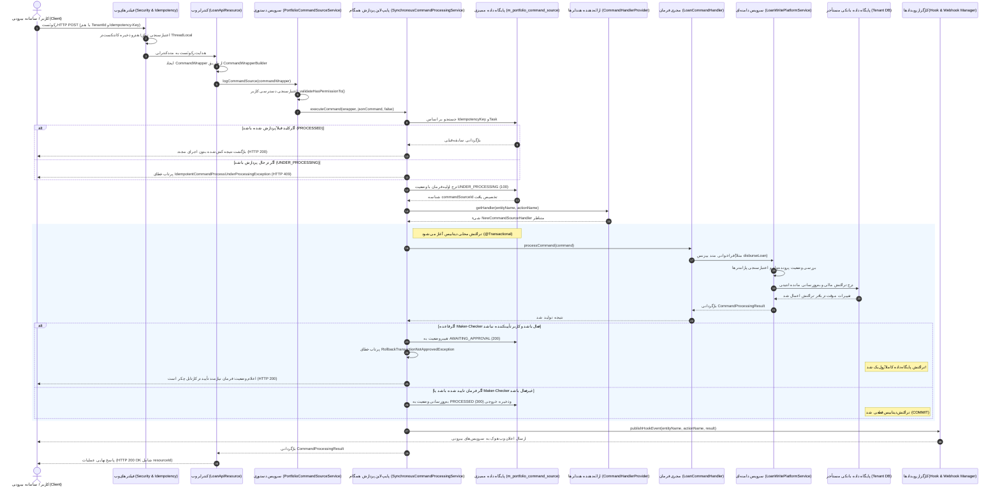

# سند جامع کاتالوگ REST API، پایپ‌لاین دستورات CQRS و مدل امنیت دسترسی (RBAC) در Apache Fineract 1.15.0
## (REST API Catalog, CQRS Command Processing Pipeline & Role-Based Access Control Taxonomy)

---

## ۱. مرور کلی و اصول بنیادین معماری لایه ارائه و پردازش (Executive Summary & Architectural Principles)

سامانه **Apache Fineract 1.15.0** یک پلتفرم پیشرفته بانکداری مرکزی و هسته خدمات مالی (Core Banking Engine) است که دسترسی به قابلیت‌های گسترده خود را از طریق وب‌سرویس‌های RESTful مبتنی بر استاندارد JAX-RS / Jersey و Spring MVC ارائه می‌دهد. کلیه عملیات سیستم بر مبنای اصل تفکیک دستورات و پرس‌وجوها (**CQRS: Command Query Responsibility Segregation**) سازمان‌دهی شده‌اند؛ به نحوی که مسیر خواندن اطلاعات و کوئری‌ها از مسیر پردازش و نگارش فرامین مالی و تغییرات وضعیت کاملاً جدا و ایزوله شده است.

### اصول کلیدی معماری ارائه، پردازش دستورات و امنیت:

1. **تفکیک کامل خواندن از نوشتن (CQRS Architectural Segregation):**
   * **مسیر خواندن (Query / Read-Side):** کلیه درخواست‌های `GET` مستقیماً توسط سرویس‌های فقط‌خواندنی (`*ReadPlatformServiceImpl`) و کوئری‌های JDBC/JPA بهینه‌سازی‌شده اجرا شده و بدون ایجاد قفل‌های غیرضروری روی پایگاه‌داده، مدل‌های DTO مورد نیاز کلاینت را تولید می‌کنند. در صورت فعال بودن رپلیکای فقط‌خواندنی، این کوئری‌ها به سرورهای Read-Only هدایت می‌شوند.
   * **مسیر نوشتن (Command / Write-Side):** کلیه درخواست‌های تغییر وضعیت (`POST`, `PUT`, `DELETE`) به عنوان یک "دستور کسب‌وکاری" تلقی می‌شوند. این فرامین در ابتدا درون کپسول `CommandWrapper` قرار گرفته و از طریق پایپ‌لاین پردازش فرمان (`PortfolioCommandSourceWritePlatformService` و `SynchronousCommandProcessingService`) اعتبارسنجی، ممیزی، و اجرا می‌گردند.

2. **تضمین تکرارناپذیری تراکنش‌ها (Idempotency Guarantees):**
   * برای جلوگیری از خطای اجرای مضاعف تراکنش‌های حساس مالی (نظیر پرداخت دوبار وام یا دو بار کسر از حساب به دلیل خطای شبکه یا ارسال مجدد رکوئست از سمت کلاینت)، پایپ‌لاین دستورات مجهز به موتور حل و کنترل کلید تکرارناپذیری (`IdempotencyKeyResolver` و جدول `m_portfolio_command_source`) است.

3. **کنترل چهارچشمی یا گردش‌کار سازنده-تأییدکننده (Maker-Checker / 4-Eyes Principle):**
   * فاینراکت مجهز به یک موتور گردش‌کار درونی برای ممانعت از تخلف و تقلب اداری است. برای هر تراکنش یا دستور حساس مالی، می‌توان قاعده دو امضا را فعال کرد؛ در این حالت اقدام اولیه کاربر (Maker) تراکنش بیزنس را موقتاً رول‌بک کرده و جزئیات فرمان را در کارتابل چکر ثبت می‌نماید تا پس از ارزیابی توسط کاربری دیگر با نقش تأییدکننده (Checker)، تراکنش اصلی تثبیت گردد.

4. **مدل امنیت نقش‌محور چندسطحی (Multi-Layered RBAC Security):**
   * چارچوب امنیتی بر اساس انباشت اختیارات مجزا در قالب نقش‌ها (`m_role`) و اتصال آنها به کاربران (`m_appuser`) پیاده‌سازی شده است. اختیارات (`m_permission`) با فرمت استاندارد `<ACTION>_<ENTITY>` سازمان‌دهی شده و در هر دو سطح پیش از اجرا (Pre-Authorize) و در زمان توزیع فرمان در پایپ‌لاین ارزیابی می‌شوند.

5. **پشتیبانی از پروتکل‌های چندگانه احراز هویت (Pluggable Authentication):**
   * پلتفرم از احراز هویت Basic Auth مبتنی بر هدر چندمستأجری، ورود از طریق توکن‌های Bearer مبتنی بر OAuth2، ادغام یکپارچه با سرورهای هویت فدرال سازمانی (OIDC Federation نظیر Keycloak، Okta و Google)، و احراز هویت دوعاملی سخت‌گیرانه (2FA/TOTP) پشتیبانی می‌نماید.

---

## ۲. کاتالوگ جامع REST API بر اساس دامنه‌های کسب‌وکاری (Exhaustive REST API Catalog by Domain)

وب‌سرویس‌های فاینراکت تحت پیشوند `/v1/` در کنترلرهای تخصصی (`*ApiResource.java`) سازمان‌دهی شده‌اند. در جدول و دسته‌بندی‌های زیر، کلیه اندپوینت‌های اصلی، متدهای HTTP، پارامترهای دستوری (`command`) و نمونه پی‌لودهای ورودی مستند شده‌اند.

### ۲.۱. احراز هویت، کاربران و مدیریت دسترسی‌ها (Authentication, User Administration, Roles & Permissions)

این دامنه مسئول کنترل نشست‌های امنیتی، تعریف ساختار پرسنلی، پیکربندی نقش‌ها و فعال‌سازی اختیارات سازنده-تأییدکننده است.

| متد HTTP | مسیر اندپوینت (URI Path) | شرح عملیات و سناریوی کاربردی | پارامتر دستوری (Command Param) | کلاس سورس کنترلر | مجوز امنیتی لازم |
| :--- | :--- | :--- | :--- | :--- | :--- |
| `POST` | `/v1/authentication` | احراز هویت کاربر از طریق Basic Auth و دریافت شناسه کلاینت و لیست پرمیشن‌ها | ندارد | `AuthenticationApiResource` | عمومی (نیاز به هدر مستأجر) |
| `GET` | `/v1/users` | دریافت فهرست کلیه کاربران سامانه در دامنه دسترسی شعبه جاری | ندارد | `UsersApiResource` | `READ_USER` |
| `POST` | `/v1/users` | ایجاد حساب کاربری جدید برای کارمند یا پرسنل شعبه | ندارد | `UsersApiResource` | `CREATE_USER` |
| `GET` | `/v1/users/{userId}` | دریافت جزئیات، نقش‌ها و وضعیت فعال بودن کاربر مشخص | ندارد | `UsersApiResource` | `READ_USER` |
| `PUT` | `/v1/users/{userId}` | ویرایش مشخصات پرسنلی، انتساب نقش‌ها، یا تغییر شعبه کاربر | ندارد | `UsersApiResource` | `UPDATE_USER` |
| `DELETE` | `/v1/users/{userId}` | حذف منطقی (Soft Delete) حساب کاربر از سیستم | ندارد | `UsersApiResource` | `DELETE_USER` |
| `GET` | `/v1/roles` | دریافت لیست کلیه نقش‌های تعریف‌شده در چارت سازمانی | ندارد | `RolesApiResource` | `READ_ROLE` |
| `POST` | `/v1/roles` | ایجاد نقش امنیتی جدید در سیستم | ندارد | `RolesApiResource` | `CREATE_ROLE` |
| `GET` | `/v1/roles/{roleId}` | دریافت اطلاعات یک نقش به همراه پرمیشن‌های فعال آن | ندارد | `RolesApiResource` | `READ_ROLE` |
| `PUT` | `/v1/roles/{roleId}` | ویرایش نام یا توضیحات نقش | ندارد | `RolesApiResource` | `UPDATE_ROLE` |
| `PUT` | `/v1/roles/{roleId}/permissions` | انتساب و تغییر دسته‌جمعی پرمیشن‌ها به یک نقش | ندارد | `RolesApiResource` | `PERMISSIONS_ROLE` |
| `GET` | `/v1/permissions` | استخراج فهرست کل پرمیشن‌های سیستمی و وضعیت Maker-Checker آن‌ها | `makerCheckerable=true/false` | `PermissionsApiResource` | `READ_PERMISSION` |
| `PUT` | `/v1/permissions` | فعال‌سازی یا غیرفعال‌سازی وضعیت Maker-Checker برای پرمیشن‌ها | ندارد | `PermissionsApiResource` | `UPDATE_PERMISSION` |
| `GET` | `/v1/twofactor` | دریافت روش‌های فعال ارسال رمز یک‌بارمصرف (OTP) برای کاربر جاری | ندارد | `TwoFactorApiResource` | کاربر احراز هویت‌شده |
| `POST` | `/v1/twofactor` | درخواست صدور توکن یک‌بارمصرف OTP دوعاملی | `deliveryMethod=email/sms` | `TwoFactorApiResource` | کاربر احراز هویت‌شده |
| `POST` | `/v1/twofactor/validate` | اعتبارسنجی کد OTP واردشده و دریافت توکن دسترسی 2FA | `token={otp}` | `TwoFactorApiResource` | کاربر احراز هویت‌شده |

#### نمونه بدنه درخواست (Payload) برای ورود به سیستم (`POST /v1/authentication`):
```json
{
  "username": "mifos",
  "password": "password"
}
```

#### نمونه بدنه درخواست برای ایجاد کاربر جدید (`POST /v1/users`):
```json
{
  "username": "reza_teller",
  "firstname": "Reza",
  "lastname": "Mohammadi",
  "email": "reza@bank.example.com",
  "officeId": 1,
  "staffId": 12,
  "roles": [2, 5],
  "sendPasswordToEmail": false,
  "password": "SecurePassword123!",
  "repeatPassword": "SecurePassword123!"
}
```

---

### ۲.۲. مدیریت مشتریان، گروه‌ها و مراکز (Clients, Groups & Centers)

این دامنه شامل چرخه عمر مشتریان حقیقی و حقوقی، احراز هویت بانکی، انتقال پرونده میان شعب و تشکیل گروه‌های تسهیلات خرد است.

| متد HTTP | مسیر اندپوینت (URI Path) | شرح عملیات و سناریوی کاربردی | پارامتر دستوری (Command Param) | کلاس سورس کنترلر | مجوز امنیتی لازم |
| :--- | :--- | :--- | :--- | :--- | :--- |
| `GET` | `/v1/clients` | جستجو و دریافت لیست مشتریان با فیلتر وضعیت، شعبه و کدملی | ندارد | `ClientsApiResource` | `READ_CLIENT` |
| `POST` | `/v1/clients` | ثبت پرونده مشتری حقیقی یا حقوقی جدید در وضعیت در انتظار فعال‌سازی | ندارد | `ClientsApiResource` | `CREATE_CLIENT` |
| `GET` | `/v1/clients/{clientId}` | استخراج پروفایل جامع مشتری، اطلاعات دموگرافیک و وضعیت پرونده | ندارد | `ClientsApiResource` | `READ_CLIENT` |
| `PUT` | `/v1/clients/{clientId}` | به‌روزرسانی مشخصات فردی یا ثبتی مشتری | ندارد | `ClientsApiResource` | `UPDATE_CLIENT` |
| `DELETE` | `/v1/clients/{clientId}` | حذف پرونده پیش‌نویس مشتری قبل از فعال‌سازی | ندارد | `ClientsApiResource` | `DELETE_CLIENT` |
| `POST` | `/v1/clients/{clientId}` | فعال‌سازی پرونده مشتری و امکان دریافت سرویس‌های بانکی | `?command=activate` | `ClientsApiResource` | `ACTIVATE_CLIENT` |
| `POST` | `/v1/clients/{clientId}` | بستن حساب مشتری و تسویه‌حساب نهایی | `?command=close` | `ClientsApiResource` | `CLOSE_CLIENT` |
| `POST` | `/v1/clients/{clientId}` | رد درخواست افتتاح پرونده مشتری | `?command=reject` | `ClientsApiResource` | `REJECT_CLIENT` |
| `POST` | `/v1/clients/{clientId}` | ثبت انصراف متقاضی از افتتاح حساب | `?command=withdraw` | `ClientsApiResource` | `WITHDRAW_CLIENT` |
| `POST` | `/v1/clients/{clientId}` | ابطال وضعیت رد پرونده و بازگشت به چرخه بررسی | `?command=undoRejection` | `ClientsApiResource` | `UNDOREJECTION_CLIENT` |
| `POST` | `/v1/clients/{clientId}` | ابطال انصراف متقاضی و احیای مجدد پرونده | `?command=undoWithdrawal` | `ClientsApiResource` | `UNDOWITHDRAWAL_CLIENT` |
| `POST` | `/v1/clients/{clientId}` | فعال‌سازی مجدد پرونده مشتری بسته‌شده | `?command=reactivate` | `ClientsApiResource` | `REACTIVATE_CLIENT` |
| `POST` | `/v1/clients/{clientId}` | پیشنهاد انتقال پرونده مشتری به شعبه دیگر | `?command=proposeTransfer` | `ClientsApiResource` | `PROPOSETRANSFER_CLIENT` |
| `POST` | `/v1/clients/{clientId}` | پذیرش قطعی انتقال مشتری در شعبه مقصد | `?command=acceptTransfer` | `ClientsApiResource` | `ACCEPTTRANSFER_CLIENT` |
| `POST` | `/v1/clients/{clientId}` | انتساب کارمند مسئول یا تسهیلات‌یار به مشتری | `?command=assignStaff` | `ClientsApiResource` | `ASSIGNSTAFF_CLIENT` |
| `GET` | `/v1/groups` | دریافت لیست گروه‌های همبستگی و تشکل‌های متقاضی وام | ندارد | `GroupsApiResource` | `READ_GROUP` |
| `POST` | `/v1/groups` | تشکیل گروه جدید مشتریان با قابلیت ضمانت متقابل | ندارد | `GroupsApiResource` | `CREATE_GROUP` |
| `POST` | `/v1/groups/{groupId}` | فعال‌سازی یا تغییر وضعیت گروه مشتریان | `?command=activate/close` | `GroupsApiResource` | `ACTIVATE_GROUP` |
| `GET` | `/v1/centers` | دریافت فهرست مراکز روستایی یا خوشه‌های تسهیلاتی | ندارد | `CentersApiResource` | `READ_CENTER` |

#### نمونه بدنه درخواست برای ایجاد مشتری جدید (`POST /v1/clients`):
```json
{
  "officeId": 1,
  "firstname": "Ali",
  "lastname": "Mohammadzadeh",
  "externalId": "IR-CUST-982143",
  "dateFormat": "dd MMMM yyyy",
  "locale": "en",
  "active": false,
  "submittedOnDate": "28 October 2026",
  "activationDate": "28 October 2026",
  "legalFormId": 1,
  "mobileNo": "+989123456789"
}
```

#### نمونه بدنه درخواست برای فعال‌سازی مشتری (`POST /v1/clients/{clientId}?command=activate`):
```json
{
  "activationDate": "28 October 2026",
  "dateFormat": "dd MMMM yyyy",
  "locale": "en"
}
```

---

### ۲.۳. سبد محصولات و چرخه حیات تسهیلات (Loan Portfolio & Servicing)

جامع‌ترین دامنه عملیاتی فاینراکت که فرایند درخواست تسهیلات، اعتبارسنجی، تصویب، پرداخت وجه، مدیریت اقساط، جرائم معوقات، بازپرداخت و تسویه را بر عهده دارد.

| متد HTTP | مسیر اندپوینت (URI Path) | شرح عملیات و سناریوی کاربردی | پارامتر دستوری (Command Param) | کلاس سورس کنترلر | مجوز امنیتی لازم |
| :--- | :--- | :--- | :--- | :--- | :--- |
| `GET` | `/v1/loanproducts` | استخراج لیست محصولات تسهیلاتی تعریف‌شده با قوانین بازپرداخت | ندارد | `LoanProductsApiResource` | `READ_LOANPRODUCT` |
| `POST` | `/v1/loanproducts` | ایجاد طرح یا محصول جدید وام (محاسبه بهره، اقساط، وثایق) | ندارد | `LoanProductsApiResource` | `CREATE_LOANPRODUCT` |
| `GET` | `/v1/loans` | جستجو و پایش پرونده‌های وام با امکان فیلتر بر اساس وضعیت مالی | ندارد | `LoansApiResource` | `READ_LOAN` |
| `POST` | `/v1/loans` | ثبت درخواست اولیه تسهیلات برای مشتری یا گروه | ندارد | `LoansApiResource` | `CREATE_LOAN` |
| `GET` | `/v1/loans/{loanId}` | استخراج وضعیت پرونده وام، جدول اقساط و گردش مالی | ندارد | `LoansApiResource` | `READ_LOAN` |
| `PUT` | `/v1/loans/{loanId}` | اصلاح مفاد پرونده وام در وضعیت قبل از تصویب | ندارد | `LoansApiResource` | `UPDATE_LOAN` |
| `DELETE` | `/v1/loans/{loanId}` | حذف پرونده وام در وضعیت پیش‌نویس | ندارد | `LoansApiResource` | `DELETE_LOAN` |
| `POST` | `/v1/loans/{loanId}` | تصویب نهایی پرونده تسهیلات و تعیین سقف مبلغ مصوب | `?command=approve` | `LoansApiResource` | `APPROVE_LOAN` |
| `POST` | `/v1/loans/{loanId}` | لغو یا ابطال مصوبه تسهیلات قبل از پرداخت وجه | `?command=undoapproval` | `LoansApiResource` | `APPROVALUNDO_LOAN` |
| `POST` | `/v1/loans/{loanId}` | پرداخت نقدی/بانکی مبلغ تسهیلات و فعال‌سازی وام | `?command=disburse` | `LoansApiResource` | `DISBURSE_LOAN` |
| `POST` | `/v1/loans/{loanId}` | پرداخت وجه وام مستقیماً به حساب پس‌انداز مشتری در سامانه | `?command=disburseToSavings` | `LoansApiResource` | `DISBURSETOSAVINGS_LOAN` |
| `POST` | `/v1/loans/{loanId}` | ابطال عملیات پرداخت وجه و بازگشت وام به وضعیت مصوب | `?command=undodisbursal` | `LoansApiResource` | `DISBURSALUNDO_LOAN` |
| `POST` | `/v1/loans/{loanId}` | رد درخواست متقاضی تسهیلات در کمیته اعتباری | `?command=reject` | `LoansApiResource` | `REJECT_LOAN` |
| `POST` | `/v1/loans/{loanId}` | ثبت انصراف متقاضی تسهیلات | `?command=withdrawnByApplicant` | `LoansApiResource` | `WITHDRAW_LOAN` |
| `POST` | `/v1/loans/{loanId}` | انتساب کارشناس پیگیری یا افسر پرونده به وام | `?command=assignloanofficer` | `LoansApiResource` | `UPDATELOANOFFICER_LOAN` |
| `POST` | `/v1/loans/{loanId}/transactions` | ثبت تراکنش بازپرداخت قسط وام یا پیش‌پرداخت تسویه | `?command=repayment` | `LoanTransactionsApiResource` | `REPAYMENT_LOAN` |
| `POST` | `/v1/loans/{loanId}/transactions` | بخشودگی یا تخفیف بخشیده از بهره یا کارمزد | `?command=waiveInterest` | `LoanTransactionsApiResource` | `WAIVEINTERESTPORTION_LOAN` |
| `POST` | `/v1/loans/{loanId}/transactions` | ثبت سوخت مطالبات یا واخواست اصل وام (Write-off) | `?command=writeoff` | `LoanTransactionsApiResource` | `WRITEOFF_LOAN` |
| `POST` | `/v1/loans/{loanId}/charges` | اعمال کارمزد جدید، هزینه کارشناسی یا جریمه بر پرونده وام | ندارد | `LoanChargesApiResource` | `CREATE_LOANCHARGE` |
| `POST` | `/v1/rescheduleloans` | استمهال یا امهال بدهی و بازتنظیم جدول اقساط وام | `?command=reschedule` | `RescheduleLoansApiResource` | `CREATE_RESCHEDULELOAN` |

#### نمونه بدنه درخواست برای ایجاد پرونده تسهیلات (`POST /v1/loans`):
```json
{
  "clientId": 1,
  "productId": 2,
  "principal": 50000000.00,
  "loanTermFrequency": 12,
  "loanTermFrequencyType": 2,
  "numberOfRepayments": 12,
  "repaymentEvery": 1,
  "repaymentFrequencyType": 2,
  "interestRatePerPeriod": 1.5,
  "amortizationType": 1,
  "interestType": 0,
  "interestCalculationPeriodType": 1,
  "transactionProcessingStrategyCode": "mifos-standard-strategy",
  "expectedDisbursementDate": "01 November 2026",
  "submittedOnDate": "28 October 2026",
  "linkAccountId": 4,
  "dateFormat": "dd MMMM yyyy",
  "locale": "en"
}
```

#### نمونه بدنه درخواست پرداخت وام (`POST /v1/loans/{loanId}?command=disburse`):
```json
{
  "actualDisbursementDate": "01 November 2026",
  "transactionAmount": 50000000.00,
  "paymentTypeId": 1,
  "note": "Disbursed via automated branch payment engine",
  "dateFormat": "dd MMMM yyyy",
  "locale": "en"
}
```

---

### ۲.۴. سبد حساب‌های پس‌انداز و سپرده‌ها (Savings, Current & Term Deposits)

مدیریت انواع حساب‌های دیداری (قرض‌الحسنه/جاری)، پس‌انداز، سپرده‌های سرمایه‌گذاری کوتاه‌مدت، سپرده‌های مدت‌دار ثابت (Fixed Deposit) و سپرده‌های متناوب (Recurring Deposit).

| متد HTTP | مسیر اندپوینت (URI Path) | شرح عملیات و سناریوی کاربردی | پارامتر دستوری (Command Param) | کلاس سورس کنترلر | مجوز امنیتی لازم |
| :--- | :--- | :--- | :--- | :--- | :--- |
| `GET` | `/v1/savingsproducts` | دریافت طرح‌ها و قوانین سپرده‌پذیری (نرخ سود، حداقل موجودی) | ندارد | `SavingsProductsApiResource` | `READ_SAVINGSPRODUCT` |
| `POST` | `/v1/savingsproducts` | ایجاد نوع جدید حساب سپرده یا پس‌انداز | ندارد | `SavingsProductsApiResource` | `CREATE_SAVINGSPRODUCT` |
| `GET` | `/v1/savingsaccounts` | جستجوی حساب‌های پس‌انداز فعال مشتریان | ندارد | `SavingsAccountsApiResource` | `READ_SAVINGSACCOUNT` |
| `POST` | `/v1/savingsaccounts` | افتتاح حساب پس‌انداز برای مشتری در وضعیت در انتظار تصویب | ندارد | `SavingsAccountsApiResource` | `CREATE_SAVINGSACCOUNT` |
| `GET` | `/v1/savingsaccounts/{accountId}` | استخراج صورت‌حساب، موجودی قابل برداشت و وضعیت سود | ندارد | `SavingsAccountsApiResource` | `READ_SAVINGSACCOUNT` |
| `POST` | `/v1/savingsaccounts/{accountId}` | تصویب افتتاح حساب سپرده توسط مسئول ارشد | `?command=approve` | `SavingsAccountsApiResource` | `APPROVE_SAVINGSACCOUNT` |
| `POST` | `/v1/savingsaccounts/{accountId}` | فعال‌سازی نهایی حساب و صدور شماره حساب معتبر | `?command=activate` | `SavingsAccountsApiResource` | `ACTIVATE_SAVINGSACCOUNT` |
| `POST` | `/v1/savingsaccounts/{accountId}` | واریز یا محاسبه سود روزشمار/ماه‌شمار به حساب | `?command=calculateInterest` / `postInterest` | `SavingsAccountsApiResource` | `CALCULATEINTEREST_SAVINGSACCOUNT` |
| `POST` | `/v1/savingsaccounts/{accountId}` | بستن حساب سپرده و تسویه موجودی باقیمانده | `?command=close` | `SavingsAccountsApiResource` | `CLOSE_SAVINGSACCOUNT` |
| `POST` | `/v1/savingsaccounts/{accountId}` | مسدودسازی برداشت بدهکار از حساب (مسدودی قضایی/شعبه) | `?command=blockDebit` | `SavingsAccountsApiResource` | `BLOCKDEBIT_SAVINGSACCOUNT` |
| `POST` | `/v1/savingsaccounts/{accountId}` | رفع مسدودی بدهکار حساب | `?command=unblockDebit` | `SavingsAccountsApiResource` | `UNBLOCKDEBIT_SAVINGSACCOUNT` |
| `POST` | `/v1/savingsaccounts/{accountId}` | مسدودسازی کامل کلیه تراکنش‌های واریز و برداشت حساب | `?command=blockAccount` | `SavingsAccountsApiResource` | `BLOCK_SAVINGSACCOUNT` |
| `POST` | `/v1/savingsaccounts/{accountId}/transactions` | واریز وجه نقد یا انتقالی به حساب پس‌انداز | `?command=deposit` | `SavingsAccountTransactionsApiResource` | `DEPOSIT_SAVINGSACCOUNT` |
| `POST` | `/v1/savingsaccounts/{accountId}/transactions` | برداشت وجه از حساب با رعایت سقف حداقل موجودی | `?command=withdrawal` | `SavingsAccountTransactionsApiResource` | `WITHDRAWAL_SAVINGSACCOUNT` |
| `POST` | `/v1/fixeddepositaccounts` | افتتاح سپرده سرمایه‌گذاری مدت‌دار با دوره مشخص و نرخ سود قطعی | ندارد | `FixedDepositAccountsApiResource` | `CREATE_FIXEDDEPOSITACCOUNT` |
| `POST` | `/v1/recurringdepositaccounts` | افتتاح سپرده اقساطی متناوب با واریز ماهانه اجباری | ندارد | `RecurringDepositAccountsApiResource` | `CREATE_RECURRINGDEPOSITACCOUNT` |

#### نمونه بدنه درخواست واریز به حساب پس‌انداز (`POST /v1/savingsaccounts/{accountId}/transactions?command=deposit`):
```json
{
  "transactionDate": "28 October 2026",
  "transactionAmount": 1500000.00,
  "paymentTypeId": 1,
  "accountNumber": "0102938475",
  "routingCode": "CENTRAL-BANK-IR",
  "receiptNumber": "REC-998811",
  "dateFormat": "dd MMMM yyyy",
  "locale": "en"
}
```

---

### ۲.۵. دفتر کل و حسابداری دوطرفه مالی (General Ledger & Double-Entry Accounting)

پایه مالی پلتفرم که کدینگ حسابداری (Chart of Accounts)، اسناد روزنامه (Journal Entries)، نگاشت‌های خودکار مالی بین محصولات و دفتر کل، و تسویه حساب‌های فیمابین را پیاده‌سازی می‌نماید.

| متد HTTP | مسیر اندپوینت (URI Path) | شرح عملیات و سناریوی کاربردی | پارامتر دستوری (Command Param) | کلاس سورس کنترلر | مجوز امنیتی لازم |
| :--- | :--- | :--- | :--- | :--- | :--- |
| `GET` | `/v1/glaccounts` | استخراج ساختار درختی کدینگ حسابداری و مانده دفاتر کل | ندارد | `GLAccountsApiResource` | `READ_GLACCOUNT` |
| `POST` | `/v1/glaccounts` | تعریف حساب جدید در دفتر کل (دارایی، بدهی، حقوق صاحبان سهام، درآمد، هزینه) | ندارد | `GLAccountsApiResource` | `CREATE_GLACCOUNT` |
| `PUT` | `/v1/glaccounts/{glAccountId}` | ویرایش عنوان، وضعیت فعال یا امکان ثبت دستی در حساب | ندارد | `GLAccountsApiResource` | `UPDATE_GLACCOUNT` |
| `DELETE` | `/v1/glaccounts/{glAccountId}` | حذف سرفصل حسابی که فاقد گردش مالی باشد | ندارد | `GLAccountsApiResource` | `DELETE_GLACCOUNT` |
| `GET` | `/v1/journalentries` | جستجو و استخراج اسناد حسابداری ثبت‌شده با امکان فیلتر بر اساس تاریخ و شماره سند | ندارد | `JournalEntriesApiResource` | `READ_JOURNALENTRY` |
| `POST` | `/v1/journalentries` | صدور سند حسابداری دستی متوازن (Balanced Journal Entry) با بدهکار/بستانکار مساوی | ندارد | `JournalEntriesApiResource` | `CREATE_JOURNALENTRY` |
| `POST` | `/v1/journalentries/{transactionId}` | صدور سند معکوس (Reverse Journal Entry) جهت ابطال تراکنش اشتباه مالی | `?command=reverse` | `JournalEntriesApiResource` | `REVERSE_JOURNALENTRY` |
| `POST` | `/v1/journalentries` | ثبت مانده افتتاحیه سرفصل‌های دفتر کل | `?command=defineOpeningBalance` | `JournalEntriesApiResource` | `DEFINEOPENINGBALANCE_JOURNALENTRY` |
| `GET` | `/v1/financialactivitymappings` | استخراج نگاشت‌های خودکار بین رخدادهای مالی و سرفصل‌های معین | ندارد | `FinancialActivityAccountsApiResource` | `READ_FINANCIALACTIVITYACCOUNT` |
| `POST` | `/v1/financialactivitymappings` | تخصیص سرفصل معین به فعالیت‌های بانکی خودکار (مانند حساب تعلیق، تسویه وجه) | ندارد | `FinancialActivityAccountsApiResource` | `CREATE_FINANCIALACTIVITYACCOUNT` |
| `GET` | `/v1/accountingrules` | مشاهده قواعد حسابداری تعریف‌شده جهت تسهیل ثبت سند دستی | ندارد | `AccountingRuleApiResource` | `READ_ACCOUNTINGRULE` |

#### نمونه بدنه درخواست صدور سند دستی متوازن (`POST /v1/journalentries`):
```json
{
  "officeId": 1,
  "transactionDate": "28 October 2026",
  "currencyCode": "IRR",
  "comments": "Internal inter-branch settlement transaction",
  "credits": [
    {
      "glAccountId": 15,
      "amount": 20000000.00,
      "comments": "Credit from Vault Cash Account"
    }
  ],
  "debits": [
    {
      "glAccountId": 42,
      "amount": 20000000.00,
      "comments": "Debit to Branch Operations Clearing Account"
    }
  ],
  "dateFormat": "dd MMMM yyyy",
  "locale": "en"
}
```

---

### ۲.۶. عملیات دسته‌ای، پردازش پایان روز (COB) و زیرساخت (Batch, Jobs, COB, Hooks & Audit)

مدیریت جاب‌های پس‌زمینه کرون، دسته‌ای‌سازی درخواست‌های وب، پردازش‌های مقیاس‌پذیر تسویه روزانه و پایش ممیزی فرامین.

| متد HTTP | مسیر اندپوینت (URI Path) | شرح عملیات و سناریوی کاربردی | پارامتر دستوری (Command Param) | کلاس سورس کنترلر | مجوز امنیتی لازم |
| :--- | :--- | :--- | :--- | :--- | :--- |
| `GET` | `/v1/jobs` | فهرست جاب‌های خودکار زمان‌بندی‌شده (Scheduler Jobs) | ندارد | `SchedulerJobApiResource` | `READ_SCHEDULER` |
| `POST` | `/v1/jobs/{jobId}` | اجرای دستی و فوری یک جاب زمان‌بندی‌شده | `?command=executeJob` | `SchedulerJobApiResource` | `EXECUTEJOB_SCHEDULER` |
| `PUT` | `/v1/jobs/{jobId}` | تغییر زمان‌بندی اجرای جاب (عبارت Cron) و وضعیت فعال/معلق | ندارد | `SchedulerJobApiResource` | `UPDATE_SCHEDULER` |
| `POST` | `/v1/batches` | اجرای دسته‌ای چندین درخواست HTTP در قالب یک رکوئست و با تراکنش محصورکننده اختیاری | `?enclosingTransaction=true/false` | `BatchApiResource` | بر اساس محتوای درونی |
| `GET` | `/v1/loans/oldest-cob-closed` | بررسی قدیمی‌ترین روز تجاری تسویه‌نشده در موتور COB | ندارد | `LoanCOBCatchUpApiResource` | `READ_LOAN` |
| `POST` | `/v1/loans/catch-up` | اجرای جاب تسریع تسویه پایان روز (COB Catch Up) | ندارد | `LoanCOBCatchUpApiResource` | `EXECUTE_COB` |
| `GET` | `/v1/jobs/names` | دریافت لیست جاب‌های دارای مراحل قابل‌پیکربندی تجاری | ندارد | `ConfigureBusinessStepApiResource` | `READ_SCHEDULER` |
| `PUT` | `/v1/jobs/{jobName}/steps` | تنظیم ترتیب و گام‌های بیزنس در فرایند پایان روز وام‌ها | ندارد | `ConfigureBusinessStepApiResource` | `UPDATE_SCHEDULER` |
| `GET` | `/v1/hooks` | دریافت لیست وب‌هوک‌های تعریف‌شده برای اطلاع‌رسانی وقایع | ندارد | `HookApiResource` | `READ_HOOK` |
| `POST` | `/v1/hooks` | ایجاد وب‌هوک جدید جهت شلیک رویدادها به آدرس URL خارجی | ندارد | `HookApiResource` | `CREATE_HOOK` |
| `GET` | `/v1/makercheckers` | فهرست فرامین در انتظار تأیید کارتابل چکر | ندارد | `MakercheckersApiResource` | `READ_MAKERCHECKER` |
| `POST` | `/v1/makercheckers/{auditId}` | تأیید نهایی یا رد فرمان ارجاع‌شده در کارتابل چکر | `?command=approve` / `?command=reject` | `MakercheckersApiResource` | `CHECKER_SUPER_USER` یا `<TASK>_CHECKER` |
| `GET` | `/v1/audits` | رهگیری تاریخچه ممیزی اجرای کلیه فرامین و تغییرات دیتابیس | ندارد | `AuditsApiResource` | `READ_AUDIT` |

---

## ۳. معماری پردازش دستورات CQRS و پایپ‌لاین اجرا (CQRS & Command Pipeline Architecture)

سامانه فاینراکت بر مبنای اصل جداسازی تغییر وضعیت از کوئری بنا شده است. در نسخه 1.15.0، سیستم هم از پایپ‌لاین تولیدی و جاافتاده پردازش همگام فرامین (`PortfolioCommandSourceWritePlatformService` و `SynchronousCommandProcessingService`) و هم از زیرسیستم مدرن، نوع‌بندی‌شده و قابل توسعه CQRS (`fineract-command` مبتنی بر FINERACT-2169) بهره می‌برد.

### ۳.۱. چرخه ساخت و کپسوله‌سازی فرامین (`CommandWrapperBuilder` و `CommandWrapper`)

هنگامی که یک کلاینت، درخواست نگارشی را به هر یک از کنترلرهای REST ارسال می‌کند:
1. کنترلر با دریافت بادی خام JSON و پارامتر کوئری `command`، یک نمونه از `CommandWrapperBuilder` ایجاد می‌نماید.
2. کنترلر متد متناظر با اکشن را روی بیلدر فراخوانی می‌کند (مثلاً `builder.disburseLoanApplication(loanId).withJson(apiRequestBodyAsJson).build()`).
3. کلاس `CommandWrapper` متولد می‌شود. این شیء فیلدهای کلیدی را در خود تجمیع می‌کند:
   * `actionName`: عنوان اقدام (مانند `APPROVE`, `DISBURSE`, `CREATE`, `REPAYMENT`).
   * `entityName`: نام موجودیت هدف (مانند `LOAN`, `SAVINGSACCOUNT`, `CLIENT`).
   * `taskPermissionName`: کد متناظر برای بررسی دسترسی کاربر که حاصل ترکیب `actionName + "_" + entityName` است (نظیر `DISBURSE_LOAN`).
   * `entityId`, `subentityId`, `clientId`, `loanId`, `savingsId`: شناسه‌های هویتی دامنه.
   * `idempotencyKey`: کلید یکتایی درخواست استخراج‌شده از هدر یا کانتکست.
   * `sanitizeJsonKeys`: لیست کلیدهایی که در لاگ‌ها باید ماسک شوند (مانند پسوردها یا اطلاعات کارت).

### ۳.۲. سرویس هماهنگ‌کننده `SynchronousCommandProcessingService` و پایپ‌لاین همگام

سرویس `SynchronousCommandProcessingService` قلب تپنده اجرای تراکنش‌ها در فاینراکت است:

```
[REST API Controller]
         │
         ▼ (CommandWrapper)
[PortfolioCommandSourceWritePlatformServiceImpl]
         │
         ├─► validateHasPermissionTo(wrapper.getTaskPermissionName())
         ├─► schedulerJobRunnerReadService.isUpdatesAllowed()
         │
         ▼ (wrapper, JsonCommand, isApprovedByChecker)
[SynchronousCommandProcessingService]
         │
         ├─► IdempotencyKeyResolver (بررسی تکرارناپذیری)
         │       └─► وجود دارد؟ ──► UNDER_PROCESSING ──► پرتاب خطا IdempotentCommandProcessUnderProcessingException
         │                          PROCESSED        ──► بازگردانی نتیجه کش‌شده بدون اجرای مجدد
         │                          ERROR            ──► پرتاب خطا IdempotentCommandProcessFailedException
         │
         ├─► CommandSourceService.saveInitial() (ثبت در m_portfolio_command_source با وضعیت UNDER_PROCESSING)
         │
         ├─► CommandHandlerProvider.getHandler() (یافتن NewCommandSourceHandler متناظر)
         │
         ▼ (@Transactional Execution)
[CommandSourceService.processCommandAndSaveResult()]
         │
         ├─► NewCommandSourceHandler.processCommand(command)
         │         │
         │         └─► [Domain WritePlatformServiceImpl] ──► (تغییر انتیتی، صدور سند، درج در دیتابیس)
         │
         ├─► validateMakerChecker()
         │         │
         │         ├─► آیا Maker-Checker فعال است و کاربر Checker نیست؟
         │         │         │
         │         │         ├─► commandSource.markAsAwaitingApproval()
         │         │         └─► THROW RollbackTransactionNotApprovedException
         │         │                   │
         │         │                   └─► رول‌بک تراکنش مالی و بازگشت به کلاینت (وضعیت AWAITING_APPROVAL)
         │         │
         │         └─► آیا کاربر مجاز Checker است یا فرآیند عادی است؟
         │                   │
         │                   ├─► commandSource.updateSuccessfulResult(PROCESSED, statusCode=200)
         │                   └─► COMMIT قطعی دیتابیس
         │
         ▼ (Hook / Webhook Triggering)
[publishHookEvent] ──► انتشار رویداد وب‌هوک به کلاینت‌های شنونده (در حالت Enclosing Batch: بعد از afterCommit)
```

#### جدول وضعیت‌های فرامین در جدول `m_portfolio_command_source`:

| کد وضعیت (Status Code) | عنوان وضعیت (Status Enum) | تشریح و مفهوم معماری |
| :--- | :--- | :--- |
| `100` | `UNDER_PROCESSING` | فرمان دریافت شده و تراکنش در حال حاضر در حال اجرا توسط یک ترد کاری است. تلاش همزمان دیگر با همین Idempotency Key بلاک می‌شود. |
| `200` | `AWAITING_APPROVAL` | فرمان اعتبارسنجی شده اما به دلیل فعال بودن مکانیزم Maker-Checker رول‌بک گردیده و منتظر تأیید کاربر دوم (Checker) است. |
| `300` | `PROCESSED` | فرمان با موفقیت به اتمام رسیده، در پایگاه داده کامیت شده و خروجی JSON آن در ستون `result` ذخیره شده است. |
| `400` | `REJECTED` | فرمان در کارتابل چکر توسط تأییدکننده رد شده و اجرای آن لغو گردیده است. |
| `500` | `ERROR` | در حین اجرای فرمان خطای سیستمی یا بیزنسی رخ داده و مشخصات استک تریس در جدول ممیزی ثبت شده است. |

### ۳.۳. معماری مدرن CQRS (ماژول‌های `fineract-command*` و ارتقای نوع‌بندی)

برای رفع معضل اتکا بر رشته‌های عمومی JSON و ارتقای عملکرد در مقیاس‌های کلان، فاینراکت ساختار نوینی تحت عنوان `fineract-command` طراحی کرده است:
1. **اینترفیس `CommandDispatcher`:** نقطه ورودی متمرکز برای ارسال فرامین به صورت شیء‌گرا (`<REQ, RES> Supplier<RES> dispatch(Command<REQ> command)`).
2. **پلاگین‌های توزیع‌کننده (Dispatcher Implementations):**
   * **همگام (`SynchronousCommandDispatcher`):** اجرای مسدودکننده استاندارد در همان ترد HTTP.
   * **ناهمگام (`AsyncCommandDispatcher` در `fineract-command-async`):** واگذاری فرمان به صف‌های اجرایی پس‌زمینه بدون معطل کردن درخواست کلاینت.
   * **بافر حلقوی دیسراپتور (`DisruptorCommandDispatcher` در `fineract-command-disruptor`):** استفاده از الگوی بدون قفل (Lock-Free RingBuffer) با توان پردازش میلیون‌ها تراکنش بر ثانیه با حداقل تأخیر CPU.
3. **چرخه حیات هوک‌های درون پایپ‌لاین (`CommandHookManager`):**
   * `CommandHookBefore`: اجرای پیش‌شرط‌ها و انژکت کردن هدرهای سرولت، برچسب زمانی و هویت کاربر (`ServletHeadersCommandHook`, `TimestampCommandHook`, `UsernameCommandHook`, `AuditBeforeHook`).
   * `CommandHookAfter`: ممیزی پس از موفقیت و انتشار پیام به صف رویدادها (`AuditAfterHook`).
   * `CommandHookError`: ضبط خطاها و بازگردانی خطاهای استاندارشده به کلاینت (`AuditErrorHook`).
4. **ذخیره‌سازی مستقیم در دیتابیس (`JdbcCommandStore` در `fineract-command-jdbc`):**
   * ثبت تاریخچه فرمان با نگاشت داده‌های JSON به فیلدهای اسکیمای جدول `c_commands`.

---

### ۳.۴. نمودار توالی جامع پایپ‌لاین اجرای فرامین CQRS (Comprehensive Sequence Diagram)

نمودار توالی زیر تمامی مراحل اجرای یک فرمان مالی از ورود به فیلترها تا ممیزی و تعامل با Maker-Checker را نشان می‌دهد:



---

## ۴. مدل امنیت، احراز هویت و کنترل دسترسی نقش‌محور (Security & RBAC Taxonomy)

سامانه فاینراکت بر اساس اصل **امنیت در طراحی (Secure by Design)** پیاده‌سازی شده و از مکانیزم‌های سخت‌گیرانه برای تفکیک دسترسی‌ها بهره می‌برد.

### ۴.۱. سازوکارهای احراز هویت (Authentication Architecture)

فاینراکت به صورت انحصاری از سه شیوه احراز هویت پشتیبانی می‌کند:

```
                                  ┌──────────────────────────────────────────────┐
                                  │           انواع درخواست‌های ورودی             │
                                  └──────────────────────┬───────────────────────┘
                                                         │
                        ┌────────────────────────────────┼───────────────────────────────┐
                        ▼                                ▼                               ▼
            [Basic Authentication]            [OAuth2 / OIDC Bearer]           [Two-Factor (2FA/TOTP)]
                        │                                │                               │
     ┌──────────────────┴──────────────────┐             │                ┌──────────────┴──────────────┐
     ▼                                     ▼             ▼                ▼                             ▼
[Tenant-Aware Filter]           [Custom Auth Provider]  [JWT Decoder]  [OTP Generation]        [Token Validation]
`Fineract-Platform-TenantId`    بررسی پسورد در دیتابیس   اعتبارسنجی JWKS ارسال ایمیل/پیامک/TOTP هدر `Fineract-Platform-TFA-Token`
```

1. **احراز هویت استاندارد HTTP Basic Authentication:**
   * فعال‌سازی پیش‌فرض با `FINERACT_SECURITY_BASICAUTH_ENABLED=true`.
   * کلاینت موظف است در کنار هدر `Authorization: Basic <base64>`, همواره هدر مشخصه چندمستأجری `Fineract-Platform-TenantId: <tenant>` را ارسال نماید. فیلتر `TenantAwareBasicAuthenticationFilter` ابتدا مستأجر را در پایگاه داده مرکزی شناسایی و کانکشن پول اختصاصی آن را در `ThreadLocal` بارگذاری کرده و سپس اعتبار کاربر را می‌سنجد.
2. **احراز هویت مبتنی بر توکن‌های فدرال (OAuth2 / OIDC Federation):**
   * فعال‌سازی با `FINERACT_SECURITY_OAUTH_ENABLED=true` و کانفیگ `fineract.security.oidc-federation.enabled=true`.
   * فاینراکت به عنوان Resource Server عمل کرده و توکن‌های JWT امضاشده توسط سرورهای هویت خارجی (مانند Keycloak, Okta, Azure AD یا Google) را از طریق کلیدهای عمومی `jwk-set-uri` راستی‌آزمایی می‌کند.
   * نام کاربری از کلیم‌های استاندارد توکن (`username` یا `email`) استخراج شده و به موجودیت `AppUser` در دیتابیس مستأجر نگاشت می‌گردد. در صورت فعال بودن `auto-create-user=true`، کاربر فاقد پرونده به طور خودکار در سیستم ایجاد می‌شود.
3. **احراز هویت دوعاملی (Two-Factor Authentication - 2FA):**
   * فعال‌سازی با `FINERACT_SECURITY_2FA_ENABLED=true`.
   * در صورت فعال بودن، کاربران پس از تأیید کلمه عبور ملزم به فراخوانی اندپوینت `/v1/twofactor` برای دریافت کد OTP (پیامک، ایمیل، یا اپلیکیشن Authenticator) هستند. پس از تایید کد در `/v1/twofactor/validate`، توکن اعتباری موقت تولید شده و کلاینت باید آن را در هدر `Fineract-Platform-TFA-Token` در کلیه رکوئست‌های بعدی ارسال نماید.

### ۴.۲. تاکسونومی پرمیشن‌ها و ساختار پایگاه‌داده دسترسی‌ها (RBAC Database Taxonomy)

مدل داده‌ای کنترل دسترسی فاینراکت شامل ۵ جدول کلیدی در اسکیمای هر مستأجر است:

```
  ┌───────────────────┐               ┌───────────────────┐
  │     m_appuser     │◄─────────────►│      m_role       │
  │ (کاربران سامانه)   │  m_appuser_role│   (نقش‌های سازمانی) │
  └───────────────────┘               └─────────┬─────────┘
                                                │
                                                │ m_role_permission
                                                ▼
                                      ┌───────────────────┐
                                      │   m_permission    │
                                      │ (اختیارات سیستمی)  │
                                      └───────────────────┘
```

#### ساختار کدهای اختیارات (`m_permission.code`):
کدهای پرمیشن حاصل ترکیب الگوی عملگر و موجودیت است:
$$\text{Permission Code} = \text{ACTION} + \text{"\_"} + \text{ENTITY}$$
* **عملیات پایه داده‌ای (CRUD):**
  * `READ_<ENTITY>`: مشاهده و جستجوی اطلاعات انتیتی (نظیر `READ_LOAN`, `READ_CLIENT`).
  * `CREATE_<ENTITY>`: افتتاح یا تعریف رکورد جدید (نظیر `CREATE_SAVINGSACCOUNT`).
  * `UPDATE_<ENTITY>`: ویرایش مشخصات موجودیت (نظیر `UPDATE_CLIENT`).
  * `DELETE_<ENTITY>`: حذف منطقی یا قطعی موجودیت (نظیر `DELETE_LOAN`).
* **عملیات جریان کار مالی (Financial Workflow Actions):**
  * `APPROVE_<ENTITY>`: تصویب درخواست (نظیر `APPROVE_LOAN`).
  * `DISBURSE_<ENTITY>`: پرداخت و واریز وجه به مشتری (نظیر `DISBURSE_LOAN`).
  * `REPAYMENT_<ENTITY>`: ثبت و پذیرش بازپرداخت اقساط (نظیر `REPAYMENT_LOAN`).
  * `CLOSE_<ENTITY>`: بستن حساب و تسویه‌حساب پایانی.

#### اختیارات سطح بالا و ابرکاربران (Superuser Permissions):
* `ALL_FUNCTIONS`: بای‌پس کردن و داشتن دسترسی نامحدود به تمامی عملیات سازنده (Maker) در کل سیستم.
* `ALL_FUNCTIONS_READ`: داشتن مجوز خواندن کلیه بخش‌های سیستم بدون نیاز به پرمیشن‌های منفرد `READ_*`.
* `CHECKER_SUPER_USER`: مجوز بررسی و تأیید کلیه فرامین در کارتابل چکر بدون نیاز به داشتن پرمیشن اختصاصی چکر.
* `REPORTING_SUPER_USER`: دسترسی نامحدود به استخراج و مشاهده گزارش‌های تحلیلی و مالی.

---

### ۴.۳. گردش‌کار کنترل چهارچشمی (Maker-Checker / 4-Eyes Workflow)

فرایند کنترل چهارچشمی تضمین می‌کند که هیچ کاربری به تنهایی نتواند یک تراکنش مالی با ریسک بالا را ایجاد و نهایی کند:

1. **پیکربندی اختیارات چکر:**
   * برای هر مجوزی که در جدول `m_permission` فیلد `can_maker_checker = true` تنظیم شده باشد، یک مجوز متناظر با پسوند `_CHECKER` در سیستم شناسایی می‌شود (مثلاً `DISBURSE_LOAN_CHECKER`).
2. **جداسازی سخت‌گیرانه اقدام‌کننده از تأییدکننده (Separation of Duty):**
   * در متد `validateMakerCheckerTransaction`، سامانه بررسی می‌کند که آیا کاربر جاری همان کاربری است که فرمان را ثبت کرده است (`appUser.getId().equals(maker.getId())`). در صورتی که تنظیمات مجاز بودن اقدام‌کننده یکسان فعال نباشد (`!configurationService.isSameMakerCheckerEnabled()`) و کاربر ابرکاربر چکر نباشد، درخواست تأیید با خطای زیر مسدود می‌گردد:
   ```json
   {
     "developerMessage": "Can not be checked by the same user.",
     "httpStatusCode": "403",
     "defaultUserMessage": "A transaction cannot be approved by the same user who created it."
   }
   ```

---

## ۵. نیازمندی‌های معماری نرم‌افزار بر اساس استاندارد EARS (Architectural EARS Requirements)

کلیه نیازمندی‌های این بخش به صورت دوزبانه (فارسی و انگلیسی) تدوین شده و در بند بیانیه انگلیسی به صورت انحصاری و سخت‌گیرانه از فعل مدال **`shall`** استفاده شده است.

---

### REQ-ARCH-API-DISPATCH-001: بسته‌بندی و ارسال فرامین لایه وب به پایپ‌لاین CQRS
* **الگوی EARS:** Event-Driven
* **EARS Statement:**
  > When an incoming HTTP write request is received by a REST API controller, the Fineract Presentation Layer shall encapsulate the request payload and action parameters into a CommandWrapper and dispatch it to the PortfolioCommandSourceWritePlatformService for authorization and transactional execution.
* **شرح نیازمندی و سناریوی بیزنس (فارسی):**
  کلیه اندپوینت‌های نگارشی در کنترلرهای REST فاینراکت موظفند به جای اعمال مستقیم تغییرات روی لایه پایگاه‌داده یا انتیتی‌ها، بدنه JSON درخواست و دستور را درون شیء کپسوله‌شده `CommandWrapper` قرار داده و آن را به پایپ‌لاین پردازش فرمان ارسال کنند تا ممیزی، اعتبارسنجی دسترسی‌ها و کنترل‌های تراکنشی به طور یکپارچه اعمال گردد.
* **رفتارهای ناخواسته و شروط خطا (EARS If-Then):**
  * `If the action query parameter "command" in the incoming request is missing or unmapped, then the REST controller shall reject the request and throw an UnrecognizedQueryParamException.`
  * `If the request body contains malformed or unparseable JSON, then the Fineract Platform shall reject the command and throw a PlatformApiDataValidationException with error code "error.msg.invalid.json".`
* **ماتریس ردیابی به سورس‌کد (Traceability Matrix):**
  * **مسیر فایل و کلاس سورس:** `apache-fineract-src-1.15.0/fineract-provider/src/main/java/org/apache/fineract/portfolio/loanaccount/api/LoansApiResource.java` (خطوط ۱۳۴۵–۱۳۸۹)
  * **کلاس کپسوله‌ساز:** `org.apache.fineract.commands.service.CommandWrapperBuilder`
  * **اهداف معماری:** پایبندی به تفکیک CQRS و کپسوله‌سازی اقدامات بیزنسی در قالب دستور.

---

### REQ-ARCH-CQRS-IDEMPOTENCY-002: تضمین تکرارناپذیری فرامین مالی از طریق کلید عدم تکرار
* **الگوی EARS:** State-Driven
* **EARS Statement:**
  > While an idempotency key header is present in an incoming command request, the Fineract Command Subsystem shall verify whether the command has been previously registered in "m_portfolio_command_source", and if already in "PROCESSED" state, the subsystem shall return the cached CommandProcessingResult without re-executing domain business logic.
* **شرح نیازمندی و سناریوی بیزنس (فارسی):**
  به منظور جلوگیری از خطاهای ناشی از ارسال مجدد تراکنش‌های مالی به علت قطعی ارتباط یا تلاش مکرر کلاینت، سامانه فاینراکت باید کلید تکرارناپذیری (`Idempotency-Key`) را بررسی نموده و در صورتی که فرمان قبلاً با موفقیت اجرا شده باشد، بدون ایجاد بدهکاری یا بستانکاری مجدد، پاسخ قبلی را از جدول ممیزی واکشی و به کاربر بازگرداند.
* **رفتارهای ناخواسته و شروط خطا (EARS If-Then):**
  * `If the command with the specified idempotency key is currently in "UNDER_PROCESSING" status, then the Fineract Command Subsystem shall reject the concurrent invocation and throw an IdempotentCommandProcessUnderProcessingException.`
  * `If the previous execution associated with the idempotency key resulted in an "ERROR" status and retry is false, then the subsystem shall rethrow an IdempotentCommandProcessFailedException.`
* **ماتریس ردیابی به سورس‌کد (Traceability Matrix):**
  * **مسیر فایل و کلاس سورس:** `apache-fineract-src-1.15.0/fineract-core/src/main/java/org/apache/fineract/commands/service/SynchronousCommandProcessingService.java` (خطوط ۸۹–۱۰۹ و ۲۰۸–۲۳۱)
  * **کلاس فیلتر:** `org.apache.fineract.infrastructure.core.filters.IdempotencyStoreFilter`
  * **جدول پایگاه داده:** `m_portfolio_command_source` (ستون `idempotency_key`)
  * **اهداف معماری:** تضمین اتکاپذیری تراکنش‌های مالی و حذف خطای تراکنش‌های تکراری در شبکه.

---

### REQ-ARCH-MAKER-CHECKER-003: تعلیق تراکنش و گردش‌کار چهارچشمی در کنترل سازنده-تأییدکننده
* **الگوی EARS:** Complex
* **EARS Statement:**
  > While a task permission is configured as maker-checker enabled, when an authorized maker user submits a write command without prior checker approval, the Fineract Command Subsystem shall stage the command in "m_portfolio_command_source" with "AWAITING_APPROVAL" status, roll back the modifying financial database transaction via RollbackTransactionNotApprovedException, and require a distinct checker user to subsequently approve the staged entry.
* **شرح نیازمندی و سناریوی بیزنس (فارسی):**
  در صورتی که برای یک عملیات بانکی حساس (مانند پرداخت وام، ایجاد حساب، یا تعدیل مانده دفتر کل) قابلیت Maker-Checker فعال شده باشد، کاربر ثبت‌کننده اولیه قادر به نهایی کردن تراکنش نخواهد بود. سامانه موظف است تمامی مراحل محاسباتی را انجام دهد، اما در انتهای تراکنش، رکورد پایگاه داده بانکی را لغو (Rollback) کرده و اطلاعات کامل درخواست را به عنوان یک وظیفه در کارتابل چکر ذخیره نماید تا توسط فرد دیگری تأیید شود.
* **رفتارهای ناخواسته و شروط خطا (EARS If-Then):**
  * `If the command payload contains sanitized fields when maker-checker is triggered, then the CommandSourceService shall abort the operation and throw a GeneralPlatformDomainRuleException with error code "error.msg.invalid.sanitization".`
* **ماتریس ردیابی به سورس‌کد (Traceability Matrix):**
  * **مسیر فایل و کلاس سورس:** `apache-fineract-src-1.15.0/fineract-core/src/main/java/org/apache/fineract/commands/service/CommandSourceService.java` (خطوط ۱۲۶–۱۴۳)
  * **کلاس استثنا:** `org.apache.fineract.commands.exception.RollbackTransactionNotApprovedException`
  * **اهداف معماری:** پایبندی به اصول حسابرسی بانکی و نظارت دوطرفه بر ثبت تراکنش‌ها.

---

### REQ-ARCH-MC-SELF-CHECK-PREVENTION-004: ممانعت از تأیید فرمان توسط کاربر اقدام‌کننده اولیه
* **الگوی EARS:** Unwanted Behavior
* **EARS Statement:**
  > If a checker user attempts to approve or check a staged maker-checker entry where that same user is recorded as the original maker and same-maker-checker configuration is disabled, then the Fineract Platform shall abort the approval command and throw an UnsupportedCommandException with message "Can not be checked by the same user.".
* **شرح نیازمندی و سناریوی بیزنس (فارسی):**
  برای پیشگیری از دور زدن قوانین کنترل داخلی و تبانی، سیستم فاینراکت باید از تأیید یک درخواست تعلیق‌شده توسط همان کاربری که آن را ایجاد کرده است ممانعت به عمل آورد، مگر آنکه کاربر دارای مجوز ابرکاربر چکر (`CHECKER_SUPER_USER`) بوده یا در پیکربندی سیستم قابلیت سازنده-تأییدکننده یکسان صراحتاً فعال شده باشد.
* **رفتارهای ناخواسته و شروط خطا (EARS If-Then):**
  * `If the maker user entity associated with the command source record is null, then the system shall reject the verification and throw an UnsupportedCommandException with message "Maker user is missing.".`
* **ماتریس ردیابی به سورس‌کد (Traceability Matrix):**
  * **مسیر فایل و کلاس سورس:** `apache-fineract-src-1.15.0/fineract-core/src/main/java/org/apache/fineract/commands/service/PortfolioCommandSourceWritePlatformServiceImpl.java` (خطوط ۱۲۸–۱۳۷)
  * **اهداف معماری:** صیانت از اصول عدم تعارض منافع و تفکیک وظایف (Segregation of Duties).

---

### REQ-ARCH-DISRUPTOR-RINGBUFFER-005: پردازش بدون‌قفل با توان عملیاتی بالا با LMAX Disruptor
* **الگوی EARS:** Optional Feature
* **EARS Statement:**
  > Where the high-throughput disruptor command engine ("fineract-command-disruptor") is included and configured, the Fineract Command Subsystem shall dispatch write commands into an in-memory lock-free LMAX Disruptor ring buffer to process incoming banking operations asynchronously without thread contention.
* **شرح نیازمندی و سناریوی بیزنس (فارسی):**
  در سامانه‌های پردازش تراکنش‌های خرد و درگاه‌های پرداخت با بار کاری سنگین، ماژول دیسراپتور به سیستم اجازه می‌دهد بدون ایجاد گلوگاه و قفل شدن نخ‌های وب سرور، فرامین را درون یک بافر حلقوی پرسرعت در حافظه قرار داده و توسط حلقه‌های پردازشی مستقل به سرانجام برساند.
* **رفتارهای ناخواسته و شروط خطا (EARS If-Then):**
  * `If an unhandled exception occurs during command execution within the disruptor handler thread, then the DisruptorCommandDispatcher shall invoke the registered CommandHookError callbacks and propagate the failure to the calling future supplier.`
* **ماتریس ردیابی به سورس‌کد (Traceability Matrix):**
  * **مسیر فایل و کلاس سورس:** `apache-fineract-src-1.15.0/fineract-command-disruptor/src/main/java/org/apache/fineract/command/disruptor/implementation/DisruptorCommandDispatcher.java`
  * **کتابخانه:** `com.lmax:disruptor:4.0.0`
  * **اهداف معماری:** مقیاس‌پذیری عمودی و حذف سربار همگام‌سازی تردها در پردازش فرامین.

---

### REQ-ARCH-RBAC-TASK-AUTH-006: اعتبارسنجی اختیارات نقش‌محور پیش از پردازش دستور
* **الگوی EARS:** Ubiquitous
* **EARS Statement:**
  > The Fineract Security Gateway shall validate that the authenticated user possesses the specific task permission ("<ACTION>_<ENTITY>") or superuser authority ("ALL_FUNCTIONS") prior to permitting any write command to enter the domain execution pipeline.
* **شرح نیازمندی و سناریوی بیزنس (فارسی):**
  سامانه فاینراکت موظف است قبل از ارسال هرگونه دستور نگارشی به لایه دامنه‌ای، دسترسی کاربر احراز هویت‌شده را در برابر نام وظیفه امنیتی فرمان بررسی کند. در صورتی که کاربر هیچ‌یک از نقش‌های مجاز را نداشته باشد، دسترسی بی‌درنگ مسدود می‌گردد.
* **رفتارهای ناخواسته و شروط خطا (EARS If-Then):**
  * `If the authenticated user does not possess the required permission or superuser authority, then the PlatformSecurityContext shall reject the request and throw a NoAuthorizationException with HTTP 403 Forbidden.`
* **ماتریس ردیابی به سورس‌کد (Traceability Matrix):**
  * **مسیر فایل و کلاس سورس:** `apache-fineract-src-1.15.0/fineract-core/src/main/java/org/apache/fineract/useradministration/domain/AppUser.java` (خطوط ۶۷۳–۶۸۶)
  * **کلاس کانتکست:** `org.apache.fineract.infrastructure.security.service.PlatformSecurityContext`
  * **اهداف معماری:** کنترل دسترسی نقش‌محور سراسری و حفظ اصل حداقل اختیارات (Least Privilege).

---

### REQ-ARCH-TWOFACTOR-TOKEN-CHECK-007: الزام اعتبارسنجی توکن دوعاملی در وضعیت فعال بودن 2FA
* **الگوی EARS:** Complex
* **EARS Statement:**
  > Where two-factor authentication is globally activated ("fineract.security.2fa.enabled=true"), while the authenticated user does not possess the bypass authority ("BYPASS_TWO_FACTOR"), when an API request is received, the Fineract Security Filter shall require a valid "Fineract-Platform-TFA-Token" header before granting access to protected REST endpoints.
* **شرح نیازمندی و سناریوی بیزنس (فارسی):**
  هنگامی که قابلیت احراز هویت دوعاملی در مؤسسه مالی فعال است، ورود با نام کاربری و کلمه عبور به تنهایی برای دسترسی به وب‌سرویس‌های عملیاتی کافی نیست. کاربر باید کد یک‌بارمصرف را تأیید کرده و توکن اعتباری حاصله را در هدر درخواست‌های خود درج نماید، در غیر این صورت دسترسی به سایر اندپوینت‌ها مسدود خواهد بود.
* **رفتارهای ناخواسته و شروط خطا (EARS If-Then):**
  * `If the "Fineract-Platform-TFA-Token" header is missing, expired, or invalid, then the TwoFactorAuthenticationFilter shall block the request and return an HTTP 403 Forbidden status.`
* **ماتریس ردیابی به سورس‌کد (Traceability Matrix):**
  * **مسیر فایل و کلاس سورس:** `apache-fineract-src-1.15.0/fineract-security/src/main/java/org/apache/fineract/infrastructure/security/filter/TwoFactorAuthenticationFilter.java`
  * **کنترلر وابسته:** `org.apache.fineract.infrastructure.security.api.TwoFactorApiResource.java`
  * **اهداف معماری:** ارتقای امنیت سایبری حساب‌های کاربری بانکی در برابر حملات سرقت گذرواژه.

---

### REQ-ARCH-OIDC-USER-RESOLUTION-008: نگاشت هویت فدرال توکن‌های OIDC به کانتکست کاربر سازمانی
* **الگوی EARS:** Optional Feature
* **EARS Statement:**
  > Where OIDC Federation is enabled ("fineract.security.oidc-federation.enabled=true"), the Fineract Authentication Gateway shall validate external IdP signed JSON Web Tokens (JWT) using the discovered JWK Set URI and resolve the authenticated subject to an active Fineract AppUser entity in the targeted tenant database.
* **شرح نیازمندی و سناریوی بیزنس (فارسی):**
  در سازمان‌هایی که از ارائه‌دهندگان هویت فدرال (IdP نظیر Keycloak یا Google) استفاده می‌کنند، فاینراکت باید توکن امضاشده Bearer را بررسی کرده، شناسه مستأجر را از هدر یا کلیم توکن استخراج کند، و هویت دارنده توکن را با جدول کاربران `m_appuser` تطبیق دهد تا تمام اختیارات نقش‌محور کاربر در کانتکست تراکنش بارگذاری شود.
* **رفتارهای ناخواسته و شروط خطا (EARS If-Then):**
  * `If the incoming JWT signature verification fails or the token has expired, then the Spring Security Resource Server shall reject the connection with an HTTP 401 Unauthorized status.`
  * `If no matching Fineract AppUser is found for the OIDC subject and auto-create-user is disabled, then the gateway shall reject the request and throw an OidcUserNotFoundException.`
* **ماتریس ردیابی به سورس‌کد (Traceability Matrix):**
  * **مسیر فایل و کلاس سورس:** `apache-fineract-src-1.15.0/fineract-security/src/main/java/org/apache/fineract/infrastructure/security/filter/OidcTenantAwareFilter.java`
  * **کانفیگ:** `fineract.security.oidc-federation.*`
  * **اهداف معماری:** یکپارچگی امن با سامانه‌های هویت متمرکز سازمان (SSO).

---

### REQ-ARCH-BATCH-ATOMICITY-009: اتمیک بودن تراکنش در اجرای دسته‌ای رکوئست‌ها
* **الگوی EARS:** State-Driven
* **EARS Statement:**
  > While an enclosing transaction flag ("enclosingTransaction=true") is asserted on an incoming batch request, the Fineract Batch Subsystem shall execute all composite child commands within a single atomic database transaction and defer outbound webhook publication until after successful transaction commit.
* **شرح نیازمندی و سناریوی بیزنس (فارسی):**
  در زمان ارسال یک بسته شامل چندین تراکنش وابسته (مثلاً برداشت از یک حساب و واریز همزمان به حساب دیگر یا ثبت کارمزد)، در صورتی که فلگ تراکنش محصورکننده فعال باشد، بروز هرگونه خطا در هر یک از گام‌های فرعی باعث رول‌بک کامل تمامی عملیات قبلی آن بسته می‌شود. همچنین ارسال وب‌هوک‌ها به سیستم‌های بیرونی تا زمان اطمینان از کامیت نهایی به تعویق می‌افتد تا اعلان‌های کاذب شلیک نشوند.
* **رفتارهای ناخواسته و شروط خطا (EARS If-Then):**
  * `If any child command in an enclosing batch request fails with an unhandled exception, then the BatchApiService shall roll back the entire enclosing transaction and return the consolidated error status for all batch items.`
* **ماتریس ردیابی به سورس‌کد (Traceability Matrix):**
  * **مسیر فایل و کلاس سورس:** `apache-fineract-src-1.15.0/fineract-core/src/main/java/org/apache/fineract/batch/api/BatchApiResource.java`
  * **هماهنگ‌کننده:** `org.apache.fineract.commands.service.SynchronousCommandProcessingService.java` (خطوط ۱۴۴–۱۶۰)
  * **اهداف معماری:** تضمین اصول اتمیک بودن و یکپارچگی داده‌ها (ACID) در عملیات دسته‌ای.

---

## ۶. ماتریس ردیابی و انطباق فنی معماری (Architecture Traceability Matrix)

| شناسه نیازمندی EARS | نام و هدف نیازمندی | الگوی EARS | لایه معماری | کلاس سورس اصلی | جداول پایگاه داده درگیر |
| :--- | :--- | :--- | :--- | :--- | :--- |
| `REQ-ARCH-API-DISPATCH-001` | ارسال فرامین وب به پایپ‌لاین CQRS | Event-Driven | لایه ارائه / REST API | `LoansApiResource`, `CommandWrapperBuilder` | فاقد جدول (لایه کپسوله‌سازی) |
| `REQ-ARCH-CQRS-IDEMPOTENCY-002` | تضمین تکرارناپذیری فرامین | State-Driven | پایپ‌لاین پردازش فرمان | `SynchronousCommandProcessingService`, `IdempotencyStoreFilter` | `m_portfolio_command_source` |
| `REQ-ARCH-MAKER-CHECKER-003` | گردش‌کار سازنده-تأییدکننده (4-Eyes) | Complex | کنترل و ممیزی دستورات | `CommandSourceService`, `SynchronousCommandProcessingService` | `m_portfolio_command_source`, `m_permission` |
| `REQ-ARCH-MC-SELF-CHECK-PREVENTION-004` | منع تأیید توسط اقدام‌کننده اولیه | Unwanted Behavior | امنیت بیزنس و دسترسی | `PortfolioCommandSourceWritePlatformServiceImpl` | `m_portfolio_command_source`, `m_appuser` |
| `REQ-ARCH-DISRUPTOR-RINGBUFFER-005` | پردازش بدون‌قفل با LMAX Disruptor | Optional Feature | پردازش ناهمگام فرمان | `DisruptorCommandDispatcher` | فاقد جدول (حافظه‌محور) |
| `REQ-ARCH-RBAC-TASK-AUTH-006` | اعتبارسنجی اختیارات نقش‌محور | Ubiquitous | امنیت و دسترسی‌ها (RBAC) | `AppUser`, `PlatformSecurityContext` | `m_appuser`, `m_role`, `m_permission` |
| `REQ-ARCH-TWOFACTOR-TOKEN-CHECK-007` | الزام توکن اعتباری 2FA/TOTP | Complex | احراز هویت دوعاملی | `TwoFactorAuthenticationFilter`, `TwoFactorApiResource` | `m_twofactor_configuration`, `m_twofactor_access_token` |
| `REQ-ARCH-OIDC-USER-RESOLUTION-008` | نگاشت هویت فدرال OIDC/JWT | Optional Feature | احراز هویت توزیع‌شده | `OidcTenantAwareFilter`, `OidcAppUserResolutionServiceImpl` | `m_appuser`, `m_tenant_oidc_config` |
| `REQ-ARCH-BATCH-ATOMICITY-009` | اتمیک بودن تراکنش در Batch | State-Driven | پردازش دسته‌ای و وب | `BatchApiResource`, `SynchronousCommandProcessingService` | کلیه جداول درگیر در تراکنش‌های فرعی |

---

## ۷. نتیجه‌گیری و گام‌های بعدی (Conclusion & Next Steps)

این سند مرجع رسمی و استخراج‌شده از کدهای منبع Apache Fineract 1.15.0 است که ساختار کامل وب‌سرویس‌های RESTful، پایپ‌لاین پردازش فرامین و الگوی معماری CQRS، مدیریت تکرارناپذیری، جریان کار تأیید دوطرفه (Maker-Checker) و چارچوب امنیت دسترسی نقش‌محور (RBAC) را مستند می‌نماید. این سند همراه با سند `01-system-modules-and-stack.md` زیربنای مستحکمی برای تحلیل دامنه‌های تخصصی تسهیلات، حسابداری و سپرده‌ها در گام‌های بعدی پروژه استخراج نیازمندی‌های ایجاد می‌کند.
