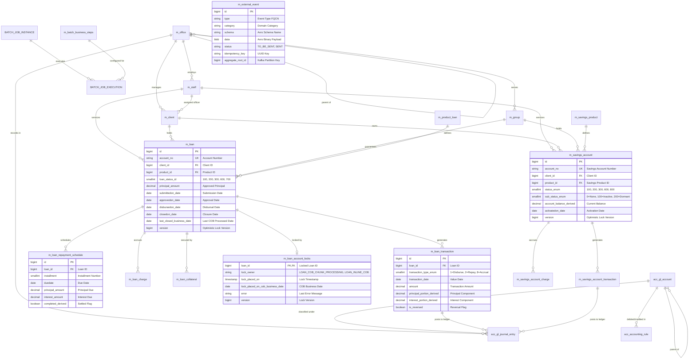
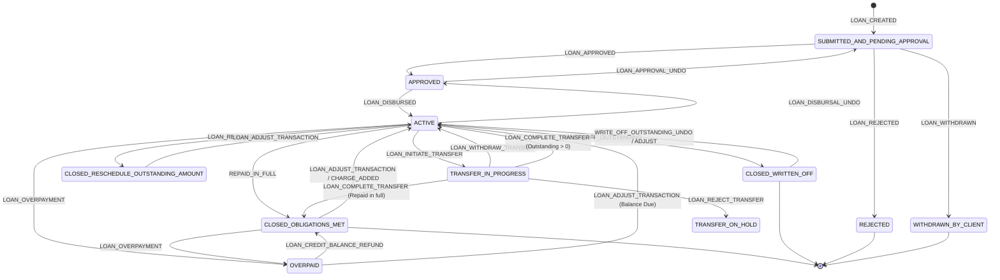
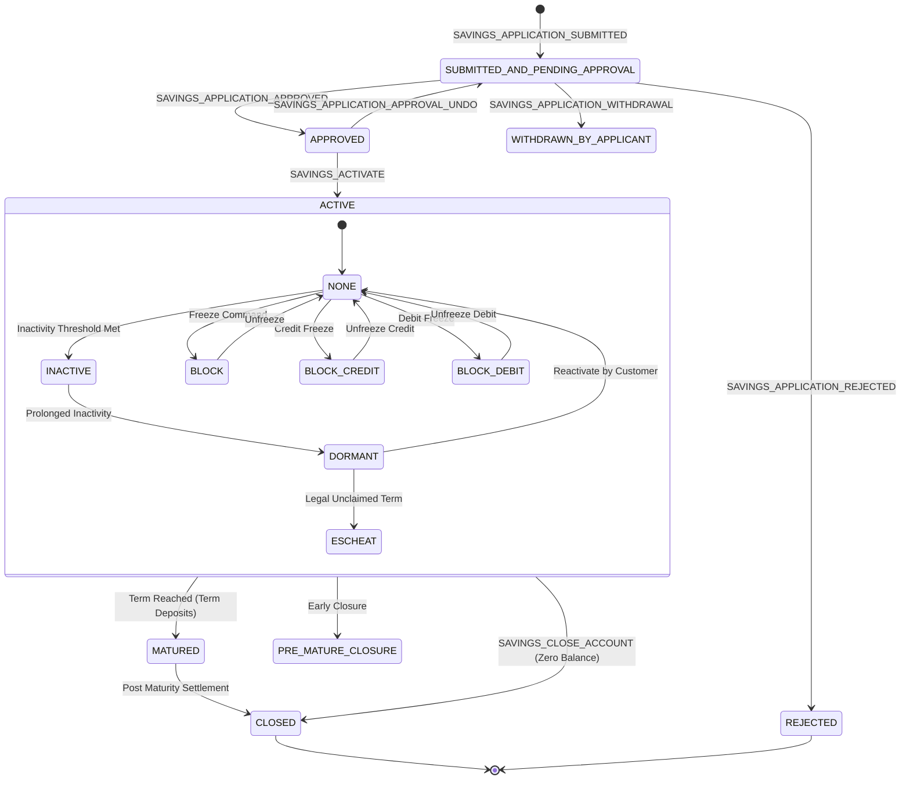
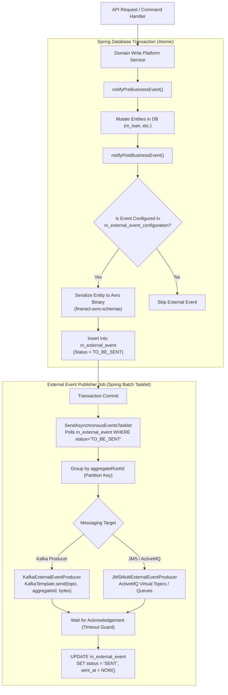
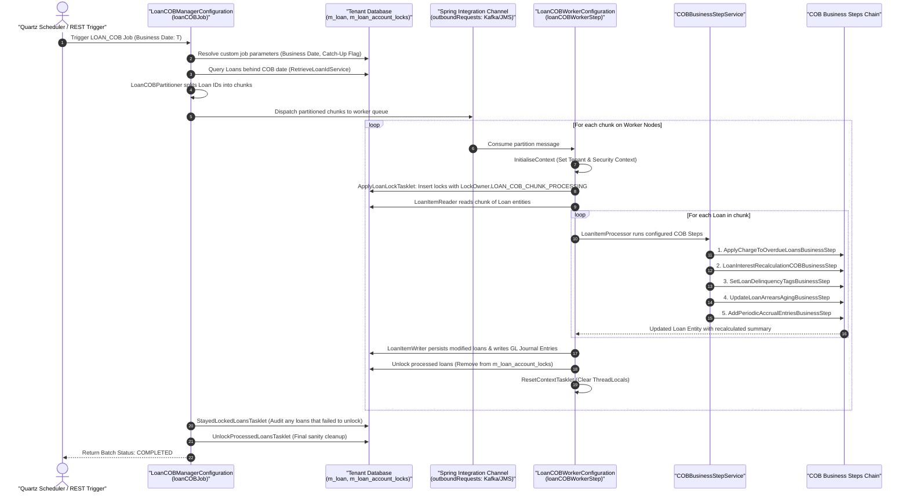

# سند جامع مدل داده دامنه، ماشین‌های حالت، گذرگاه رویدادها و موتور پردازش دسته‌ای (COB)
## Apache Fineract 1.15.0 Architecture: Domain Data Model, ERD, State Machines, Domain Events Bus & Close of Business (COB) Lifecycle

---

## ۱. مرور کلی معماری و اصول بنیادین (Executive Summary & Architecture Overview)

سامانه **Apache Fineract 1.15.0** یک پلتفرم بانکداری خرد (Core Banking Engine) با معماری توزیع‌پذیر و مبتنی بر تفکیک دامنه‌های کسب‌وکاری (Domain-Driven Design) است. در قلب این سامانه، سه ستون معماری پیوسته و هماهنگ قرار دارند:
1. **مدل داده دامنه و لایه پایداری رابطه‌ای (Domain Data Model & Relational Persistence):** ساختار داده‌های مالی با حفظ کامل یکپارچگی ارجاعی (Referential Integrity)، قیود یکتایی تفکیک‌شده به ازای هر مستأجر (Tenant-level Uniqueness)، و ردگیری دقیق تغییرات از طریق ستون‌های حسابرسی (`createdby_id`, `created_date`, `lastmodifiedby_id`, `lastmodified_date`) و قفل‌گذاری خوش‌بینانه (`version`).
2. **ماشین‌های حالت رسمی حساب‌ها (Formal Account State Machines):** چرخه حیات حساب‌های تسهیلات (`Loan`) و حساب‌های سپرده (`SavingsAccount`) از طریق ماشین‌های حالت تعین‌پذیر (Deterministic State Machines) اداره می‌شوند که کلیه تغییرات وضعیت، رویدادهای مجاز، شرایط پیش‌نیاز (Preconditions) و اثرات جانبی مالی را تحت کنترل کامل دارند.
3. **گذرگاه رویدادهای دامنه و الگوی صندوق خروجی (Domain Event Bus & Transactional Outbox Pattern):** تفکیک ارتباطات درون‌سیستمی و برون‌سیستمی با استفاده از `BusinessEventNotifierService`، ثبت رویدادها در جدول واسط `m_external_event`، سریال‌سازی باینری بر پایه **Apache Avro** (`fineract-avro-schemas`)، و انتشار به کارگزارهای پیام نظیر **Apache Kafka** و **ActiveMQ**.
4. **موتور پردازش دسته‌ای پایان روز (Close of Business - COB Batch Engine):** زیرسیستم پردازش مقیاس‌پذیر مبتنی بر **Spring Batch** و **Spring Integration** با قابلیت پارتیشن‌بندی توزیع‌شده (Remote Partitioning)، قفل‌گذاری حساب‌های در حال تسویه (`m_loan_account_locks`)، اجرای درون‌خطی (`Inline COB`)، پردازش جبرانی (`Catch-Up Mode`)، و زنجیره گام‌های کسب‌وکاری دینامیک (`COBBusinessStep`).

---

## ۲. مدل داده جامع دامنه بانکداری خرد و دیاگرام ERD (Core Banking Domain Data Model & ERD)

مدل داده پایگاه داده در فاینراکت بر مبنای تجمیع‌کننده‌های اصلی دامنه (Aggregate Roots) طراحی شده است. جداول سامانه از طریق مهاجرت‌های متوالی لیکوی‌بیس (Liquibase Changelogs) در مسیر `db/changelog/tenant/parts/` ایجاد و مدیریت می‌شوند.

### ۲.۱. زیرسیستم مشتری و ساختار سازمانی (Customer & Party Aggregate)

| نام جدول پایگاه داده | موجودیت متناظر JPA | شرح کارکرد و ساختار دامنه | کلیدهای اصلی و خارجی کلیدی | قیود یکتایی و شاخص‌ها |
| :--- | :--- | :--- | :--- | :--- |
| `m_office` | `Office` | نمایانگر ساختار سلسله‌مراتبی شعب، دفاتر مرکزی و دفاتر منطقه‌ای | `id` (PK), `parent_id` (FK -> `m_office`) | شاخص روی `hierarchy` جهت جستجوی درختی سریع شعب زیرمجموعه |
| `m_staff` | `Staff` | پرسنل، کارشناسان تسهیلات (Loan Officers) و مدیران شعب | `id` (PK), `office_id` (FK -> `m_office`) | شاخص ترکیبی روی `office_id` و پرچم `is_active` |
| `m_client` | `Client` | مشتریان حقیقی یا حقوقی، احراز هویت شده و فعال در سیستم بانکی | `id` (PK), `office_id` (FK -> `m_office`), `staff_id` (FK -> `m_staff`), `default_savings_account` (FK -> `m_savings_account`) | قید یکتایی `account_no_unique` روی `account_no`، شاخص خارجی `external_id` |
| `m_group` | `Group` | گروه‌های همبسته اعتباری (Lending Groups) و مراکز روستایی/شهری (Centers) | `id` (PK), `office_id` (FK -> `m_office`), `staff_id` (FK -> `m_staff`), `parent_id` (FK -> `m_group`) | شاخص روی `level_id` (تفکیک گروه از مرکز) و قید یکتایی `account_no` |

### ۲.۲. زیرسیستم تسهیلات و اعتبارات (Loan Subsystem Aggregate)

| نام جدول پایگاه داده | موجودیت متناظر JPA | شرح کارکرد و ساختار دامنه | کلیدهای اصلی و خارجی کلیدی | قیود یکتایی و شاخص‌ها |
| :--- | :--- | :--- | :--- | :--- |
| `m_product_loan` | `LoanProduct` | کاتالوگ محصولات تسهیلاتی، تعریف نرخ بهره، متد استهلاک، و روش‌های حسابداری | `id` (PK) | قید یکتایی روی `name` و `short_name` |
| `m_loan` | `Loan` | ریشه اصلی تجمیع پرونده تسهیلات مشتری، وضعیت، اصل و مانده بدهی | `id` (PK), `client_id` (FK -> `m_client`), `group_id` (FK -> `m_group`), `product_id` (FK -> `m_product_loan`), `loan_officer_id` (FK -> `m_staff`) | قید یکتایی `loan_account_no_unique` روی `account_no`، شاخص روی `loan_status_id` |
| `m_loan_transaction` | `LoanTransaction` | رویدادهای مالی پرونده وام: پرداخت، بازپرداخت، بخشودگی، کارمزد، سوخت بدهی | `id` (PK), `loan_id` (FK -> `m_loan`), `office_id` (FK -> `m_office`), `payment_detail_id` (FK -> `m_payment_detail`) | شاخص روی `transaction_date` و `transaction_type_enum` |
| `m_loan_repayment_schedule` | `LoanRepaymentScheduleInstallment` | اقساط زمان‌بندی‌شده، سهم اصل، سود، کارمزد و جریمه به ازای هر قسط | `id` (PK), `loan_id` (FK -> `m_loan`) | شاخص ترکیبی روی `loan_id` و `installment` |
| `m_loan_charge` | `LoanCharge` | کارمزدها و جرائم تخصیص‌یافته به وام (در زمان پرداخت، قسط معین یا سررسید) | `id` (PK), `loan_id` (FK -> `m_loan`), `charge_id` (FK -> `m_charge`) | شاخص روی `loan_id` و وضعیت فعالیت `is_active` |
| `m_loan_collateral` | `LoanCollateral` | وثایق، تضامین و دارایی‌های توثیق‌شده جهت اخذ تسهیلات | `id` (PK), `loan_id` (FK -> `m_loan`), `type_cv_id` (FK -> `m_code_value`) | کلید خارجی مقید به پرونده تسهیلات |

### ۲.۳. زیرسیستم سپرده و پس‌انداز (Savings & Deposit Subsystem Aggregate)

| نام جدول پایگاه داده | موجودیت متناظر JPA | شرح کارکرد و ساختار دامنه | کلیدهای اصلی و خارجی کلیدی | قیود یکتایی و شاخص‌ها |
| :--- | :--- | :--- | :--- | :--- |
| `m_savings_product` | `SavingsProduct` | تعریف سبد محصولات پس‌انداز، سپرده کوتاه‌مدت، بلندمدت و سرمایه‌گذاری دوره‌ای | `id` (PK) | قید یکتایی روی `name` و `short_name` |
| `m_savings_account` | `SavingsAccount` | ریشه اصلی تجمیع حساب سپرده مشتری، کنترل موجودی، اضافه برداشت و انسداد | `id` (PK), `client_id` (FK -> `m_client`), `group_id` (FK -> `m_group`), `product_id` (FK -> `m_savings_product`), `field_officer_id` (FK -> `m_staff`) | قید یکتایی `sa_account_no_unique` روی `account_no`، شاخص وضعیت `status_enum` |
| `m_savings_account_transaction` | `SavingsAccountTransaction` | تراکنش‌های واریز، برداشت، انتساب سود دوره‌ای و انسداد وجه | `id` (PK), `savings_account_id` (FK -> `m_savings_account`), `office_id` (FK -> `m_office`), `payment_detail_id` (FK -> `m_payment_detail`) | شاخص ترکیبی روی `savings_account_id` و `transaction_date` |
| `m_savings_account_charge` | `SavingsAccountCharge` | کارمزدهای دوره‌ای، کارمزد نگهداری سالیانه یا هزینه برداشت از سپرده | `id` (PK), `savings_account_id` (FK -> `m_savings_account`), `charge_id` (FK -> `m_charge`) | شاخص روی `savings_account_id` |

### ۲.۴. زیرسیستم دفتر کل و حسابداری مالی (General Ledger Accounting Subsystem)

| نام جدول پایگاه داده | موجودیت متناظر JPA | شرح کارکرد و ساختار دامنه | کلیدهای اصلی و خارجی کلیدی | قیود یکتایی و شاخص‌ها |
| :--- | :--- | :--- | :--- | :--- |
| `acc_gl_account` | `GLAccount` | سرفصل‌های دفتر کل (Chart of Accounts): دارایی، بدهی، سرمایه، درآمد و هزینه | `id` (PK), `parent_id` (FK -> `acc_gl_account`) | قید یکتایی `acc_gl_code` روی کد سرفصل `gl_code` |
| `acc_gl_journal_entry` | `JournalEntry` | ثبت آرتیکل‌های حسابداری دوطرفه (بدهکار/بستانکار) متصل به تراکنش‌های وام/سپرده | `id` (PK), `account_id` (FK -> `acc_gl_account`), `office_id` (FK -> `m_office`), `loan_transaction_id` (FK -> `m_loan_transaction`), `savings_transaction_id` (FK -> `m_savings_account_transaction`) | شاخص ترکیبی روی `transaction_id`، `entry_date` و `account_id` |
| `acc_accounting_rule` | `AccountingRule` | قواعد خودکارسازی صدور اسناد حسابداری بر اساس الگوهای ثابت بانکی | `id` (PK), `office_id` (FK -> `m_office`), `debit_account_id` (FK -> `acc_gl_account`), `credit_account_id` (FK -> `acc_gl_account`) | قید یکتایی روی نام قاعده به ازای هر شعبه |

### ۲.۵. زیرسیستم تسویه COB و رخدادهای بیرونی (COB & External Events Subsystem)

| نام جدول پایگاه داده | موجودیت متناظر JPA | شرح کارکرد و ساختار دامنه | کلیدهای اصلی و خارجی کلیدی | قیود یکتایی و شاخص‌ها |
| :--- | :--- | :--- | :--- | :--- |
| `m_loan_account_locks` | `LoanAccountLock` | ثبت قفل‌های فعال تسویه پایان روز یا اجرای درون‌خطی با درج مالک قفل و خطاها | `loan_id` (PK, FK -> `m_loan`) | شاخص روی `lock_owner` و `lock_placed_on_cob_business_date` |
| `m_batch_business_steps` | `BatchBusinessStep` | ترتیب و پیکربندی گام‌های تجاری قابل اجرا در پردازش دسته‌ای پایان روز | `id` (PK) | شاخص ترکیبی روی `job_name` و `step_order` |
| `BATCH_JOB_EXECUTION` | - (Spring Batch) | جدول متادیتای Spring Batch برای ردیابی وضعیت اجرا، زمان پایان و خروجی Job | `JOB_EXECUTION_ID` (PK), `JOB_INSTANCE_ID` (FK -> `BATCH_JOB_INSTANCE`) | شاخص روی `STATUS` و `JOB_INSTANCE_ID` |
| `m_external_event` | `ExternalEvent` | صندوق خروجی رخدادهای تراکنشی (Transactional Outbox) با داده باینری Avro | `id` (PK) | شاخص روی `status` (`TO_BE_SENT`), `business_date` و `aggregate_root_id` |

---

### ۲.۶. دیاگرام جامع ارتباط موجودیت‌ها (Comprehensive Mermaid ERD)

---

## ۳. ماشین‌های حالت و چرخه حیات حساب‌های بانکی (Account State Machines & Lifecycles)

### ۳.۱. ماشین حالت رسمی حساب‌های تسهیلات (`DefaultLoanLifecycleStateMachine`)

مدیریت تغییر وضعیت پرونده‌های تسهیلات در کلاس `DefaultLoanLifecycleStateMachine.java` متمرکز است. وضعیت‌های وام توسط اینام `LoanStatus` (دارای مقادیر عددی ثابت در دیتابیس) و رویدادهای مؤثر بر وضعیت توسط اینام `LoanEvent` هدایت می‌شوند.

#### جدول جامع وضعیت‌های حساب تسهیلات (`LoanStatus`):
| شناسه عددی | کد وضعیت | نام وضعیت | مفهوم کسب‌وکاری و شرایط ورود |
| :---: | :--- | :--- | :--- |
| `100` | `loanStatusType.submitted.and.pending.approval` | **SUBMITTED_AND_PENDING_APPROVAL** | پرونده وام توسط کاربر ثبت شده و منتظر بررسی و تأیید اعتباری شعبه/مرکز است. |
| `200` | `loanStatusType.approved` | **APPROVED** | تقاضای وام مصوب شده و آماده اجرای رویداد پرداخت وجه (Disbursement) است. |
| `300` | `loanStatusType.active` | **ACTIVE** | وجه وام به مشتری پرداخت شده، جدول بازپرداخت فعال گردیده و اقساط در جریان است. |
| `303` | `loanStatusType.transfer.in.progress` | **TRANSFER_IN_PROGRESS** | وام در فرایند انتقال بین‌شعبه‌ای یا واگذاری پورتفوی قرار دارد. |
| `304` | `loanStatusType.transfer.on.hold` | **TRANSFER_ON_HOLD** | انتقال وام به دلیل بروز خطا یا عدم تأیید مقصد متوقف شده است. |
| `400` | `loanStatusType.withdrawn.by.client` | **WITHDRAWN_BY_CLIENT** | مشتری پیش از مصوب شدن وام، تقاضای خود را مسترد نموده است (خاتمه یافته). |
| `500` | `loanStatusType.rejected` | **REJECTED** | تقاضای وام توسط کمیته اعتباری رد شده است (خاتمه یافته). |
| `600` | `loanStatusType.closed.obligations.met` | **CLOSED_OBLIGATIONS_MET** | کلیه تعهدات مالی وام (اصل، سود، کارمزد و جرایم) به‌طور کامل تسویه شده است. |
| `601` | `loanStatusType.closed.written.off` | **CLOSED_WRITTEN_OFF** | مانده مطالبات سوخت‌شده اعلام شده و پرونده بسته شده است. |
| `602` | `loanStatusType.closed.reschedule.outstanding.amount` | **CLOSED_RESCHEDULE_OUTSTANDING_AMOUNT** | مانده بدهی پرونده بسته شده و به یک پرونده استمهال‌شده جدید منتقل شده است. |
| `700` | `loanStatusType.overpaid` | **OVERPAID** | مبالغ پرداختی مشتری از کل بدهی فراتر رفته و پرونده بستانکار است. |

#### قوانین گذار حالت تسهیلات و اثرات جانبی:
1. **ثبت وام (`LOAN_CREATED`):** از وضعیت فرضی `null` وارد `SUBMITTED_AND_PENDING_APPROVAL` می‌شود.
2. **تصویب وام (`LOAN_APPROVED`):** فقط از وضعیت `SUBMITTED_AND_PENDING_APPROVAL` به `APPROVED` می‌رود. فیلدهای `approvedon_date` و `approvedby_id` مقداردهی می‌شوند.
3. **لغو تصویب (`LOAN_APPROVAL_UNDO`):** از `APPROVED` به `SUBMITTED_AND_PENDING_APPROVAL` بازمی‌گردد و فیلدهای تصویب پاک می‌شوند.
4. **پرداخت وجه (`LOAN_DISBURSED`):** از `APPROVED` (یا `CLOSED_OBLIGATIONS_MET` در تسهیلات چندمرحله‌ای) وارد وضعیت `ACTIVE` می‌شود. فیلد `disbursedon_date` تنظیم شده و تاریخ‌های خاتمه پاک می‌شوند.
5. **لغو پرداخت (`LOAN_DISBURSAL_UNDO`):** وضعیت از `ACTIVE` به `APPROVED` بازگردانده شده، اقساط معلق گردیده و تراکنش مالی معکوس می‌شود.
6. **تسویه کامل اقساط (`REPAID_IN_FULL`):** پس از صفر شدن مانده اصل و سود و تسویه کامل کارمزدها (`isRepaidInFull && isAllChargesPaid`) وضعیت به `CLOSED_OBLIGATIONS_MET` تغییر می‌یابد و فیلد `closedon_date` مقداردهی می‌شود.
7. **واریز مازاد (`LOAN_OVERPAYMENT`):** چنانچه مجموع واریزی بیش از مانده بدهی باشد، وضعیت به `OVERPAID` تغییر می‌یابد و `overpaidon_date` تنظیم می‌شود.
8. **استرداد مازاد وجه (`LOAN_CREDIT_BALANCE_REFUND`):** پس از بازگرداندن مبلغ مازاد به مشتری، وضعیت از `OVERPAID` به `CLOSED_OBLIGATIONS_MET` بازمی‌گردد.
9. **تعدیل یا ابطال تراکنش (`LOAN_ADJUST_TRANSACTION`):** اگر تراکنشی در وضعیت‌های بسته معکوس شود و مانده بدهی مجدداً مثبت گردد، ماشین حالت خودکار پرونده را به وضعیت `ACTIVE` بازمی‌گرداند.

---

### ۳.۲. ماشین حالت و زیروضعیت‌های حساب‌های سپرده (`SavingsAccountStatusType`)

حساب‌های سپرده و پس‌انداز علاوه بر وضعیت اولیه (`SavingsAccountStatusType`)، دارای مکانیزم کنترل زیروضعیت (`SavingsAccountSubStatusEnum`) در حالت فعال هستند که برای پایش حساب‌های راکد و انسدادهای قضایی استفاده می‌شود.

#### جدول وضعیت‌های حساب سپرده (`SavingsAccountStatusType`):
| شناسه عددی | کد وضعیت | نام وضعیت | مفهوم کسب‌وکاری |
| :---: | :--- | :--- | :--- |
| `100` | `savingsAccountStatusType.submitted.and.pending.approval` | **SUBMITTED_AND_PENDING_APPROVAL** | درخواست افتتاح حساب ثبت شده و در انتظار تأیید است. |
| `200` | `savingsAccountStatusType.approved` | **APPROVED** | افتتاح حساب تأیید شده اما هنوز اولین واریز اولیه یا فعال‌سازی رخ نداده است. |
| `300` | `savingsAccountStatusType.active` | **ACTIVE** | حساب فعال بوده و قابلیت واریز، برداشت و انتساب سود دوره‌ای دارد. |
| `303` | `savingsAccountStatusType.transfer.in.progress` | **TRANSFER_IN_PROGRESS** | حساب در فرآیند انتقال به شعبه یا مشتری دیگر است. |
| `304` | `savingsAccountStatusType.transfer.on.hold` | **TRANSFER_ON_HOLD** | انتقال حساب سپرده موقتاً مسدود شده است. |
| `400` | `savingsAccountStatusType.withdrawn.by.applicant` | **WITHDRAWN_BY_APPLICANT** | متقاضی پیش از تصویب، تقاضای افتتاح را پس گرفته است. |
| `500` | `savingsAccountStatusType.rejected` | **REJECTED** | درخواست افتتاح حساب توسط شعبه رد شده است. |
| `600` | `savingsAccountStatusType.closed` | **CLOSED** | حساب پس از تسویه کامل مانده و پرداخت سود متعلقه بسته شده است. |
| `700` | `savingsAccountStatusType.pre.mature.closure` | **PRE_MATURE_CLOSURE** | سپرده مدت‌دار پیش از موعد سررسید با نرخ شکست بسته شده است. |
| `800` | `savingsAccountStatusType.matured` | **MATURED** | سپرده مدت‌دار به تاریخ سررسید نهایی خود رسیده است. |

#### جدول زیروضعیت‌های حساب سپرده فعال (`SavingsAccountSubStatusEnum`):
| شناسه عددی | کد زیروضعیت | نام زیروضعیت | اثر رفتاری بر تراکنش‌ها |
| :---: | :--- | :--- | :--- |
| `0` | `SavingsAccountSubStatusEnum.none` | **NONE** | وضعیت استاندارد و نرمال؛ کلیه تراکنش‌ها مجاز است. |
| `100` | `SavingsAccountSubStatusEnum.inactive` | **INACTIVE** | حساب برای مدتی معین فاقد تراکنش بوده است؛ نیازمند هشدار به مشتری. |
| `200` | `SavingsAccountSubStatusEnum.dormant` | **DORMANT** | حساب راکد؛ تراکنش‌های برداشت خودکار مسدود بوده و نیازمند احراز مجدد است. |
| `300` | `SavingsAccountSubStatusEnum.escheat` | **ESCHEAT** | حساب بلاصاحب/اعراض‌شده؛ مانده به حساب تعهدی یا خزانه‌داری منتقل می‌شود. |
| `400` | `SavingsAccountSubStatusEnum.block` | **BLOCK** | انسداد کامل؛ واریز و برداشت هر دو با دستور قضایی یا اداری مسدود است. |
| `500` | `SavingsAccountSubStatusEnum.blockCredit` | **BLOCK_CREDIT** | انسداد واریز؛ هرگونه تراکنش بستانکار به حساب رد می‌شود. |
| `600` | `SavingsAccountSubStatusEnum.blockDebit` | **BLOCK_DEBIT** | انسداد برداشت؛ هرگونه تراکنش بدهکار از حساب رد می‌شود. |

---

## ۴. گذرگاه رویدادهای دامنه و معماری پیام‌رسانی توزیع‌شده (Domain Event Bus & Messaging)

فاینراکت 1.15.0 از یک معماری رویدادمحور دولایه بهره می‌برد:
1. **گذرگاه همگام درون‌برنامه‌ای (Internal Synchronous Event Bus):** مدیریت‌شده توسط `BusinessEventNotifierService` جهت اطلاع‌رسانی به ماژول‌های مجاور قبل و بعد از اعمال تراکنش در دیتابیس (`notifyPreBusinessEvent` و `notifyPostBusinessEvent`).
2. **صندوق خروجی تراکنشی بیرونی (External Transactional Outbox):** رویدادها در همان تراکنش پایگاه‌داده در جدول `m_external_event` ذخیره شده و سپس به‌صورت ناهمگام و مطمئن (At-least-once Delivery) توسط جاب ارائه‌دهنده پیام به صفوف توزیع‌شده ارسال می‌گردند.

### ۴.۱. سلسله‌مراتب کلاس‌های `BusinessEvent`

کلیه رویدادهای مالی از کلاس انتزاعی `AbstractBusinessEvent<T>` مشتق می‌شوند که شیء دامنه مرتبط (`get()`) را در بر می‌گیرد:
- **تسهیلات:**
  - `LoanCreatedBusinessEvent`: ثبت اولیه پرونده تسهیلات.
  - `LoanApprovedBusinessEvent`: تصویب وام.
  - `LoanDisbursalBusinessEvent`: پرداخت تسهیلات به حساب مشتری.
  - `LoanTransactionMakeRepaymentPostBusinessEvent`: بازپرداخت موفق قسط.
  - `LoanStatusChangedBusinessEvent`: هرگونه تغییر در وضعیت وام (`oldStatus` -> `newStatus`).
  - `LoanBalanceChangedBusinessEvent`: به‌روزرسانی مانده بدهی پرونده.
- **سپرده:**
  - `SavingsActivatedBusinessEvent`: فعال‌سازی حساب سپرده.
  - `SavingsDepositBusinessEvent`: واریز وجه به حساب پس‌انداز.
  - `SavingsWithdrawalBusinessEvent`: برداشت از حساب پس‌انداز.
  - `SavingsPostInterestBusinessEvent`: انتساب سود سپرده دوره‌ای.

### ۴.۲. سریال‌سازی داده با Apache Avro (`fineract-avro-schemas`)

پلتفرم فاینراکت برای تضمین سازگاری طرح‌واره‌ها (Schema Evolution)، یکپارچگی میان‌سیستمی و فشرده‌سازی حداکثری بارهای پیام، از **Apache Avro** استفاده می‌کند.
- تعاریف طرح‌واره در ماژول `fineract-avro-schemas/src/main/avro/` نگهداری می‌شوند (نظیر `LoanAccountDataV1.avsc`, `LoanTransactionDataV1.avsc`, `SavingsAccountDataV1.avsc`).
- مبدل‌های نگاشت (`AvroDateTimeMapper`, `ExternalIdMapper`, `CommandProcessingResultMapper`) اشیای دامنه را به `SpecificRecordBase` تبدیل می‌کنند.
- داده باینری خروجی به‌صورت آرایه بایتی (`byte[]`) در ستون `data` جدول `m_external_event` ذخیره می‌شود.

### ۴.۳. پارتیشن‌بندی و کلید یکتایی در Kafka و JMS

- **کلید پارتیشن کافکا (Partition Key):** به ازای هر پیام، مقدار `aggregateRootId` (شناسه اصلی پرونده تسهیلات یا حساب سپرده) به‌عنوان Partition Key استفاده می‌شود. این تضمین می‌کند که **کلیه رخدادهای مرتبط با یک حساب معین با رعایت ترتیب زمانی اکید (Strict FIFO Ordering) به یک پارتیشن کافکا وارد شوند.**
- **شناسه انحصاری (Idempotency Key):** هر رکورد رخداد دارای یک `idempotency_key` (UUID تصادفی) است که مصرف‌کنندگان بیرونی به کمک آن می‌توانند تراکنش‌های تکراری حاصل از ارسال مجدد پیام (At-least-once Delivery) را شناسایی و فیلتر کنند.

---

## ۵. چرخه حیات موتور پردازش دسته‌ای پایان روز (Close of Business - COB Batch Engine)

موتور COB در فاینراکت 1.15.0، پردازش‌های حجیم و سنگین پایان روز (محاسبه استهلاک بهره، بازتنظیم جدول معوقات، انتساب کارمزد سررسید گذشته، و انتقال مانده‌ها) را با استفاده از **Spring Batch**، **Spring Integration** و پارتیشن‌بندی موازی اجرا می‌کند.

### ۵.۱. تقویم کاری، تعطیلات و پیشروی تاریخ کسب‌وکار (Business Day Progression)

فاینراکت تاریخ تقویمی سرور را از تاریخ منطقی کسب‌وکار تفکیک کرده است:
- **`BusinessDateType.BUSINESS_DATE`:** تاریخ عملیاتی شعب جهت ثبت اسناد، صدور چک و ثبت تراکنش‌های روزمره.
- **`BusinessDateType.COB_DATE`:** تاریخی که عملیات پایان روز بر مبنای آن تسویه و بسته می‌شود.
- **قواعد تعطیلات رسمی و روزهای غیرکاری (`m_working_days` و `m_holiday`):**
  - جدول `m_working_days` روزهای تعطیل هفته را با رشته تکرار iCalendar (مثلاً شنبه/یکشنبه یا پنج‌شنبه/جمعه) مشخص می‌کند.
  - فیلد `repayment_rescheduling_enum` تعیین می‌کند در صورت انطباق سررسید قسط با روز تعطیل، قسط به:
    1. همان روز (Same Day)،
    2. اولین روز کاری بعد (Next Working Day)،
    3. روز جلسه بازپرداخت بعد (Next Repayment Meeting Day)، یا
    4. روز کاری قبل (Previous Working Day) منتقل گردد.

### ۵.۲. معماری پارتیشن‌بندی توزیع‌شده (Remote Partitioning)

1. **نود ارکستراتور (Manager Node):**
   - کلاس `LoanCOBPartitioner` کل شناسه‌های وام‌هایی که وضعیت آنها نیازمند پردازش تسویه است (مثلاً وضعیت ۳۰۰ یا وام‌هایی که تاریخ آخرین تسویه آنها قبل از `COB_DATE` است) را از طریق `RetrieveLoanIdService` واکشی می‌کند.
   - شناسه‌ها بر مبنای تنظیمات `fineract.cob.partition-size` به پارتیشن‌های متوازن تقسیم شده و همراه با `ExecutionContext` به کانال خروجی Spring Integration ارسال می‌شوند.
2. **نودهای پردازنده (Worker Nodes):**
   - پیام‌های پارتیشن را از طریق صفی در Kafka یا ActiveMQ دریافت می‌کنند.
   - پردازش به شکل چندنخی (Multi-threaded) توسط `ThreadPoolTaskExecutor` و با انتساب `ContextAwareTaskDecorator` انجام می‌شود تا کانتکست چندمستأجری (`FineractContext`) بین نخ‌ها حفظ شود.

### ۵.۳. زنجیره گام‌های کسب‌وکاری تسویه (`m_batch_business_steps`)

گام‌های اجرایی COB به‌صورت کامپوننت‌های پلاگین‌محور طراحی شده‌اند و ترتیب اجرای آنها در دیتابیس در جدول `m_batch_business_steps` برای جاب `LOAN_CLOSE_OF_BUSINESS` ثبت می‌شود:
1. `APPLY_CHARGE_TO_OVERDUE_LOANS`: اعمال خودکار جرایم و کارمزدهای سررسید گذشته به اقساط معوق.
2. `LOAN_INTEREST_RECALCULATION`: بازتنظیم جدول استهلاک و محاسبات سود روزشمار بر اساس نرخ‌های متغیر یا بازپرداخت‌های زودهنگام.
3. `CHECK_LOAN_REPAYMENT_DUE`: بررسی اقساطی که سررسید آنها فرا رسیده و صدور اخطاریه‌های پیامکی/ایمیلی.
4. `CHECK_LOAN_REPAYMENT_OVERDUE`: شناسایی اقساطی که از موعد مقرر گذشته و ورود پرونده به فاز پیگیری معوقات.
5. `UPDATE_LOAN_ARREARS_AGING`: دسته‌بندی و به‌روزرسانی سن معوقات (Aging Buckets: 1-30 days, 31-60 days, 61-90 days, 90+ days).
6. `SET_LOAN_DELINQUENCY_TAGS`: الصاق برچسب‌های نکول و طبقه‌بندی اعتباری به پرونده وام بر مبنای بازه‌های معوقه مصوب بانک مرکزی.
7. `ACCRUAL_ACTIVITY_POSTING`: شناسایی و صدور اسناد حسابداری شناسایی درآمد سود تعهدی (Accrued Interest) در دفتر کل.
8. `ADD_PERIODIC_ACCRUAL_ENTRIES`: ثبت استهلاک هزینه‌های تخفیف تجاری و درآمدهای سرمایه‌شده.

### ۵.۴. مکانیزم انحصاری قفل‌گذاری و اجرای درون‌خطی (Locking & Inline COB)

یکی از نوآوری‌های مهم فاینراکت 1.15.0، تضمین **یکپارچگی قوی داده‌ها در شرایط همزمانی بالا** است:
1. **قفل سطح حساب (`LoanAccountLock`):**
   - پیش از شروع پردازش هر چانک، نود کارگر رکوردی در جدول `m_loan_account_locks` با شناسه وام و مقدار `LockOwner.LOAN_COB_CHUNK_PROCESSING` درج می‌کند.
   - نسخه رکورد با `@Version` محافظت می‌شود تا از هرگونه تداخل قفل‌گذاری جلوگیری شود.
2. **فیلتر رهگیری درخواست‌های API (`LoanCOBApiFilter`):**
   - هنگامی که یک درخواست تراکنش مالی (نظیر واریز قسط، لغو پرداخت یا اعمال کارمزد) به اندپوینت‌های وام ارسال می‌شود، فیلتر `LoanCOBApiFilter` آن را ارزیابی می‌کند.
   - **سناریوی قفل سخت (Hard Locked):** اگر وام در جدول قفل‌ها موجود باشد، فیلتر بلافاصله با خطای **HTTP 409 Conflict** و پیام `error.msg.loan.locked` مانع اجرای درخواست می‌شود.
   - **سناریوی عقب‌ماندگی از تاریخ تسویه (Loan Behind COB Date):** اگر وامی قفل نباشد، اما به دلیل قطعی سیستم یا اضافه شدن ناگهانی، گام‌های COB روز قبل برای آن اجرا نشده باشد (`helper.isLoanBehind(loanIds)`)، فیلتر به صورت خودکار متوقف شده و متد `executeInlineCob` را فراخوانی می‌کند.
   - **اجرای درون‌خطی (`Inline Loan COB`):** جاب سبکی در همان کانتکست با قفل `LockOwner.LOAN_INLINE_COB_PROCESSING` اجرا می‌شود، محاسبات تسویه تا روز جاری به‌روزرسانی شده، قفل آزاد می‌شود و سپس درخواست اصلی کاربر پردازش می‌گردد.
3. **پردازش جبرانی کل سیستم (`COB Catch-Up Mode`):**
   - در صورت عقب ماندن سامانه به مدت چند روز کاری (مثلاً پس از تعطیلات طولانی یا بازیابی سامانه از بحران)، سرویس `LoanCOBCatchUpService` به‌صورت خودکار چرخه‌های متوالی جاب تسویه را فراخوانی می‌کند تا تاریخ پردازش به آخرین تاریخ کاری برسد.

---

## ۶. نیازمندی‌های استاندارد معماری به فرمت EARS (Architectural EARS Requirements)

این بخش شامل ۱۰ کارت نیازمندی استاندارد دوزبانه (فارسی و انگلیسی) است که کلیه قواعد حاکم بر مدل داده، ماشین‌های حالت، سیستم رویدادها و موتور COB را با استفاده از الگوی استاندارد EARS و فعل وجهی دستوری **`shall`** تعریف می‌کند.

---

### REQ-DATA-LOAN-AUDIT-001: ثبت رکوردهای ممیزی و کنترل قفل خوش‌بینانه در پایگاه داده تسهیلات
* **الگوی EARS:** Ubiquitous
* **EARS Statement:**
  > The Fineract Database Layer shall automatically record the creation timestamp, creating user identity, last modification timestamp, last modifying user identity, and increment an optimistic locking version number on every write transaction executed against the "m_loan" table.
* **شرح نیازمندی و سناریوی بیزنس (فارسی):**
  به منظور تطابق با استانداردهای نظارتی بانکداری و حفظ سلامت تراکنش‌ها در محیط‌های با همزمانی بالا، تمامی موجودیت‌های مالی دامنه تسهیلات در جدول `m_loan` ملزم به دارا بودن فیلدهای استاندارد ممیزی و ستون نسخه (`version`) برای قفل‌گذاری خوش‌بینانه (Optimistic Locking) هستند. در صورت اقدام همزمان دو تراکنش برای ویرایش یک رکورد، تراکنش دوم با خطای تداخل نسخه متوقف می‌شود.
* **رفتارهای ناخواسته و شروط خطا (EARS If-Then):**
  * `If a concurrent write transaction detects a mismatch between the expected and current version column of an "m_loan" record, then the Fineract Persistence Context shall abort the transaction and raise an "OptimisticLockException".`
* **ماتریس ردیابی به سورس‌کد (Traceability Matrix):**
  * **مسیر فایل و کلاس سورس:** `apache-fineract-src-1.15.0/fineract-provider/src/main/resources/db/changelog/tenant/parts/0001_initial_schema.xml`
  * **کلاس موجودیت جاوا:** `org.apache.fineract.portfolio.loanaccount.domain.Loan` (مشتق از `AbstractAuditableCustom`)
  * **پایگاه داده و انتیتی‌ها:** جدول `m_loan`، ستون‌های `createdby_id`, `created_date`, `lastmodifiedby_id`, `lastmodified_date`, `version`

---

### REQ-DATA-LOAN-UNIQUE-ACC-002: تضمین یکتایی شماره حساب تسهیلات در سطح هر مستأجر
* **الگوی EARS:** Unwanted Behavior
* **EARS Statement:**
  > If a loan creation or account modification request specifies an "account_no" value that already exists in table "m_loan" within the current tenant database schema, then the Fineract Database Layer shall reject the insertion and raise a unique constraint violation error on "loan_account_no_unique".
* **شرح نیازمندی و سناریوی بیزنس (فارسی):**
  شماره حساب پرونده تسهیلات شناسه اصلی پیگیری مشتری، قراردادهای اعتباری و اسناد مالی است. سامانه موظف است یکتایی قطعی شماره حساب را در سطح پایگاه‌داده همان مستأجر تضمین نماید و مانع از ایجاد پرونده‌های تکراری شود.
* **رفتارهای ناخواسته و شروط خطا (EARS If-Then):**
  * `If an insertion into "m_loan" attempts to violate constraint "loan_account_no_unique", then the Fineract Platform shall rollback the database transaction and return error code "error.msg.loan.duplicate.accountNo".`
* **ماتریس ردیابی به سورس‌کد (Traceability Matrix):**
  * **مسیر فایل چنج‌لاگ:** `apache-fineract-src-1.15.0/fineract-provider/src/main/resources/db/changelog/tenant/parts/0001_initial_schema.xml`
  * **نام جدول و قید یکتایی:** جدول `m_loan`، قید `loan_account_no_unique` روی ستون `account_no`
  * **کلاس موجودیت جاوا:** `org.apache.fineract.portfolio.loanaccount.domain.Loan`

---

### REQ-STATE-LOAN-DISBURSE-003: گذار حالت پرونده وام از تصویب‌شده به فعال هنگام پرداخت وجه
* **الگوی EARS:** Complex
* **EARS Statement:**
  > While a loan account is in "APPROVED" status, when an authorized user submits a valid disbursement command with a non-future disbursement date, the Fineract Loan Lifecycle Engine shall transition the loan status to "ACTIVE", disburse the approved principal amount, generate the finalized repayment schedule, and emit a "LoanDisbursalBusinessEvent".
* **شرح نیازمندی و سناریوی بیزنس (فارسی):**
  هنگامی که یک پرونده تسهیلات در وضعیت مصوب قرار دارد، کارشناس مجاز شعبه می‌تواند وجه وام را به مشتری پرداخت کند. سیستم فاینراکت موظف است پس از اعتبارسنجی تاریخ و مبلغ، وضعیت را به فعال تغییر دهد، اقساط را تثبیت کند، و رخداد تجاری پرداخت را جهت انتشار در گذرگاه پیام و صدور سند حسابداری صادر نماید.
* **رفتارهای ناخواسته و شروط خطا (EARS If-Then):**
  * `If the loan account is not in "APPROVED" status at the time of disbursement, then the Fineract Loan Engine shall reject the operation and return error code "error.msg.loan.not.approved".`
  * `If the actual disbursement date is prior to the loan approval date, then the Fineract Loan Engine shall reject the command and return error code "error.msg.loan.disbursement.date.cannot.be.before.approved.date".`
* **ماتریس ردیابی به سورس‌کد (Traceability Matrix):**
  * **مسیر فایل و کلاس سورس:** `apache-fineract-src-1.15.0/fineract-loan/src/main/java/org/apache/fineract/portfolio/loanaccount/domain/DefaultLoanLifecycleStateMachine.java`
  * **سرویس اجرایی:** `LoanWritePlatformServiceJpaRepositoryImpl#disburseLoan`
  * **انوتیشن‌ها و کدهای خطا:** `@PreAuthorize("hasAuthority('DISBURSE_LOAN')")`, `error.msg.loan.not.approved`
  * **پایگاه داده و انتیتی‌ها:** جدول `m_loan` (ستون `loan_status_id=300`), جدول `m_loan_transaction`

---

### REQ-STATE-LOAN-FULL-REPAY-004: گذار خودکار وضعیت به تسویه‌کامل پس از پرداخت کامل تعهدات
* **الگوی EARS:** State-Driven
* **EARS Statement:**
  > While a loan account is in "ACTIVE" status, when a repayment transaction reduces the total outstanding balance of principal, interest, fees, and penalties to zero, the Fineract Loan Lifecycle Engine shall transition the loan status to "CLOSED_OBLIGATIONS_MET", record the closed date, and raise a "LoanStatusChangedBusinessEvent".
* **شرح نیازمندی و سناریوی بیزنس (فارسی):**
  به محض این که یک تراکنش بازپرداخت (یا بخشودگی مجاز) منجر به تسویه کامل تمامی اقساط و هزینه‌های پرونده وام گردد، ماشین حالت فاینراکت موظف است وضعیت پرونده را به صورت خودکار به «بسته‌شده به دلیل انجام تعهدات» تغییر داده و تاریخ بسته شدن را معادل تاریخ تراکنش ثبت کند.
* **رفتارهای ناخواسته و شروط خطا (EARS If-Then):**
  * `If active charges or penalty amounts remain unpaid on the loan after principal and interest are settled, then the Fineract Loan Lifecycle Engine shall keep the loan in "ACTIVE" status until all associated charges are settled or waived.`
* **ماتریس ردیابی به سورس‌کد (Traceability Matrix):**
  * **مسیر فایل و کلاس سورس:** `apache-fineract-src-1.15.0/fineract-loan/src/main/java/org/apache/fineract/portfolio/loanaccount/domain/DefaultLoanLifecycleStateMachine.java`
  * **متد اجرایی:** `#determineTransitionFromActive()`
  * **کدهای خطا و مقادیر وضعیت:** `LoanStatus.CLOSED_OBLIGATIONS_MET` (مقدار `600`), `LoanEvent.REPAID_IN_FULL`
  * **پایگاه داده و انتیتی‌ها:** جدول `m_loan` (ستون `closedon_date`)

---

### REQ-STATE-SAVINGS-DORMANT-005: انتقال خودکار حساب‌های پس‌انداز غیرفعال به زیروضعیت راکد (Dormant)
* **الگوی EARS:** State-Driven
* **EARS Statement:**
  > While a savings account is in "ACTIVE" status with sub-status "NONE", when the duration since the last customer-initiated transaction exceeds the configured dormancy threshold days of the associated savings product, the Fineract Savings Engine shall update the account sub-status to "DORMANT" and restrict automated debit transactions.
* **شرح نیازمندی و سناریوی بیزنس (فارسی):**
  مطابق مقررات مبارزه با پولشویی و حفاظت از سپرده‌ها، حساب‌هایی که برای مدتی مشخص (مثلاً ۶ ماه یا یک سال) هیچ‌گونه تراکنش با اراده مشتری نداشته باشند، باید توسط جاب دوره‌ای به زیروضعیت راکد (DORMANT) منتقل شوند. در این وضعیت، هرگونه برداشت از حساب تا زمان حضور مشتری و احراز هویت مجدد مسدود می‌گردد.
* **رفتارهای ناخواسته و شروط خطا (EARS If-Then):**
  * `If a debit withdrawal transaction is attempted against a savings account having sub-status "DORMANT", then the Fineract Savings Engine shall reject the transaction and return error code "error.msg.savingsaccount.is.dormant".`
* **ماتریس ردیابی به سورس‌کد (Traceability Matrix):**
  * **مسیر فایل و کلاس سورس:** `apache-fineract-src-1.15.0/fineract-core/src/main/java/org/apache/fineract/portfolio/savings/domain/SavingsAccountSubStatusEnum.java`
  * **جاب اجرایی:** `UpdateSavingsDormantAccountsTasklet`
  * **کدهای خطا و مقادیر وضعیت:** `SavingsAccountSubStatusEnum.DORMANT` (مقدار `200`), `error.msg.savingsaccount.is.dormant`
  * **پایگاه داده و انتیتی‌ها:** جدول `m_savings_account` (ستون `sub_status_enum`)

---

### REQ-EVENT-OUTBOX-ASYNC-006: درج رویداد در جدول صندوق خروجی و انتشار ناهمگام به Kafka با طرح‌واره Avro
* **الگوی EARS:** Event-Driven
* **EARS Statement:**
  > When a domain write operation completes successfully and external event posting is enabled, the Fineract Event Subsystem shall persist an Avro-serialized binary representation of the business event into table "m_external_event" within the same database transaction, and subsequently dispatch the payload to Apache Kafka partitioned by "aggregate_root_id".
* **شرح نیازمندی و سناریوی بیزنس (فارسی):**
  سامانه فاینراکت جهت تضمین تحویل حداقل یک‌باره (At-least-once) رویدادها به سامانه‌های پایین‌دستی بدون وابستگی همگام، از الگوی Transactional Outbox بهره می‌برد. رخداد با طرح‌واره آپاچی آورو سریال شده و در همان تراکنش بانک ذخیره می‌شود؛ سپس جاب ارسال پیام آن را با کلید شناسه ریشه تجمیع به کافکا ارسال می‌نماید تا حفظ ترتیب رویدادها تضمین گردد.
* **رفتارهای ناخواسته و شروط خطا (EARS If-Then):**
  * `If the Kafka producer fails to receive a broker acknowledgement within the configured timeout window, then the Fineract Event Publisher shall raise an "AcknowledgementTimeoutException" and keep the event status as "TO_BE_SENT" for subsequent retry.`
* **ماتریس ردیابی به سورس‌کد (Traceability Matrix):**
  * **مسیر فایل و کلاس سورس:** `apache-fineract-src-1.15.0/fineract-core/src/main/java/org/apache/fineract/infrastructure/event/business/service/BusinessEventNotifierServiceImpl.java`
  * **کلاس تولیدکننده پیام:** `KafkaExternalEventProducer#sendEvents`
  * **کلاس موجودیت و پایگاه داده:** `ExternalEvent.java`، جدول `m_external_event`، ستون‌های `data` (نوع `BLOB/BYTEA`), `status`, `aggregate_root_id`

---

### REQ-COB-HARD-LOCK-EXCLUSION-007: مسدودسازی درخواست‌های همزمان در زمان اجرای قفل تسویه پایان روز
* **الگوی EARS:** Unwanted Behavior
* **EARS Statement:**
  > If an incoming API command attempts to mutate a loan account that is currently locked by a running COB batch worker with lock owner "LOAN_COB_CHUNK_PROCESSING", then the Fineract COB Filter shall immediately abort request execution and return HTTP status 409 Conflict with error code "error.msg.loan.locked".
* **شرح نیازمندی و سناریوی بیزنس (فارسی):**
  در طول زمان اجرای فرآیند تسویه شبانه روی یک دسته از وام‌ها، جهت جلوگیری از وقوع پدیده بروزرسانی گمشده (Lost Update) یا ناهماهنگی در اسناد مالی، پرونده در جدول قفل‌ها نشانه‌گذاری می‌شود. هرگونه درخواست موازی از کانال‌های اینترنتی یا شعب در این بازه با پاسخ تعارض (Conflict) رد می‌شود.
* **رفتارهای ناخواسته و شروط خطا (EARS If-Then):**
  * `If a loan ID extracted from an incoming HTTP request exists in table "m_loan_account_locks" and is not overrulable, then the "LoanCOBApiFilter" shall write an "ApiGlobalErrorResponse.loanIsLocked" JSON error response directly to the servlet output.`
* **ماتریس ردیابی به سورس‌کد (Traceability Matrix):**
  * **مسیر فایل و کلاس سورس:** `apache-fineract-src-1.15.0/fineract-provider/src/main/java/org/apache/fineract/infrastructure/jobs/filter/COBApiFilter.java`
  * **کلاس هلپر فیلتر:** `LoanCOBFilterHelperImpl`
  * **استثنای سیستمی:** `LoanIdsHardLockedException`
  * **پایگاه داده و جداول:** جدول `m_loan_account_locks`، ستون `lock_owner`

---

### REQ-COB-INLINE-CATCHUP-008: رهگیری و اجرای درون‌خطی تسویه برای حساب‌های عقب‌مانده از تاریخ تجاری
* **الگوی EARS:** Complex
* **EARS Statement:**
  > While external loan lock records do not exist for a requested account, when an incoming financial transaction targets a loan whose "last_closed_business_date" is prior to the active COB business date, the Fineract COB Filter shall execute an on-demand Inline COB batch cycle for that specific loan before permitting the transaction to proceed.
* **شرح نیازمندی و سناریوی بیزنس (فارسی):**
  چنانچه به هر دلیلی یک پرونده وام از پردازش دسته‌ای شب گذشته جا مانده باشد، فاینراکت اجازه صدور تراکنش جدید روی داده‌های تاریخی را نمی‌دهد. فیلتر امنیتی به محض تشخیص عقب‌ماندگی، جاب درون‌خطی (`Inline Loan COB`) را برای همان وام فرامی‌خواند تا استهلاک و محاسبات معوقات تا تاریخ روز تسویه شده و سپس تراکنش مشتری اجرا شود.
* **رفتارهای ناخواسته و شروط خطا (EARS If-Then):**
  * `If the on-demand Inline COB execution fails due to an unexpected business calculation error, then the Fineract COB Filter shall abort the user request and raise a "LoanCOBExecutionException".`
* **ماتریس ردیابی به سورس‌کد (Traceability Matrix):**
  * **مسیر فایل و کلاس سورس:** `apache-fineract-src-1.15.0/fineract-provider/src/main/java/org/apache/fineract/cob/service/InlineLoanCOBExecutorServiceImpl.java`
  * **فیلتر فراخوان:** `LoanCOBApiFilter#doFilterInternal`
  * **پایگاه داده و انتیتی‌ها:** موجودیت `Loan`، ستون `last_closed_business_date` در جدول `m_loan`

---

### REQ-COB-PIPELINE-ORDER-009: اجرای زنجیره گام‌های تسویه پایان روز بر اساس ترتیب پیکربندی‌شده
* **الگوی EARS:** State-Driven
* **EARS Statement:**
  > While executing the "LOAN_CLOSE_OF_BUSINESS" batch job, the Fineract COB Business Step Engine shall iterate through and execute each configured business step in strict ascending order of the "step_order" attribute defined in table "m_batch_business_steps".
* **شرح نیازمندی و سناریوی بیزنس (فارسی):**
  عملیات تسویه پایان روز مشتمل بر زنجیره‌ای از گام‌های وابسته است (مثلاً ابتدا باید جرائم سررسید گذشته ثبت شوند، سپس جدول معوقات محاسبه گردد، و در انتها سند استهلاک و شناسایی درآمد صادر شود). سیستم فاینراکت موظف است این گام‌ها را دقیقاً بر اساس شماره ترتیب ذخیره‌شده در پایگاه‌داده اجرا نماید.
* **رفتارهای ناخواسته و شروط خطا (EARS If-Then):**
  * `If an unhandled exception is thrown by any business step during item processing, then the Fineract COB Worker shall mark the chunk item for skip or retry according to the configured fault-tolerant policy, and log the failure stacktrace into table "m_loan_account_locks".`
* **ماتریس ردیابی به سورس‌کد (Traceability Matrix):**
  * **مسیر فایل و کلاس سورس:** `apache-fineract-src-1.15.0/fineract-cob/src/main/java/org/apache/fineract/cob/COBBusinessStepServiceImpl.java`
  * **کلاس پردازنده کارگر:** `LoanItemProcessor#process`
  * **پایگاه داده و انتیتی‌ها:** جدول `m_batch_business_steps` (ستون‌های `job_name`, `step_name`, `step_order`)

---

### REQ-HOLIDAY-RESCHEDULE-010: بازتنظیم سررسید اقساط منطبق بر تعطیلات رسمی و روزهای غیرکاری
* **الگوی EARS:** Optional Feature
* **EARS Statement:**
  > Where holiday repayment rescheduling is enabled on the tenant organization profile, when a loan repayment installment due date falls on an official holiday recorded in table "m_holiday" or a weekly non-working day in "m_working_days", the Fineract Schedule Generator shall reschedule the installment due date in accordance with the configured "repayment_rescheduling_enum" rule.
* **شرح نیازمندی و سناریوی بیزنس (فارسی):**
  در صورتی که مؤسسه مالی قابلیت مدیریت روزهای تعطیل را فعال کرده باشد، هرگاه سررسید قسطی با روز تعطیل رسمی یا روزهای تعطیل هفته تلاقی پیدا کند، موتور تولید جدول اقساط موظف است بر اساس استراتژی منتخب (انتقال به روز کاری بعد یا قبل)، تاریخ سررسید قسط را به‌طور خودکار تعدیل نماید.
* **رفتارهای ناخواسته و شروط خطا (EARS If-Then):**
  * `If a holiday date range is modified while active loan accounts exist, then the Fineract Holiday Service shall execute a background recalculation job to adjust affected future installment schedule rows in "m_loan_repayment_schedule".`
* **ماتریس ردیابی به سورس‌کد (Traceability Matrix):**
  * **مسیر فایل و کلاس سورس:** `apache-fineract-src-1.15.0/fineract-core/src/main/java/org/apache/fineract/organisation/workingdays/service/WorkingDaysUtil.java`
  * **کلاس موجودیت:** `org.apache.fineract.organisation.holiday.domain.Holiday`
  * **پایگاه داده و انتیتی‌ها:** جدول `m_holiday`، جدول `m_working_days`، جدول `m_loan_repayment_schedule`
