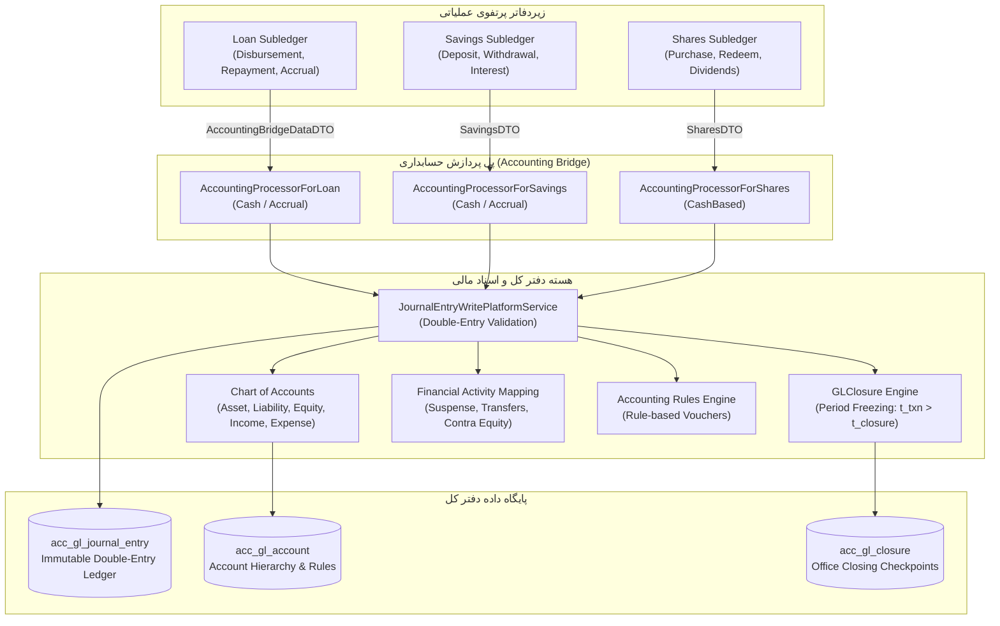

# سند نیازمندی‌های مهندسی معکوس حسابداری، دفتر کل و تعادل مالی در Apache Fineract 1.15.0
## (Tier 3: Core Accounting, Financial GL & Subledger Requirements Specification)

---

## ۱. نمای کلی حوزه، معماری دامنه و ناورداهای بنیادین (Executive Summary & Domain Invariants)

این سند مرجع رسمی و مهندسی معکوس‌شده از سورس‌کد **Apache Fineract 1.15.0** جهت پوشش جامع نیازمندی‌های عملکردی و غیرعملکردی حوزه دفتر کل، حسابداری مالی دوبل و پل ارتباطی زیردفاتر پرتفوی اعتبارات، پس‌انداز و سهام (Accounting & Financial Ledger Domain) در قالب استاندارد بین‌المللی **EARS (Easy Approach to Requirements Syntax)** به صورت دوزبانه (فارسی - انگلیسی) است.

### ارکان معماری و ماژول‌های فعال در این حوزه:
1. **موتور حسابداری و دفتر کل (`fineract-accounting`):** مدیریت ساختار درختی سرفصل‌های حسابداری (Chart of Accounts)، ثبت اسناد دستی و خودکار، قواعد حسابداری، بستن دوره‌های مالی و نگاشت فعالیت‌های ویژه مالی.
2. **هسته مشترک دامنه (`fineract-core`):** تعاریف پایه موجودیت‌ها (`GLAccount`، `GLAccountType`، `GLAccountUsage`)، اینام‌ها و مپرهای پایه.
3. **لایه سرویس و هماهنگ‌سازی زیردفاتر (`fineract-provider`):** پیاده‌سازی پردازشگرهای ارتباطی پرتفوی (`AccountingProcessorForLoan`، `AccountingProcessorForSavings`، `AccountingProcessorForShares`، `AccountingProcessorForClientTransactions`)، بروزرسانی مانده جاری حساب‌ها و اجرای بستن دوره‌ها.
4. **ماژول تسهیلات و سپرده‌ها (`fineract-loan` / `fineract-savings`):** ارسال بسته‌های داده‌ای رویداد مالی (`AccountingBridgeDataDTO`، `SavingsDTO`) جهت صدور اتوماتیک اسناد تعهدی و نقدی.

### ناورداهای ریاضی و مالی حاکم بر سیستم (Mathematical & Domain Invariants):
* **توازن اصل تعادل دوطرفه حسابداری (Double-Entry Balance Conservation Law):**
  برای هر سند صادره در سامانه فاینراکت، مجموع مبالغ بدهکار دقیقا برابر با مجموع مبالغ بستانکار در همان ارز است:
  $$\sum_{i=1}^n \text{Debit}_i = \sum_{j=1}^m \text{Credit}_j$$
* **محاسبه مانده جاری دفاتر کل (Running Balance Computation Formula):**
  مانده حساب‌ها بر اساس ماهیت سرفصل (`GLAccountType`) به‌روزرسانی می‌شود:
  $$\text{RunningBalance}_{\text{Asset/Expense}} = \text{PrevBalance} + \text{Debit} - \text{Credit}$$
  $$\text{RunningBalance}_{\text{Liability/Equity/Income}} = \text{PrevBalance} + \text{Credit} - \text{Debit}$$
* **مرز انسداد بستن دوره‌های مالی (Periodic Accounting Closure Boundary Condition):**
  هیچ سندی نمی‌تواند در تاریخی قبل یا مساوی تاریخ آخرین بستن دوره ثبت گردد:
  $$t_{\text{txn}} > t_{\text{closure}}$$

---

## ۲. خلاصه ماتریس نیازمندی‌ها (Requirements Index Matrix)

| شناسه نیازمندی | عنوان نیازمندی (فارسی) | الگوی EARS | کلاس و لایه سورس Fineract |
| :--- | :--- | :--- | :--- |
| **REQ-ACC-COA-001** | تعریف کدینگ، رده‌های حسابداری و طبقه‌بندی سرفصل‌های دفتر کل | Complex | `GLAccountWritePlatformServiceJpaRepositoryImpl.java` |
| **REQ-ACC-COA-002** | ساختار درختی، حساب‌های سرگروه و حساب‌های تفصیلی | Complex | `GLAccount.java` |
| **REQ-ACC-COA-003** | قیود غیرفعال‌سازی، انتساب به محصولات و حذف سرفصل‌های دفتر کل | State-Driven | `GLAccountWritePlatformServiceJpaRepositoryImpl.java` |
| **REQ-ACC-JRNL-001** | قانون ناوردای توازن دوطرفه در اسناد حسابداری | Ubiquitous | `JournalEntryWritePlatformServiceJpaRepositoryImpl.java` |
| **REQ-ACC-JRNL-002** | اعتبارسنجی ثبت دستی اسناد حسابداری و کنترل شعب | Event-Driven | `JournalEntryCommandFromApiJsonDeserializer.java` |
| **REQ-ACC-JRNL-003** | تغییرناپذیری اسناد حسابداری و فرآیند برگشت سند | Event-Driven | `JournalEntryWritePlatformServiceJpaRepositoryImpl.java` |
| **REQ-ACC-JRNL-004** | محاسبه داینامیک مانده جاری حساب‌ها و تراز آزمایشی | Event-Driven | `JournalEntryRunningBalanceUpdateServiceImpl.java` |
| **REQ-ACC-LOAN-001** | حسابداری مبتنی بر نقدی تسهیلات اعطایی | Event-Driven | `CashBasedAccountingProcessorForLoan.java` |
| **REQ-ACC-LOAN-002** | حسابداری تعهدی دوره‌ای و شناختی تسهیلات | Event-Driven | `AccrualBasedAccountingProcessorForLoan.java` |
| **REQ-ACC-LOAN-003** | ثبت اسناد سوخت مطالبات، تعدیل تعهدات و بازیافت مطالبات سوخت‌شده | Event-Driven | `AccrualBasedAccountingProcessorForLoan.java` |
| **REQ-ACC-SAV-001** | حسابداری نقدی حساب‌های پس‌انداز و سپرده | Event-Driven | `CashBasedAccountingProcessorForSavings.java` |
| **REQ-ACC-SAV-002** | حسابداری تعهدی سپرده‌ها و شناسایی سود بدهکاران/بستانکاران | Event-Driven | `AccrualBasedAccountingProcessorForSavings.java` |
| **REQ-ACC-SHR-001** | ثبت دفاتر کل حسابداری معاملات و سهامداری | Event-Driven | `CashBasedAccountingProcessorForShares.java` |
| **REQ-ACC-FINACT-001** | نگاشت سرفصل‌های دفتر کل به فعالیت‌های ویژه مالی | Complex | `FinancialActivityAccountWritePlatformServiceImpl.java` |
| **REQ-ACC-CLOS-001** | بستن دوره‌های مالی و انسداد ثبت اسناد عطف به ماسبق | Complex | `GLClosureWritePlatformServiceJpaRepositoryImpl.java` |
| **REQ-ACC-CLOS-002** | مدیریت چرخه حیات و محدودیت‌های حذف بستن حساب‌ها | State-Driven | `GLClosureWritePlatformServiceJpaRepositoryImpl.java` |
| **REQ-ACC-RULE-001** | حسابداری مبتنی بر قواعد و الگوهای سند دوبل | Complex | `AccountingRuleWritePlatformServiceJpaRepositoryImpl.java` |
| **REQ-ACC-OPEN-001** | ثبت مانده‌های افتتاحیه دفاتر کل و حساب رابط سرمایه | Event-Driven | `JournalEntryWritePlatformServiceJpaRepositoryImpl.java` |

---

## ۳. کاتالوگ تفصیلی کارت‌های نیازمندی به تفکیک حوزه‌ها

### بخش ۱: درخت حساب‌ها و کدینگ دفتر کل (Chart of Accounts & GL Hierarchy)

#### REQ-ACC-COA-001: تعریف کدینگ، رده‌های حسابداری و طبقه‌بندی سرفصل‌های دفتر کل
* **الگوی EARS:** Complex
* **EARS Statement:**
  > When creating or modifying a general ledger account, the Fineract Accounting Engine shall validate that the account payload contains a non-empty GL code, a non-blank account name, and an accounting classification value mapped strictly to one of the five primary types: `ASSET (1)`, `LIABILITY (2)`, `EQUITY (3)`, `INCOME (4)`, or `EXPENSE (5)`, and shall reject any request containing an existing GL code within the tenant domain.
* **شرح نیازمندی و سناریوی بیزنس (فارسی):**
  هنگام تعریف سرفصل‌های حسابداری در جدول کدینگ (Chart of Accounts)، مدیر سیستم باید کد یکتا (`glCode`)، نام حساب و طبقه‌بندی بنیادین حساب را تعیین نماید. موتور حسابداری فاینراکت موظف است اطمینان حاصل کند که کدینگ اختصاص‌یافته در سطح مستأجر بانکی تکراری نبوده و ماهیت حساب دقیقا منطبق بر یکی از ۵ رده استاندارد حسابداری (دارایی=۱، بدهی=۲، حقوق صاحبان سهام=۳، درآمد=۴، هزینه=۵) باشد. همچنین فعال یا غیرفعال بودن ورود دستی سند (`manualEntriesAllowed`) و توضیحات اختیاری حساب اعتبارسنجی و ذخیره می‌گردد.
* **رفتارهای ناخواسته و شروط خطا (EARS If-Then):**
  * `If the glCode parameter is missing or empty, then the Fineract Accounting Engine shall reject the request and return error code "validation.msg.glAccount.glCode.cannot.be.empty".`
  * `If the glCode already exists in table acc_gl_account, then the Fineract Accounting Engine shall abort persistence and throw a "GLAccountDuplicateException" with error code "error.msg.glAccount.glCode.duplicate".`
  * `If the classification type integer does not resolve to an integer in the range 1 through 5, then the Fineract Accounting Engine shall reject the request and return error code "validation.msg.glAccount.type.is.not.within.expected.range".`
  * `If the name parameter is blank or exceeds 200 characters, then the Fineract Accounting Engine shall reject the payload and return error code "validation.msg.glAccount.name.cannot.be.empty".`
* **ماتریس ردیابی به سورس‌کد (Traceability Matrix):**
  * **مسیر فایل و کلاس سورس:** `apache-fineract-src-1.15.0/fineract-accounting/src/main/java/org/apache/fineract/accounting/glaccount/service/GLAccountWritePlatformServiceJpaRepositoryImpl.java`
  * **کلاس دامنه و انتیتی:** `apache-fineract-src-1.15.0/fineract-core/src/main/java/org/apache/fineract/accounting/glaccount/domain/GLAccount.java`
  * **متد اجرایی:** `#createGLAccount(JsonCommand command)` و `#updateGLAccount(Long glAccountId, JsonCommand command)`
  * **کدهای خطا و استثناها:** `GLAccountDuplicateException`, `GLAccountInvalidClassificationException`, `error.msg.glAccount.glCode.duplicate`
  * **پایگاه داده و جداول:** جدول `acc_gl_account` (ستون‌های `gl_code`, `name`, `classification_enum`, `account_usage`, `manual_journal_entries_allowed`, `disabled`)

---

#### REQ-ACC-COA-002: ساختار درختی، حساب‌های سرگروه و حساب‌های تفصیلی
* **الگوی EARS:** Complex
* **EARS Statement:**
  > While assembling the Chart of Accounts tree hierarchy, the Fineract Accounting Engine shall allow an account to be marked as `HEADER (2)` or `DETAIL (1)` usage, shall mandate that any designated parent account is configured with `HEADER` usage, shall enforce that child accounts possess the identical accounting classification as their parent account, and shall prohibit an account from serving as its own parent.
* **شرح نیازمندی و سناریوی بیزنس (فارسی):**
  ساختار کدینگ دفتر کل در فاینراکت به صورت درختی و سلسه‌مراتبی است. حساب‌ها بر اساس فیلد `account_usage` به دو دسته سرگروه/کل (`HEADER`) و تفصیلی/معین (`DETAIL`) تقسیم می‌شوند. ثبت سند حسابداری صرفا بر روی حساب‌های تفصیلی مجاز است. همچنین اگر یک حساب دارای والد (`parentId`) باشد، موتور حسابداری باید اعتبارسنجی کند که حساب والد حتما از نوع سرگروه بوده و رده حسابداری والد و فرزند یکسان باشند (به عنوان مثال یک حساب هزینه نمی‌تواند زیرمجموعه یک حساب دارایی باشد). همچنین سیستم با محاسبه فیلد `hierarchy` مسیر درختی سرفصل‌ها را استخراج می‌کند.
* **رفتارهای ناخواسته و شروط خطا (EARS If-Then):**
  * `If the parent account specified by parentId is configured as a DETAIL account, then the Fineract Accounting Engine shall reject the operation and throw a "GLAccountInvalidParentException" with error code "error.msg.glAccount.parent.is.detail".`
  * `If the child account classification differs from the parent account classification, then the Fineract Accounting Engine shall reject the assignment and throw a "GLAccountInvalidClassificationException" with error code "error.msg.glAccount.invalid.classification".`
  * `If the parentId equals the id of the account itself, then the Fineract Accounting Engine shall raise an "InvalidParentGLAccountHeadException" with error code "error.msg.glAccount.invalid.parent".`
  * `If the accountUsage is not equal to 1 (DETAIL) or 2 (HEADER), then the Fineract Accounting Engine shall reject the request and return error code "validation.msg.glAccount.usage.is.not.within.expected.range".`
* **ماتریس ردیابی به سورس‌کد (Traceability Matrix):**
  * **مسیر فایل و کلاس سورس:** `apache-fineract-src-1.15.0/fineract-accounting/src/main/java/org/apache/fineract/accounting/glaccount/service/GLAccountWritePlatformServiceJpaRepositoryImpl.java`
  * **کلاس دامنه:** `apache-fineract-src-1.15.0/fineract-core/src/main/java/org/apache/fineract/accounting/glaccount/domain/GLAccount.java`
  * **متد اجرایی:** `#validateParentGLAccount(Long parentAccountId)` و `GLAccount#generateHierarchy()`
  * **کدهای خطا و استثناها:** `GLAccountInvalidParentException`, `GLAccountInvalidClassificationException`, `InvalidParentGLAccountHeadException`
  * **پایگاه داده و جداول:** جدول `acc_gl_account` (ستون‌های `parent_id`, `hierarchy`, `account_usage`)

---

#### REQ-ACC-COA-003: قیود غیرفعال‌سازی، انتساب به محصولات و حذف سرفصل‌های دفتر کل
* **الگوی EARS:** State-Driven
* **EARS Statement:**
  > While modifying or attempting to delete a GL account, the Fineract Accounting Engine shall prevent deactivation of any account actively mapped to financial products in `acc_product_mapping`, and shall prohibit deletion of any account that possesses child accounts, logged journal entries in `acc_gl_journal_entry`, or active product mapping references.
* **شرح نیازمندی و سناریوی بیزنس (فارسی):**
  جهت حفظ جامعیت ارجاعی و پایداری گزارشات مالی، سرفصل‌های دفتر کل تحت شرایط سخت‌گیرانه‌ای قابلیت غیرفعال‌سازی یا حذف دارند. اگر کاربری قصد غیرفعال کردن (`disabled = true`) یک سرفصل را داشته باشد، موتور حسابداری بررسی می‌کند که حساب در جدول `acc_product_mapping` به عنوان سرفصل مبنای هیچ محصول فعالی منتسب نشده باشد. در زمان حذف سرفصل نیز بررسی می‌شود که اولا حساب دارای فرزند نباشد، ثانیا تاکنون حتی یک سند حسابداری در `acc_gl_journal_entry` بر روی آن ثبت نشده باشد و ثالثا در هیچ محصولی استفاده نشده باشد.
* **رفتارهای ناخواسته و شروط خطا (EARS If-Then):**
  * `If a user attempts to disable a GL account that is referenced in acc_product_mapping, then the Fineract Accounting Engine shall reject the update and throw a "GLAccountDisableException" with error code "error.msg.glAccount.cannot.disable".`
  * `If a deletion is requested for a HEADER account having active child accounts, then the Fineract Accounting Engine shall abort deletion and throw a "GLAccountInvalidDeleteException" with error code "error.msg.glAccount.has.children".`
  * `If a deletion is requested for an account with existing transactions in acc_gl_journal_entry, then the Fineract Accounting Engine shall abort deletion and throw a "GLAccountInvalidDeleteException" with error code "error.msg.glAccount.transactions.logged".`
  * `If a deletion is requested for an account mapped to a financial product, then the Fineract Accounting Engine shall abort deletion and throw a "GLAccountInvalidDeleteException" with error code "error.msg.glAccount.product.mapping".`
* **ماتریس ردیابی به سورس‌کد (Traceability Matrix):**
  * **مسیر فایل و کلاس سورس:** `apache-fineract-src-1.15.0/fineract-accounting/src/main/java/org/apache/fineract/accounting/glaccount/service/GLAccountWritePlatformServiceJpaRepositoryImpl.java`
  * **متد اجرایی:** `#deleteGLAccount(Long glAccountId)` و `#validateForAttachedProduct(Long glAccountId)`
  * **کدهای خطا و استثناها:** `GLAccountDisableException`, `GLAccountInvalidDeleteException`, `GlAccountInvalidDeleteReason`
  * **پایگاه داده و جداول:** جدول `acc_gl_account`, جدول `acc_product_mapping`, جدول `acc_gl_journal_entry`

---

### بخش ۲: مدیریت اسناد حسابداری و دفتر روزنامه (Journal Entries & Balancing)

#### REQ-ACC-JRNL-001: قانون ناوردای توازن دوطرفه در اسناد حسابداری
* **الگوی EARS:** Ubiquitous
* **EARS Statement:**
  > Across all manual journal vouchers and automated portfolio subledger postings, the Fineract Accounting Engine shall strictly enforce double-entry balance conservation such that the arithmetic sum of all debit entry amounts equals the arithmetic sum of all credit entry amounts ($\sum_{i=1}^n \text{Debit}_i = \sum_{j=1}^m \text{Credit}_j$) in the designated currency.
* **شرح نیازمندی و سناریوی بیزنس (فارسی):**
  بنیادی‌ترین اصل حاکم بر هسته حسابداری فاینراکت، توازن ریاضی اسناد دوبل است. هیچ تراکنشی در سامانه – اعم از اسناد دستی کاربران یا اسناد سیستمی ناشی از پرداخت وام، دریافت اقساط، برداشت سپرده و شناسایی کارمزد – ثبت نخواهد شد مگر آنکه جمع ارقام بدهکار دقیقا معادل جمع ارقام بستانکار باشد. این اعتبارسنجی در متد `checkDebitAndCreditAmounts` با دقت اعشاری کامل مقایسه می‌گردد تا از هرگونه عدم تعادل ترازنامه پیشگیری شود.
* **رفتارهای ناخواسته و شروط خطا (EARS If-Then):**
  * `If the sum of debits does not equal the sum of credits, then the Fineract Accounting Engine shall abort transaction persistence and throw a "JournalEntryInvalidException" with error code "error.msg.glJournalEntry.invalid.mismatch.debits.credits".`
  * `If the credits array or debits array is null or empty, then the Fineract Accounting Engine shall reject the command with error code "error.msg.glJournalEntry.invalid.no.debits.or.credits".`
  * `If any debit or credit item lacks an assigned account ID or amount value, then the Fineract Accounting Engine shall reject the entry with error code "error.msg.glJournalEntry.invalid.empty.account.or.amount".`
  * `If a debit or credit entry specifies an amount less than or equal to zero, then the Fineract Accounting Engine shall reject the submission with error code "validation.msg.glJournalEntry.amount.must.be.greater.than.zero".`
* **ماتریس ردیابی به سورس‌کد (Traceability Matrix):**
  * **مسیر فایل و کلاس سورس:** `apache-fineract-src-1.15.0/fineract-provider/src/main/java/org/apache/fineract/accounting/journalentry/service/JournalEntryWritePlatformServiceJpaRepositoryImpl.java`
  * **متد اجرایی:** `#checkDebitAndCreditAmounts(SingleDebitOrCreditEntryCommand[] credits, SingleDebitOrCreditEntryCommand[] debits)`
  * **کدهای خطا و استثناها:** `JournalEntryInvalidException`, `GlJournalEntryInvalidReason.DEBIT_CREDIT_SUM_MISMATCH`, `GlJournalEntryInvalidReason.NO_DEBITS_OR_CREDITS`
  * **پایگاه داده و جداول:** جدول `acc_gl_journal_entry` (ستون‌های `type_enum`, `amount`, `currency_code`, `transaction_id`)

---

#### REQ-ACC-JRNL-002: اعتبارسنجی ثبت دستی اسناد حسابداری و کنترل شعب
* **الگوی EARS:** Event-Driven
* **EARS Statement:**
  > When a user submits a manual journal voucher request, the Fineract Accounting Engine shall verify that manual journal entries are explicitly permitted on each selected GL account (`manual_journal_entries_allowed == true`), that no selected account is marked as disabled, that the voucher transaction date is not set in the future relative to system date, and that the target branch office exists and is operational.
* **شرح نیازمندی و سناریوی بیزنس (فارسی):**
  کاربران حسابداری مجازند جهت اصلاحات دوره‌ای یا ثبت هزینه‌ها و درآمدهای اداری، اسناد دستی ثبت نمایند. موتور حسابداری موظف است قبل از پذیرش سند، وضعیت هر سرفصل بدهکار یا بستانکار را بازرسی کند. اگر حسابی ورود دستی را مسدود کرده باشد (مانند حساب‌های کنترل تسهیلات یا سپرده که صرفا باید توسط موتورهای تخصصی تغذیه شوند) یا حساب غیرفعال شده باشد، سند رد می‌شود. همچنین تاریخ سند نمی‌تواند در آینده قرار داشته باشد و شعبه مقصد باید معتبر باشد.
* **رفتارهای ناخواسته و شروط خطا (EARS If-Then):**
  * `If any target GL account does not permit manual adjustments, then the Fineract Accounting Engine shall reject the voucher and throw a "JournalEntryInvalidException" with error code "error.msg.glJournalEntry.invalid.account.manual.adjustments.not.permitted".`
  * `If any target GL account is disabled, then the Fineract Accounting Engine shall reject the voucher with error code "error.msg.glJournalEntry.invalid.account.disabled".`
  * `If transactionDate is in the future relative to the tenant current date, then the Fineract Accounting Engine shall reject the command with error code "error.msg.glJournalEntry.invalid.future.date".`
  * `If the office specified by officeId does not exist, then the Fineract Accounting Engine shall raise an "OfficeNotFoundException".`
* **ماتریس ردیابی به سورس‌کد (Traceability Matrix):**
  * **مسیر فایل و کلاس سورس:** `apache-fineract-src-1.15.0/fineract-provider/src/main/java/org/apache/fineract/accounting/journalentry/service/JournalEntryWritePlatformServiceJpaRepositoryImpl.java`
  * **کلاس اعتبارسنجی:** `apache-fineract-src-1.15.0/fineract-accounting/src/main/java/org/apache/fineract/accounting/journalentry/command/JournalEntryCommand.java`
  * **متد اجرایی:** `#validateGLAccountForTransaction(GLAccount creditOrDebitAccountHead)` و `#validateBusinessRulesForJournalEntries(JournalEntryCommand command)`
  * **کدهای خطا و استثناها:** `GlJournalEntryInvalidReason.GL_ACCOUNT_MANUAL_ENTRIES_NOT_PERMITTED`, `GlJournalEntryInvalidReason.GL_ACCOUNT_DISABLED`, `GlJournalEntryInvalidReason.FUTURE_DATE`
  * **پایگاه داده و جداول:** جدول `acc_gl_account`, جدول `m_office`, جدول `acc_gl_journal_entry`

---

#### REQ-ACC-JRNL-003: تغییرناپذیری اسناد حسابداری و فرآیند برگشت سند
* **الگوی EARS:** Event-Driven
* **EARS Statement:**
  > When a command to reverse a posted journal transaction is executed, the Fineract Accounting Engine shall preserve the original immutable journal rows without physical deletion or alteration, shall create corresponding contra-entries with inverted debit and credit designations, shall mark the original entries with `reversed = true`, and shall record the new reversal transaction identifier in `reversal_id`.
* **شرح نیازمندی و سناریوی بیزنس (فارسی):**
  اسناد حسابداری در فاینراکت دارای خاصیت تغییرناپذیری (Immutability) هستند؛ بدین معنا که رکورد فیزیکی سند ثبت‌شده هرگز حذف یا ویرایش نمی‌شود. جهت اصلاح اشتباهات حسابداری یا ابطال تراکنش‌های تسهیلاتی و سپرده، مکانیزم برگشت سند (Reversal) اجرا می‌گردد. در این فرآیند، برای تمامی رکوردهای بدهکار سند مبدا، رکوردهای بستانکار با همان مبلغ و برای رکوردهای بستانکار، رکوردهای بدهکار ایجاد شده و فیلدهای `reversed` و `reversal_id` جهت ردیابی کامل زنجیره حسابرسی (Audit Trail) بروزرسانی می‌گردند.
* **رفتارهای ناخواسته و شروط خطا (EARS If-Then):**
  * `If the transactionId submitted for reversal does not match any active unreversed manual entries, then the Fineract Accounting Engine shall abort and throw a "JournalEntriesNotFoundException" with error code "error.msg.journalEntries.not.found".`
  * `If the reversal comment exceeds 500 characters, then the Fineract Accounting Engine shall reject the request and return error code "validation.msg.glJournalEntry.comments.exceeds.max.length".`
  * `If the original transaction date falls in a closed accounting period for the office, then the Fineract Accounting Engine shall reject the reversal with error code "error.msg.glJournalEntry.invalid.accounting.closed".`
* **ماتریس ردیابی به سورس‌کد (Traceability Matrix):**
  * **مسیر فایل و کلاس سورس:** `apache-fineract-src-1.15.0/fineract-provider/src/main/java/org/apache/fineract/accounting/journalentry/service/JournalEntryWritePlatformServiceJpaRepositoryImpl.java`
  * **کلاس دامنه:** `apache-fineract-src-1.15.0/fineract-accounting/src/main/java/org/apache/fineract/accounting/journalentry/domain/JournalEntry.java`
  * **متد اجرایی:** `#revertJournalEntry(List<JournalEntry> journalEntries, String reversalComment)`
  * **کدهای خطا و استثناها:** `JournalEntriesNotFoundException`, `JournalEntryInvalidException`
  * **پایگاه داده و جداول:** جدول `acc_gl_journal_entry` (ستون‌های `reversed`, `reversal_id`, `description`, `transaction_id`)

---

#### REQ-ACC-JRNL-004: محاسبه داینامیک مانده جاری حساب‌ها و تراز آزمایشی
* **الگوی EARS:** Event-Driven
* **EARS Statement:**
  > When the running balance update routine is triggered for an office or organization, the Fineract Accounting Engine shall compute `office_running_balance` and `organization_running_balance` across chronological journal entries by adding debits and subtracting credits for Asset and Expense accounts, and by adding credits and subtracting debits for Liability, Equity, and Income accounts, and shall set `is_running_balance_calculated = true`.
* **شرح نیازمندی و سناریوی بیزنس (فارسی):**
  جهت ارائه سریع گزارشات مالی، صورت‌های مالی و تراز آزمایشی (Trial Balance) بدون نیاز به اسکن کامل تاریخچه تراکنش‌ها، فاینراکت دارای یک جاب پس‌زمینه و سرویس بروزرسانی مانده جاری (`JournalEntryRunningBalanceUpdateService`) است. این سرویس اسناد حسابداری پردازش‌نشده را به ترتیب زمانی و شناسه بازخوانی کرده و بر اساس ماهیت سرفصل، مانده جاری در سطح شعبه و کل سازمان را محاسبه و ذخیره می‌نماید تا تراز دفاتر همواره با سرعت بالا در دسترس باشد.
* **رفتارهای ناخواسته و شروط خطا (EARS If-Then):**
  * `If an invalid office ID is supplied for updating office running balance, then the Fineract Accounting Engine shall raise an "OfficeNotFoundException".`
  * `If journal entries exist with uncalculated running balances while database connectivity fails during batch execution, then the Fineract Accounting Engine shall roll back the batch transaction and retain is_running_balance_calculated as false.`
* **ماتریس ردیابی به سورس‌کد (Traceability Matrix):**
  * **مسیر فایل و کلاس سورس:** `apache-fineract-src-1.15.0/fineract-provider/src/main/java/org/apache/fineract/accounting/journalentry/service/JournalEntryRunningBalanceUpdateServiceImpl.java`
  * **کلاس جاب پس‌زمینه:** `apache-fineract-src-1.15.0/fineract-provider/src/main/java/org/apache/fineract/accounting/jobs/accountrunningbalanceupdate/AccountRunningBalanceUpdateTasklet.java`
  * **متد اجرایی:** `#calculateRunningBalance(JournalEntryData entry, Map<Long, BigDecimal> runningBalanceMap)`
  * **پایگاه داده و جداول:** جدول `acc_gl_journal_entry` (ستون‌های `office_running_balance`, `organization_running_balance`, `is_running_balance_calculated`)

---

### بخش ۳: پل ارتباطی زیردفاتر پرتفوی اعتبارات (Loan Subledger Bridge)

#### REQ-ACC-LOAN-001: حسابداری مبتنی بر نقدی تسهیلات اعطایی
* **الگوی EARS:** Event-Driven
* **EARS Statement:**
  > Where a loan product is configured with cash-based accounting (`accountingRule == 2`), the Fineract Accounting Engine shall debit the `Loan Portfolio` asset account and credit the `Fund Source` asset account upon loan disbursement, and upon receiving repayment shall credit `Loan Portfolio` for principal while directly recognizing interest, fees, and penalties into their respective Income accounts.
* **شرح نیازمندی و سناریوی بیزنس (فارسی):**
  در روش حسابداری نقدی (Cash-Based Accounting)، درآمدها صرفا در لحظه وصول وجه نقد شناسایی می‌شوند و پیش از دریافت واقعی قسط، هیچ‌گونه حساب دریافتنی یا درآمد تعهدی ثبت نمی‌گردد. در زمان پرداخت وام، حساب دارایی پرتفوی وام بدهکار و حساب منبع تأمین مالی بستانکار می‌شود. در زمان دریافت اقساط، سهم اصل وام از حساب پرتفوی کسر شده و سهم سود، کارمزد و جرایم مستقیما به حساب‌های درآمدی نظیر `Interest on Loans` و `Income from Fees` بستانکار می‌گردند.
* **رفتارهای ناخواسته و شروط خطا (EARS If-Then):**
  * `If a loan disbursement occurs without a mapped Fund Source or Loan Portfolio account in acc_product_mapping, then the Fineract Accounting Engine shall abort transaction processing and throw a "ProductToGLAccountMappingNotFoundException".`
  * `If the payment type used in the repayment transaction has an advanced payment-to-account mapping configured, then the Fineract Accounting Engine shall debit the specific mapped cash account rather than the product default Fund Source.`
* **ماتریس ردیابی به سورس‌کد (Traceability Matrix):**
  * **مسیر فایل و کلاس سورس:** `apache-fineract-src-1.15.0/fineract-provider/src/main/java/org/apache/fineract/accounting/journalentry/service/CashBasedAccountingProcessorForLoan.java`
  * **کلاس کمکی نگاشت:** `apache-fineract-src-1.15.0/fineract-provider/src/main/java/org/apache/fineract/accounting/journalentry/service/AccountingProcessorHelper.java`
  * **متد اجرایی:** `#createJournalEntriesForLoan(LoanDTO loanDTO)` و `#createJournalEntriesForRepayments(...)`
  * **پایگاه داده و جداول:** جدول `acc_product_mapping`, جدول `m_loan_transaction`, جدول `acc_gl_journal_entry`

---

#### REQ-ACC-LOAN-002: حسابداری تعهدی دوره‌ای و شناختی تسهیلات
* **الگوی EARS:** Event-Driven
* **EARS Statement:**
  > Where a loan product is configured with accrual accounting (`PERIODIC_ACCRUAL` or `UPFRONT_ACCRUAL`), the Fineract Accounting Engine shall debit `Interest/Fee/Penalty Receivable` asset accounts and credit corresponding Income accounts during accrual recognition, and upon subsequent repayment collection shall credit the accrued `Receivable` accounts rather than directly crediting Income accounts.
* **شرح نیازمندی و سناریوی بیزنس (فارسی):**
  در روش حسابداری تعهدی (Accrual Accounting)، درآمد در زمان سررسید یا به صورت روزشمار دوره‌ای قبل از وصول وجه نقد شناسایی می‌گردد. جاب شناسایی تعهدی (`ExecutePeriodicAccrualCommandHandler`) حساب‌های دریافتنی سود، کارمزد و جریمه را بدهکار کرده و حساب‌های درآمد را بستانکار می‌نماید. هنگامی که مشتری بازپرداخت قسط را واریز می‌کند، موتور حسابداری به جای بستانکار کردن مجدد حساب درآمد، حساب دریافتنی متناظر را بستانکار و تصفیه می‌کند تا از شناسایی مضاعف درآمد جلوگیری به عمل آید.
* **رفتارهای ناخواسته و شروط خطا (EARS If-Then):**
  * `If periodic accrual execution is triggered with a tillDate parameter falling on a closed financial period, then the Fineract Accounting Engine shall reject the execution and throw a "JournalEntryInvalidException" with error code "error.msg.glJournalEntry.invalid.accounting.closed".`
  * `If a loan is classified as a Non-Performing Asset (NPA) and stops accruals, then the Fineract Accounting Engine shall suppress further accrual journal entry postings until the loan returns to performing status.`
* **ماتریس ردیابی به سورس‌کد (Traceability Matrix):**
  * **مسیر فایل و کلاس سورس:** `apache-fineract-src-1.15.0/fineract-provider/src/main/java/org/apache/fineract/accounting/journalentry/service/AccrualBasedAccountingProcessorForLoan.java`
  * **کلاس سرویس تعهدی:** `apache-fineract-src-1.15.0/fineract-accounting/src/main/java/org/apache/fineract/accounting/accrual/service/AccrualAccountingWritePlatformService.java`
  * **متد اجرایی:** `#createJournalEntriesForAccruals(LoanDTO loanDTO, LoanTransactionDTO loanTransactionDTO, Office office)`
  * **کدهای خطا و استثناها:** `PERIODIC_ACCRUAL_ACCOUNTING_EXECUTION_ERROR_CODE`, `error.msg.glJournalEntry.invalid.accounting.closed`
  * **پایگاه داده و جداول:** جدول `acc_product_mapping`, جدول `acc_gl_journal_entry`

---

#### REQ-ACC-LOAN-003: ثبت اسناد سوخت مطالبات، تعدیل تعهدات و بازیافت مطالبات سوخت‌شده
* **الگوی EARS:** Event-Driven
* **EARS Statement:**
  > When a loan write-off or charge-off transaction is processed, the Fineract Accounting Engine shall debit the `Losses Written Off` expense account and credit `Loan Portfolio` for the uncollectible principal balance, while upon processing any subsequent recovery repayment the engine shall debit `Fund Source` and credit `Income from Recovery`.
* **شرح نیازمندی و سناریوی بیزنس (فارسی):**
  هنگامی که پرونده تسهیلاتی به دلیل نکول غیرقابل بازگشت سوخت می‌شود (Write-Off)، حساب هزینه زیان ناشی از سوخت تسهیلات بدهکار شده و اصل وام از حساب دارایی پرتفوی خارج و بستانکار می‌گردد. همچنین اقلام سود و کارمزدهای شناسایی‌شده تعهدی قبلی تعدیل و معکوس می‌شوند. چنانچه پس از سوخت مطالبات، مبالغی از متقاضی یا وثایق وی وصول گردد (Recovery Repayment)، موتور حسابداری سند بازیافت را با بدهکار کردن حساب صندوق/بانک و بستانکار کردن حساب درآمد ناشی از بازیافت مطالبات صادر می‌کند.
* **رفتارهای ناخواسته و شروط خطا (EARS If-Then):**
  * `If write-off accounting mapping is missing for the loan product, then the Fineract Accounting Engine shall abort the write-off and throw a "ProductToGLAccountMappingNotFoundException".`
  * `If recovery repayment occurs on a loan without a designated Income from Recovery account, then the Fineract Accounting Engine shall reject the recovery transaction posting.`
* **ماتریس ردیابی به سورس‌کد (Traceability Matrix):**
  * **مسیر فایل و کلاس سورس:** `apache-fineract-src-1.15.0/fineract-provider/src/main/java/org/apache/fineract/accounting/journalentry/service/AccrualBasedAccountingProcessorForLoan.java`
  * **متد اجرایی:** `#createJournalEntriesForWriteOffs(...)` و `#createJournalEntriesForRecoveryRepayments(...)`
  * **پایگاه داده و جداول:** جدول `acc_product_mapping`, جدول `m_loan_transaction`, جدول `acc_gl_journal_entry`

---

### بخش ۴: پل ارتباطی زیردفاتر سپرده‌ها و سهام (Savings & Shares Subledger Bridge)

#### REQ-ACC-SAV-001: حسابداری نقدی حساب‌های پس‌انداز و سپرده
* **الگوی EARS:** Event-Driven
* **EARS Statement:**
  > Where a savings product is configured with cash-based accounting, the Fineract Accounting Engine shall credit `Savings Control` liability and debit `Savings Reference` asset upon client deposit, shall debit `Savings Control` and credit `Savings Reference` upon client withdrawal, and shall debit `Interest on Savings` expense and credit `Savings Control` upon interest application.
* **شرح نیازمندی و سناریوی بیزنس (فارسی):**
  در حساب‌های سپرده سرمایه‌گذاری و پس‌انداز تحت مدل نقدی، موجودی مشتریان به عنوان بدهی مؤسسه به سپرده‌گذاران در حساب `Savings Control` (بدهی جاری) نگهداری می‌شود. با واریز وجه توسط مشتری، حساب وجوه نقد/بانک (`Savings Reference`) بدهکار و حساب بدهی بستانکار می‌شود. در زمان برداشت وجه، فرآیند معکوس رخ می‌دهد. در زمان واریز سود دوره‌ای به حساب سپرده مشتری، حساب هزینه سود سپرده‌ها (`Interest on Savings`) بدهکار و موجودی سپرده مشتری در حساب بستانکار افزایش می‌یابد.
* **رفتارهای ناخواسته و شروط خطا (EARS If-Then):**
  * `If the savings transaction represents an account transfer rather than cash, then the Fineract Accounting Engine shall route the entry through the mapped LIABILITY_TRANSFER financial activity account instead of Savings Reference.`
  * `If an escheat transaction is executed on an abandoned dormant savings account, then the Fineract Accounting Engine shall debit Savings Control and credit the ESCHEAT_LIABILITY account.`
* **ماتریس ردیابی به سورس‌کد (Traceability Matrix):**
  * **مسیر فایل و کلاس سورس:** `apache-fineract-src-1.15.0/fineract-provider/src/main/java/org/apache/fineract/accounting/journalentry/service/CashBasedAccountingProcessorForSavings.java`
  * **کلاس کمکی:** `apache-fineract-src-1.15.0/fineract-provider/src/main/java/org/apache/fineract/accounting/journalentry/service/AccountingProcessorHelper.java`
  * **متد اجرایی:** `#createJournalEntriesForSavings(SavingsDTO savingsDTO)`
  * **پایگاه داده و جداول:** جدول `acc_product_mapping`, جدول `m_savings_account_transaction`, جدول `acc_gl_journal_entry`

---

#### REQ-ACC-SAV-002: حسابداری تعهدی سپرده‌ها و شناسایی سود بدهکاران/بستانکاران
* **الگوی EARS:** Event-Driven
* **EARS Statement:**
  > Where a savings product operates under accrual-based accounting, the Fineract Accounting Engine shall debit `Interest on Savings` expense and credit `Interest Payable` liability during periodic savings accrual, and upon interest posting shall debit `Interest Payable` and credit `Savings Control`, while tracking negative balances via `Overdraft Portfolio Control` asset account.
* **شرح نیازمندی و سناریوی بیزنس (فارسی):**
  در سپرده‌هایی که دارای حسابداری تعهدی هستند، سود متعلقه به سپرده‌گذاران در پایان هر دوره محاسبه تعهدی بدهکارِ حساب هزینه و بستانکارِ حساب `Interest Payable` (سود پرداختنی) می‌شود. هنگامی که تاریخ واریز رسمی سود فرا می‌رسد، سند نهایی با بدهکار کردن سود پرداختنی و بستانکار کردن حساب کنترل سپرده مشتری ثبت می‌گردد. در صورت فعال بودن قابلیت اضافه برداشت (Overdraft)، مبالغ برداشتی مازاد بر موجودی از سرخط بدهی تفکیک شده و به حساب دارایی کنترل تسهیلات اضافه برداشت (`Overdraft Portfolio Control`) منتقل می‌شود.
* **رفتارهای ناخواسته و شروط خطا (EARS If-Then):**
  * `If withholding tax applies to accrued savings interest, then the Fineract Accounting Engine shall debit the gross interest payable and credit the designated Tax Withholding liability account for the tax portion.`
  * `If fee deductions occur while a savings account is in an overdraft position, then the Fineract Accounting Engine shall debit Overdraft Portfolio Control and credit Fee Income.`
* **ماتریس ردیابی به سورس‌کد (Traceability Matrix):**
  * **مسیر فایل و کلاس سورس:** `apache-fineract-src-1.15.0/fineract-provider/src/main/java/org/apache/fineract/accounting/journalentry/service/AccrualBasedAccountingProcessorForSavings.java`
  * **متد اجرایی:** `#createJournalEntriesForSavings(SavingsDTO savingsDTO)`
  * **پایگاه داده و جداول:** جدول `acc_product_mapping`, جدول `m_savings_account_transaction`, جدول `acc_gl_journal_entry`

---

#### REQ-ACC-SHR-001: ثبت دفاتر کل حسابداری معاملات و سهامداری
* **الگوی EARS:** Event-Driven
* **EARS Statement:**
  > When share account purchase, redemption, or dividend distribution transactions are approved, the Fineract Accounting Engine shall generate balanced journal entries debiting `Shares Reference` asset and crediting `Shares Equity` and `Income from Fees` upon purchase, and debiting `Shares Equity` and crediting `Shares Reference` upon redemption.
* **شرح نیازمندی و سناریوی بیزنس (فارسی):**
  ماژول سهامداری فاینراکت نیازمند ثبت مستقیم وقایع در دفاتر کل است. هنگام خرید سهام توسط اعضا، وجه واریزی به حساب دارایی نقدی (`Shares Reference`) بدهکار شده و ارزش اسمی سهام به حساب حقوق صاحبان سهام (`Shares Equity`) و کارمزد صدور به حساب درآمد کارمزد بستانکار می‌گردد. در زمان بازخرید یا ابطال سهام (Redemption)، حساب سرمایه سهام بدهکار و وجوه نقد بستانکار می‌شود. همچنین توزیع سود سهام از طریق حساب رابط بدهی `Payable Dividends` صورت می‌پذیرد.
* **رفتارهای ناخواسته و شروط خطا (EARS If-Then):**
  * `If a share purchase transaction includes charge amounts without a mapped Fee Income account, then the Fineract Accounting Engine shall abort the transaction and raise a mapping exception.`
  * `If a share transaction is reversed, then the Fineract Accounting Engine shall automatically issue mirror reversal journal entries.`
* **ماتریس ردیابی به سورس‌کد (Traceability Matrix):**
  * **مسیر فایل و کلاس سورس:** `apache-fineract-src-1.15.0/fineract-provider/src/main/java/org/apache/fineract/accounting/journalentry/service/CashBasedAccountingProcessorForShares.java`
  * **کارخانه ساخت:** `apache-fineract-src-1.15.0/fineract-provider/src/main/java/org/apache/fineract/accounting/journalentry/service/AccountingProcessorForSharesFactory.java`
  * **متد اجرایی:** `#createJournalEntriesForShares(SharesDTO sharesDTO)`
  * **پایگاه داده و جداول:** جدول `acc_product_mapping`, جدول `m_share_account_transactions`, جدول `acc_gl_journal_entry`

---

### بخش ۵: فعالیت‌های ویژه مالی و بستن دوره‌ها (Financial Activities & Periodic Closures)

#### REQ-ACC-FINACT-001: نگاشت سرفصل‌های دفتر کل به فعالیت‌های ویژه مالی
* **الگوی EARS:** Complex
* **EARS Statement:**
  > When defining or updating a financial activity account mapping, the Fineract Accounting Engine shall validate that the target GL account belongs strictly to the classification mandated by the financial activity type, mapping `ASSET_TRANSFER`, `CASH_AT_MAINVAULT`, `CASH_AT_TELLER`, and `ASSET_FUND_SOURCE` to Asset accounts, `LIABILITY_TRANSFER` and `PAYABLE_DIVIDENDS` to Liability accounts, and `OPENING_BALANCES_TRANSFER_CONTRA` to Equity accounts.
* **شرح نیازمندی و سناریوی بیزنس (فارسی):**
  برخی عملیات مالی سیستمی (مانند انتقال دارایی بین شعب، مدیریت گاوصندوق اصلی و باجه صندوقداران، تسویه حساب‌های انتقالی بدهی، پرداخت سود سهام و حساب واسط ثبت مانده افتتاحیه) به سرفصل‌های مشخصی از دفتر کل نیاز دارند که مستقیما به محصول خاصی وابسته نیستند. این موارد در جدول `acc_gl_financial_activity_account` نگاشت می‌شوند. موتور حسابداری موظف است اعتبارسنجی کند که رده حسابداری سرفصل متناظر با نوع فعالیت سازگار باشد؛ به عنوان مثال نمی‌توان حساب درآمد را به عنوان حساب واسط انتقال دارایی تعیین نمود.
* **رفتارهای ناخواسته و شروط خطا (EARS If-Then):**
  * `If the GL account classification does not match the mandated classification of the financial activity, then the Fineract Accounting Engine shall reject the mapping and throw a "FinancialActivityAccountInvalidException" with error code "error.msg.financialactivityaccount.mapping.invalid".`
  * `If a financial activity mapping already exists for the given activity type, then the Fineract Accounting Engine shall reject duplicate creation and throw a "DuplicateFinancialActivityAccountFoundException" with error code "error.msg.financialactivityaccount.duplicate".`
  * `If the financial activity ID is not a recognized enum value, then the Fineract Accounting Engine shall reject the payload with error code "validation.msg.financialactivityaccount.financialActivityId.is.not.within.expected.range".`
* **ماتریس ردیابی به سورس‌کد (Traceability Matrix):**
  * **مسیر فایل و کلاس سورس:** `apache-fineract-src-1.15.0/fineract-accounting/src/main/java/org/apache/fineract/accounting/financialactivityaccount/service/FinancialActivityAccountWritePlatformServiceImpl.java`
  * **اعتبارسنج داده:** `apache-fineract-src-1.15.0/fineract-accounting/src/main/java/org/apache/fineract/accounting/financialactivityaccount/serialization/FinancialActivityAccountDataValidator.java`
  * **متد اجرایی:** `#createFinancialActivityAccountMapping(JsonCommand command)` و `#validateFinancialActivityAndAccountMapping(...)`
  * **کدهای خطا و استثناها:** `FinancialActivityAccountInvalidException`, `DuplicateFinancialActivityAccountFoundException`
  * **پایگاه داده و جداول:** جدول `acc_gl_financial_activity_account` (ستون‌های `financial_activity_type`, `gl_account_id`)

---

#### REQ-ACC-CLOS-001: بستن دوره‌های مالی و انسداد ثبت اسناد عطف به ماسبق
* **الگوی EARS:** Complex
* **EARS Statement:**
  > While processing manual journal entries or automated subledger postings for a branch office, the Fineract Accounting Engine shall verify that the voucher transaction date strictly succeeds the latest closing date recorded in `acc_gl_closure` ($t_{\text{txn}} > t_{\text{closure}}$), and shall reject any transaction dated on or prior to the branch closure date.
* **شرح نیازمندی و سناریوی بیزنس (فارسی):**
  جهت تطبیق با استانداردهای حسابرسی و قطعیت صورت‌های مالی دوره‌ای، مدیران شعب یا سرپرستان مالی اقدام به بستن دفاتر مالی در مقاطع زمانی معین (ماهانه، فصلی، سالانه) می‌نمایند (`GLClosure`). پس از ثبت بستن دوره، موتور حسابداری تمامی تراکنش‌های بعدی ورودی به سیستم را بررسی می‌کند و چنانچه تاریخ تراکنشی قبل یا مساوی تاریخ بستن حساب‌های آن شعبه باشد، سیستم بلافاصله از ثبت سند جلوگیری می‌نماید. این قید مانع از دستکاری عطف به ماسبق ترازنامه بسته شده می‌گردد.
* **رفتارهای ناخواسته و شروط خطا (EARS If-Then):**
  * `If the transactionDate of a journal entry is on or prior to the latest closing date of the office, then the Fineract Accounting Engine shall abort transaction processing and throw a "JournalEntryInvalidException" with error code "error.msg.glJournalEntry.invalid.accounting.closed".`
  * `If a portfolio transaction reversal is requested for a date within a closed period, then the Fineract Accounting Engine shall reject the reversal with error code "error.msg.glJournalEntry.invalid.accounting.closed".`
* **ماتریس ردیابی به سورس‌کد (Traceability Matrix):**
  * **مسیر فایل و کلاس سورس:** `apache-fineract-src-1.15.0/fineract-provider/src/main/java/org/apache/fineract/accounting/journalentry/service/JournalEntryWritePlatformServiceJpaRepositoryImpl.java`
  * **کلاس کمکی بازرسی:** `apache-fineract-src-1.15.0/fineract-provider/src/main/java/org/apache/fineract/accounting/journalentry/service/AccountingProcessorHelper.java`
  * **متد اجرایی:** `AccountingProcessorHelper#checkForBranchClosures(GLClosure latestGLClosure, LocalDate transactionDate)`
  * **کدهای خطا و استثناها:** `GlJournalEntryInvalidReason.ACCOUNTING_CLOSED`, `error.msg.glJournalEntry.invalid.accounting.closed`
  * **پایگاه داده و جداول:** جدول `acc_gl_closure` (ستون‌های `office_id`, `closing_date`, `is_deleted`), جدول `acc_gl_journal_entry`

---

#### REQ-ACC-CLOS-002: مدیریت چرخه حیات و محدودیت‌های حذف بستن حساب‌ها
* **الگوی EARS:** State-Driven
* **EARS Statement:**
  > When creating, updating, or deleting an accounting closure for an office, the Fineract Accounting Engine shall reject closure dates located in the future or prior to existing branch closures, and shall allow deletion of a closure checkpoint only if no subsequent closure exists for that office.
* **شرح نیازمندی و سناریوی بیزنس (فارسی):**
  ثبت رکورد بستن دوره مالی مستلزم رعایت توالی تاریخی است. تاریخ بستن نمی‌تواند در آینده قرار گیرد و همچنین نمی‌تواند قبل از آخرین تاریخ بستن موجود در همان شعبه باشد. به علاوه، جهت جلوگیری از ایجاد شکاف یا بی‌نظمی در دوره‌های مالی، حذف یک رکورد بستن دوره تنها زمانی امکان‌پذیر است که جدیدترین (آخرین) رکورد بستن آن شعبه باشد. در صورتی که بستن دوره‌های بعدی برای شعبه ثبت شده باشد، حذف رکورد میانی اکیداً ممنوع است.
* **رفتارهای ناخواسته و شروط خطا (EARS If-Then):**
  * `If the closingDate is in the future relative to system date, then the Fineract Accounting Engine shall reject the closure and throw a "GLClosureInvalidException" with error code "error.msg.glClosure.invalid.future.date".`
  * `If closingDate is prior to the latest existing closure date for the branch, then the Fineract Accounting Engine shall reject the command with error code "error.msg.glClosure.invalid.accounting.closed".`
  * `If a user attempts to delete a closure when a later closure exists for the office, then the Fineract Accounting Engine shall abort deletion and throw a "GLClosureInvalidDeleteException" with error code "error.msg.glClosure.invalid.delete".`
* **ماتریس ردیابی به سورس‌کد (Traceability Matrix):**
  * **مسیر فایل و کلاس سورس:** `apache-fineract-src-1.15.0/fineract-accounting/src/main/java/org/apache/fineract/accounting/closure/service/GLClosureWritePlatformServiceJpaRepositoryImpl.java`
  * **کلاس دامنه:** `apache-fineract-src-1.15.0/fineract-accounting/src/main/java/org/apache/fineract/accounting/closure/domain/GLClosure.java`
  * **متد اجرایی:** `#createGLClosure(JsonCommand command)` و `#deleteGLClosure(Long glClosureId)`
  * **کدهای خطا و استثناها:** `GLClosureInvalidException`, `GLClosureInvalidDeleteException`
  * **پایگاه داده و جداول:** جدول `acc_gl_closure` (ستون‌های `office_id`, `closing_date`, `comments`, `created_by`)

---

### بخش ۶: قواعد حسابداری و مانده‌های افتتاحیه (Accounting Rules & Opening Balances)

#### REQ-ACC-RULE-001: حسابداری مبتنی بر قواعد و الگوهای سند دوبل
* **الگوی EARS:** Complex
* **EARS Statement:**
  > When defining an accounting rule template, the Fineract Accounting Engine shall validate that the rule is assigned to a valid office, possesses a unique name within the branch, and designates valid debit and credit configurations either via specific fixed GL accounts or via account tag rules with configurable multiple-entry allowances.
* **شرح نیازمندی و سناریوی بیزنس (فارسی):**
  قواعد حسابداری (`AccountingRule`) الگوهای از پیش‌تعریف‌شده‌ای هستند که صدور اسناد پرتکرار روزمره را تسهیل و استانداردسازی می‌کنند. هر قاعده مشخص می‌کند که چه سرفصل‌ها یا تگ‌هایی (`acc_rule_tags`) مجاز به قرارگیری در ستون بدهکار یا بستانکار سند هستند و آیا کاربر اجازه دارد چندین ردیف بدهکار یا چندین ردیف بستانکار وارد نماید (`allowMultipleDebitEntries` و `allowMultipleCreditEntries`). هنگام صدور سند با ارجاع به یک قاعده، موتور حسابداری تطابق سرفصل‌های انتخابی کاربر با حساب‌ها و تگ‌های مصوب قاعده را اعتبارسنجی می‌کند.
* **رفتارهای ناخواسته و شروط خطا (EARS If-Then):**
  * `If neither an accountToDebit nor debitAccountTags is supplied, then the Fineract Accounting Engine shall reject the rule creation with error code "validation.msg.accountToDebit.or.debitAccountTags.required".`
  * `If neither an accountToCredit nor creditAccountTags is supplied, then the Fineract Accounting Engine shall reject the rule creation with error code "validation.msg.accountToCredit.or.creditAccountTags.required".`
  * `If a journal entry referencing a rule passes debit accounts not associated with the rule tags, then the Fineract Accounting Engine shall reject the entry with error code "error.msg.glJournalEntry.invalid.debits".`
  * `If a journal entry referencing a rule passes credit accounts not associated with the rule tags, then the Fineract Accounting Engine shall reject the entry with error code "error.msg.glJournalEntry.invalid.credits".`
* **ماتریس ردیابی به سورس‌کد (Traceability Matrix):**
  * **مسیر فایل و کلاس سورس:** `apache-fineract-src-1.15.0/fineract-accounting/src/main/java/org/apache/fineract/accounting/rule/service/AccountingRuleWritePlatformServiceJpaRepositoryImpl.java`
  * **اعتبارسنج سورس:** `apache-fineract-src-1.15.0/fineract-accounting/src/main/java/org/apache/fineract/accounting/rule/serialization/AccountingRuleCommandFromApiJsonDeserializer.java`
  * **متد اجرایی:** `#createAccountingRule(JsonCommand command)` و `JournalEntryWritePlatformServiceJpaRepositoryImpl#checkDebitOrCreditAccountsAreValid(...)`
  * **کدهای خطا و استثناها:** `AccountingRuleDataException`, `AccountingRuleDuplicateException`
  * **پایگاه داده و جداول:** جدول `acc_accounting_rule`, جدول `acc_rule_tags`, جدول `acc_gl_journal_entry`

---

#### REQ-ACC-OPEN-001: ثبت مانده‌های افتتاحیه دفاتر کل و حساب رابط سرمایه
* **الگوی EARS:** Event-Driven
* **EARS Statement:**
  > When defining opening balances for a branch office, the Fineract Accounting Engine shall verify the presence of an active `OPENING_BALANCES_TRANSFER_CONTRA` equity mapping, shall ensure total debit opening balances equal total credit opening balances, and shall persist opening journal entries tagged with the designated contra account reference.
* **شرح نیازمندی و سناریوی بیزنس (فارسی):**
  هنگام راه‌اندازی اولیه سامانه یا مهاجرت داده‌ها از سامانه‌های قدیمی به فاینراکت، مدیران مالی باید مانده‌های اولیه ترازنامه هر شعبه را در دفاتر کل مستقر کنند (`defineOpeningBalance`). این فرآیند از طریق صدور اسناد افتتاحیه با طرف‌حساب ویژه حقوق صاحبان سهام تحت عنوان `OPENING_BALANCES_TRANSFER_CONTRA` انجام می‌گیرد. موتور حسابداری توازن کامل جمع مبالغ بدهکار و بستانکار اعلام‌شده در پکیج افتتاحیه را بررسی کرده و اسناد افتتاحیه را در تاریخ تعیین‌شده ثبت می‌کند.
* **رفتارهای ناخواسته و شروط خطا (EARS If-Then):**
  * `If the OPENING_BALANCES_TRANSFER_CONTRA financial activity is not mapped to an active GL account, then the Fineract Accounting Engine shall abort opening balance definition and throw a "FinancialActivityAccountNotFoundException".`
  * `If the sum of opening debits does not equal the sum of opening credits, then the Fineract Accounting Engine shall reject the command with error code "error.msg.glJournalEntry.invalid.mismatch.debits.credits".`
  * `If opening balances are submitted for an office that already has transactions registered, then the Fineract Accounting Engine shall validate whether the opening date is prior to existing entries or closures.`
* **ماتریس ردیابی به سورس‌کد (Traceability Matrix):**
  * **مسیر فایل و کلاس سورس:** `apache-fineract-src-1.15.0/fineract-provider/src/main/java/org/apache/fineract/accounting/journalentry/service/JournalEntryWritePlatformServiceJpaRepositoryImpl.java`
  * **متد اجرایی:** `#defineOpeningBalance(JsonCommand command)`
  * **کدهای خطا و استثناها:** `FinancialActivityAccountNotFoundException`, `JournalEntryInvalidException`
  * **پایگاه داده و جداول:** جدول `acc_gl_financial_activity_account`, جدول `acc_gl_journal_entry`, جدول `m_office`
