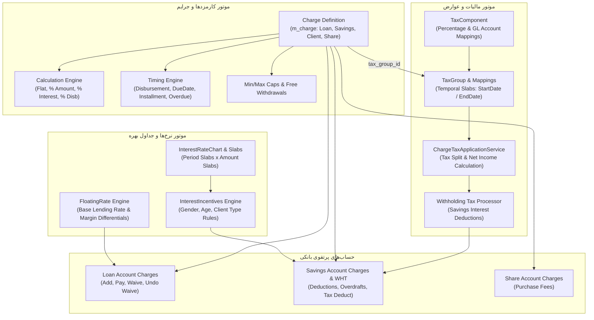

# سند استخراج نیازمندی‌های کارمزدها، مالیات و نرخ‌های بهره در Apache Fineract 1.15.0
## (Tier 3: Charges, Taxes, Floating Rates & Interest Rate Charts Requirements Specification)

---

## ۱. نمای کلی حوزه، معماری دامنه و ناورداهای بنیادین (Executive Summary & Domain Invariants)

این سند مرجع رسمی و استخراج‌شده از سورس‌کد **Apache Fineract 1.15.0** جهت پوشش جامع نیازمندی‌های عملکردی و غیرعملکردی حوزه تعرفه کارمزدها و جرایم، کسر مالیات‌های تکلیفی و ارزش افزوده، نرخ‌های شناور و جداول چندبُعدی سود و پاداش‌های تشویقی (Charges, Taxes & Rates Domain) در قالب استاندارد بین‌المللی **EARS (Easy Approach to Requirements Syntax)** به صورت دوزبانه (فارسی - انگلیسی) است.

### ارکان معماری و ماژول‌های فعال در این حوزه:
1. **موتور کارمزدها و جرایم (`fineract-charge`):** تعریف سرفصل‌های کارمزد، زمان‌بندی اعمال، روش‌های محاسبه، تعیین حداقل و حداکثر (Cap)، و سیاست برداشت‌های رایگان.
2. **زیرسیستم مالیات (`fineract-tax`):** ایجاد مؤلفه‌های مالیاتی (`TaxComponent`) با سرفصل‌های دفتر کل و گروه‌بندی آنها در قالب بسته‌های مالیاتی (`TaxGroup`) جهت کسر مالیات تکلیفی و مالیات بر کارمزد.
3. **موتور نرخ‌های شناور (`fineract-rates`):** مدیریت نرخ مبنای بهره وام (`Base Lending Rate`) و دوره‌های زمانی مؤثر نرخ‌های متغیر بانکی.
4. **سیستم جداول نرخ سود و پاداش‌ها (`fineract-savings` / `fineract-provider`):** تعریف ماتریس‌های پلکانی سود سپرده بر اساس مدت و مبلغ (`InterestRateChart` / `InterestRateChartSlab`) و اعمال داینامیک مشوق‌های جمعیتی و رفتاری مشتریان (`InterestIncentives`).
5. **ارتباط با حساب‌های عملیاتی (`fineract-loan` / `fineract-savings`):** پیاده‌سازی کارمزدهای پرونده تسهیلاتی (`LoanCharge`)، کارمزدهای سپرده (`SavingsAccountCharge`)، و کارمزدهای اعضا و سهام.

### ناورداهای ریاضی و مالی حاکم بر سیستم (Mathematical & Domain Invariants):
* **محاسبه مبلغ کارمزد در روش‌های مختلف (Charge Calculation Equations):**
  * روش مبلغ ثابت (Flat):
    $$\text{Fee} = \text{Amount}$$
  * روش درصدی از مبلغ مبنا (% of Amount):
    $$\text{Fee} = P \times \frac{r_{\text{charge}}}{100}$$
  * روش درصدی از اصل تسهیلات به علاوه سود اقساط (% of Amount + Interest):
    $$\text{Fee} = (P + I_{\text{total}}) \times \frac{r_{\text{charge}}}{100}$$
  * روش درصدی از سود تسهیلات (% of Interest):
    $$\text{Fee} = I \times \frac{r_{\text{charge}}}{100}$$
  * روش درصدی از مبلغ پرداخت‌شده ترانش (% of Disbursement Amount):
    $$\text{Fee} = D_{\text{tranche}} \times \frac{r_{\text{charge}}}{100}$$
* **اعمال سقف و کف مبالغ کارمزد (Clamping Function for Min/Max Caps):**
  $$\text{EffectiveFee} = \min\Big(\text{maxCap}, \; \max(\text{minCap}, \; \text{Fee})\Big)$$
* **فرمول کسر مالیات تکلیفی و تسهیم اجزای مالیاتی (Tax Withholding & Split Formula):**
  برای هر مؤلفه مالیاتی $k$ عضو گروه مالیاتی در تاریخ رویداد:
  $$T_k = \text{BaseAmount} \times \frac{r_{\text{tax}, k}}{100}$$
  $$\text{TotalTax} = \sum_{k=1}^m T_k, \quad \text{NetIncome} = \text{BaseAmount} - \text{TotalTax}$$
* **نرخ نهایی سود بر مبنای جدول و پاداش تشویقی (Effective Incentive Interest Rate):**
  $$r_{\text{effective}} = r_{\text{slab}} + \sum \Delta r_{\text{incentive}}$$

---

## ۲. خلاصه ماتریس نیازمندی‌ها (Requirements Index Matrix)

| شناسه نیازمندی | عنوان نیازمندی (فارسی) | الگوی EARS | کلاس و لایه سورس Fineract |
| :--- | :--- | :--- | :--- |
| **REQ-CHG-DEF-001** | تعریف جامع کارمزد و قلمرو انتساب به حساب‌های بانکی | Complex | `ChargeDefinitionCommandFromApiJsonDeserializer.java` |
| **REQ-CHG-CALC-001** | پیاده‌سازی متدهای پنج‌گانه محاسبه مبلغ کارمزد | Optional Feature | `LoanCharge.java` |
| **REQ-CHG-TIME-001** | زمان‌بندی و رویدادهای محرک اعمال کارمزدها | Complex | `Charge.java` |
| **REQ-CHG-DEF-002** | قواعد و الزامات تفکیک کارمزد عادی از جرایم تاخیر | State-Driven | `Charge.java` |
| **REQ-CHG-CAP-001** | اعمال حدود کف و سقف بر کارمزدهای درصدی | Optional Feature | `LoanCharge.java` |
| **REQ-CHG-FREE-001** | معافیت برداشت‌های رایگان و بازنشانی دوره‌ای شمارنده | Event-Driven | `Charge.java` |
| **REQ-CHG-LOAN-001** | تخصیص، تسویه و پرداخت کارمزد در پرونده تسهیلات | Event-Driven | `LoanCharge.java` |
| **REQ-CHG-LOAN-002** | بخشش کارمزد تسهیلات و ابطال بخشش قبلی | Event-Driven | `LoanCharge.java` |
| **REQ-CHG-SAV-001** | کسر کارمزد سپرده، وضعیت تعلیق و غیرفعال‌سازی | Event-Driven | `SavingsAccountCharge.java` |
| **REQ-CHG-MISC-001** | کارمزدهای سطح مشتری و کارمزد معاملات خرید سهام | Event-Driven | `ShareAccountCharge.java` |
| **REQ-TAX-COMP-001** | تعریف مؤلفه مالیاتی و اتصال به حساب‌های معین دفتر کل | Complex | `TaxValidator.java` |
| **REQ-TAX-GRP-001** | گروه‌بندی مالیاتی و مدیریت بازه‌های زمانی ناهمپوشان | Complex | `TaxValidator.java` |
| **REQ-TAX-CALC-001** | محاسبه و تسهیم مالیات بر کارمزدهای خدمات بانکی | Event-Driven | `ChargeTaxApplicationServiceImpl.java` |
| **REQ-TAX-WHT-001** | کسر اتوماتیک مالیات تکلیفی از سود سپرده‌های سرمایه‌گذاری | Event-Driven | `TaxUtils.java` |
| **REQ-FLT-DEF-001** | تعریف نرخ شناور و ناوردای انحصار نرخ مرجع وام‌دهی | State-Driven | `FloatingRateDataValidator.java` |
| **REQ-FLT-PER-001** | دوره‌های زمانی اثرگذاری نرخ شناور و حاشیه سود تفاضلی | Complex | `FloatingRate.java` |
| **REQ-CHRT-SLAB-001** | جدول ماتریسی پلکان‌های نرخ سود بر اساس مدت و مبلغ | Complex | `InterestRateChart.java` |
| **REQ-CHRT-INC-001** | اعمال پاداش‌ها و مشوق‌های نرخ سود بر اساس صفات مشتری | Event-Driven | `ClientAttributeIncentiveCalculation.java` |

---

## ۳. کاتالوگ تفصیلی کارت‌های نیازمندی به تفکیک حوزه‌ها

### بخش ۱: تعاریف پایه کارمزد و انواع محاسبات (Charge Definitions & Calculations)

#### REQ-CHG-DEF-001: تعریف جامع کارمزد و قلمرو انتساب به حساب‌های بانکی
* **الگوی EARS:** Complex
* **EARS Statement:**
  > When defining or modifying a charge master template, the Fineract Charge Engine shall mandate a unique charge name, a positive monetary amount, an ISO currency code, and an applicability scope (`chargeAppliesTo`) restricted strictly to `LOAN (1)`, `SAVINGS (2)`, `CLIENT (3)`, or `SHARES (4)`.
* **شرح نیازمندی و سناریوی بیزنس (فارسی):**
  سامانه فاینراکت نیازمند یک جدول پایه جامع (`m_charge`) جهت تعریف تمامی انواع تعرفه‌ها، کارمزدهای خدماتی، آبونمان‌ها و جرایم تاخیر است. هنگام ایجاد تعرفه جدید، مدیر سیستم موظف است نام یکتا، مبلغ یا درصد کارمزد، ارز پایه و قلمرو کاربرد کارمزد را مشخص کند. فیلد `chargeAppliesTo` تعیین می‌کند که این تعرفه صرفا بر روی کدام موجودیت بانکی (وام، سپرده پس‌انداز، پرونده مشتری، یا حساب سهام) قابلیت اعمال خواهد داشت.
* **رفتارهای ناخواسته و شروط خطا (EARS If-Then):**
  * `If the charge name parameter is blank or exceeds 100 characters, then the Fineract Charge Engine shall reject the command and return error code "validation.msg.charge.name.cannot.be.empty".`
  * `If the chargeAppliesTo value is not in the set {1, 2, 3, 4}, then the Fineract Charge Engine shall reject the request and return error code "validation.msg.charge.chargeAppliesTo.is.not.within.expected.range".`
  * `If a charge with identical name already exists in m_charge, then the Fineract Charge Engine shall reject creation with error code "error.msg.charge.duplicate.name".`
  * `If the amount parameter is null or negative, then the Fineract Charge Engine shall reject the payload and return error code "validation.msg.charge.amount.cannot.be.empty".`
* **ماتریس ردیابی به سورس‌کد (Traceability Matrix):**
  * **مسیر فایل و کلاس سورس:** `apache-fineract-src-1.15.0/fineract-charge/src/main/java/org/apache/fineract/portfolio/charge/serialization/ChargeDefinitionCommandFromApiJsonDeserializer.java`
  * **کلاس دامنه:** `apache-fineract-src-1.15.0/fineract-charge/src/main/java/org/apache/fineract/portfolio/charge/domain/Charge.java`
  * **متد اجرایی:** `#validateForCreate(String json)` و `Charge#fromJson(...)`
  * **کدهای خطا و استثناها:** `validation.msg.charge.name.cannot.be.empty`, `validation.msg.charge.chargeAppliesTo.is.not.within.expected.range`
  * **پایگاه داده و جداول:** جدول `m_charge` (ستون‌های `name`, `amount`, `currency_code`, `charge_applies_to_enum`, `is_active`)

---

#### REQ-CHG-CALC-001: پیاده‌سازی متدهای پنج‌گانه محاسبه مبلغ کارمزد
* **الگوی EARS:** Optional Feature
* **EARS Statement:**
  > Where a charge calculation method is selected, the Fineract Charge Engine shall calculate the monetary obligation strictly according to its configured type: as a static currency figure where `FLAT (1)`, as a percentage of principal balance where `PERCENT_OF_AMOUNT (2)`, as a percentage of combined principal and scheduled interest where `PERCENT_OF_AMOUNT_AND_INTEREST (3)`, as a percentage of interest where `PERCENT_OF_INTEREST (4)`, or as a percentage of disbursed capital where `PERCENT_OF_DISBURSEMENT_AMOUNT (5)`.
* **شرح نیازمندی و سناریوی بیزنس (فارسی):**
  محاسبه مبالغ کارمزد در فاینراکت انعطاف‌پذیر بوده و از ۵ الگوی محاسباتی استاندارد تبعیت می‌کند:
  ۱. **مبلغ ثابت (Flat):** مبلغ عینا همان رقم تعیین‌شده در تعرفه است.
  ۲. **درصدی از مبلغ وام/تراکنش (Percent of Amount):** درصد بر روی اصل تسهیلات یا مبلغ برداشت اعمال می‌شود.
  ۳. **درصدی از اصل و سود (Percent of Amount and Interest):** درصد بر مجموع کل اقساط اصل و سود جدول استهلاک اعمال می‌گردد.
  ۴. **درصدی از سود (Percent of Interest):** درصد صرفا بر مبلغ سود دوره یا کل سود اعمال می‌شود.
  ۵. **درصدی از مبلغ پرداخت ترانش (Percent of Disbursement Amount):** در وام‌های چندمرحله‌ای، درصد بر مبلغ هر ترانش واریزی اعمال می‌گردد.
* **رفتارهای ناخواسته و شروط خطا (EARS If-Then):**
  * `If the chargeCalculationType is not an integer from 1 through 5, then the Fineract Charge Engine shall reject the command and return error code "validation.msg.charge.chargeCalculationType.is.not.within.expected.range".`
  * `If PERCENT_OF_DISBURSEMENT_AMOUNT is selected for a charge that does not apply to LOAN, then the Fineract Charge Engine shall raise a validation error.`
* **ماتریس ردیابی به سورس‌کد (Traceability Matrix):**
  * **مسیر فایل و کلاس سورس:** `apache-fineract-src-1.15.0/fineract-loan/src/main/java/org/apache/fineract/portfolio/loanaccount/domain/LoanCharge.java`
  * **اینام دامنه:** `apache-fineract-src-1.15.0/fineract-charge/src/main/java/org/apache/fineract/portfolio/charge/domain/ChargeCalculationType.java`
  * **متد اجرایی:** `LoanCharge#percentageOf(BigDecimal value, BigDecimal percentage)`
  * **کدهای خطا و انوتیشن‌ها:** `validation.msg.charge.chargeCalculationType.is.not.within.expected.range`
  * **پایگاه داده و جداول:** جدول `m_charge` (ستون `charge_calculation_enum`), جدول `m_loan_charge` (ستون `charge_calculation_enum`)

---

#### REQ-CHG-TIME-001: زمان‌بندی و رویدادهای محرک اعمال کارمزدها
* **الگوی EARS:** Complex
* **EARS Statement:**
  > While assigning a charge timing rule (`chargeTimeType`), the Fineract Charge Engine shall trigger fee assessment strictly upon the specified lifecycle event: at initial disbursement (`DISBURSEMENT`), on a calendar due date (`SPECIFIED_DUE_DATE`), across periodic repayment installments (`INSTALMENT_FEE`), upon installment delinquency (`OVERDUE_INSTALLMENT`), during withdrawal (`WITHDRAWAL_FEE`), on account activation (`SAVINGS_ACTIVATION`), or on recurring annual or monthly intervals (`ANNUAL_FEE` / `MONTHLY_FEE`).
* **شرح نیازمندی و سناریوی بیزنس (فارسی):**
  زمان شناسایی و سررسید کارمزد توسط مشخصه `chargeTimeType` تعیین می‌گردد. برخی کارمزدها در لحظه پرداخت وام به حساب اضافه یا از مبلغ پرداختی کسر می‌شوند (`DISBURSEMENT`). کارمزدهای دارای تاریخ سررسید مشخص (`SPECIFIED_DUE_DATE`) در روز تقویمی معین وصول می‌گردند. کارمزدهای تقسیطی (`INSTALMENT_FEE`) به نسبت مساوی در تمام اقساط تسهیلات سرشکن می‌شوند. کارمزدهای سالانه یا ماهانه در دوره‌های منظم تقویمی محاسبه شده و جرایم تاخیر سررسید گذشته (`OVERDUE_INSTALLMENT`) به محض ورود قسط به وضعیت معوقه ایجاد می‌شوند.
* **رفتارهای ناخواسته و شروط خطا (EARS If-Then):**
  * `If ANNUAL_FEE is chosen without supplying valid feeOnMonth and feeOnDay values, then the Fineract Charge Engine shall reject the configuration and return error code "validation.msg.charge.feeOnMonthDay.cannot.be.empty".`
  * `If MONTHLY_FEE is chosen without specifying a positive feeInterval, then the Fineract Charge Engine shall reject the command and return error code "validation.msg.charge.feeInterval.cannot.be.empty".`
  * `If chargeTimeType is not within recognized domain enum ordinal bounds, then the Fineract Charge Engine shall reject the request and return error code "validation.msg.charge.chargeTimeType.is.not.within.expected.range".`
* **ماتریس ردیابی به سورس‌کد (Traceability Matrix):**
  * **مسیر فایل و کلاس سورس:** `apache-fineract-src-1.15.0/fineract-charge/src/main/java/org/apache/fineract/portfolio/charge/domain/Charge.java`
  * **اینام دامنه:** `apache-fineract-src-1.15.0/fineract-core/src/main/java/org/apache/fineract/portfolio/charge/domain/ChargeTimeType.java`
  * **متد اجرایی:** `ChargeDefinitionCommandFromApiJsonDeserializer#validateForCreate(String json)`
  * **کدهای خطا و استثناها:** `validation.msg.charge.feeOnMonthDay.cannot.be.empty`, `validation.msg.charge.feeInterval.cannot.be.empty`
  * **پایگاه داده و جداول:** جدول `m_charge` (ستون‌های `charge_time_enum`, `fee_on_month`, `fee_on_day`, `fee_interval`)

---

#### REQ-CHG-DEF-002: قواعد و الزامات تفکیک کارمزد عادی از جرایم تاخیر
* **الگوی EARS:** State-Driven
* **EARS Statement:**
  > While validating charge configuration parameters, the Fineract Charge Engine shall enforce that any charge configured with `chargeTimeType == DISBURSEMENT` has `penalty == false`, and shall require that any charge configured with `chargeTimeType == OVERDUE_INSTALLMENT` or `OVERDUE_ON_MATURITY` is designated with `penalty == true`.
* **شرح نیازمندی و سناریوی بیزنس (فارسی):**
  سیستم بانکی تمایز دقیقی میان کارمزدهای خدماتی (Fees) و جرایم دیرکرد (Penalties) قائل است؛ چرا که جرایم دارای احکام قانونی، اولویت‌های تسویه متفاوت و سرفصل‌های حسابداری مجزا هستند. موتور کارمزد فاینراکت ناورداهای زیر را اجباری می‌کند:
  ۱. کارمزدی که در زمان پرداخت اولیه وام سررسید می‌شود هرگز نمی‌تواند جریمه باشد (`ChargeDueAtDisbursementCannotBePenaltyException`).
  ۲. کارمزدی که بر روی اقساط معوقه یا سررسید تسهیلات محاسبه می‌شود حتماً و الزاما باید به عنوان جریمه علامت‌گذاری شده باشد (`ChargeMustBePenaltyException`).
* **رفتارهای ناخواسته و شروط خطا (EARS If-Then):**
  * `If a charge due at disbursement is flagged as a penalty, then the Fineract Charge Engine shall reject the operation and throw a "ChargeDueAtDisbursementCannotBePenaltyException" with error code "error.msg.charge.due.at.disbursement.cannot.be.penalty".`
  * `If an overdue installment charge is not flagged as a penalty, then the Fineract Charge Engine shall reject the configuration and throw a "ChargeMustBePenaltyException" with error code "error.msg.charge.must.be.penalty".`
* **ماتریس ردیابی به سورس‌کد (Traceability Matrix):**
  * **مسیر فایل و کلاس سورس:** `apache-fineract-src-1.15.0/fineract-charge/src/main/java/org/apache/fineract/portfolio/charge/domain/Charge.java`
  * **استثناهای اعتبارسنجی:** `apache-fineract-src-1.15.0/fineract-charge/src/main/java/org/apache/fineract/portfolio/charge/exception/ChargeDueAtDisbursementCannotBePenaltyException.java`, `apache-fineract-src-1.15.0/fineract-charge/src/main/java/org/apache/fineract/portfolio/charge/exception/ChargeMustBePenaltyException.java`
  * **متد اجرایی:** `Charge#validate()`
  * **پایگاه داده و جداول:** جدول `m_charge` (ستون‌های `is_penalty`, `charge_time_enum`)

---

### بخش ۲: سقف و کف، برداشت رایگان و چرخه کارمزد تسهیلات (Caps & Loan Charges)

#### REQ-CHG-CAP-001: اعمال حدود کف و سقف بر کارمزدهای درصدی
* **الگوی EARS:** Optional Feature
* **EARS Statement:**
  > Where minimum cap (`minCap`) or maximum cap (`maxCap`) limits are defined on a percentage-based charge, the Fineract Charge Engine shall constrain the computed fee amount such that it does not fall below `minCap` and does not exceed `maxCap`.
* **شرح نیازمندی و سناریوی بیزنس (فارسی):**
  در کارمزدهای درصدی، در صورتی که مبلغ وام یا تراکنش بسیار اندک یا بسیار سنگین باشد، رقم کارمزد محاسبه‌شده ممکن است غیرمنطقی گردد. بدین منظور امکان تعریف حداقل سقف مجاز (`minCap`) و حداکثر سقف مجاز (`maxCap`) در تعرفه وجود دارد. متد `minimumAndMaximumCap` در موتور کارمزد، پس از محاسبه درصد، چنانچه مبلغ از کف کمتر باشد آن را به اندازه کف افزایش داده و چنانچه از سقف بیشتر باشد آن را به اندازه سقف برش می‌دهد.
* **رفتارهای ناخواسته و شروط خطا (EARS If-Then):**
  * `If minCap is configured greater than maxCap in the charge definition payload, then the Fineract Charge Engine shall reject the configuration and return error code "validation.msg.charge.minCap.must.be.less.than.maxCap".`
  * `If minCap or maxCap is specified on a charge whose calculation type is FLAT, then the Fineract Charge Engine shall ignore the caps or return a validation warning.`
* **ماتریس ردیابی به سورس‌کد (Traceability Matrix):**
  * **مسیر فایل و کلاس سورس:** `apache-fineract-src-1.15.0/fineract-loan/src/main/java/org/apache/fineract/portfolio/loanaccount/domain/LoanCharge.java`
  * **کلاس تعریف تعرفه:** `apache-fineract-src-1.15.0/fineract-charge/src/main/java/org/apache/fineract/portfolio/charge/domain/Charge.java`
  * **متد اجرایی:** `LoanCharge#minimumAndMaximumCap(BigDecimal percentageOf)`
  * **پایگاه داده و جداول:** جدول `m_charge` (ستون‌های `min_cap`, `max_cap`), جدول `m_loan_charge` (ستون‌های `min_cap`, `max_cap`)

---

#### REQ-CHG-FREE-001: معافیت برداشت‌های رایگان و بازنشانی دوره‌ای شمارنده
* **الگوی EARS:** Event-Driven
* **EARS Statement:**
  > When a withdrawal charge with free withdrawal policy enabled (`enableFreeWithdrawalCharge == true`) is evaluated against a savings withdrawal, the Fineract Charge Engine shall waive the fee if the transaction count is within `freeWithdrawalFrequency`, shall assess the charge on subsequent withdrawals, and shall reset the count to zero upon boundary transition of the designated `restartCountFrequency`.
* **شرح نیازمندی و سناریوی بیزنس (فارسی):**
  جهت ترغیب مشتریان به استفاده از حساب‌های پس‌انداز و ابزارهای پرداخت الکترونیک، بانک‌ها ممکن است تعدادی برداشت در ماه (مثلاً ۳ برداشت اول در ماه) را از کارمزد معاف نمایند. در فاینراکت، با فعال‌سازی `enableFreeWithdrawalCharge` و تعیین سقف برداشت رایگان (`freeWithdrawalFrequency`) و دوره بازنشانی (`countFrequencyType`: ماهانه/سالانه)، سیستم تراکنش‌های برداشت را شمارش کرده و به محض رسیدن به دوره جدید، شمارنده را صفر می‌کند.
* **رفتارهای ناخواسته و شروط خطا (EARS If-Then):**
  * `If enableFreeWithdrawalCharge is true while freeWithdrawalFrequency is null or zero, then the Fineract Charge Engine shall reject the charge definition and return error code "validation.msg.charge.freeWithdrawalFrequency.cannot.be.empty".`
  * `If restartCountFrequency is missing when free withdrawal charge is enabled, then the Fineract Charge Engine shall reject the configuration and return error code "validation.msg.charge.restartCountFrequency.cannot.be.empty".`
* **ماتریس ردیابی به سورس‌کد (Traceability Matrix):**
  * **مسیر فایل و کلاس سورس:** `apache-fineract-src-1.15.0/fineract-charge/src/main/java/org/apache/fineract/portfolio/charge/domain/Charge.java`
  * **اعتبارسنج سورس:** `apache-fineract-src-1.15.0/fineract-charge/src/main/java/org/apache/fineract/portfolio/charge/serialization/ChargeDefinitionCommandFromApiJsonDeserializer.java`
  * **پایگاه داده و جداول:** جدول `m_charge` (ستون‌های `is_free_withdrawal`, `free_withdrawal_charge_frequency`, `restart_frequency`, `restart_frequency_enum`)

---

#### REQ-CHG-LOAN-001: تخصیص، تسویه و پرداخت کارمزد در پرونده تسهیلات
* **الگوی EARS:** Event-Driven
* **EARS Statement:**
  > When a charge payment transaction is executed on a loan account, the Fineract Loan Charge Engine shall reduce the outstanding balance of the designated charge, shall record tracking metadata in `m_loan_charge_paid_by`, and shall mark the charge as `paid = true` if the outstanding amount reaches zero.
* **شرح نیازمندی و سناریوی بیزنس (فارسی):**
  کارمزدهای منتسب به پرونده وام (`LoanCharge`) ممکن است به صورت مستقل توسط مشتری پرداخت شوند (`payCharge`) یا در فرآیند بازپرداخت اقساط بر اساس استراتژی تخصیص پرداخت (`AdvancedPaymentScheduleTransactionProcessor`) تسویه گردند. با واریز وجه، متد پرداخت در انتیتی کارمزد مبلغ پرداختی (`amountPaid`) را افزایش و مانده بدهی کارمزد (`amountOutstanding`) را کاهش داده و در صورت تصفیه کامل، وضعیت `paid` را فعال می‌نماید. تمامی جزئیات تسهیم در جدول `m_loan_charge_paid_by` ثبت می‌شود.
* **رفتارهای ناخواسته و شروط خطا (EARS If-Then):**
  * `If a payment amount submitted for a loan charge exceeds the current amountOutstanding of that charge, then the Fineract Loan Charge Engine shall reject the overpayment and throw a "LoanChargeCannotBePayedException".`
  * `If a user attempts to pay a charge on a closed or written-off loan, then the Fineract Loan Charge Engine shall abort the command and raise a state validation error.`
* **ماتریس ردیابی به سورس‌کد (Traceability Matrix):**
  * **مسیر فایل و کلاس سورس:** `apache-fineract-src-1.15.0/fineract-loan/src/main/java/org/apache/fineract/portfolio/loanaccount/domain/LoanCharge.java`
  * **هندلر دستور:** `apache-fineract-src-1.15.0/fineract-loan/src/main/java/org/apache/fineract/portfolio/loanaccount/handler/PayLoanChargeCommandHandler.java`
  * **متد اجرایی:** `LoanCharge#pay(MonetaryCurrency currency, BigDecimal amountPaid)`
  * **کدهای خطا و استثناها:** `LoanChargeCannotBePayedException`, `error.msg.loan.charge.cannot.be.payed`
  * **پایگاه داده و جداول:** جدول `m_loan_charge` (ستون‌های `amount_paid_derived`, `amount_outstanding_derived`, `is_paid_derived`), جدول `m_loan_charge_paid_by`

---

#### REQ-CHG-LOAN-002: بخشش کارمزد تسهیلات و ابطال بخشش قبلی
* **الگوی EARS:** Event-Driven
* **EARS Statement:**
  > When a command to waive a loan charge is executed, the Fineract Loan Charge Engine shall transition the remaining `amountOutstanding` into `amountWaived`, shall set `amountOutstanding = 0`, and shall mark the charge as `waived = true`, whereas upon receiving an undo-waive command the engine shall restore the waived amount back to `amountOutstanding` and reset `waived = false`.
* **شرح نیازمندی و سناریوی بیزنس (فارسی):**
  کاربران مجاز بانکی (نظیر رؤسای شعب یا کمیته اعتبارات) می‌توانند بنا به صلاحدید و اختیارات تفویض‌شده، کارمزد یا جریمه دیرکرد یک وام را ببخشند (`waiveCharge`). در این حالت، مانده بدهی کارمزد صفر شده و فیلد `amountWaived` معادل مانده بخشیده‌شده قرار می‌گیرد. چنانچه بخشش به اشتباه انجام شده باشد، دستور ابطال بخشش (`undoWaive`) مانده بدهی را احیا کرده و پرونده را به وضعیت قبلی بازمی‌گرداند.
* **رفتارهای ناخواسته و شروط خطا (EARS If-Then):**
  * `If a user attempts to waive a charge that is already fully paid or already waived, then the Fineract Loan Charge Engine shall reject the request and throw a "LoanChargeCannotBeWaivedException" with error code "error.msg.loan.charge.cannot.be.waived".`
  * `If undo-waive is executed on a charge that has not been waived, then the Fineract Loan Charge Engine shall abort the command and throw a "LoanChargeWaiveCannotBeReversedException".`
* **ماتریس ردیابی به سورس‌کد (Traceability Matrix):**
  * **مسیر فایل و کلاس سورس:** `apache-fineract-src-1.15.0/fineract-loan/src/main/java/org/apache/fineract/portfolio/loanaccount/domain/LoanCharge.java`
  * **هندلرهای دستور:** `apache-fineract-src-1.15.0/fineract-loan/src/main/java/org/apache/fineract/portfolio/loanaccount/handler/WaiveLoanChargeCommandHandler.java`, `apache-fineract-src-1.15.0/fineract-loan/src/main/java/org/apache/fineract/portfolio/loanaccount/handler/UndoLoanChargeWaiveCommandHandler.java`
  * **متد اجرایی:** `LoanCharge#waive(MonetaryCurrency currency, Integer loanInstallmentNumber)` و `LoanCharge#undoWaive(...)`
  * **کدهای خطا و استثناها:** `LoanChargeCannotBeWaivedException`, `LoanChargeWaiveCannotBeReversedException`
  * **پایگاه داده و جداول:** جدول `m_loan_charge` (ستون‌های `amount_waived_derived`, `is_waived_derived`, `amount_outstanding_derived`)

---

### بخش ۳: کارمزدهای سپرده، اعضا و سهام (Savings, Client & Share Charges)

#### REQ-CHG-SAV-001: کسر کارمزد سپرده، وضعیت تعلیق و غیرفعال‌سازی
* **الگوی EARS:** Event-Driven
* **EARS Statement:**
  > When a charge deduction is processed on a savings account, the Fineract Savings Charge Engine shall deduct the charge amount from available savings balance, shall create a corresponding `SAVINGS_ACCOUNT_CHARGE` transaction, and shall support waiving or inactivating recurring annual or monthly fees if the account enters a dormant or frozen status.
* **شرح نیازمندی و سناریوی بیزنس (فارسی):**
  حساب‌های سپرده مشمول انواع کارمزدها نظیر کارمزد افتتاح، آبونمان نگهداری حساب سالانه/ماهانه، و کارمزد برداشت وجه هستند (`SavingsAccountCharge`). هنگام کسر کارمزد، در صورت وجود موجودی کافی، وجه از حساب کسر و در جدول تراکنش‌های سپرده با نوع `Fee Deduction` ثبت می‌شود. در صورت عدم امکان ادامه اعمال تعرفه (مانند راکد شدن حساب)، مدیر سیستم می‌تواند کارمزد را غیرفعال (`inactivateCharge`) یا ببخشد (`waiveCharge`).
* **رفتارهای ناخواسته و شروط خطا (EARS If-Then):**
  * `If a savings account does not possess sufficient funds and overdraft is disabled, then the Fineract Savings Charge Engine shall record the charge as unpaid or reject the withdrawal fee deduction.`
  * `If a user requests waiving a savings charge that is already paid, then the Fineract Savings Charge Engine shall reject the operation and throw a "SavingsAccountChargeCannotBeWaivedException".`
* **ماتریس ردیابی به سورس‌کد (Traceability Matrix):**
  * **مسیر فایل و کلاس سورس:** `apache-fineract-src-1.15.0/fineract-savings/src/main/java/org/apache/fineract/portfolio/savings/domain/SavingsAccountCharge.java`
  * **هندلر دستور:** `apache-fineract-src-1.15.0/fineract-provider/src/main/java/org/apache/fineract/portfolio/savings/handler/PaySavingsAccountChargeCommandHandler.java`
  * **متد اجرایی:** `SavingsAccountCharge#pay(Money amountPaid)` و `SavingsAccountCharge#waive(Money amountWaived)`
  * **کدهای خطا و استثناها:** `SavingsAccountChargeCannotBeWaivedException`, `SavingsAccountChargeNotFoundException`
  * **پایگاه داده و جداول:** جدول `m_savings_account_charge` (ستون‌های `amount`, `amount_paid_derived`, `amount_waived_derived`, `amount_outstanding_derived`, `is_active`)

---

#### REQ-CHG-MISC-001: کارمزدهای سطح مشتری و کارمزد معاملات خرید سهام
* **الگوی EARS:** Event-Driven
* **EARS Statement:**
  > When processing member registration or share account transactions, the Fineract Charge Engine shall assess client charges during onboarding and shall deduct share transaction fees (`ShareAccountCharge`) during share purchase approvals, routing fee proceeds to the configured Fee Income GL account.
* **شرح نیازمندی و سناریوی بیزنس (فارسی):**
  علاوه بر وام و سپرده، فاینراکت از کارمزدهای پرونده مشتری (`ClientCharge` جهت هزینه‌های اعتبارسنجی اولیه، صدور کارت یا عضویت) و کارمزدهای حساب سهامداری اعضا (`ShareAccountCharge` جهت کارمزد نقل و انتقال و پذیره‌نویسی سهام) پشتیبانی می‌کند. در زمان تصویب خرید سهام، مبلغ کارمزد به همراه ارزش اسمی سهام از متقاضی دریافت و به حساب درآمد کارمزد دفتر کل منتقل می‌گردد.
* **رفتارهای ناخواسته و شروط خطا (EARS If-Then):**
  * `If a share account charge is created without specifying a mandatory charge definition ID, then the Fineract Charge Engine shall throw a "ShareAccountChargeWithoutMandatoryFieldException".`
  * `If client charge payment is attempted on an inactive client profile, then the Fineract Charge Engine shall reject the transaction.`
* **ماتریس ردیابی به سورس‌کد (Traceability Matrix):**
  * **مسیر فایل و کلاس سورس:** `apache-fineract-src-1.15.0/fineract-provider/src/main/java/org/apache/fineract/portfolio/shareaccounts/domain/ShareAccountCharge.java`
  * **استثنای دامنه:** `apache-fineract-src-1.15.0/fineract-charge/src/main/java/org/apache/fineract/portfolio/charge/exception/ShareAccountChargeWithoutMandatoryFieldException.java`
  * **پایگاه داده و جداول:** جدول `m_share_account_charge`, جدول `m_client_charge`, جدول `acc_gl_journal_entry`

---

### بخش ۴: سیستم مالیات و کسر مالیات‌های تکلیفی (Tax Components, Groups & Withholding)

#### REQ-TAX-COMP-001: تعریف مؤلفه مالیاتی و اتصال به حساب‌های معین دفتر کل
* **الگوی EARS:** Complex
* **EARS Statement:**
  > When configuring a tax component, the Fineract Tax Engine shall mandate a unique component name, a percentage rate between 0 and 100, an effective start date, and explicit debit and credit GL account linkage specifying valid account types and identifiers, and shall record rate adjustments into `m_tax_component_history`.
* **شرح نیازمندی و سناریوی بیزنس (فارسی):**
  مؤلفه مالیاتی (`TaxComponent`) جزء سازنده هر ساختار مالیاتی در سامانه است (مانند مالیات بر ارزش افزوده ۹٪ یا مالیات تکلیفی ۱۰٪ سود سپرده). هر مؤلفه دارای یک نرخ درصدی و تاریخ شروع اثر است. جهت ثبت خودکار اسناد حسابداری، کاربر باید حساب بدهکار (مثلا حساب دارایی یا هزینه مالیات) و حساب بستانکار (حساب بدهی مالیات پرداختنی به سازمان امور مالیاتی) را تعیین نماید. با هرگونه ویرایش نرخ، تاریخچه تغییرات در جدول `m_tax_component_history` ذخیره می‌شود.
* **رفتارهای ناخواسته و شروط خطا (EARS If-Then):**
  * `If the tax component percentage is negative or exceeds 100, then the Fineract Tax Engine shall reject the payload and return error code "validation.msg.tax.component.percentage.must.be.between.0.and.100".`
  * `If debitAccountType is specified without providing a corresponding valid debitAccountId, then the Fineract Tax Engine shall reject the configuration.`
  * `If creditAccountType is specified without providing a corresponding valid creditAccountId, then the Fineract Tax Engine shall reject the configuration.`
  * `If the component name parameter is empty, then the Fineract Tax Engine shall reject the request and return error code "validation.msg.tax.component.name.cannot.be.empty".`
* **ماتریس ردیابی به سورس‌کد (Traceability Matrix):**
  * **مسیر فایل و کلاس سورس:** `apache-fineract-src-1.15.0/fineract-tax/src/main/java/org/apache/fineract/portfolio/tax/domain/TaxComponent.java`
  * **اعتبارسنج سورس:** `apache-fineract-src-1.15.0/fineract-tax/src/main/java/org/apache/fineract/portfolio/tax/serialization/TaxValidator.java`
  * **متد اجرایی:** `TaxValidator#validateForTaxComponentCreate(String json)`
  * **کدهای خطا و استثناها:** `TaxComponentNotFoundException`, `validation.msg.tax.component.percentage.must.be.between.0.and.100`
  * **پایگاه داده و جداول:** جدول `m_tax_component` (ستون‌های `name`, `percentage`, `start_date`, `debit_account_id`, `credit_account_id`), جدول `m_tax_component_history`

---

#### REQ-TAX-GRP-001: گروه‌بندی مالیاتی و مدیریت بازه‌های زمانی ناهمپوشان
* **الگوی EARS:** Complex
* **EARS Statement:**
  > While assembling a tax group from multiple tax components, the Fineract Tax Engine shall enforce that each component mapping specifies a valid start date and shall verify that temporal date ranges for identical tax components within the group do not overlap.
* **شرح نیازمندی و سناریوی بیزنس (فارسی):**
  در نظام‌های مالیاتی، اغلب چندین جزء مالیاتی (مانند مالیات سلامت، عوارض شهرداری، مالیات بر ارزش افزوده) در قالب یک پکیج واحد بر فاکتورها یا کارمزدها اعمال می‌شوند. موجودیت `TaxGroup` مجموعه‌ای از چندین `TaxComponent` را تجمیع می‌کند. موتور مالیات موظف است در زمان تعریف گروه یا اصلاح بازه‌های زمانی، بررسی کند که برای یک مؤلفه مالیاتی خاص در درون گروه، بازه‌های تاریخی همپوشانی نداشته باشند تا از اعمال مضاعف مالیات در یک تاریخ معین پیشگیری شود.
* **رفتارهای ناخواسته و شروط خطا (EARS If-Then):**
  * `If the tax components array is empty in a TaxGroup payload, then the Fineract Tax Engine shall reject creation with error code "validation.msg.tax.group.taxComponents.cannot.be.empty".`
  * `If date ranges for the same tax component overlap within a tax group, then the Fineract Tax Engine shall reject the operation and return error code "validation.msg.tax.group.component.dates.are.overlapping".`
  * `If a tax component referenced by ID does not exist in m_tax_component, then the Fineract Tax Engine shall raise a "TaxComponentNotFoundException".`
* **ماتریس ردیابی به سورس‌کد (Traceability Matrix):**
  * **مسیر فایل و کلاس سورس:** `apache-fineract-src-1.15.0/fineract-tax/src/main/java/org/apache/fineract/portfolio/tax/domain/TaxGroup.java`
  * **کلاس نگاشت:** `apache-fineract-src-1.15.0/fineract-tax/src/main/java/org/apache/fineract/portfolio/tax/domain/TaxGroupMappings.java`
  * **اعتبارسنج سورس:** `apache-fineract-src-1.15.0/fineract-tax/src/main/java/org/apache/fineract/portfolio/tax/serialization/TaxValidator.java`
  * **متد اجرایی:** `TaxValidator#validateForTaxGroupCreate(String json)`
  * **کدهای خطا و استثناها:** `TaxGroupNotFoundException`, `validation.msg.tax.group.component.dates.are.overlapping`
  * **پایگاه داده و جداول:** جدول `m_tax_group`, جدول `m_tax_group_mappings` (ستون‌های `tax_group_id`, `tax_component_id`, `start_date`, `end_date`)

---

#### REQ-TAX-CALC-001: محاسبه و تسهیم مالیات بر کارمزدهای خدمات بانکی
* **الگوی EARS:** Event-Driven
* **EARS Statement:**
  > When a charge associated with a `TaxGroup` is assessed on a transaction, the Fineract Tax Engine shall execute `TaxUtils.splitTax` to apportion the gross charge amount across active constituent tax components based on their applicable percentages on the transaction date, and shall compute net fee income after deducting total tax liabilities.
* **شرح نیازمندی و سناریوی بیزنس (فارسی):**
  هنگامی که یک تعرفه کارمزد به یک گروه مالیاتی متصل است، مبلغ وصول‌شده از مشتری مشمول مالیات است. سرویس `ChargeTaxApplicationServiceImpl` متد `TaxUtils.splitTax` را فراخوانی می‌کند. این متد کلیه مؤلفه‌های مالیاتی فعال در تاریخ تراکنش را استخراج کرده و سهم هر یک را محاسبه می‌نماید ($T_k = \text{Amount} \times \frac{r_k}{100}$). سپس جمع مالیات از مبلغ کل کارمزد کسر شده و مبلغ خالص درآمد شناسایی‌شده (`net income`) به همراه سهم هر صندوق مالیاتی در اسناد حسابداری ثبت می‌شود.
* **رفتارهای ناخواسته و شروط خطا (EARS If-Then):**
  * `If the base amount is null or zero, then the Fineract Tax Engine shall return an empty tax breakdown map without generating tax liabilities.`
  * `If no tax components in the assigned group are active on the given transaction date, then the Fineract Tax Engine shall record zero tax amount and assign full charge value to fee income.`
* **ماتریس ردیابی به سورس‌کد (Traceability Matrix):**
  * **مسیر فایل و کلاس سورس:** `apache-fineract-src-1.15.0/fineract-tax/src/main/java/org/apache/fineract/portfolio/tax/service/ChargeTaxApplicationServiceImpl.java`
  * **کلاس محاسباتی کمکی:** `apache-fineract-src-1.15.0/fineract-tax/src/main/java/org/apache/fineract/portfolio/tax/service/TaxUtils.java`
  * **متد اجرایی:** `TaxUtils#splitTax(BigDecimal amount, LocalDate date, Set<TaxGroupMappings> taxGroupMappings, int scale)`
  * **پایگاه داده و جداول:** جدول `m_loan_charge_tax_details`, جدول `acc_gl_journal_entry`

---

#### REQ-TAX-WHT-001: کسر اتوماتیک مالیات تکلیفی از سود سپرده‌های سرمایه‌گذاری
* **الگوی EARS:** Event-Driven
* **EARS Statement:**
  > Where a savings product is configured with withholding tax enabled (`withHoldTax == true`) and linked to a `TaxGroup`, the Fineract Savings Engine shall automatically deduct withholding tax upon periodic interest posting, shall credit the designated tax liability accounts, and shall generate a dedicated `WITHHOLD_TAX` savings transaction.
* **شرح نیازمندی و سناریوی بیزنس (فارسی):**
  در بسیاری از کشورها، بانک‌ها موظف به کسر مالیات تکلیفی از سود پرداختی به حساب‌های سپرده سرمایه‌گذاری اشخاص حقیقی و حقوقی هستند. در فاینراکت، با فعال‌سازی گزینه `withHoldTax` در محصول سپرده و انتساب گروه مالیاتی مربوطه، هنگام اجرای فرآیند محاسبه و واریز سود، سیستم ابتدا مالیات را با فرمول $T = I_{\text{gross}} \times \frac{r_{\text{tax}}}{100}$ کسر نموده، سود خالص را به حساب سپرده واریز می‌کند، و یک رکورد تراکنش از نوع `WITHHOLD_TAX` به همراه اسناد دوبل متناظر بستانکارِ حساب اداره مالیات صادر می‌نماید.
* **رفتارهای ناخواسته و شروط خطا (EARS If-Then):**
  * `If withHoldTax is set to true on a savings product without assigning a taxGroupId, then the Fineract Savings Engine shall reject the product configuration and return error code "validation.msg.savingsproduct.taxGroupId.cannot.be.blank".`
  * `If the earned interest amount on a savings account is zero or negative, then the Fineract Savings Engine shall bypass withholding tax processing for that cycle.`
* **ماتریس ردیابی به سورس‌کد (Traceability Matrix):**
  * **مسیر فایل و کلاس سورس:** `apache-fineract-src-1.15.0/fineract-provider/src/main/java/org/apache/fineract/accounting/journalentry/service/AccountingProcessorHelper.java`
  * **کلاس محاسباتی:** `apache-fineract-src-1.15.0/fineract-tax/src/main/java/org/apache/fineract/portfolio/tax/service/TaxUtils.java`
  * **متد اجرایی:** `AccountingProcessorHelper#createCashBasedJournalEntriesAndReversalsForSavingsTax(...)`
  * **پایگاه داده و جداول:** جدول `m_savings_account_transaction` (ستون `transaction_type_enum`), جدول `m_savings_product` (ستون‌های `withhold_tax`, `tax_group_id`), جدول `acc_gl_journal_entry`

---

### بخش ۵: نرخ‌های شناور و نرخ مبنای وام‌دهی (Floating Interest Rates & Base Lending Rate)

#### REQ-FLT-DEF-001: تعریف نرخ شناور و ناوردای انحصار نرخ مرجع وام‌دهی
* **الگوی EARS:** State-Driven
* **EARS Statement:**
  > While creating or modifying a floating rate definition, the Fineract Rates Engine shall enforce a unique rate name up to 200 characters, and shall strictly enforce the singleton invariant that at most one active floating rate is designated as the Base Lending Rate (`isBaseLendingRate == true`) across the entire tenant.
* **شرح نیازمندی و سناریوی بیزنس (فارسی):**
  نرخ‌های شناور (`FloatingRate`) مبنای قیمت‌گذاری تسهیلات با نرخ متغیر در شرایط تورمی یا نوسانات بازار پول هستند (نظیر نرخ بهره بین‌بانکی، نرخ تورم بانک مرکزی یا لایبور). سیستم به مدیر اجازه می‌دهد نرخ شناور تعریف کند. یک ناوردای حیاتی در سامانه این است که در سطح هر سازمان/مستأجر بانکی، حداکثر یک نرخ شناور می‌تواند به عنوان «نرخ پایه وام‌دهی» (`isBaseLendingRate = true`) انتخاب شود. چنانچه کاربری اقدام به تعریف نرخ پایه دوم نماید، سیستم درخواست را رد می‌کند.
* **رفتارهای ناخواسته و شروط خطا (EARS If-Then):**
  * `If isBaseLendingRate is set to true while an active Base Lending Rate already exists in m_floating_rates, then the Fineract Rates Engine shall reject the operation and return error code "baselendingrate.duplicate".`
  * `If the floating rate name is missing, blank, or exceeds 200 characters, then the Fineract Rates Engine shall reject the command and return error code "validation.msg.floatingrate.name.cannot.be.empty".`
  * `If a floating rate with identical name already exists, then the Fineract Rates Engine shall abort persistence and return error code "error.msg.floatingrate.duplicate.name".`
* **ماتریس ردیابی به سورس‌کد (Traceability Matrix):**
  * **مسیر فایل و کلاس سورس:** `apache-fineract-src-1.15.0/fineract-rates/src/main/java/org/apache/fineract/portfolio/floatingrates/domain/FloatingRate.java`
  * **اعتبارسنج سورس:** `apache-fineract-src-1.15.0/fineract-rates/src/main/java/org/apache/fineract/portfolio/floatingrates/serialization/FloatingRateDataValidator.java`
  * **متد اجرایی:** `FloatingRateDataValidator#validateForCreate(String json)`
  * **کدهای خطا و استثناها:** `baselendingrate.duplicate`, `FloatingRateNotFoundException`
  * **پایگاه داده و جداول:** جدول `m_floating_rates` (ستون‌های `name`, `is_base_lending_rate`, `is_active`)

---

#### REQ-FLT-PER-001: دوره‌های زمانی اثرگذاری نرخ شناور و حاشیه سود تفاضلی
* **الگوی EARS:** Complex
* **EARS Statement:**
  > When defining floating rate periods in `m_floating_rates_periods`, the Fineract Rates Engine shall validate that each period defines a valid `fromDate` and a non-null `interestRate`, shall verify that `fromDate` values do not duplicate within the same rate entity, and where `isDifferentialToBaseLendingRate == true` shall compute the effective lending rate by adding the period interest rate differential to the active Base Lending Rate.
* **شرح نیازمندی و سناریوی بیزنس (فارسی):**
  یک نرخ شناور در طول زمان دستخوش تغییر می‌شود؛ لذا دارای لیستی از دوره‌ها (`FloatingRatePeriod`) است که از یک تاریخ مشخص (`fromDate`) آغاز شده و تا قبل از تاریخ دوره بعدی معتبر می‌باشند. نرخ می‌تواند به صورت نرخ اسمی مطلق تعریف شود، یا در صورت فعال بودن فلگ `isDifferentialToBaseLendingRate`، به صورت حاشیه سود تفاضلی (Margin/Spread) بر روی نرخ پایه وام‌دهی منظور گردد (مثلا نرخ پایه + ۲.۵٪). سیستم تضمین می‌کند که تاریخ‌های شروع درون یک نرخ شناور تکراری نباشند.
* **رفتارهای ناخواسته و شروط خطا (EARS If-Then):**
  * `If duplicate fromDate entries exist within the ratePeriods array of a floating rate, then the Fineract Rates Engine shall reject the payload and return error code "validation.msg.floatingrate.ratePeriods.duplicate.fromDate".`
  * `If interestRate is null or negative when isDifferentialToBaseLendingRate is false, then the Fineract Rates Engine shall reject the period configuration.`
  * `If isDifferentialToBaseLendingRate is true but no active Base Lending Rate is registered in the system, then the Fineract Rates Engine shall raise an evaluation exception during schedule generation.`
* **ماتریس ردیابی به سورس‌کد (Traceability Matrix):**
  * **مسیر فایل و کلاس سورس:** `apache-fineract-src-1.15.0/fineract-rates/src/main/java/org/apache/fineract/portfolio/floatingrates/domain/FloatingRatePeriod.java`
  * **کلاس تجمیع‌کننده:** `apache-fineract-src-1.15.0/fineract-rates/src/main/java/org/apache/fineract/portfolio/floatingrates/domain/FloatingRate.java`
  * **متد اجرایی:** `FloatingRate#getRatePeriods(JsonCommand command)`
  * **پایگاه داده و جداول:** جدول `m_floating_rates_periods` (ستون‌های `floating_rates_id`, `from_date`, `interest_rate`, `is_differential_to_base_lending_rate`)

---

### بخش ۶: جداول نرخ سود سپرده‌ها و پاداش‌های تشویقی (Interest Rate Charts & Incentives)

#### REQ-CHRT-SLAB-001: جدول ماتریسی پلکان‌های نرخ سود بر اساس مدت و مبلغ
* **الگوی EARS:** Complex
* **EARS Statement:**
  > While creating or modifying an interest rate chart for deposit products, the Fineract Rates Engine shall allow defining a multi-dimensional matrix of interest rate slabs (`InterestRateChartSlab`) indexed by period range (`fromPeriod` to `toPeriod` with unit frequency `periodType`) and amount range (`amountRangeFrom` to `amountRangeTo`), and shall validate that period boundaries do not overlap for identical amount bands.
* **شرح نیازمندی و سناریوی بیزنس (فارسی):**
  حساب‌های سپرده مدت‌دار (Term Deposits) و سپرده‌های سرمایه‌گذاری نیازمند ساختار سود پلکانی بر مبنای ماندگاری وجوه و حجم سپرده‌گذاری هستند (`InterestRateChart`). هر جدول شامل چندین پله سود (`InterestRateChartSlab`) است که در آن مشخص می‌شود اگر سپرده بین ۱ تا ۳ ماه و مبلغ بین ۱۰ تا ۵۰ میلیون ریال باشد، نرخ سود ۱۵٪ و اگر بالای ۵۰ میلیون ریال باشد ۱۷٪ خواهد بود. موتور محاسبات فاینراکت ناورداهای عدم همپوشانی بازه‌های زمانی و مبلغی را اعتبارسنجی می‌کند.
* **رفتارهای ناخواسته و شروط خطا (EARS If-Then):**
  * `If fromPeriod is greater than toPeriod within the same slab, then the Fineract Rates Engine shall reject the slab and return error code "validation.msg.interestratechart.slab.fromPeriod.must.be.less.than.toPeriod".`
  * `If amountRangeFrom is greater than amountRangeTo within the same slab, then the Fineract Rates Engine shall reject the configuration.`
  * `If consecutive slabs within the same chart share overlapping period ranges for the same amount category, then the Fineract Rates Engine shall reject the chart with error code "validation.msg.interestratechart.slab.periods.overlap".`
* **ماتریس ردیابی به سورس‌کد (Traceability Matrix):**
  * **مسیر فایل و کلاس سورس:** `apache-fineract-src-1.15.0/fineract-savings/src/main/java/org/apache/fineract/portfolio/interestratechart/domain/InterestRateChart.java`
  * **کلاس اسلب:** `apache-fineract-src-1.15.0/fineract-savings/src/main/java/org/apache/fineract/portfolio/interestratechart/domain/InterestRateChartSlab.java`
  * **متد اجرایی:** `InterestRateChartDataValidator#validateChartSlabs(...)`
  * **کدهای خطا و استثناها:** `InterestRateChartNotFoundException`, `InterestRateChartSlabNotFoundException`
  * **پایگاه داده و جداول:** جدول `m_interest_rate_chart`, جدول `m_interest_rate_chart_slab` (ستون‌های `from_period`, `to_period`, `period_type_enum`, `amount_range_from`, `amount_range_to`, `annual_interest_rate`)

---

#### REQ-CHRT-INC-001: اعمال پاداش‌ها و مشوق‌های نرخ سود بر اساس صفات مشتری
* **الگوی EARS:** Event-Driven
* **EARS Statement:**
  > When evaluating the applicable interest rate on a client deposit account, the Fineract Rates Engine shall assess defined interest incentives (`InterestIncentives`) matching client demographic attributes (including `GENDER`, `AGE`, `CLIENT_TYPE`, and `CLIENT_CLASSIFICATION`), and shall adjust the base slab interest rate by adding or subtracting the incentive margin amount where condition criteria evaluate to true.
* **شرح نیازمندی و سناریوی بیزنس (فارسی):**
  جهت اجرای برنامه‌های بازاریابی بانکی، شمول مالی و جذب سپرده‌های اقشار خاص، فاینراکت مجهز به موتور پاداش سود (`InterestIncentives`) بر روی پلکان‌های جدول نرخ است. سیستم اجازه می‌دهد قواعدی تعریف شوند که بر اساس ویژگی‌های پرونده مشتری (مانند سن بالای ۶۰ سال برای بازنشستگان، جنسیت زن، یا دسته‌بندی مشتریان ویژه VIP)، نرخ سود پایه اسلب به صورت داینامیک تعدیل شود ($r_{\text{eff}} = r_{\text{base}} \pm \Delta r$). عملگرهای مقایسه‌ای شامل مساوی، نامساوی، بزرگتر و کوچکتر هستند.
* **رفتارهای ناخواسته و شروط خطا (EARS If-Then):**
  * `If conditionType is not a valid condition operator in {EQUAL, NOT_EQUAL, LESS_THAN, LESS_THAN_OR_EQUAL, GREATER_THAN, GREATER_THAN_OR_EQUAL}, then the Fineract Rates Engine shall reject the incentive configuration.`
  * `If attributeName is AGE while attributeValue cannot be parsed into a valid integer, then the Fineract Rates Engine shall return a data validation error.`
  * `If incentiveType is configured as INCENTIVE while amount is zero, then the Fineract Rates Engine shall reject the incentive payload.`
* **ماتریس ردیابی به سورس‌کد (Traceability Matrix):**
  * **مسیر فایل و کلاس سورس:** `apache-fineract-src-1.15.0/fineract-savings/src/main/java/org/apache/fineract/portfolio/interestratechart/incentive/ClientAttributeIncentiveCalculation.java`
  * **انتیتی دامنه:** `apache-fineract-src-1.15.0/fineract-savings/src/main/java/org/apache/fineract/portfolio/interestratechart/domain/InterestIncentives.java`
  * **فیلدهای مشوق:** `apache-fineract-src-1.15.0/fineract-savings/src/main/java/org/apache/fineract/portfolio/interestratechart/domain/InterestIncentivesFields.java`
  * **متد اجرایی:** `ClientAttributeIncentiveCalculation#calculateIncentive(IncentiveDTO incentiveDTO)`
  * **پایگاه داده و جداول:** جدول `m_interest_incentives` (ستون‌های `interest_rate_slab_id`, `entiry_type`, `attribute_name`, `condition_type`, `attribute_value`, `incentive_type`, `amount`)
