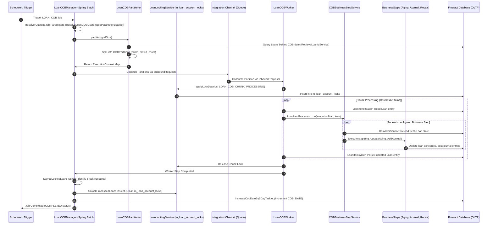

# سند استخراج نیازمندی‌های پردازش‌های پایان روز (COB) و جاب‌های دسته‌ای در Apache Fineract 1.15.0
## (Tier 4: Close of Business - COB & Batch Operations Requirements Specification)

---

## ۱. نمای کلی حوزه، معماری دامنه و ناورداهای بنیادین (Executive Summary & Domain Invariants)

این سند مرجع رسمی و استخراج‌شده از سورس‌کد **Apache Fineract 1.15.0** جهت پوشش جامع نیازمندی‌های عملکردی و غیرعملکردی زیرسیستم عملیات پایان روز (Close of Business - COB)، مدیریت افراز موازی پردازش‌های دسته‌ای (Spring Batch Partitioning)، کنترل همروندی و قفل‌گذاری بدبینانه، محاسبه تاخیرات و سناریوهای اقساط معوق، شناسایی اقلام تعهدی و استهلاک درآمدها، تغییر تاریخ‌های کاری و تقویم تعطیلات سازمانی، و موتور پایدار پایش و بازیابی جاب‌ها (Batch Job Infrastructure) در قالب استاندارد بین‌المللی **EARS (Easy Approach to Requirements Syntax)** به صورت دوزبانه (فارسی - انگلیسی) است.

### ارکان معماری و ماژول‌های فعال در این حوزه:
1. **موتور افراز و ارکستراسیون COB (`fineract-cob` / `fineract-provider`):** پیاده‌سازی مبتنی بر Spring Batch و معماری Remote Partitioning شامل `LoanCOBManagerConfiguration` به عنوان گره هماهنگ‌کننده (Manager) و `LoanCOBWorkerConfiguration` به عنوان کارگرهای پردازنده (Workers)، پشتیبانی از چندنخی (Multithreading) از طریق `ThreadPoolTaskExecutor` و ارتباط پیام‌محور از طریق کانال‌های یکپارچه‌سازی Spring Integration (`outboundRequests` / `inboundRequests`).
2. **خط‌لوله گام‌های بیزنسی قابل پیکربندی (`COBBusinessStepService` / `m_batch_business_steps`):** موتور داینامیک ثبت، بازآرایی و اجرای توالی مراحل تجاری بر روی موجودیت‌های پرتفوی بدون نیاز به کامپایل مجدد، با قابلیت تفکیک خطا و بارگذاری مجدد حالت موجودیت (`ReloaderService#reload`).
3. **زیرسیستم قفل‌گذاری و ممانعت از تداخل همروندی (`m_loan_account_locks` / `LoanLockingService`):** استراتژی قفل‌گذاری بدبینانه (Pessimistic Locking) بر روی پرونده‌های تسهیلاتی فعال، رد درخواست‌های هم‌زمان کاربران در لایه فیلتر وب (`LoanCOBApiFilter`) با خطای عدم امکان لغو قفل (`AccountLockCannotBeOverruledException`)، و اجرای جبرانی برخط (`InlineLoanCOBExecutorService`) برای حساب‌های عقب‌افتاده از تاریخ تقویمی سیستم.
4. **موتور فرسودگی معوقات و طبقه‌بندی مطالبات (`m_loan_arrears_aging` / `DelinquencyClassification`):** محاسبه روزانه روزهای تاخیر (Days Past Due - DPD)، تفکیک اقلام اصل، سود، کارمزد و جرایم معوق، اعمال کارمزدهای تاخیر (`ApplyChargeToOverdueLoansBusinessStep`)، انطباق با بازه‌های دسته‌بندی بدهی و اعمال مکث موقت در فرآیند معوقات (`LoanDelinquencyAction`).
5. **موتور مالی و حسابداری تعهدی پایان روز (`LoanAccrualsProcessingService` / `Amortization`):** شناسایی دوره‌ای سود و کارمزدهای تعهدی (`AddPeriodicAccrualEntriesBusinessStep`)، بازحساب مرکب بهره (`LoanInterestRecalculationCOBBusinessStep`)، و استهلاک مستقیم روزانه کارمزدهای خرید، تخفیف و درآمدهای سرمایه‌ای (`BuyDownFeeAmortizationBusinessStep` / `DiscountFeeAmortizationBusinessStep`).
6. **موتور زمان، تقویم کاری و جابجایی سررسید اقساط (`m_business_date` / `m_holiday` / `m_working_days`):** ارتقای یکنواخت و انحصاری تاریخ تجاری سیستم ($t+1$)، تنظیم قواعد روزهای کاری (استراتژی‌های پنج‌گانه تغییر سررسید اقساط) و اعمال دسته‌ای تعطیلات بر برنامه‌های بازپرداخت شعب (`ApplyHolidaysToLoansTasklet`).
7. **زیرساخت پایش، پایدارسازی و بازیابی جاب‌ها (`job` / `job_run_history` / `batch_custom_job_parameters`):** قفل انحصاری توزیع‌شده با Resilience4j Retry، ثبت تاریخچه دقیق اجرا، بازیابی جاب‌های معلق (`StuckJobExecutorServiceImpl`)، و تسویه دسته‌ای جبرانی چندروزه (`LoanCOBCatchUpService`).

### ناورداهای ریاضی و مالی حاکم بر سیستم (Mathematical & Domain Invariants):

* **شرط اتمام کامل فرآیند پایان روز (COB Completion Invariant):**
  فرآیند COB تنها در صورتی برای تاریخ تجاری هدف ($T_{\text{target}}$) تکمیل‌شده تلقی می‌گردد که تمام حساب‌های فعال بدون قفل خطا به تاریخ روز رسانده شوند:
  $$\forall a \in \mathcal{A}_{\text{active}}, \quad \text{LastClosedBusinessDate}(a) = T_{\text{target}}$$

* **ناوردای حالات قفل پرونده بانکی (Locking State Space Invariant):**
  در هر لحظه از زمان، وضعیت قفل یک حساب تسهیلاتی $a$ اکیداً عضو یکی از وضعیت‌های زیر در پایگاه داده است:
  $$\text{LockState}(a) \in \{\text{UNLOCKED}, \; \text{LOAN\_COB\_CHUNK\_PROCESSING}, \; \text{LOAN\_INLINE\_COB\_PROCESSING}\}$$
  به طوری که:
  $$\text{IsAccessibleByAPI}(a) \iff \text{LockState}(a) = \text{UNLOCKED} \;\lor\; \big(\text{LockState}(a) \neq \text{UNLOCKED} \land \text{HasError}(a) \land \text{IsBypassUser}()\big)$$

* **معادله محاسبه تاخیر سررسید گذشته (Days Past Due - DPD Equation):**
  تعداد روزهای تاخیر یک پرونده تسهیلاتی در پایان روز برابر است با تفاصل تاریخ جاری بیزنس از قدیمی‌ترین قسط پرداخت‌نشده با کسر مهلت تنفس معوقات:
  $$\text{OverdueDays} = \max\left(0, \; \text{CurrentBusinessDate} - \min_{i \in \text{Unpaid}} \text{DueDate}(i) - \text{GraceOnArrears}\right)$$
  که در آن:
  $$\text{Unpaid} = \left\{i \in \text{Installments} \mid \text{CompletedDerived}(i) = \text{false} \land \text{DueDate}(i) < \text{CurrentBusinessDate} - \text{GraceOnArrears}\right\}$$

* **تجزیه تعهدی اقلام معوقات (Overdue Decomposition Invariant):**
  مبلغ کل بدهی معوق پرونده تسهیلاتی عینا برابر با مجموع اجزای چهارگانه مطالبات سررسیدگذشته است:
  $$\text{TotalOverdue} = \text{PrincipalOverdue} + \text{InterestOverdue} + \text{FeeOverdue} + \text{PenaltyOverdue}$$
  $$\text{PrincipalOverdue} = \sum_{i \in \text{Unpaid}} \Big(\text{Principal}(i) - \text{PrincipalPaid}(i) - \text{PrincipalWrittenOff}(i)\Big)$$
  $$\text{InterestOverdue} = \sum_{i \in \text{Unpaid}} \Big(\text{Interest}(i) - \text{InterestPaid}(i) - \text{InterestWaived}(i) - \text{InterestWrittenOff}(i)\Big)$$

* **ناوردای ارتقای یکنواخت تاریخ بیزنس (Business Date Monotonic Progression Invariant):**
  تاریخ بیزنس سیستم و تاریخ COB در گام‌های شبانه همواره به صورت یک‌روزه و اکیداً صعودی تغییر می‌یابند:
  $$\text{BusinessDate}_{t+1} = \text{BusinessDate}_t + 1 \text{ day}$$
  $$\text{COBDate}_{t+1} = \text{BusinessDate}_{t+1} - 1 \text{ day} = \text{BusinessDate}_t$$

* **تابع تنظیم سررسید در روزهای تعطیل و کاری (Working Day Due Date Adjustment Function):**
  برای یک قسط با تاریخ سررسید اولیه $d$ تحت استراتژی انتقال به روز کاری بعد (`MOVE_TO_NEXT_WORKING_DAY`):
  $$\text{AdjustDueDate}(d) = \min \big\{d' \ge d \;\big|\; \text{IsWorkingDay}(d') = \text{true} \;\land\; \text{IsHoliday}(d', \text{OfficeId}) = \text{false}\big\}$$

---

## ۲. خلاصه ماتریس نیازمندی‌ها (Requirements Index Matrix)

| شناسه نیازمندی | عنوان نیازمندی (فارسی) | الگوی EARS | کلاس و لایه سورس Fineract |
| :--- | :--- | :--- | :--- |
| **REQ-COB-ORCH-001** | افراز موازی و توزیع‌شده داده‌های پرتفوی در فرآیند COB | Complex | `LoanCOBPartitioner.java` / `CommonPartitioner.java` |
| **REQ-COB-ORCH-002** | خط‌لوله گام‌های بیزنسی قابل پیکربندی و ترتیب اجرای مراحل | Complex | `COBBusinessStepServiceImpl.java` |
| **REQ-COB-ORCH-003** | جداسازی خطای گام‌های بیزنسی، بارگذاری مجدد موجودیت و رویدادهای تجمیعی | Event-Driven | `COBBusinessStepServiceImpl.java` |
| **REQ-COB-ORCH-004** | مدیریت پارتیشن‌های پویا و توقف زودهنگام در صورت فقدان گام فعال | State-Driven | `CommonPartitioner.java` |
| **REQ-COB-LOCK-001** | قفل‌گذاری بدبینانه حساب‌های تسهیلات در چرخه پردازش COB | State-Driven | `LoanLockingServiceImpl.java` / `AbstractLockingService.java` |
| **REQ-COB-LOCK-002** | مسدودسازی تراکنش‌های وب و خطای تداخل قفل با عدم امکان لغو | Unwanted Behavior | `LoanCOBApiFilter.java` / `LoanCOBFilterHelperImpl.java` |
| **REQ-COB-LOCK-003** | پردازش همگام‌سازی برخط تسهیلات عقب‌افتاده از تاریخ بیزنس | Event-Driven | `InlineLoanCOBExecutorServiceImpl.java` |
| **REQ-COB-LOCK-004** | آزادسازی قفل‌ها، پایش حساب‌های مسدودمانده و امتیازات کاربر مجاز | Complex | `UnlockProcessedLoansTasklet.java` / `StayedLockedLoansTasklet.java` |
| **REQ-COB-DLQ-001** | محاسبه روزانه روزهای تاخیر و فرسودگی معوقات تسهیلات | State-Driven | `LoanArrearsAgeingUpdateHandler.java` |
| **REQ-COB-DLQ-002** | دسته‌بندی و طبقه‌بندی بازه‌های مطالبات غیرجاری در COB | Event-Driven | `SetLoanDelinquencyTagsBusinessStep.java` |
| **REQ-COB-DLQ-003** | اعمال اتوماتیک کارمزدها و جرایم تاخیر اقساط معوق در پایان روز | Event-Driven | `ApplyChargeToOverdueLoansBusinessStep.java` |
| **REQ-COB-DLQ-004** | پایش اقساط در شرف سررسید و سررسیدگذشته جهت انتشار رویدادها | State-Driven | `CheckLoanRepaymentOverdueBusinessStep.java` |
| **REQ-COB-FIN-001** | شناسایی و ثبت روزانه اسناد حسابداری تعهدی سود و کارمزد | State-Driven | `AddPeriodicAccrualEntriesBusinessStep.java` |
| **REQ-COB-FIN-002** | ثبت رویدادهای حسابداری تعهدی در تاریخ سررسید قسط | Event-Driven | `AccrualActivityPostingBusinessStep.java` |
| **REQ-COB-FIN-003** | بازحساب داینامیک بهره تسهیلات با بهره متغیر و ترکیبی | Event-Driven | `LoanInterestRecalculationCOBBusinessStep.java` |
| **REQ-COB-FIN-004** | خط‌لوله استهلاک روزانه کارمزدهای خرید، تخفیف و درآمدهای سرمایه‌ای | State-Driven | `BuyDownFeeAmortizationBusinessStep.java` |
| **REQ-COB-DATE-001** | ناوردای افزایش یک‌روزه تاریخ بیزنس و هماهنگی تاریخ COB | Ubiquitous | `IncreaseBusinessDateBy1DayTasklet.java` / `IncreaseCobDateBy1DayTasklet.java` |
| **REQ-COB-DATE-002** | تنظیم تقویم روزهای کاری و استراتژی‌های پنج‌گانه تغییر سررسید اقساط | Optional Feature | `WorkingDays.java` / `RepaymentRescheduleType.java` |
| **REQ-COB-DATE-003** | تعریف تعطیلات رسمی، انتساب به ساختار شعب و چرخه حیات وضعیت‌ها | Complex | `Holiday.java` |
| **REQ-COB-DATE-004** | اعمال دسته‌ای تعطیلات بر جداول اقساط و بازتنظیم سررسید وام‌ها | Event-Driven | `ApplyHolidaysToLoansTasklet.java` |
| **REQ-COB-JOB-001** | ثبت جاب‌های دسته‌ای، زمان‌بندی کرون و انحصار اجرای ناشی از قفل بدبینانه | Complex | `SchedularWritePlatformServiceJpaRepositoryImpl.java` |
| **REQ-COB-JOB-002** | پارامترسازی منعطف و ثبت کامل تاریخچه عملکرد اجرای جاب‌ها | Event-Driven | `CustomJobParameterRepositoryImpl.java` / `ScheduledJobRunHistory.java` |
| **REQ-COB-JOB-003** | تشخیص و بازیابی جاب‌های معلق و اجرای مجدد خودکار | Complex | `StuckJobExecutorServiceImpl.java` |
| **REQ-COB-JOB-004** | فرآیند جبرانی COB سراسری برای دوره‌های معوقه چندروزه | Complex | `CommonCOBCatchUpService.java` / `LoanCOBCatchUpServiceImpl.java` |

---

## ۳. کاتالوگ تفصیلی کارت‌های نیازمندی به تفکیک حوزه‌ها

### بخش ۱: ارکستراسیون، افراز توزیع‌شده و خط‌لوله گام‌های بیزنسی COB (COB Orchestration, Remote Partitioning & Step Pipeline)

#### REQ-COB-ORCH-001: افراز موازی و توزیع‌شده داده‌های پرتفوی در فرآیند COB
* **الگوی EARS:** Complex
* **EARS Statement:**
  > While initiating the Close of Business batch execution for loan accounts, the Fineract COB Partitioning Engine shall dynamically split eligible active loan records into balanced partitions based on configured partition size, dispatch partition contexts via Spring Integration outbound messaging channels to worker nodes, execute chunk processing within worker steps using a bounded thread pool, and retry failed operations up to the configured retry threshold before marking partitions as skipped or failed.
* **شرح نیازمندی و سناریوی بیزنس (فارسی):**
  فرآیند پایان روز در بانکداری مقیاس‌پذیر نیازمند پردازش حجم انبوهی از تسهیلات فعال در کمترین پنجره زمانی ممکن است. کلاس `LoanCOBPartitioner` با ارث‌بری از `CommonPartitioner`، تعداد تسهیلاتی را که تاریخ بسته‌شدن آن‌ها قبل از تاریخ COB جاری است استخراج کرده و آن‌ها را بر اساس اندازه پارتیشن (`partitionSize`) به بخش‌های مساوی تقسیم می‌کند. سپس `LoanCOBManagerConfiguration` با استفاده از `RemotePartitioningManagerStepBuilderFactory` این پارتیشن‌ها را از طریق کانال `outboundRequests` به نودهای پردازشگر (`LoanCOBWorkerConfiguration`) ارسال می‌نماید. در سمت کارگر، هر گام کاری در قالب تکه‌های اطلاعاتی (`Chunk`) پردازش شده و نخ‌های اجرایی با الگوی `ThreadPoolTaskExecutor` (دارای پیشوند `COB-Thread-`) به صورت موازی عملیات را هدایت می‌کنند. همچنین در صورت بروز خطاهای گذرا، مکانیسم `faultTolerant().retry(Exception.class)` با سقف تکرار مجاز فعال می‌گردد.
* **رفتارهای ناخواسته و شروط خطا (EARS If-Then):**
  * `If no business steps are configured for the LOAN_COB job name in m_batch_business_steps, then the Fineract COB Partitioning Engine shall abort execution, invoke jobOperator.stop(jobId), and return an empty partition map.`
  * `If a worker thread encounters an unrecoverable database connectivity failure exceeding retryLimit, then the Fineract COB Partitioning Engine shall mark the step execution as FAILED and record the root cause in the step execution context.`
* **ماتریس ردیابی به سورس‌کد (Traceability Matrix):**
  * **مسیر فایل و کلاس سورس:** `apache-fineract-src-1.15.0/fineract-provider/src/main/java/org/apache/fineract/cob/loan/LoanCOBPartitioner.java`
  * **کلاس‌های مرتبط:** `LoanCOBManagerConfiguration.java`, `LoanCOBWorkerConfiguration.java`, `CommonPartitioner.java`
  * **متد اجرایی:** `LoanCOBPartitioner#partition(int gridSize)` و `CommonPartitioner#getPartitions(int partitionSize, Set<BusinessStepNameAndOrder> cobBusinessSteps)`
  * **انوتیشن‌ها و کدهای سیستم:** `@EnableBatchIntegration`, `@Conditional(BatchManagerCondition.class)`, `@StepScope`
  * **پایگاه داده و جداول:** جداول `m_loan`, `batch_job_execution`, `batch_step_execution`, `m_batch_business_steps`

---

#### REQ-COB-ORCH-002: خط‌لوله گام‌های بیزنسی قابل پیکربندی و ترتیب اجرای مراحل
* **الگوی EARS:** Complex
* **EARS Statement:**
  > While processing loan accounts through the COB pipeline, the Fineract Business Step Engine shall resolve active business steps registered for the job from the configuration repository, sort the execution sequence strictly in ascending order of configured step order indices, and execute each business step sequentially against the loan account.
* **شرح نیازمندی و سناریوی بیزنس (فارسی):**
  انعطاف‌پذیری سیستم بانکی ایجاب می‌کند که مؤسسات مالی بتوانند ترتیب یا حضور مراحل مختلف پایان روز (مانند اعمال جریمه، فرسودگی معوقات، بازحساب سود، یا شناسایی تعهدی) را بدون تغییر در کد برنامه سفارشی‌سازی کنند. کلاس `COBBusinessStepServiceImpl` از طریق جدول `m_batch_business_steps` تمامی گام‌های تعریف‌شده برای نام جاب را خوانده و با استفاده از رابط برنامه‌نویسی REST (`ConfigureBusinessStepApiResource`) امکان مشاهده (`/v1/jobs/{jobName}/steps`) و به‌روزرسانی اولویت مراحل (`PUT /v1/jobs/{jobName}/steps`) را با اعتبارسنجی یکتایی و عدم تداخل ترتیب گام‌ها فراهم می‌سازد. ترتیب اجرا بر اساس فیلد عددی `step_order` در قالب ساختار مرتب `TreeMap<Long, String>` تضمین می‌شود.
* **رفتارهای ناخواسته و شروط خطا (EARS If-Then):**
  * `If the executionMap supplied to the business step runner is null or empty, then the Fineract Business Step Engine shall throw a BusinessStepException with message "Execution map is empty! COB Business step execution skipped!".`
  * `If a configured business step bean cannot be resolved within the Spring ApplicationContext, then the Fineract Business Step Engine shall abort pipeline execution and raise a BusinessStepException wrapping the NoSuchBeanDefinitionException.`
  * `If an administrator submits a step update request containing duplicate step orders or invalid step names, then the Fineract Business Step Engine shall reject the API command with a validation exception.`
* **ماتریس ردیابی به سورس‌کد (Traceability Matrix):**
  * **مسیر فایل و کلاس سورس:** `apache-fineract-src-1.15.0/fineract-cob/src/main/java/org/apache/fineract/cob/COBBusinessStepServiceImpl.java`
  * **کلاس‌ها و کنترلرها:** `ConfigureBusinessStepApiResource.java`, `BatchBusinessStepRepository.java`, `BatchBusinessStep.java`
  * **متد اجرایی:** `COBBusinessStepServiceImpl#run(TreeMap<Long, String> executionMap, S item)` و `#getCOBBusinessSteps(...)`
  * **کدهای خطا و انوتیشن‌ها:** `BusinessStepException`, `@Service`, `@RequiredArgsConstructor`
  * **پایگاه داده و جداول:** جدول `m_batch_business_steps` (ستون‌های `job_name`, `step_name`, `step_order`)

---

#### REQ-COB-ORCH-003: جداسازی خطای گام‌های بیزنسی، بارگذاری مجدد موجودیت و رویدادهای تجمیعی
* **الگوی EARS:** Event-Driven
* **EARS Statement:**
  > When a business step is invoked within the COB pipeline, the Fineract Business Step Engine shall set the thread action context to COB, reload a fresh entity instance from the persistence store via the reloader service prior to step execution, isolate internal business events within a bulk event recording session if bulk events are enabled, and rollback pending external event notifications if any business step execution fails.
* **شرح نیازمندی و سناریوی بیزنس (فارسی):**
  در طول اجرای گام‌های متوالی بر روی یک وام، ممکن است یک گام تغییراتی در وضعیت اقساط یا مانده‌ها ایجاد کند. جهت جلوگیری از بروز پدیده داده‌های کهنه (Stale State / Non-repeatable Reads)، کلاس `COBBusinessStepServiceImpl` قبل از واگذاری کنترل به هر `businessStepBean`، متد `reloaderService.reload(item)` را فراخوانی کرده تا آخرین نسخه معتبر موجودیت از دیتابیس واکشی شود. علاوه بر این، چنانچه قابلیت رویدادهای تجمیعی خارجی (`isCOBBulkEventEnabled`) فعال باشد، سیستم ضبط رویدادها را در ابتدای چرخه آغاز (`startExternalEventRecording`) و در پایان متوقف می‌کند؛ اما در صورت بروز هرگونه خطا در حین اجرای گام، با فراخوانی `resetEventRecording` از نشت رویدادهای نامعتبر به سامانه رویدادنگاری جلوگیری به عمل می‌آورد.
* **رفتارهای ناخواسته و شروط خطا (EARS If-Then):**
  * `If any unhandled exception occurs during the execution of a business step, then the Fineract Business Step Engine shall reset external event recording, restore the ActionContext to COB, and throw a BusinessStepException wrapping the underlying failure.`
  * `If the reloader service fails to retrieve the persistent entity by its primary key, then the Fineract Business Step Engine shall fail the step execution immediately.`
* **ماتریس ردیابی به سورس‌کد (Traceability Matrix):**
  * **مسیر فایل و کلاس سورس:** `apache-fineract-src-1.15.0/fineract-cob/src/main/java/org/apache/fineract/cob/COBBusinessStepServiceImpl.java`
  * **سرویس‌های کمکی:** `ReloaderService.java`, `BusinessEventNotifierService.java`, `ThreadLocalContextUtil.java`
  * **متد اجرایی:** `COBBusinessStepServiceImpl#run(TreeMap<Long, String> executionMap, S item)`
  * **کدهای خطا و انوتیشن‌ها:** `BusinessStepException`, `ActionContext.COB`
  * **پایگاه داده و جداول:** جدول `m_loan`, جدول `m_batch_business_steps`

---

#### REQ-COB-ORCH-004: مدیریت پارتیشن‌های پویا و توقف زودهنگام در صورت فقدان گام فعال
* **الگوی EARS:** State-Driven
* **EARS Statement:**
  > While partitioning loan accounts for batch execution, the Fineract Partitioning Engine shall stop the running job execution via the job operator if the configured business steps set is empty, and shall create at least one placeholder partition containing zero loan counts if no eligible loan accounts require processing for the current business date.
* **شرح نیازمندی و سناریوی بیزنس (فارسی):**
  کلاس پایه `CommonPartitioner` پایداری چرخه افراز را تضمین می‌کند. در صورتی که مدیر سیستم تمامی گام‌های تجاری جاب را غیرفعال کرده باشد، ادامه پردازش بیهوده بوده و سیستم بلافاصله با فراخوانی متد `stopJobExecution()` وضعیت جاب در `JobOperator` را متوقف می‌نماید. در نقطه مقابل، چنانچه گام‌های بیزنسی معتبر باشند اما هیچ پرونده وامی در سامانه نیاز به بسته‌شدن پایان روز نداشته باشد (مثلاً تمامی وام‌ها به‌روز باشند)، سیستم به منظور حفظ یکپارچگی خط‌لوله Spring Batch و تکمیل موفقیت‌آمیز گام‌های بعدی منیجر، دقیقاً یک پارتیشن فرضی با شناسه و شمارش صفر (`new COBPartition(0L, 0L, 1L, 0L)`) تولید می‌کند.
* **رفتارهای ناخواسته و شروط خطا (EARS If-Then):**
  * `If jobOperator.stop(jobId) throws NoSuchJobExecutionException or JobExecutionNotRunningException during an empty-step abort, then the Fineract Partitioning Engine shall log an error and throw a RuntimeException.`
  * `If the retrieve ID service encounters a database timeout during partition query retrieval, then the Fineract Partitioning Engine shall propagate the DataAccessException to trigger batch retry.`
* **ماتریس ردیابی به سورس‌کد (Traceability Matrix):**
  * **مسیر فایل و کلاس سورس:** `apache-fineract-src-1.15.0/fineract-cob/src/main/java/org/apache/fineract/cob/common/CommonPartitioner.java`
  * **کلاس‌های مرتبط:** `RetrieveLoanIdService.java`, `COBPartition.java`, `BusinessDateResolver.java`
  * **متد اجرایی:** `CommonPartitioner#getPartitions(int partitionSize, Set<BusinessStepNameAndOrder> cobBusinessSteps)`
  * **کدهای خطا و استثناها:** `NoSuchJobExecutionException`, `JobExecutionNotRunningException`
  * **پایگاه داده و جداول:** جداول `m_loan`, `batch_job_execution`

---

### بخش ۲: قفل‌گذاری بدبینانه، کنترل همروندی و همگام‌سازی برخط (Loan Account Locking, Concurrency Control & Inline COB)

#### REQ-COB-LOCK-001: قفل‌گذاری بدبینانه حساب‌های تسهیلات در چرخه پردازش COB
* **الگوی EARS:** State-Driven
* **EARS Statement:**
  > While executing a loan COB worker partition, the Fineract Locking Service shall acquire a pessimistic lock on every loan account in the partition by inserting a lock record into the loan account locks table with lock owner set to LOAN_COB_CHUNK_PROCESSING, incrementing the lock version, and recording the audit timestamp and current COB business date.
* **شرح نیازمندی و سناریوی بیزنس (فارسی):**
  برای تضمین صحت اطلاعات مالی و جلوگیری از تغییر وضعیت مانده وام‌ها در حین پردازش پایان روز توسط تراکنش‌های موازی کاربران، سامانه از جدول اختصاصی `m_loan_account_locks` استفاده می‌کند. قبل از ورود پردازشگر به هر پارتیشن یا تکه داده، کلاس `LoanLockingServiceImpl` (مشتق از `AbstractLockingService`) دستور درج دسته‌ای (`BATCH_LOAN_LOCK_INSERT`) را اجرا می‌کند. در این دستور، شناسه وام، شماره نسخه اولیه (۱)، نوع مالکیت قفل (`LOAN_COB_CHUNK_PROCESSING`)، زمان درج قفل و تاریخ تجاری COB جاری ثبت می‌گردد. در صورت ارتقای قفل، نسخه رکورد یک واحد افزایش یافته و مالک جدید جایگزین می‌شود.
* **رفتارهای ناخواسته و شروط خطا (EARS If-Then):**
  * `If an account lock insert fails due to a unique constraint violation on loan_id, then the Fineract Locking Service shall treat the loan as already locked by another process and raise a LoanAccountWasAlreadyLockedOrProcessed exception.`
  * `If the database connection is interrupted during batch lock insertion, then the transaction shall rollback and the worker partition shall re-attempt lock acquisition according to retry configuration.`
* **ماتریس ردیابی به سورس‌کد (Traceability Matrix):**
  * **مسیر فایل و کلاس سورس:** `apache-fineract-src-1.15.0/fineract-provider/src/main/java/org/apache/fineract/cob/loan/LoanLockingServiceImpl.java`
  * **کلاس پایه و دامنه:** `AbstractLockingService.java`, `LoanAccountLock.java`, `LockOwner.java`
  * **متد اجرایی:** `AbstractLockingService#applyLock(List<Long> loanIds, LockOwner lockOwner)` و `#upgradeLock(...)`
  * **کدهای خطا و انوتیشن‌ها:** `LoanAccountWasAlreadyLockedOrProcessed`, `LockOwner.LOAN_COB_CHUNK_PROCESSING`
  * **پایگاه داده و جداول:** جدول `m_loan_account_locks` (ستون‌های `loan_id`, `version`, `lock_owner`, `lock_placed_on`, `lock_placed_on_cob_business_date`, `error`)

---

#### REQ-COB-LOCK-002: مسدودسازی تراکنش‌های وب و خطای تداخل قفل با عدم امکان لغو
* **الگوی EARS:** Unwanted Behavior
* **EARS Statement:**
  > If an incoming HTTP POST, PUT, or DELETE request targets a loan account that is currently hard-locked by batch COB chunk processing without recorded errors, then the Fineract API Gateway Filter shall reject the request, return HTTP status 409 Conflict, and emit an error response indicating that the loan account is locked.
* **شرح نیازمندی و سناریوی بیزنس (فارسی):**
  فیلتر امنیتی `LoanCOBApiFilter` (مشتق از `COBApiFilter`) تمامی درخواست‌های ورودی وب تغییردهنده وضعیت (POST, PUT, DELETE) را که مسیر آن‌ها با الگوهای وامی (`/v1/loans/{id}`, `/v1/rescheduleloans/{id}`, `/v1/loans/glimAccount/{id}`) منطبق است شنود می‌کند. متد `calculateRelevantLoanIds` شناسه وام‌ها را از مسیر یا بدنه درخواست استخراج می‌کند. چنانچه حسابی در جدول `m_loan_account_locks` دارای قفل سخت معتبر بدون خطا (`error IS NULL`) باشد و کاربر جاری دارای پرچم دورزدن قفل (`isBypassUser() == false`) نباشد، استثنای `LoanIdsHardLockedException` ایجاد شده و فیلتر وب پاسخ خطای استاندارد JSON (`ApiGlobalErrorResponse.loanIsLocked(loanId)`) را همراه با کد وضعیت HTTP 409 Conflict به کاربر بازمی‌گرداند.
* **رفتارهای ناخواسته و شروط خطا (EARS If-Then):**
  * `If the request attempts to modify a loan locked with an active non-overrulable lock, then the Fineract API Gateway Filter shall return HTTP 409 with payload message "error.msg.loan.locked".`
  * `If an unauthenticated request attempts to access a locked loan resource, then the Fineract API Gateway Filter shall raise an AuthenticationCredentialsNotFoundException.`
* **ماتریس ردیابی به سورس‌کد (Traceability Matrix):**
  * **مسیر فایل و کلاس سورس:** `apache-fineract-src-1.15.0/fineract-provider/src/main/java/org/apache/fineract/infrastructure/jobs/filter/COBApiFilter.java`
  * **کلاس‌های پیاده‌سازی:** `LoanCOBApiFilter.java`, `LoanCOBFilterHelperImpl.java`, `LoanIdsHardLockedException.java`
  * **متد اجرایی:** `COBApiFilter#doFilterInternal(...)` و `LoanCOBFilterHelperImpl#calculateRelevantLoanIds(...)`
  * **کدهای وضعیت و خطا:** `HttpStatus.SC_CONFLICT (409)`, `error.msg.loan.locked`
  * **پایگاه داده و جداول:** جدول `m_loan_account_locks`

---

#### REQ-COB-LOCK-003: پردازش همگام‌سازی برخط تسهیلات عقب‌افتاده از تاریخ بیزنس
* **الگوی EARS:** Event-Driven
* **EARS Statement:**
  > When an authorized API request accesses a loan account whose last closed business date lags behind the current system COB date, the Fineract Inline COB Executor shall acquire an inline processing lock with owner LOAN_INLINE_COB_PROCESSING, execute the inline COB job sequentially for each lagging calendar day until caught up to the COB business date, and release the lock upon successful completion.
* **شرح نیازمندی و سناریوی بیزنس (فارسی):**
  هنگامی که کاربری قصد دارد بر روی وامی که از فرآیند پایان روزهای گذشته جا مانده است تراکنشی (مانند بازپرداخت یا تغییر وضعیت) ثبت کند، فیلتر `LoanCOBApiFilter` از طریق متد `isLoanBehind` متوجه عقب‌ماندگی تاریخ وام می‌شود. سپس متد `helper.executeInlineCob(loanIds)` کنترل را به سرویس `InlineLoanCOBExecutorServiceImpl` واگذار می‌کند. این سرویس ابتدا وام را با قفل `LOAN_INLINE_COB_PROCESSING` مسدود کرده و در یک حلقه روزبه‌روز (`while (!isAfter(executingBusinessDate, cobBusinessDate))`) جاب دسته‌ای `inlineLoanCOBJob` را به ازای تک تک روزهای عقب‌افتاده اجرا می‌کند تا پرونده تسهیلات به وضعیت به‌روز تاریخ جاری COB برسد. پس از پایان موفقیت‌آمیز، قفل آزاد شده و تراکنش کاربر اجازه ادامه می‌یابد.
* **رفتارهای ناخواسته و شروط خطا (EARS If-Then):**
  * `If the number of loan IDs in an inline COB request exceeds the configured item size limit (inlineLoanCobRequestItemLimit), then the Fineract Inline COB Executor shall reject the execution and throw a PlatformRequestBodyItemLimitValidationException.`
  * `If a loan in the catch-up batch possesses a hard lock without errors, then the Fineract Inline COB Executor shall throw an AccountLockCannotBeOverruledException with message "There is a hard lock on the loan account without any error, so it cannot be overruled."`
  * `If the Spring Batch job execution for inline COB does not terminate with BatchStatus.COMPLETED, then the Fineract Inline COB Executor shall throw a PlatformInternalServerException with code "error.msg.sheduler.job.execution.failed".`
* **ماتریس ردیابی به سورس‌کد (Traceability Matrix):**
  * **مسیر فایل و کلاس سورس:** `apache-fineract-src-1.15.0/fineract-provider/src/main/java/org/apache/fineract/cob/service/InlineCommonLockableCOBExecutorService.java`
  * **کلاس تخصصی:** `InlineLoanCOBExecutorServiceImpl.java`, `LoanAccountLockRepository.java`
  * **متد اجرایی:** `InlineCommonLockableCOBExecutorService#execute(List<Long> loanIds, String jobName)`
  * **کدهای خطا و استثناها:** `AccountLockCannotBeOverruledException`, `PlatformRequestBodyItemLimitValidationException`, `error.msg.sheduler.job.execution.failed`
  * **پایگاه داده و جداول:** جدول `m_loan_account_locks`, جدول `batch_custom_job_parameters`, جدول `m_loan`

---

#### REQ-COB-LOCK-004: آزادسازی قفل‌ها، پایش حساب‌های مسدودمانده و امتیازات کاربر مجاز
* **الگوی EARS:** Complex
* **EARS Statement:**
  > While concluding the loan COB batch job, the Fineract Lock Management Engine shall execute the stayed-locked tasklet to identify and publish notification events for accounts remaining locked after processing, execute the unlock-processed tasklet to delete regular chunk processing locks from the locks table, and permit authenticated bypass users to overrule existing locks regardless of error state.
* **شرح نیازمندی و سناریوی بیزنس (فارسی):**
  در انتهای اجرای گراف جاب `loanCOBJob` در کلاس `LoanCOBManagerConfiguration`، دو گام حیاتی پس‌پردازش تعریف شده است:
  ۱. گام `stayedLockedStep` که توسط `StayedLockedLoansTasklet` اجرا می‌شود و حساب‌هایی را که به دلیل خطای پردازش یا وقفه غیرمنتظره در وضعیت قفل باقی مانده‌اند شناسایی کرده و داده‌های آن را در قالب `LoanAccountsStayedLockedData` جهت اطلاع‌رسانی به ناظران سیستم منتشر می‌سازد.
  ۲. گام `unlockProcessedLoansStep` که توسط `UnlockProcessedLoansTasklet` هدایت شده و تمامی قفل‌های موفق مرتبط با جاب را از جدول `m_loan_account_locks` پاکسازی می‌نماید.
  علاوه بر این، متد `isLockOverrulable` در شرایطی که کاربر جاری شناسه `isBypassUser() == true` داشته باشد، یا ستون `error` در جدول قفل پر باشد (نشان‌دهنده قفل نرم ناشی از خطا)، اجازه ابطال قفل و ادامه پردازش را صادر می‌کند.
* **رفتارهای ناخواسته و شروط خطا (EARS If-Then):**
  * `If an unhandled exception occurs while releasing processed locks in UnlockProcessedLoansTasklet, then the Fineract Lock Management Engine shall log the failure and throw a BatchExecutionException.`
  * `If non-bypass users attempt to acquire or overrule a lock on a loan that has a NULL error column, then the Fineract Lock Management Engine shall deny access and raise an AccountLockCannotBeOverruledException.`
* **ماتریس ردیابی به سورس‌کد (Traceability Matrix):**
  * **مسیر فایل و کلاس سورس:** `apache-fineract-src-1.15.0/fineract-provider/src/main/java/org/apache/fineract/cob/loan/UnlockProcessedLoansTasklet.java`
  * **کلاس‌های تکمیلی:** `StayedLockedLoansTasklet.java`, `LoanCOBManagerConfiguration.java`, `LoanAccountLockService.java`
  * **متد اجرایی:** `UnlockProcessedLoansTasklet#execute(...)` و `StayedLockedLoansTasklet#execute(...)`
  * **انوتیشن‌ها و کدهای خطا:** `@Bean`, `AccountLockCannotBeOverruledException`
  * **پایگاه داده و جداول:** جدول `m_loan_account_locks`, جدول `m_loan`

---

### بخش ۳: فرسودگی معوقات و طبقه‌بندی مطالبات غیرجاری در COB (Delinquency Classification & Arrears Aging on COB)

#### REQ-COB-DLQ-001: محاسبه روزانه روزهای تاخیر و فرسودگی معوقات تسهیلات
* **الگوی EARS:** State-Driven
* **EARS Statement:**
  > While executing the arrears aging business step within the COB pipeline, the Fineract Delinquency Engine shall purge prior arrears records from the loan arrears aging table for the affected loans, calculate unpaid overdue principal, interest, fee charges, and penalty charges across all past-due installments, compute the oldest unpaid installment due date as overdue-since-date, and persist the consolidated arrears metrics into the aging repository.
* **شرح نیازمندی و سناریوی بیزنس (فارسی):**
  محاسبه دقیق فرسودگی مطالبات بانکی هسته اصلی مدیریت ریسک اعتباری در پایان روز است. کلاس `UpdateLoanArrearsAgingBusinessStep` (با نام نمادین `UPDATE_LOAN_ARREARS_AGING`) کنترل را به `LoanArrearsAgeingUpdateHandler` واگذار می‌کند. این پردازش ابتدا رکوردهای قبلی وام در جدول `m_loan_arrears_aging` را حذف کرده و سپس با اجرای کوئری جامع بر روی `m_loan_repayment_schedule`، به تفکیک مبالغ زیر را برای اقساطی که سررسید آن‌ها قبل از `currentBusinessDate - grace_on_arrears_ageing` است و هنوز تسویه نشده‌اند (`completed_derived = false`) محاسبه می‌نماید:
  - اصل معوق: `principal_overdue_derived`
  - سود معوق: `interest_overdue_derived`
  - کارمزد معوق: `fee_charges_overdue_derived`
  - جرایم معوق: `penalty_charges_overdue_derived`
  - مجموع کل مطالبات سررسید گذشته: `total_overdue_derived`
  - تاریخ شروع تاخیر: قدیمی‌ترین سررسید پرداخت‌نشده (`MIN(mr.duedate)`).
  سیستم همچنین وام‌های دارای بازحساب بهره با جدول اولیه (`arrears_based_on_original_schedule = true`) را پشتیبانی می‌کند.
* **رفتارهای ناخواسته و شروط خطا (EARS If-Then):**
  * `If a loan has zero past-due installments beyond the grace period, then the Fineract Delinquency Engine shall not insert any record into m_loan_arrears_aging for that loan ID.`
  * `If the grace period on arrears ageing exceeds the overdue duration, then the Fineract Delinquency Engine shall exclude the installment from arrears classification.`
* **ماتریس ردیابی به سورس‌کد (Traceability Matrix):**
  * **مسیر فایل و کلاس سورس:** `apache-fineract-src-1.15.0/fineract-loan/src/main/java/org/apache/fineract/portfolio/loanaccount/jobs/updateloanarrearsageing/LoanArrearsAgeingUpdateHandler.java`
  * **گام بیزنسی مرتبط:** `UpdateLoanArrearsAgingBusinessStep.java` (`fineract-provider`)
  * **متد اجرایی:** `LoanArrearsAgeingUpdateHandler#updateLoanArrearsAgeingDetails(List<Long> loanIdsForUpdate)`
  * **نام شناسه گام:** `UPDATE_LOAN_ARREARS_AGING`
  * **پایگاه داده و جداول:** جدول `m_loan_arrears_aging`, جدول `m_loan_repayment_schedule`, جدول `m_loan`, جدول `m_product_loan_recalculation_details`

---

#### REQ-COB-DLQ-002: دسته‌بندی و طبقه‌بندی بازه‌های مطالبات غیرجاری در COB
* **الگوی EARS:** Event-Driven
* **EARS Statement:**
  > When evaluating loan delinquency buckets during the COB cycle, the Fineract Delinquency Engine shall temporarily switch the execution context to default mode to compare against the active business date, evaluate pause periods defined on the loan, suppress tag progression if delinquency is currently paused, update the loan delinquency tag and range classification in accordance with configured delinquency ranges if not paused, and publish a delinquency range change business event whenever the delinquency bucket changes.
* **شرح نیازمندی و سناریوی بیزنس (فارسی):**
  کلاس `SetLoanDelinquencyTagsBusinessStep` با شناسه استایل `LOAN_DELINQUENCY_CLASSIFICATION` مسئول به‌روزرسانی برچسب طبقه‌بندی مطالبات غیرجاری وام بر اساس روزهای تاخیر است. این گام ابتدا زمینه اجرایی را به `ActionContext.DEFAULT` تغییر می‌دهد تا مقایسه سررسید با تاریخ جاری بیزنس انجام گیرد. سپس لیست اقدامات تعلیق مطالبات (`LoanDelinquencyAction`) توسط `DelinquencyEffectivePauseHelper` ارزیابی می‌شود. اگر وام در بازه تعلیق قانونی یا اداری قرار داشته باشد (`isDelinquencyOnPause`), ارتقای طبقه متوقف می‌گردد. در غیر این صورت، متد `loanAccountDomainService.setLoanDelinquencyTag` محدوده سنی بدهی (مانند جاری، سررسیدگذشته، معوق، مشکوک‌الوصول) را در جداول `m_loan_delinquency_tag` تنظیم کرده و در صورت تغییر طبقه، رویداد `LoanDelinquencyRangeChangeBusinessEvent` منتشر می‌گردد.
* **رفتارهای ناخواسته و شروط خطا (EARS If-Then):**
  * `If a loan instance passed to the step is null, then the Fineract Delinquency Engine shall bypass execution and return null without throwing an exception.`
  * `If the calculation of effective delinquency pause intervals encounters invalid date ranges (where startDate is after endDate), then the Fineract Delinquency Engine shall raise a PlatformApiDataValidationException.`
* **ماتریس ردیابی به سورس‌کد (Traceability Matrix):**
  * **مسیر فایل و کلاس سورس:** `apache-fineract-src-1.15.0/fineract-provider/src/main/java/org/apache/fineract/cob/loan/SetLoanDelinquencyTagsBusinessStep.java`
  * **سرویس‌ها و اعتبارسنج‌ها:** `DelinquencyReadPlatformService.java`, `DelinquencyEffectivePauseHelper.java`, `LoanAccountDomainService.java`
  * **متد اجرایی:** `SetLoanDelinquencyTagsBusinessStep#execute(Loan loan)`
  * **رویداد منتشره و نام گام:** `LoanDelinquencyRangeChangeBusinessEvent`, `LOAN_DELINQUENCY_CLASSIFICATION`
  * **پایگاه داده و جداول:** جدول `m_loan_delinquency_tag`, جدول `m_delinquency_range`, جدول `m_loan_delinquency_action`

---

#### REQ-COB-DLQ-003: اعمال اتوماتیک کارمزدها و جرایم تاخیر اقساط معوق در پایان روز
* **الگوی EARS:** Event-Driven
* **EARS Statement:**
  > When an installment becomes overdue on the Close of Business date, the Fineract Overdue Charge Business Step shall query all overdue installments for the loan account, identify any overdue charge or penalty definitions bound to the loan product, calculate the penalty amount according to configured calculation rules, and append the generated charge entries directly to the loan repayment schedule and account ledger.
* **شرح نیازمندی و سناریوی بیزنس (فارسی):**
  جریمه تاخیر در بازپرداخت اقساط یکی از ابزارهای بازدارنده و درآمدی بانک‌هاست. کلاس `ApplyChargeToOverdueLoansBusinessStep` با شناسه استایل `APPLY_CHARGE_TO_OVERDUE_LOANS` در خط‌لوله COB به صورت خودکار اقساطی را که تاریخ سررسید آن‌ها گذشته و هنوز پرداخت نشده‌اند واکشی می‌کند (`retrieveAllOverdueInstallmentsForLoan`). سپس از طریق سرویس `LoanChargeWritePlatformService#applyOverdueChargesForLoan`، کارمزدها و جرایم تاخیر تعریف‌شده در محصول وام (`OVERDUE_INSTALLMENT`) را بر روی قسط معوق محاسبه و اعمال می‌کند. این مبالغ به صورت رکوردهای جدید در جدول `m_loan_charge` و ستون `penalty_charges_amount` قسط درج شده و وضعیت حسابداری آن همگام می‌گردد.
* **رفتارهای ناخواسته و شروط خطا (EARS If-Then):**
  * `If no overdue installments exist for the loan account, then the Fineract Overdue Charge Business Step shall complete execution without invoking charge generation.`
  * `If an overdue charge has already been applied to an installment for the current due date and duplicate charges are prohibited, then the Fineract Overdue Charge Business Step shall ignore that installment to prevent duplicate assessment.`
* **ماتریس ردیابی به سورس‌کد (Traceability Matrix):**
  * **مسیر فایل و کلاس سورس:** `apache-fineract-src-1.15.0/fineract-provider/src/main/java/org/apache/fineract/cob/loan/ApplyChargeToOverdueLoansBusinessStep.java`
  * **سرویس‌های دامنه:** `LoanReadPlatformService.java`, `LoanChargeWritePlatformService.java`
  * **متد اجرایی:** `ApplyChargeToOverdueLoansBusinessStep#execute(Loan loan)`
  * **نام شناسه گام:** `APPLY_CHARGE_TO_OVERDUE_LOANS`
  * **پایگاه داده و جداول:** جدول `m_loan_charge`, جدول `m_loan_repayment_schedule`, جدول `m_charge`

---

#### REQ-COB-DLQ-004: پایش اقساط در شرف سررسید و سررسیدگذشته جهت انتشار رویدادها
* **الگوی EARS:** State-Driven
* **EARS Statement:**
  > While checking loan repayment schedules during the COB batch run, the Fineract Schedule Monitor shall publish a repayment due business event when an upcoming installment matches the configured pre-due notification days, publish a repayment overdue business event when an unpaid installment reaches the post-due threshold days, and publish a custom snapshot event when an installment falls due on the current business date.
* **شرح نیازمندی و سناریوی بیزنس (فارسی):**
  اطلاع‌رسانی به موقع به مشتریان قبل و بعد از سررسید اقساط، نیازمند پایش مستمر جدول اقساط در پایان روز است. این نیازمندی توسط سه گام هماهنگ در فاینراکت پوشش داده می‌شود:
  ۱. `CheckLoanRepaymentDueBusinessStep` (`CHECK_LOAN_REPAYMENT_DUE`): اقساطی را که تاریخ سررسید آن‌ها منهای تعداد روزهای پیکربندی‌شده قبل از سررسید (`retrieveRepaymentDueDays`) برابر با تاریخ جاری بیزنس است بررسی کرده و رویداد `LoanRepaymentDueBusinessEvent` را منتشر می‌کند.
  ۲. `CheckLoanRepaymentOverdueBusinessStep` (`CHECK_LOAN_REPAYMENT_OVERDUE`): اقساط پرداخت‌نشده‌ای را که تاریخ سررسید آن‌ها به علاوه تعداد روزهای مجاز معوقه (`retrieveRepaymentOverdueDays`) برابر با تاریخ جاری است پایش کرده و رویداد `LoanRepaymentOverdueBusinessEvent` صادر می‌کند.
  ۳. `CheckDueInstallmentsBusinessStep` (`CHECK_DUE_INSTALLMENTS`): اقساطی را که دقیقاً در تاریخ جاری سررسید می‌شوند شناسایی کرده و رویداد تصویربرداری وضعیت وام (`LoanAccountCustomSnapshotBusinessEvent`) را منتشر می‌سازد.
* **رفتارهای ناخواسته و شروط خطا (EARS If-Then):**
  * `If a loan status is non-disbursed (such as INVALID, SUBMITTED_AND_PENDING_APPROVAL, or APPROVED), then the Fineract Schedule Monitor shall bypass repayment due and overdue event publication.`
  * `If the total outstanding balance of the loan is zero or obligations are fully met, then the Fineract Schedule Monitor shall suppress due and overdue notification events.`
* **ماتریس ردیابی به سورس‌کد (Traceability Matrix):**
  * **مسیر فایل و کلاس سورس:** `apache-fineract-src-1.15.0/fineract-provider/src/main/java/org/apache/fineract/cob/loan/CheckLoanRepaymentOverdueBusinessStep.java`
  * **کلاس‌های مرتبط:** `CheckLoanRepaymentDueBusinessStep.java`, `CheckDueInstallmentsBusinessStep.java`
  * **متد اجرایی:** `CheckLoanRepaymentOverdueBusinessStep#execute(Loan loan)`
  * **رویدادهای منتشره:** `LoanRepaymentDueBusinessEvent`, `LoanRepaymentOverdueBusinessEvent`, `LoanAccountCustomSnapshotBusinessEvent`
  * **پایگاه داده و جداول:** جدول `m_loan_repayment_schedule`, جدول `m_loan`, جدول `m_product_loan`

---

### بخش ۴: شناسایی تعهدی، بازحساب بهره و استهلاک کارمزدها در COB (Accruals, Interest Recalculation & Fee Amortization on COB)

#### REQ-COB-FIN-001: شناسایی و ثبت روزانه اسناد حسابداری تعهدی سود و کارمزد
* **الگوی EARS:** State-Driven
* **EARS Statement:**
  > While executing the periodic accrual business step during the COB run, the Fineract Accrual Engine shall calculate unaccrued interest, fee charges, and penalty charges up to the current business date for all eligible loans with periodic accrual accounting enabled, and post balancing debit and credit journal entries to the configured general ledger accounts.
* **شرح نیازمندی و سناریوی بیزنس (فارسی):**
  در بانکداری مبتنی بر حسابداری تعهدی (Accrual Accounting)، شناسایی درآمد بهره و کارمزد نباید تا زمان وصول نقدی به تعویق بیفتد. گام بیزنسی `AddPeriodicAccrualEntriesBusinessStep` با شناسه استایل `ADD_PERIODIC_ACCRUAL_ENTRIES` به ازای هر پرونده وام، متد `loanAccrualsProcessingService.addPeriodicAccruals(businessDate, loan)` را فراخوانی می‌کند. این سرویس مبالغ سود تحقق‌یافته دوره را تا تاریخ تجاری جاری محاسبه کرده، سرفصل‌های دفتر کل مربوطه (بدهکار حساب دارایی تعهدی سود / بستانکار حساب درآمد سود تسهیلات) را شناسایی و آرتیکل‌های حسابداری مربوطه را در جدول `acc_gl_journal_entry` درج می‌نماید.
* **رفتارهای ناخواسته و شروط خطا (EARS If-Then):**
  * `If an error occurs during periodic accrual calculation and throws MultiException, then the Fineract Accrual Engine shall wrap the error and throw a BusinessStepException specifying the failed loan ID.`
  * `If a loan product is configured with cash-basis accounting rather than accrual accounting, then the Fineract Accrual Engine shall bypass accrual entry generation.`
* **ماتریس ردیابی به سورس‌کد (Traceability Matrix):**
  * **مسیر فایل و کلاس سورس:** `apache-fineract-src-1.15.0/fineract-provider/src/main/java/org/apache/fineract/cob/loan/AddPeriodicAccrualEntriesBusinessStep.java`
  * **سرویس پردازشی:** `LoanAccrualsProcessingService.java`
  * **متد اجرایی:** `AddPeriodicAccrualEntriesBusinessStep#execute(Loan loan)`
  * **نام شناسه گام:** `ADD_PERIODIC_ACCRUAL_ENTRIES`
  * **پایگاه داده و جداول:** جدول `acc_gl_journal_entry`, جدول `m_loan`, جدول `m_loan_transaction`

---

#### REQ-COB-FIN-002: ثبت رویدادهای حسابداری تعهدی در تاریخ سررسید قسط
* **الگوی EARS:** Event-Driven
* **EARS Statement:**
  > When an installment reaches its calendar due date during the COB run, the Fineract Accrual Engine shall trigger accrual activity transaction generation for the loan account, posting maturity accrual journal entries to reconcile earned charges and scheduled interest with ledger accounts.
* **شرح نیازمندی و سناریوی بیزنس (فارسی):**
  کلاس `AccrualActivityPostingBusinessStep` (با شناسه استایل `ACCRUAL_ACTIVITY_POSTING`) مسئول شناسایی و ثبت رویدادهای حسابداری تعهدی در لحظه سررسید اقساط است. هنگامی که یک قسط به تاریخ سررسید خود (`installmentDueDate == currentBusinessDate`) می‌رسد، متد `makeAccrualActivityTransaction` بر روی سرویس `LoanAccrualActivityProcessingService` اجرا می‌گردد. این پردازش اطمینان حاصل می‌کند که تفاوت مانده‌های شناسایی‌شده روزانه با مبلغ اسمی قسط تطبیق داده شده و رویدادهای حسابداری قطعی سررسید در دفاتر ثبت شوند.
* **رفتارهای ناخواسته و شروط خطا (EARS If-Then):**
  * `If the loan is not capable or eligible for accrual activity posting (e.g. loan is closed or written off), then the Fineract Accrual Engine shall skip transaction creation without error.`
  * `If GL mapping for accrual activity accounts is missing or inactive, then the Fineract Accrual Engine shall throw an accounting rule exception and fail the step.`
* **ماتریس ردیابی به سورس‌کد (Traceability Matrix):**
  * **مسیر فایل و کلاس سورس:** `apache-fineract-src-1.15.0/fineract-provider/src/main/java/org/apache/fineract/cob/loan/AccrualActivityPostingBusinessStep.java`
  * **سرویس‌های دامنه:** `LoanAccrualActivityProcessingService.java`
  * **متد اجرایی:** `AccrualActivityPostingBusinessStep#execute(Loan loan)`
  * **نام شناسه گام:** `ACCRUAL_ACTIVITY_POSTING`
  * **پایگاه داده و جداول:** جدول `m_loan_transaction`, جدول `acc_gl_journal_entry`, جدول `m_loan`

---

#### REQ-COB-FIN-003: بازحساب داینامیک بهره تسهیلات با بهره متغیر و ترکیبی
* **الگوی EARS:** Event-Driven
* **EARS Statement:**
  > When executing interest recalculation on COB, the Fineract Recalculation Engine shall verify that the loan is active, interest-bearing, non-NPA, non-charged-off, possesses recalculation enablement, and has overdue installments, and shall thereupon recalculate accrued compounding interest, rebuild subsequent amortization schedule installments, and adjust balance balances accordingly.
* **شرح نیازمندی و سناریوی بیزنس (فارسی):**
  برای وام‌هایی که دارای بهره ترکیبی (Compound Interest) یا بازحساب سود بر مبنای اصل مانده متغیر هستند، گام `LoanInterestRecalculationCOBBusinessStep` (شناسه `LOAN_INTEREST_RECALCULATION`) وارد عمل می‌شود. این گام ابتدا شرایط احراز را بررسی می‌کند: وام باید فعال (`isActive`)، غیرمعوق غیرجاری (`!isNpa`)، سوخت‌نشده (`!isChargedOff`)، دارای بهره و قابلیت بازحساب فعال (`isInterestBearingAndInterestRecalculationEnabled`)، و دارای قسط سررسیدگذشته پرداخت‌نشده باشد. همچنین نباید گزینه عدم محاسبه بهره بر روی اقساط معوق (`disallowInterestCalculationOnPastDue`) در تنظیمات وام فعال باشد. در صورت احراز تمامی شرایط، سیستم با فراخوانی `loanWritePlatformService.recalculateInterest(loan)` جدول استهلاک وام را از نو تولید و بهره مرکب را محاسبه می‌نماید.
* **رفتارهای ناخواسته و شروط خطا (EARS If-Then):**
  * `If a loan fails any gating check (such as being marked as NPA or charged-off), then the Fineract Recalculation Engine shall bypass interest recalculation and return the unmodified loan instance.`
  * `If schedule rebuilding fails due to an invalid rest frequency date interval, then the Fineract Recalculation Engine shall throw a ScheduleCalculatorException.`
* **ماتریس ردیابی به سورس‌کد (Traceability Matrix):**
  * **مسیر فایل و کلاس سورس:** `apache-fineract-src-1.15.0/fineract-provider/src/main/java/org/apache/fineract/cob/loan/LoanInterestRecalculationCOBBusinessStep.java`
  * **سرویس‌های دامنه:** `LoanWritePlatformService.java`
  * **متد اجرایی:** `LoanInterestRecalculationCOBBusinessStep#execute(Loan loan)`
  * **نام شناسه گام:** `LOAN_INTEREST_RECALCULATION`
  * **پایگاه داده و جداول:** جدول `m_loan_repayment_schedule`, جدول `m_product_loan_recalculation_details`, جدول `m_loan`

---

#### REQ-COB-FIN-004: خط‌لوله استهلاک روزانه کارمزدهای خرید، تخفیف و درآمدهای سرمایه‌ای
* **الگوی EARS:** State-Driven
* **EARS Statement:**
  > While executing the fee amortization steps during the COB run, the Fineract Amortization Engine shall calculate and recognize daily straight-line amortization for buy-down fees, capitalized income, and merchant discount fees up to the current business date, transferring unearned deferred fee balances into realized income ledger accounts.
* **شرح نیازمندی و سناریوی بیزنس (فارسی):**
  در تسهیلات تخصصی و وام‌های تجاری/سرمایه در گردش، کارمزدهای اولیه‌ای مانند کارمزد تخفیف سود توسط فروشنده (Buy-Down Fee)، درآمدهای سرمایه‌ای شده (Capitalized Income) و کارمزد تخفیف خرید دین (Discount Fee) نباید بلافاصله به عنوان سود شناسایی شوند، بلکه باید در طول عمر وام مستهلک گردند. این مهم توسط سه گام مجزا پیاده‌سازی شده است:
  ۱. `BuyDownFeeAmortizationBusinessStep` (`BUY_DOWN_FEE_AMORTIZATION`): متد `processBuyDownFeeAmortizationTillDate` را جهت استهلاک کارمزد کاهش سود اجرا می‌کند.
  ۲. `CapitalizedIncomeAmortizationBusinessStep` (`CAPITALIZED_INCOME_AMORTIZATION`): متد `processCapitalizedIncomeAmortizationTillDate` را برای تسهیم درآمدهای سرمایه‌ای فراخوانی می‌نماید.
  ۳. `DiscountFeeAmortizationBusinessStep` (`WC_DISCOUNT_FEE_AMORTIZATION`): کارمزد تخفیف سرمایه در گردش را بر اساس مبالغ مانده تحقق‌نیافته مستهلک و به حساب درآمد شناسایی‌شده واریز می‌کند.
* **رفتارهای ناخواسته و شروط خطا (EARS If-Then):**
  * `If buy-down fee enablement is false on the loan product details, then the Fineract Amortization Engine shall skip buy-down fee amortization.`
  * `If the remaining discount fee and previously recognized income are both less than or equal to zero, then the Fineract Amortization Engine shall bypass discount fee amortization execution.`
* **ماتریس ردیابی به سورس‌کد (Traceability Matrix):**
  * **مسیر فایل و کلاس سورس:** `apache-fineract-src-1.15.0/fineract-provider/src/main/java/org/apache/fineract/cob/loan/BuyDownFeeAmortizationBusinessStep.java`
  * **کلاس‌های تکمیلی:** `CapitalizedIncomeAmortizationBusinessStep.java`, `DiscountFeeAmortizationBusinessStep.java`
  * **سرویس‌های پردازش:** `LoanBuyDownFeeAmortizationProcessingService.java`, `LoanCapitalizedIncomeAmortizationProcessingService.java`, `WorkingCapitalLoanDiscountFeeAmortizationService.java`
  * **متد اجرایی:** `BuyDownFeeAmortizationBusinessStep#execute(Loan loan)`
  * **پایگاه داده و جداول:** جدول `m_loan`, جدول `m_loan_transaction`, جدول `acc_gl_journal_entry`

---

### بخش ۵: ارتقای تاریخ بیزنس، تقویم کاری و بازتنظیم سررسید اقساط (Business Date Advancement, Working Days & Holiday Calendar)

#### REQ-COB-DATE-001: ناوردای افزایش یک‌روزه تاریخ بیزنس و هماهنگی تاریخ COB
* **الگوی EARS:** Ubiquitous
* **EARS Statement:**
  > The Fineract Business Date Management Subsystem shall advance the system business date by exactly one day upon scheduled execution when business date functionality is enabled, and shall automatically synchronize the COB date to exactly one day prior to the new business date when COB date adjustment is enabled.
* **شرح نیازمندی و سناریوی بیزنس (فارسی):**
  سامانه فاینراکت قابلیت استقلال از ساعت سیستم‌عامل سرور و مدیریت تقویم مالی اختصاصی (Business Date) را ارائه می‌دهد. کلاس `IncreaseBusinessDateBy1DayTasklet` و `IncreaseCobDateBy1DayTasklet` در گام‌های جاب شبانه فراخوانی می‌شوند. متد `increaseDateByTypeByOneDay` در سرویس `BusinessDateWritePlatformServiceImpl` با دریافت نوع تاریخ (`BUSINESS_DATE` یا `COB_DATE`)، رکورد مربوطه در جدول `m_business_date` را به اندازه یک روز افزایش می‌دهد (`plusDays(1)`). علاوه بر این، چنانچه پارامتر `isCOBDateAdjustmentEnabled` فعال باشد، با هر بار تغییر تاریخ بیزنس، تاریخ پایان روز به طور اتوماتیک روی یک روز قبل از تاریخ بیزنس جدید تنظیم می‌گردد تا ناوردای $T_{\text{COB}} = T_{\text{Business}} - 1$ در تمام سامانه برقرار باشد.
* **رفتارهای ناخواسته و شروط خطا (EARS If-Then):**
  * `If an administrator attempts to update or advance the business date when business date functionality is globally disabled, then the Fineract Business Date Management Subsystem shall throw a BusinessDateActionException with error code "business.date.is.not.enabled".`
  * `If an unhandled database exception prevents the persistence of updated dates, then the Fineract Business Date Management Subsystem shall wrap all errors in a JobExecutionException and fail the tasklet.`
* **ماتریس ردیابی به سورس‌کد (Traceability Matrix):**
  * **مسیر فایل و کلاس سورس:** `apache-fineract-src-1.15.0/fineract-core/src/main/java/org/apache/fineract/infrastructure/businessdate/service/BusinessDateWritePlatformServiceImpl.java`
  * **تسک‌لت‌های مرتبط:** `IncreaseBusinessDateBy1DayTasklet.java`, `IncreaseCobDateBy1DayTasklet.java`
  * **متد اجرایی:** `BusinessDateWritePlatformServiceImpl#increaseDateByTypeByOneDay(BusinessDateType businessDateType)`
  * **کدهای خطا و انوتیشن‌ها:** `BusinessDateActionException ("business.date.is.not.enabled")`, `@Service`
  * **پایگاه داده و جداول:** جدول `m_business_date` (ستون‌های `type`, `date`)

---

#### REQ-COB-DATE-002: تنظیم تقویم روزهای کاری و استراتژی‌های پنج‌گانه تغییر سررسید اقساط
* **الگوی EARS:** Optional Feature
* **EARS Statement:**
  > Where working days and holiday rescheduling rules are configured, the Fineract Calendar Engine shall adjust installment repayment due dates falling on non-working days strictly according to the designated rescheduling strategy: SAME_DAY, MOVE_TO_NEXT_WORKING_DAY, MOVE_TO_NEXT_REPAYMENT_MEETING_DAY, MOVE_TO_PREVIOUS_WORKING_DAY, or MOVE_TO_NEXT_MEETING_DAY.
* **شرح نیازمندی و سناریوی بیزنس (فارسی):**
  مؤسسات مالی سیاست‌های متفاوتی در مواجهه با سررسید اقساطی که با روزهای تعطیل هفته یا تعطیلات رسمی همپوشانی دارند اتخاذ می‌کنند. جدول `m_working_days` و موجودیت `WorkingDays` ساختار تکرار روزهای کاری هفته (`recurrence`) و سیاست بازتنظیم سررسید اقساط (`repayment_rescheduling_enum`) را ذخیره می‌کنند. این سیاست‌ها توسط `RepaymentRescheduleType` به شرح زیر پشتیبانی می‌شوند:
  ۱. `SAME_DAY (1)`: عدم تغییر تاریخ و حفظ سررسید در همان روز تعطیل.
  ۲. `MOVE_TO_NEXT_WORKING_DAY (2)`: انتقال سررسید قسط به اولین روز کاری بعد.
  ۳. `MOVE_TO_NEXT_REPAYMENT_MEETING_DAY (3)`: انتقال سررسید به جلسه بازپرداخت بعدی گروه/مشتری.
  ۴. `MOVE_TO_PREVIOUS_WORKING_DAY (4)`: انتقال سررسید به آخرین روز کاری قبل از تعطیلی.
  ۵. `MOVE_TO_NEXT_MEETING_DAY (5)`: انتقال به روز جلسه بعدی.
  همچنین پرچم‌های `extend_term_daily_repayments` و `extend_term_holiday_repayment` امکان تمدید طول دوره تسهیلات روزانه را فراهم می‌سازند.
* **رفتارهای ناخواسته و شروط خطا (EARS If-Then):**
  * `If the repayment rescheduling type parameter is not an integer in the range 1 through 5, then the Fineract Calendar Engine shall reject the configuration update command with a validation exception.`
  * `If the recurrence pattern syntax for working days is corrupted or unparseable, then the Fineract Calendar Engine shall raise a PlatformApiDataValidationException.`
* **ماتریس ردیابی به سورس‌کد (Traceability Matrix):**
  * **مسیر فایل و کلاس سورس:** `apache-fineract-src-1.15.0/fineract-core/src/main/java/org/apache/fineract/organisation/workingdays/domain/WorkingDays.java`
  * **اینام دامنه:** `RepaymentRescheduleType.java`
  * **متد اجرایی:** `WorkingDays#getRepaymentReschedulingType()` و `RepaymentRescheduleType#fromInt(Integer value)`
  * **کدهای خطا و مقادیر اینام:** `RepaymentRescheduleType.move.to.next.working.day`
  * **پایگاه داده و جداول:** جدول `m_working_days` (ستون‌های `recurrence`, `repayment_rescheduling_enum`, `extend_term_daily_repayments`, `extend_term_holiday_repayment`)

---

#### REQ-COB-DATE-003: تعریف تعطیلات رسمی، انتساب به ساختار شعب و چرخه حیات وضعیت‌ها
* **الگوی EARS:** Complex
* **EARS Statement:**
  > While creating or maintaining organization holidays, the Fineract Holiday Subsystem shall enforce a unique holiday name, mandate a valid contiguous date interval (where fromDate is less than or equal to toDate), associate the holiday with one or more specified branch offices via the holiday-office mapping table, and manage the holiday through its lifecycle states: PENDING_FOR_ACTIVATION, ACTIVE, and DELETED.
* **شرح نیازمندی و سناریوی بیزنس (فارسی):**
  تعریف تعطیلات رسمی و منطقه‌ای در فاینراکت از طریق جدول `m_holiday` و جدول پیوند چندبه‌چند `m_holiday_office` مدیریت می‌شود. هنگام ثبت تعطیلی جدید (`Holiday#createNew`)، مدیر سیستم باید نام یکتا، بازه زمانی تاریخ شروع و پایان (`from_date` و `to_date`)، و لیست شعب مشمول (`offices`) را تعیین کند. علاوه بر این، چنانچه استراتژی تغییر سررسید از نوع انتقال به تاریخ مشخص (`RESCHEDULETOSPECIFICDATE`) باشد، فیلد `repayments_rescheduled_to` نیز الزامی است. موجودیت با وضعیت `PENDING_FOR_ACTIVATION` ایجاد شده و پس از فعال‌سازی رسمی به `ACTIVE` تغییر وضعیت می‌دهد. فیلد بولین `processed` نشان‌دهنده این است که آیا این تعطیلی بر اقساط وام‌های جاری در جاب‌های شبانه اعمال شده است یا خیر.
* **رفتارهای ناخواسته و شروط خطا (EARS If-Then):**
  * `If the holiday name already exists in m_holiday, then the Fineract Holiday Subsystem shall reject creation with error code "error.msg.holiday.duplicate.name".`
  * `If the toDate is chronologically earlier than fromDate, then the Fineract Holiday Subsystem shall reject the command with error code "validation.msg.holiday.to.date.cannot.be.before.from.date".`
  * `If no branch offices are associated with the holiday, then the Fineract Holiday Subsystem shall raise a validation error code "validation.msg.holiday.offices.cannot.be.empty".`
* **ماتریس ردیابی به سورس‌کد (Traceability Matrix):**
  * **مسیر فایل و کلاس سورس:** `apache-fineract-src-1.15.0/fineract-core/src/main/java/org/apache/fineract/organisation/holiday/domain/Holiday.java`
  * **اینام‌ها و ثابت‌ها:** `HolidayStatusType.java`, `HolidayApiConstants.java`, `RescheduleType.java`
  * **متد اجرایی:** `Holiday#createNew(Set<Office> offices, JsonCommand command)` و `Holiday#update(JsonCommand command)`
  * **کدهای خطا و انوتیشن‌ها:** `error.msg.holiday.duplicate.name`, `@Table(name = "m_holiday")`
  * **پایگاه داده و جداول:** جدول `m_holiday`, جدول `m_holiday_office`

---

#### REQ-COB-DATE-004: اعمال دسته‌ای تعطیلات بر جداول اقساط و بازتنظیم سررسید وام‌ها
* **الگوی EARS:** Event-Driven
* **EARS Statement:**
  > When the scheduled apply-holidays batch tasklet executes and holiday repayment rescheduling is enabled, the Fineract Calendar Engine shall retrieve all unprocessed holidays, query all submitted, approved, and active loans belonging to the offices assigned to each holiday, reschedule any installment due dates that coincide with the holiday duration, publish a loan rescheduled due to holiday business event, and mark the holiday as processed.
* **شرح نیازمندی و سناریوی بیزنس (فارسی):**
  تسک‌لت `ApplyHolidaysToLoansTasklet` وظیفه تطبیق اقساط وام‌های فعال با تقویم تعطیلات را بر عهده دارد. در صورتی که گزینه `isRescheduleRepaymentsOnHolidaysEnabled` در تنظیمات عمومی فعال باشد، تسک‌لت تمامی تعطیلات پردازش‌نشده (`holidayRepository.findUnprocessed()`) را واکشی می‌کند. سپس به ازای هر تعطیلی، شناسه‌های شعب مشمول را استخراج نموده و کلیه وام‌های فعال و در جریان آن شعب (`findByClientOfficeIdsAndLoanStatus` و `findByGroupOfficeIdsAndLoanStatus`) را بارگذاری می‌نماید. برای هر وام، متد `applyHolidayToRepaymentScheduleDates` تاریخ اقساطی را که در بازه تعطیلی قرار گرفته‌اند بر اساس سیاست بازتنظیم تغییر داده، رویداد `LoanRescheduledDueHolidayBusinessEvent` را منتشر کرده، تغییرات وام را ذخیره و نهایتاً فیلد `holiday.setProcessed(true)` را ثبت می‌کند.
* **رفتارهای ناخواسته و شروط خطا (EARS If-Then):**
  * `If holiday rescheduling is globally disabled in configurationDomainService, then the Fineract Calendar Engine shall immediately exit the tasklet and return RepeatStatus.FINISHED without processing holidays.`
  * `If adjusting an installment due date causes a conflict with the subsequent installment date, then the Fineract Calendar Engine shall recalculate the entire schedule structure to maintain chronological validity.`
* **ماتریس ردیابی به سورس‌کد (Traceability Matrix):**
  * **مسیر فایل و کلاس سورس:** `apache-fineract-src-1.15.0/fineract-provider/src/main/java/org/apache/fineract/portfolio/loanaccount/jobs/applyholidaystoloans/ApplyHolidaysToLoansTasklet.java`
  * **مخازن و سرویس‌ها:** `HolidayRepositoryWrapper.java`, `LoanRepositoryWrapper.java`, `LoanUtilService.java`
  * **متد اجرایی:** `ApplyHolidaysToLoansTasklet#execute(...)` و `#applyHolidayToRepaymentScheduleDates(...)`
  * **رویداد منتشره و وضعیت‌ها:** `LoanRescheduledDueHolidayBusinessEvent`, `RepeatStatus.FINISHED`
  * **پایگاه داده و جداول:** جدول `m_holiday`, جدول `m_holiday_office`, جدول `m_loan_repayment_schedule`, جدول `m_loan`

---

### بخش ۶: زیرساخت اجرای جاب‌ها، پایش، خطاگریزی و بازیابی خودکار (Batch Job Infrastructure, Monitoring & Failure Recovery)

#### REQ-COB-JOB-001: ثبت جاب‌های دسته‌ای، زمان‌بندی کرون و انحصار اجرای ناشی از قفل بدبینانه
* **الگوی EARS:** Complex
* **EARS Statement:**
  > While scheduling or dispatching batch jobs, the Fineract Batch Scheduling Engine shall evaluate cron triggers against active job detail records, acquire a pessimistic row lock with Resilience4j retry on the job table in a new isolated transaction before triggering execution, verify that the job is not currently running, and abort triggering if another cluster node has already claimed the job execution or if the scheduler is suspended.
* **شرح نیازمندی و سناریوی بیزنس (فارسی):**
  در محیط‌های کلاستر چندنودی (Multi-Node Clusters)، هماهنگی اجرای جاب‌های کرون و جلوگیری از اجرای هم‌زمان یک جاب یکسان توسط دو سرور مختلف حیاتی است. کلاس `SchedularWritePlatformServiceJpaRepositoryImpl` این انحصار را با معماری پیشرفته تضمین می‌کند: متد `processJobDetailForExecution` دارای انوتیشن `@Retry(name = "processJobDetailForExecution")` از کتابخانه Resilience4j و `@Transactional(propagation = Propagation.REQUIRES_NEW)` است. در هر بار فراخوانی، کوئری بدبینانه `findByJobKeyWithLock(jobKey)` بر روی جدول `job` اجرا شده تا یک قفل پایگاه داده مستقل دریافت شود. چنانچه جاب در حال حاضر توسط گره دیگری در حال اجرا باشد (`isCurrentlyRunning() == true`) یا زمان سررسید بعدی آن فرا نرسیده باشد، یا کلیت زمان‌بند به حالت تعلیق (`schedulerDetail.isSuspended()`) درآمده باشد، سیستم از اجرای مجدد جلوگیری کرده و در صورت نیاز پرچم `trigger_misfired` را علامت‌گذاری می‌کند.
* **رفتارهای ناخواسته و شروط خطا (EARS If-Then):**
  * `If a database serialization failure (such as Postgres 40001) occurs while locking the job row, then the Resilience4j retry mechanism shall re-enter a fresh transaction with an updated database snapshot up to configured retry limits.`
  * `If the scheduler detail indicates that the scheduler is suspended, then the Fineract Batch Scheduling Engine shall mark scheduledJobDetail.setTriggerMisfired(true) and stop execution.`
  * `If the requested job cannot be found in the job repository, then the Fineract Batch Scheduling Engine shall throw a JobNotFoundException.`
* **ماتریس ردیابی به سورس‌کد (Traceability Matrix):**
  * **مسیر فایل و کلاس سورس:** `apache-fineract-src-1.15.0/fineract-provider/src/main/java/org/apache/fineract/infrastructure/jobs/service/SchedularWritePlatformServiceJpaRepositoryImpl.java`
  * **مخازن و اعتبارسنج‌ها:** `ScheduledJobDetailRepository.java`, `SchedulerDetailRepository.java`, `JobRegisterServiceImpl.java`
  * **متد اجرایی:** `SchedularWritePlatformServiceJpaRepositoryImpl#processJobDetailForExecution(String jobKey, String triggerType)`
  * **انوتیشن‌ها و کدهای سیستم:** `@Retry(name = "processJobDetailForExecution")`, `@Transactional(propagation = Propagation.REQUIRES_NEW)`
  * **پایگاه داده و جداول:** جدول `job` (ستون‌های `currently_running`, `next_run_time`, `trigger_misfired`), جدول `m_scheduler_detail`

---

#### REQ-COB-JOB-002: پارامترسازی منعطف و ثبت کامل تاریخچه عملکرد اجرای جاب‌ها
* **الگوی EARS:** Event-Driven
* **EARS Statement:**
  > When a scheduled or ad-hoc batch job executes, the Fineract Job Infrastructure Engine shall persist serialized JSON job parameters into the batch custom job parameters table, record a new execution history entry in the job run history table detailing start time, trigger type, and node identifier, and update the entry upon completion with the terminal status, end time, and error log trace where applicable.
* **شرح نیازمندی و سناریوی بیزنس (فارسی):**
  شفافیت عملیاتی و قابلیت حسابرسی در جاب‌های سیستمی نیازمند ذخیره کامل داده‌های ورودی و نتایج عملکرد است. کلاس `CustomJobParameterRepositoryImpl` پارامترهای پیچیده و آرایه‌های شناسه‌های ورودی (مانند شناسه‌های وام در فرآیند COB) را در قالب JSON در جدول `batch_custom_job_parameters` ذخیره کرده و شناسه ارجاع یکتای آن را به `JobParameters` اختصاص می‌دهد. همچنین در طول چرخه حیات جاب، موجودیت `ScheduledJobRunHistory` در جدول `job_run_history` ذخیره می‌شود. این رکورد شامل زمان شروع، زمان پایان، نوع محرک (`TRIGGER_TYPE_CRON` یا `TRIGGER_TYPE_MANUAL`)، شناسه نود پردازشگر، وضعیت نهایی (`success` یا `failed`) و ردیابی کامل پشته خطا (`error_log`) در صورت شکست فرآیند است.
* **رفتارهای ناخواسته و شروط خطا (EARS If-Then):**
  * `If custom job parameters supplied to the repository are null, then the Fineract Job Infrastructure Engine shall raise a NullPointerException.`
  * `If job execution fails due to an unexpected throwable, then the Fineract Job Infrastructure Engine shall persist the full stack trace in job_run_history.error_log and mark status as failed.`
* **ماتریس ردیابی به سورس‌کد (Traceability Matrix):**
  * **مسیر فایل و کلاس سورس:** `apache-fineract-src-1.15.0/fineract-core/src/main/java/org/apache/fineract/infrastructure/jobs/domain/CustomJobParameterRepositoryImpl.java`
  * **مخازن و موجودیت‌ها:** `ScheduledJobRunHistory.java`, `ScheduledJobRunHistoryRepository.java`, `ScheduledJobDetail.java`
  * **متد اجرایی:** `CustomJobParameterRepositoryImpl#save(Set<JobParameterDTO> customJobParameters)`
  * **کدهای اینام و رویدادها:** `SchedulerServiceConstants.TRIGGER_TYPE_CRON`, `SchedulerServiceConstants.TRIGGER_TYPE_MANUAL`
  * **پایگاه داده و جداول:** جدول `batch_custom_job_parameters` (ستون `parameter_json`), جدول `job_run_history`, جدول `job`

---

#### REQ-COB-JOB-003: تشخیص و بازیابی جاب‌های معلق و اجرای مجدد خودکار
* **الگوی EARS:** Complex
* **EARS Statement:**
  > While monitoring batch system health, the Fineract Stuck Job Recovery Service shall identify abandoned or stuck executions where job status remains STARTED despite thread or node termination, determine whether the target job is partitioned or tasklet-based, wait for orphaned worker partitions to complete and update job status to FAILED in a new transaction for partitioned jobs, and trigger automatic job restart via the job operator.
* **شرح نیازمندی و سناریوی بیزنس (فارسی):**
  در رخدادهای غیرمترقبه نظیر خاموش‌شدن ناگهانی سرور یا خطای OutOfMemory، ممکن است وضعیت یک جاب در دیتابیس در حالت `STARTED` معلق بماند و مانع از اجرای دوره‌های بعدی گردد. کلاس `StuckJobExecutorServiceImpl` از طریق متدهای `jobExecutionRepository.getStuckJobIdsByJobName(jobName)` جاب‌های معلق را کشف می‌کند. این سرویس جاب‌ها را به دو دسته تقسیم می‌نماید:
  ۱. جاب‌های مبتنی بر Tasklet ساده که مستقیماً با فراخوانی `jobOperator.restart(stuckJobId)` دوباره راه‌اندازی می‌شوند.
  ۲. جاب‌های افراز موازی (`isPartitionedJob(jobName)`): سیستم ابتدا منتظر اتمام پارتیشن‌های جاری مانده (`waitUntilAllPartitionsFinished`)، سپس در یک تراکنش مجزا (`requiresNewTransactionJdbcTemplate`) وضعیت جاب را رسماً به `FAILED` تغییر داده و نهایتاً دستور راه‌اندازی مجدد گام‌ها را به `JobOperator` صادر می‌نماید.
* **رفتارهای ناخواسته و شروط خطا (EARS If-Then):**
  * `If jobOperator.restart(stuckJobId) fails due to JobRestartException or JobParametersInvalidException, then the Fineract Stuck Job Recovery Service shall wrap the error and throw a RuntimeException detailing the failure.`
  * `If waiting for orphaned partitions exceeds the maximum allowable timeout threshold, then the Fineract Stuck Job Recovery Service shall force-terminate remaining partitions before initiating job restart.`
* **ماتریس ردیابی به سورس‌کد (Traceability Matrix):**
  * **مسیر فایل و کلاس سورس:** `apache-fineract-src-1.15.0/fineract-provider/src/main/java/org/apache/fineract/infrastructure/jobs/service/StuckJobExecutorServiceImpl.java`
  * **کلاس‌های ارزیابی:** `PartitionedJob.java`, `JobExecutionRepository.java`, `StuckJobExecutorServiceImpl.java` (using Spring Batch `org.springframework.batch.core.launch.JobOperator`)
  * **متد اجرایی:** `StuckJobExecutorServiceImpl#resumeStuckJob(String jobName)` و `#handleStuckPartitionedJob(...)`
  * **استثناها و انوتیشن‌ها:** `@Service`, `RuntimeException ("Exception while handling a stuck job")`
  * **پایگاه داده و جداول:** جداول `batch_job_execution`, `batch_step_execution`, `job`

---

#### REQ-COB-JOB-004: فرآیند جبرانی COB سراسری برای دوره‌های معوقه چندروزه
* **الگوی EARS:** Complex
* **EARS Statement:**
  > While executing a global COB catch-up workflow, the Fineract Catch-Up Orchestrator shall determine the oldest closed business date across active loan portfolios, initiate an asynchronous background catch-up execution across sequential business dates up to the system COB date, provide real-time catch-up progress and running state status via REST APIs, and facilitate the resolution of stuck hard locks upon administrative request.
* **شرح نیازمندی و سناریوی بیزنس (فارسی):**
  چنانچه به هر دلیلی سامانه بانکی چندین روز تعطیل بوده یا جاب COB برای چند روز متوالی اجرا نشده باشد، اجرای یک‌باره عملیات برای آخرین روز می‌تواند به محاسبات غلط بهره و معوقات منجر شود. کلاس `CommonCOBCatchUpService` (و پیاده‌سازی `LoanCOBCatchUpServiceImpl`) مکانیسم جبران زنجیره‌ای را فراهم می‌سازد: متد `getOldestCOBProcessedLoan` قدیمی‌ترین تاریخ بسته شده در میان پرونده‌های وام را پیدا می‌کند. سپس متد `executeLoanCOBCatchUp` با ارسال زمینه جاری به `AsyncLoanCOBExecutorService`، پردازش پایان روز را به صورت ناهمگام و متوالی برای تک تک روزهای عقب‌افتاده اجرا می‌کند. همچنین متد `isCatchUpRunning` و endpointهای مربوطه وضعیت زنده فرآیند جبرانی را اعلام کرده و متد `unlockHardLockedLoans` با فراخوانی `accountLockService.updateCobAndRemoveLocks()` قفل‌های سخت به جامانده از دوره‌های قبل را رفع می‌نماید.
* **رفتارهای ناخواسته و شروط خطا (EARS If-Then):**
  * `If a catch-up execution is already currently running when another catch-up request is received, then the Fineract Catch-Up Orchestrator shall reject the subsequent invocation to avoid parallel catch-up conflicts.`
  * `If an asynchronous execution worker encounters an unrecoverable failure during the multi-day progression, then the Fineract Catch-Up Orchestrator shall persist the failure state and halt subsequent catch-up dates.`
* **ماتریس ردیابی به سورس‌کد (Traceability Matrix):**
  * **مسیر فایل و کلاس سورس:** `apache-fineract-src-1.15.0/fineract-provider/src/main/java/org/apache/fineract/cob/service/CommonCOBCatchUpService.java`
  * **کلاس‌های تخصصی:** `LoanCOBCatchUpServiceImpl.java`, `AsyncLoanCOBExecutorService.java`, `LoanCOBCatchUpApiResource.java`
  * **متد اجرایی:** `CommonCOBCatchUpService#executeLoanCOBCatchUp()` و `#isCatchUpRunning()`
  * **کدهای DTO و وضعیت:** `IsCatchUpRunningDTO`, `OldestCOBProcessedLoanDTO`, `@Conditional(LoanCOBEnabledCondition.class)`
  * **پایگاه داده و جداول:** جدول `batch_job_execution`, جدول `m_loan_account_locks`, جدول `m_loan`, جدول `m_business_date`
