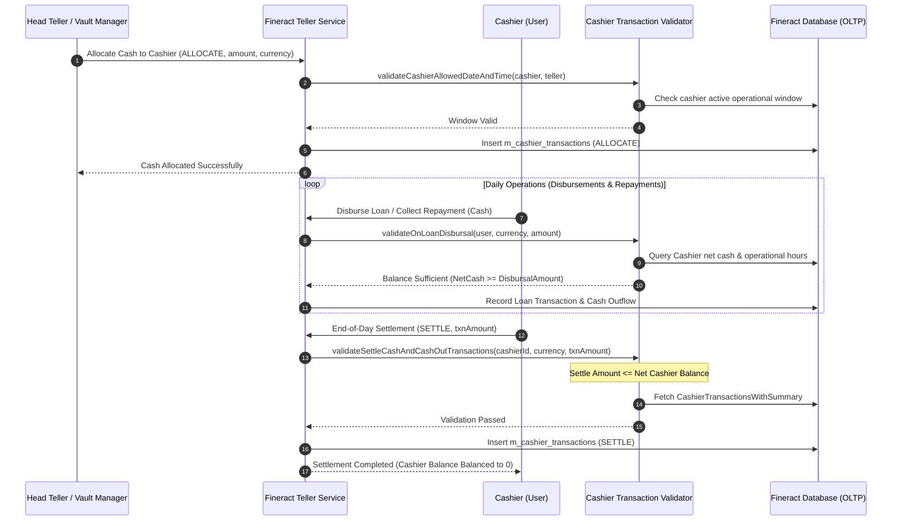

# سند استخراج نیازمندی‌های مدیریت ارتباط با مشتری (CRM)، سازمان، صندوق‌ها و امنیت در Apache Fineract 1.15.0
## (Tier 5: Organization Hierarchy, CRM, Teller Operations & Security Requirements Specification)

---

## ۱. نمای کلی حوزه، معماری دامنه و ناورداهای بنیادین (Executive Summary & Domain Invariants)

این سند مرجع رسمی و استخراج‌شده از سورس‌کد **Apache Fineract 1.15.0** جهت پوشش جامع نیازمندی‌های عملکردی و غیرعملکردی زیرسیستم مدیریت ارتباط با مشتری (CRM)، شناسایی مشتری و قواعد شناخت هویت (KYC)، ماشین وضعیت چرخه حیات مشتریان، گروه‌ها و مراکز بانکداری خرد (JLG/SHG)، سلسله‌مراتب درختی شعب و دفاتر، مدیریت پرسنل و بازتخصیص پرتفوی تسهیلات، مدیریت باجه‌ها و صندوق‌داران (Tellers & Cashiers)، و مدیریت کاربران، کنترل دسترسی مبتنی بر نقش (RBAC) و سیاست‌های امنیتی گذرواژه در قالب استاندارد بین‌المللی **EARS (Easy Approach to Requirements Syntax)** به صورت دوزبانه (فارسی - انگلیسی) است.

### ارکان معماری و ماژول‌های فعال در این حوزه:
1. **مدیریت اشخاص و هویت مشتریان (`fineract-provider` / `fineract-core`):** تفکیک ساختار داده‌ای مشتریان حقیقی (`Client.java`) و حقوقی/سازمانی (`ClientNonPerson.java`)، ثبت و انحصار اسناد شناسایی ملی و گذرنامه (`ClientIdentifier.java`)، اعتبارسنجی ارکان ثبتی و تاریخ تولد/تاسیس، و ره‌گیری پرونده‌های انتقالی میان شعب.
2. **گروه‌ها و مراکز تامین مالی خرد (`portfolio.group`):** مدل‌سازی گروه‌های همبسته متضامن (Joint Liability Groups - JLG) و گروه‌های خودیار (Self-Help Groups - SHG)، انتساب نقش‌های رهبری (رئیس، دبیر، خزانه‌دار)، ساختار دو سطحی مرکز-گروه (`CenterData.java` و `Group.java`)، و انطباق جلسات با تقویم اقساط بازپرداخت.
3. **ساختار درختی شعب و انتقالات بین‌شعبی (`organisation.office`):** تعریف ساختار اداری به صورت گراف درختی جهت‌دار بدون دور (Directed Acyclic Tree)، نگهداری مسیر سلسله‌مراتب در فیلد متنی نقطه‌گذاری‌شده (`hierarchy`)، کنترل اکید تاریخ افتتاح دفاتر فرعی نسبت به دفتر مادر، و تبادلات نقدینگی میان شعب (`OfficeTransaction.java`).
4. **پرسنل و بازتخصیص پرتفوی (`organisation.staff` / `portfolio.loanaccount`):** تعریف کارکنان، انتساب سازمانی به شعب، تفکیک افسران تسهیلات، ثبت تبارشناسی انتساب کارشناسان به پرونده‌های وام (`LoanOfficerAssignmentHistory.java`)، و امکان بازتخصیص گروهی و انفرادی پرتفوی اعتباری.
5. **باجه‌ها، صندوق‌داران و خزانه‌داری (`organisation.teller`):** تعریف باجه‌های فیزیکی/مجازی، تخصیص کاربران صندوق‌دار به باجه‌ها با پنجره‌های تاریخی و ساعتی معین، تخصیص وجه نقد از خزانه به صندوق‌دار (`ALLOCATE`)، تسویه پایانی نقدینگی به خزانه (`SETTLE`)، و کنترل اکید سقف مانده نقدینگی و عدم کسری صندوق.
6. **مدیریت کاربران، نقش‌ها و امنیت (`useradministration` / `fineract-security`):** احراز هویت چندمستأجری، کنترل دسترسی مبتنی بر نقش (RBAC)، قلمرو دسترسی داده‌ها بر پایه زیردرخت شعبه کاربر، سازوکار دوامضایی سازنده-وارسی‌کننده (Maker-Checker)، ممنوعیت استفاده مجدد از گذرواژه‌های پیشین (`AppUserPreviousPassword.java`)، و ارزیابی پیچیدگی رمز عبور بر پایه عبارات باقاعده (`PasswordValidationPolicy.java`).

### ناورداهای ریاضی، سازمانی و امنیتی حاکم بر سیستم (Mathematical & Domain Invariants):

* **ناوردای غیرمدور بودن ساختار درختی دفاتر (Acyclic Office Tree Invariant):**
  گراف دفاتر سازمان یک درخت ریشه‌دار کامل است. هیچ دفتری نمی‌تواند والد خود یا یکی از اعقاب خود باشد:
  $$\forall o \in \mathcal{O}, \quad o \notin \text{Ancestors}(o) \quad \land \quad \text{Parent}(o) \neq o$$
  به طوری که رشته سلسله‌مراتب (`hierarchy`) یکتا و نمایانگر مسیر ریشه تا گره جاری است:
  $$\text{Hierarchy}(o) = \begin{cases} \text{"."} & \text{if } o = \text{RootOffice} \\ \text{Hierarchy}(\text{Parent}(o)) \mathbin{\Vert} \text{Id}(o) \mathbin{\Vert} \text{"."} & \text{otherwise} \end{cases}$$

* **قید ترتیبی تاریخ افتتاح دفاتر (Office Opening Date Invariant):**
  تاریخ افتتاح هر دفتر فرعی ($t_{\text{open}}(o)$) همواره باید بزرگتر یا مساوی تاریخ افتتاح دفتر والد مستقیم آن باشد:
  $$\forall o \in \mathcal{O} \setminus \{\text{RootOffice}\}, \quad t_{\text{open}}(o) \ge t_{\text{open}}(\text{Parent}(o))$$

* **مرز تاریخی فعال‌سازی موجودیت‌ها در شعبه (Office Activation Date Lower Bound):**
  تاریخ فعال‌سازی هیچ مشتری یا گروهی در سامانه نمی‌تواند مقدم بر تاریخ افتتاح دفتری باشد که در آن ثبت شده است:
  $$t_{\text{activation}}(\text{Client}) \ge t_{\text{open}}(\text{Office}(\text{Client}))$$
  $$t_{\text{activation}}(\text{Group}) \ge t_{\text{open}}(\text{Office}(\text{Group}))$$

* **قانون بقای مانده نقدینگی صندوق‌دار (Cashier Balance Conservation Law):**
  مانده نقدینگی خالص یک صندوق‌دار در هر ارز مشخص در هر لحظه از زمان برابر است با مجموع دریافتی‌ها منهای مجموع پرداختی‌ها:
  $$\text{NetCashierBalance} = \sum \text{Allocations} + \sum \text{CashInflows} - \sum \text{CashOutflows} - \sum \text{Settlements}$$
  و هرگونه تسویه به خزانه یا پرداخت وام مستلزم ارضای شرط عدم کسری است:
  $$\text{TxnAmount} \le \text{NetCashierBalance}$$

* **قلمرو دسترسی داده‌ای مبتنی بر زیردرخت دفاتر (RBAC Office Scoping Invariant):**
  یک کاربر سامانه $u$ مجاز به مشاهده یا اعمال تغییرات بر روی داده‌های یک دفتر هدف $o$ است اگر و تنها اگر دفتر هدف در زیردرخت سازمانی دفتر منتسب به کاربر قرار داشته باشد:
  $$\text{IsAuthorized}(u, o) \iff o \in \text{Subtree}(\text{Office}(u)) \iff \text{Hierarchy}(o) \text{ startsWith } \text{Hierarchy}(\text{Office}(u))$$

* **محدودیت عدم تکرار تاریخچه رمز عبور (Password History Prohibition Constraint):**
  گذرواژه جدید کاربر $P_{\text{new}}$ نباید با هیچ‌یک از $K$ گذرواژه اخیر ذخیره‌شده در تاریخچه رمز عبور منطبق باشد:
  $$\forall p \in \text{RecentPasswords}(u, K), \quad \text{BCryptVerify}(P_{\text{new}}, p) = \text{false}$$

---

## ۲. خلاصه ماتریس نیازمندی‌ها (Requirements Index Matrix)

| شناسه نیازمندی | عنوان نیازمندی (فارسی) | الگوی EARS | کلاس و لایه سورس Fineract |
| :--- | :--- | :--- | :--- |
| **REQ-CRM-KYC-001** | تفکیک فرم حقوقی مشتریان (حقیقی در برابر حقوقی) و ارکان ثبتی | Complex | `Client.java` / `ClientNonPerson.java` |
| **REQ-CRM-KYC-002** | مدیریت شناسه‌های هویتی، گذرنامه و اسناد ملی با انحصار نوع و کلید | Event-Driven | `ClientIdentifier.java` / `ClientIdentifierRepository.java` |
| **REQ-CRM-KYC-003** | انتساب حساب پس‌انداز پیش‌فرض، طبقه‌بندی و شماره حساب یکتای مشتری | State-Driven | `Client.java` / `ClientDataValidator.java` |
| **REQ-CRM-LIFE-001** | ماشین وضعیت چرخه حیات مشتری و فعال‌سازی با قید تاریخ افتتاح شعبه | State-Driven | `Client.java` / `ClientWritePlatformServiceJpaRepositoryImpl.java` |
| **REQ-CRM-LIFE-002** | بستن، انصراف و رد پرونده مشتری همراه با شروط انسداد تسهیلات باز | Unwanted Behavior | `ClientWritePlatformServiceJpaRepositoryImpl.java` |
| **REQ-CRM-LIFE-003** | انتقال بین‌شعبی مشتری و وضعیت‌های معلق پرونده در فرآیند انتقال | Complex | `Client.java` / `ClientWritePlatformServiceJpaRepositoryImpl.java` |
| **REQ-CRM-GRP-001** | گروه‌های همبسته متضامن (JLG) و مراکز بانکداری خرد | Complex | `Group.java` / `GroupingTypesWritePlatformServiceJpaRepositoryImpl.java` |
| **REQ-CRM-GRP-002** | انتساب نقش‌های سازمانی گروه (رئیس، دبیر، خزانه‌دار) به اعضا | Event-Driven | `GroupRole.java` / `GroupRolesWritePlatformServiceJpaRepositoryImpl.java` |
| **REQ-CRM-GRP-003** | تقویم جلسات منظم گروهی و همگام‌سازی زمان‌بندی بازپرداخت‌ها | State-Driven | `Calendar.java` / `CalendarInstance.java` |
| **REQ-CRM-OFF-001** | درخت سلسله‌مراتبی شعب، اعتبارسنجی غیرمدور بودن و ردیابی سلسله‌مراتب | Ubiquitous | `Office.java` / `OfficeWritePlatformServiceJpaRepositoryImpl.java` |
| **REQ-CRM-OFF-002** | ناوردای زمانی تاریخ افتتاح شعب فرعی نسبت به شعبه مادر | Complex | `Office.java` / `OfficeCommandFromApiJsonDeserializer.java` |
| **REQ-CRM-OFF-003** | انتقالات مالی بین‌شعبی و تسویه ارزی میان دفاتر | Event-Driven | `OfficeTransaction.java` / `OfficeWritePlatformServiceJpaRepositoryImpl.java` |
| **REQ-CRM-STF-001** | مدیریت پرسنل، پیوند با ساختار اداری و نشان‌گذاری افسران تسهیلات | Event-Driven | `Staff.java` / `StaffWriteServiceImpl.java` |
| **REQ-CRM-STF-002** | انتساب انفرادی و تبارشناسی تاریخچه افسران پرونده تسهیلات | State-Driven | `LoanOfficerService.java` / `LoanOfficerAssignmentHistory.java` |
| **REQ-CRM-STF-003** | بازتخصیص دسته‌ای پرتفوی مشتریان و تسهیلات میان کارشناسان اعتباری | Event-Driven | `BulkUpdateLoanOfficerCommandHandler.java` / `LoanOfficerValidator.java` |
| **REQ-CRM-TLR-001** | تعریف باجه‌های دریافت و پرداخت (Teller) و پیوند با ساختار شعب | Complex | `Teller.java` / `TellerWritePlatformServiceJpaImpl.java` |
| **REQ-CRM-TLR-002** | تخصیص کاربران صندوق‌دار، اعتبارسنجی پنجره‌های زمانی و عدم تداخل ساعت | Complex | `Cashier.java` / `CashierTransactionDataValidator.java` |
| **REQ-CRM-TLR-003** | تخصیص نقدینگی، تسویه پایان روز و ممانعت از کسری وجه صندوق‌دار | Unwanted Behavior | `CashierTransaction.java` / `CashierTransactionDataValidator.java` |
| **REQ-CRM-SEC-001** | چرخه حیات کاربران سامانه، تفکیک چندمستأجری و قلمرو دسترسی زیردرخت شعب | Ubiquitous | `AppUser.java` / `AppUserWritePlatformServiceJpaRepositoryImpl.java` |
| **REQ-CRM-SEC-002** | کنترل دسترسی مبتنی بر نقش (RBAC) و اختیارات سازنده-وارسی‌کننده | State-Driven | `Role.java` / `Permission.java` |
| **REQ-CRM-SEC-003** | سیاست‌های پیچیدگی رمز عبور، ممنوعیت استفاده مجدد و تاریخ انقضا | Complex | `AppUserPreviousPassword.java` / `PasswordValidationPolicy.java` |

---

## ۳. کاتالوگ تفصیلی کارت‌های نیازمندی به تفکیک حوزه‌ها

### بخش ۱: شناخت مشتری (KYC)، فرم حقوقی و اسناد شناسایی (Client KYC, Legal Forms & Identifiers)

#### REQ-CRM-KYC-001: تفکیک فرم حقوقی مشتریان (حقیقی در برابر حقوقی) و ارکان ثبتی
* **الگوی EARS:** Complex
* **EARS Statement:**
  > While creating or updating a client record, the Fineract Client Engine shall evaluate the specified legal form parameter, instantiate a person client when legal form equals PERSON with validated firstname, lastname, and date of birth, instantiate an entity client with dedicated non-person attributes stored in table `m_client_non_person` when legal form equals ENTITY, enforce mandatory constitution and corporate registration identifiers for entities, and reject invalid incorporation validity dates.
* **شرح نیازمندی و سناریوی بیزنس (فارسی):**
  سامانه فاینراکت نیازمندی‌های احراز هویت و افتتاح پرونده را بر اساس ماهیت شخص (حقیقی یا حقوقی) تفکیک می‌نماید. در حالت مشتری حقیقی (`LegalForm.PERSON` با کد ۱)، فیلدهای نام کوچک (`firstname`) و نام خانوادگی (`lastname`) اجباری بوده و نام نمایشی (`displayName`) از ترکیب آن‌ها تولید می‌شود. در حالت مشتری حقوقی (`LegalForm.ENTITY` با کد ۲)، نام کامل شرکت به عنوان نام نمایشی ثبت شده و رکورد متناظری در جدول `m_client_non_person` برای نگهداری ارکان قانونی شامل شناسه اساسنامه (`constitution_cv_id`)، شماره ثبت شرکت (`incorp_no`)، زمینه فعالیت اصلی (`main_business_line_cv_id`) و تاریخ انقضای ثبت شرکت (`incorp_validity_till`) ذخیره می‌گردد. همچنین تاریخ انقضای ثبت نباید مقدم بر تاریخ ثبت شرکت باشد.
* **رفتارهای ناخواسته و شروط خطا (EARS If-Then):**
  * `If the legal form is ENTITY and the constitution identifier parameter is null, then the Fineract Client Engine shall throw a PlatformApiDataValidationException with error code "error.msg.clients.constitutionid.is.null".`
  * `If the incorporation validity date is before the incorporation date, then the Fineract Client Engine shall throw a PlatformApiDataValidationException with error code "error.msg.clients.incorpValidityTill.after.incorp.date".`
  * `If a client creation command contains an external identifier that already exists in the office, then the Fineract Client Engine shall throw a PlatformDataIntegrityException with error code "error.msg.client.duplicate.externalId".`
* **ماتریس ردیابی به سورس‌کد (Traceability Matrix):**
  * **مسیر فایل و کلاس سورس:** `apache-fineract-src-1.15.0/fineract-core/src/main/java/org/apache/fineract/portfolio/client/domain/Client.java`
  * **کلاس‌های مرتبط:** `ClientNonPerson.java`, `LegalForm.java`, `ClientDataValidator.java`, `ClientWritePlatformServiceJpaRepositoryImpl.java`
  * **متد اجرایی:** `ClientWritePlatformServiceJpaRepositoryImpl#createClient` و `Client#deriveDisplayName`
  * **کدهای خطا و استثناها:** `error.msg.clients.constitutionid.is.null`, `error.msg.clients.incorpValidityTill.after.incorp.date`, `PlatformApiDataValidationException`
  * **پایگاه داده و جداول:** جدول `m_client` (ستون‌های `legal_form_enum`, `display_name`, `firstname`, `lastname`) و جدول `m_client_non_person` (ستون‌های `constitution_cv_id`, `incorp_no`, `incorp_validity_till`)

---

#### REQ-CRM-KYC-002: مدیریت شناسه‌های هویتی، گذرنامه و اسناد ملی با انحصار نوع و کلید
* **الگوی EARS:** Event-Driven
* **EARS Statement:**
  > When a request to register a client identification document is processed, the Fineract Client Identifier Subsystem shall validate that the document type exists as an active code value, ensure that no active document of the same type already exists for the client, verify that the document key value is globally unique across all active clients for the specified document type, and persist the record in table `m_client_identifier`.
* **شرح نیازمندی و سناریوی بیزنس (فارسی):**
  در بانکداری خرد و استانداردهای مبارزه با پولشویی (AML/KYC)، هر مشتری دارای اسناد شناسایی رسمی نظیر کد ملی، شماره گذرنامه، کارت رانندگی یا شناسه مالیاتی است. کلاس `ClientIdentifier` رابطه میان مشتری و نوع سند شناسایی (`CodeValue documentType`) را برقرار می‌سازد. بر اساس قیود یکتایی پایگاه داده (`unique_identifier_key` و `unique_active_client_identifier`)، هیچ مشتری فعالی نمی‌تواند دو سند فعال با یک نوع شناسه داشته باشد، و شماره یک سند شناسایی معین نمی‌تواند همزمان به بیش از یک مشتری در سطح سامانه تخصیص یابد. وضعیت سند شناسایی بر اساس اینام `ClientIdentifierStatus` (شامل ACTIVE و INACTIVE) مدیریت می‌شود.
* **رفتارهای ناخواسته و شروط خطا (EARS If-Then):**
  * `If an active client identifier of the requested document type already exists for the client, then the Fineract Client Identifier Subsystem shall throw a DuplicateClientIdentifierException with error code "error.msg.clientIdentifier.type.duplicate".`
  * `If another client already possesses an active identifier with the identical document type and key value, then the Fineract Client Identifier Subsystem shall throw a DuplicateClientIdentifierException with error code "error.msg.clientIdentifier.identityKey.duplicate".`
* **ماتریس ردیابی به سورس‌کد (Traceability Matrix):**
  * **مسیر فایل و کلاس سورس:** `apache-fineract-src-1.15.0/fineract-core/src/main/java/org/apache/fineract/portfolio/client/domain/ClientIdentifier.java`
  * **کلاس‌های مرتبط:** `ClientIdentifierRepository.java`, `DuplicateClientIdentifierException.java`, `ClientIdentifiersApiResource.java`
  * **متد اجرایی:** `ClientIdentifier#fromJson` و `ClientIdentifier#update`
  * **کدهای خطا و استثناها:** `error.msg.clientIdentifier.type.duplicate`, `error.msg.clientIdentifier.identityKey.duplicate`, `DuplicateClientIdentifierException`
  * **پایگاه داده و جداول:** جدول `m_client_identifier` (ستون‌های `client_id`, `document_type_id`, `document_key`, `status`, `active`)

---

#### REQ-CRM-KYC-003: انتساب حساب پس‌انداز پیش‌فرض، طبقه‌بندی و شماره حساب یکتای مشتری
* **الگوی EARS:** State-Driven
* **EARS Statement:**
  > While a client record exists within the system, the Fineract Client Engine shall generate an immutable and unique account number if not explicitly provided, maintain foreign key references to client type and client classification code values, track default savings product or active deposit account linkages, and prevent modification of the linked savings product whenever the client status is active.
* **شرح نیازمندی و سناریوی بیزنس (فارسی):**
  هر پرونده مشتری دارای یک شماره حساب یکتا (`account_no`) است که در صورت عدم درج توسط کاربر، توسط موتور تولید شماره حساب (`AccountNumberGenerator`) بر اساس قواعد پیکربندی‌شده تولید می‌گردد. همچنین مشتریان بر اساس کدهای دسته‌بندی (`client_classification_cv_id`) و رده مشتری (`client_type_cv_id`) تفکیک می‌شوند. در صورت پیوند حساب سپرده پیش‌فرض، زمانی که مشتری در وضعیت فعال (`ClientStatus.ACTIVE`) قرار داشته باشد، فیلد `savingsProductId` قفل شده و هرگونه تلاش برای تغییر محصول پس‌انداز با خطای وضعیت نامعتبر رد می‌شود.
* **رفتارهای ناخواسته و شروط خطا (EARS If-Then):**
  * `If an administrator attempts to modify the savings product of an already active client, then the Fineract Client Engine shall throw a ClientActiveForUpdateException targeting parameter "savingsProductId".`
  * `If the account number submitted in the client request duplicates an existing account number, then the Fineract Client Engine shall throw a PlatformDataIntegrityException with error code "error.msg.client.duplicate.accountNo".`
* **ماتریس ردیابی به سورس‌کد (Traceability Matrix):**
  * **مسیر فایل و کلاس سورس:** `apache-fineract-src-1.15.0/fineract-core/src/main/java/org/apache/fineract/portfolio/client/domain/Client.java`
  * **کلاس‌های مرتبط:** `ClientDataValidator.java`, `ClientActiveForUpdateException.java`, `AccountNumberGenerator.java`
  * **متد اجرایی:** `Client#updateDefaultSavingsAccount` و `ClientWritePlatformServiceJpaRepositoryImpl#updateDefaultSavingsAccount`
  * **کدهای خطا و استثناها:** `error.msg.client.duplicate.accountNo`, `ClientActiveForUpdateException`
  * **پایگاه داده و جداول:** جدول `m_client` (ستون‌های `account_no`, `client_type_cv_id`, `client_classification_cv_id`, `default_savings_account`)

---

### بخش ۲: چرخه حیات و ماشین وضعیت مشتریان (Client Lifecycle State Machine)

#### REQ-CRM-LIFE-001: ماشین وضعیت چرخه حیات مشتری و فعال‌سازی با قید تاریخ افتتاح شعبه
* **الگوی EARS:** State-Driven
* **EARS Statement:**
  > While transitioning a client through its lifecycle states, the Fineract Client Lifecycle Engine shall enforce strict transitions between states PENDING (100), ACTIVE (300), TRANSFER_IN_PROGRESS (303), TRANSFER_ON_HOLD (304), CLOSED (600), REJECTED (700), and WITHDRAWN (800), validate that client activation date is not in the future, and verify that the client activation date is not before the opening date of the client's assigned office.
* **شرح نیازمندی و سناریوی بیزنس (فارسی):**
  پرونده مشتری در فاینراکت یک ماشین وضعیت قطعی را طی می‌کند که مقادیر آن در `ClientStatus` مشخص شده است. پرونده‌ها در ابتدا در وضعیت در انتظار (`PENDING`) ایجاد شده و با دستور فعال‌سازی به وضعیت فعال (`ACTIVE`) تغییر می‌یابند. در زمان فعال‌سازی، متد `Client#activate` اعتبارسنجی می‌کند که تاریخ فعال‌سازی بعد از تاریخ جاری نباشد و همچنین قید اساسی سازمانی $t_{\text{activation}} \ge t_{\text{open}}(\text{Office})$ ارضا گردد؛ چرا که مشتری نمی‌تواند قبل از افتتاح رسمی شعبه در آن شعبه فعال شده باشد.
* **رفتارهای ناخواسته و شروط خطا (EARS If-Then):**
  * `If the client activation date is before the opening date of the assigned office, then the Fineract Client Lifecycle Engine shall throw a PlatformApiDataValidationException with error code "error.msg.clients.activationDate.cannot.be.before.office.activation.date".`
  * `If the activation date is after the current business date, then the Fineract Client Lifecycle Engine shall throw a PlatformApiDataValidationException with error code "error.msg.clients.activationDate.in.the.future".`
  * `If an activation command is executed on a client that is already active, then the Fineract Client Lifecycle Engine shall throw a PlatformApiDataValidationException with error code "error.msg.clients.already.active".`
* **ماتریس ردیابی به سورس‌کد (Traceability Matrix):**
  * **مسیر فایل و کلاس سورس:** `apache-fineract-src-1.15.0/fineract-core/src/main/java/org/apache/fineract/portfolio/client/domain/Client.java`
  * **کلاس‌های مرتبط:** `ClientStatus.java`, `ClientWritePlatformServiceJpaRepositoryImpl.java`, `ClientDataValidator.java`
  * **متد اجرایی:** `Client#activate(AppUser currentUser, DateTimeFormatter formatter, LocalDate activationDate)`
  * **کدهای خطا و استثناها:** `error.msg.clients.activationDate.cannot.be.before.office.activation.date`, `error.msg.clients.activationDate.in.the.future`, `error.msg.clients.already.active`
  * **پایگاه داده و جداول:** جدول `m_client` (ستون‌های `status_enum`, `activation_date`, `activatedon_userid`)

---

#### REQ-CRM-LIFE-002: بستن، انصراف و رد پرونده مشتری همراه با شروط انسداد تسهیلات باز
* **الگوی EARS:** Unwanted Behavior
* **EARS Statement:**
  > If a user attempts to close, reject, or withdraw a client account while the client has open loan accounts or active savings accounts, then the Fineract Client Lifecycle Engine shall abort the command, retain the existing client state, and throw an InvalidClientStateTransitionException preventing closure of indebted or active deposit holders.
* **شرح نیازمندی و سناریوی بیزنس (فارسی):**
  بستن پرونده مشتری (`ClientStatus.CLOSED`) یا انصراف او مستلزم تسویه کامل تمامی تعهدات مالی است. سرویس `ClientWritePlatformServiceJpaRepositoryImpl#closeClient` پیش از ثبت تاریخ بستن و تغییر وضعیت، استعلام می‌گیرد که آیا هیچ وام تسویه‌نشده (`loan.non-closed`) یا حساب پس‌انداز فعال (`savings.account.non-closed`) به نام مشتری وجود دارد یا خیر. علاوه بر این، در صورتی که مشتری در وضعیت انتقال بین شعب باشد (`isUnderTransfer`)، بستن حساب تا پایان فرآیند انتقال ممنوع است. همچنین تاریخ بستن نمی‌تواند قبل از تاریخ فعال‌سازی مشتری باشد.
* **رفتارهای ناخواسته و شروط خطا (EARS If-Then):**
  * `If the client has non-closed loan accounts during a close attempt, then the Fineract Client Lifecycle Engine shall throw an InvalidClientStateTransitionException with error code "error.msg.client.close.loan.non-closed".`
  * `If the client has non-closed savings accounts during a close attempt, then the Fineract Client Lifecycle Engine shall throw an InvalidClientStateTransitionException with error code "error.msg.client.close.savings.account.non-closed".`
  * `If the client closure date is before the client activation date, then the Fineract Client Lifecycle Engine shall throw an InvalidClientStateTransitionException with error code "error.msg.client.close.date.cannot.before.client.actvation.date".`
  * `If a deletion command is submitted for a client whose status is not PENDING, then the Fineract Client Lifecycle Engine shall throw a ClientMustBePendingToBeDeletedException.`
* **ماتریس ردیابی به سورس‌کد (Traceability Matrix):**
  * **مسیر فایل و کلاس سورس:** `apache-fineract-src-1.15.0/fineract-provider/src/main/java/org/apache/fineract/portfolio/client/service/ClientWritePlatformServiceJpaRepositoryImpl.java`
  * **کلاس‌های مرتبط:** `InvalidClientStateTransitionException.java`, `ClientMustBePendingToBeDeletedException.java`, `Client.java`
  * **متد اجرایی:** `ClientWritePlatformServiceJpaRepositoryImpl#closeClient` و `ClientWritePlatformServiceJpaRepositoryImpl#deleteClient`
  * **کدهای خطا و استثناها:** `error.msg.client.close.loan.non-closed`, `error.msg.client.close.savings.account.non-closed`, `ClientMustBePendingToBeDeletedException`
  * **پایگاه داده و جداول:** جدول `m_client` (ستون‌های `status_enum`, `closedon_date`, `closedby_userid`)

---

#### REQ-CRM-LIFE-003: انتقال بین‌شعبی مشتری و وضعیت‌های معلق پرونده در فرآیند انتقال
* **الگوی EARS:** Complex
* **EARS Statement:**
  > While initiating an inter-branch client transfer, the Fineract Client Lifecycle Engine shall update the client state to TRANSFER_IN_PROGRESS (303), freeze financial transactions on associated accounts by placing them in TRANSFER_ON_HOLD (304) when required by tenant configuration, record proposed transfer dates, and upon destination branch acceptance, transition the client office reference to the destination branch and restore client status to ACTIVE.
* **شرح نیازمندی و سناریوی بیزنس (فارسی):**
  هنگامی که مشتری محل اقامت خود را تغییر داده یا نیاز به دریافت خدمات از شعبه دیگری دارد، فرآیند انتقال بین‌شعبی فعال می‌گردد. در فاز اول (پیشنهاد انتقال)، وضعیت مشتری به `TRANSFER_IN_PROGRESS` تغییر یافته و تاریخ پیشنهادی انتقال ثبت می‌شود. در این فاز، برای ممانعت از ایجاد ناهماهنگی در دفاتر مالی، حساب‌های سپرده و تسهیلات مشتری ممکن است به حالت تعلیق انتقال (`TRANSFER_ON_HOLD`) درآیند تا تراکنش جدیدی بر روی آن‌ها ثبت نشود. با پذیرش انتقال توسط شعبه مقصد، ارجاع شعبه مشتری (`office_id`) به‌روزرسانی شده و وضعیت مجدداً به `ACTIVE` تغییر می‌یابد؛ در صورت رد یا لغو انتقال، وضعیت به حالت فعال در شعبه مبدأ بازمی‌گردد.
* **رفتارهای ناخواسته و شروط خطا (EARS If-Then):**
  * `If an operator attempts to close a client while the client is under transfer, then the Fineract Client Lifecycle Engine shall throw an InvalidClientStateTransitionException with error code "error.msg.client.close.is.under.transfer".`
  * `If the proposed transfer date is in the future beyond allowable business limits, then the Fineract Client Lifecycle Engine shall reject the transfer command with a validation exception.`
* **ماتریس ردیابی به سورس‌کد (Traceability Matrix):**
  * **مسیر فایل و کلاس سورس:** `apache-fineract-src-1.15.0/fineract-core/src/main/java/org/apache/fineract/portfolio/client/domain/Client.java`
  * **کلاس‌های مرتبط:** `ClientStatus.java`, `ClientWritePlatformServiceJpaRepositoryImpl.java`, `ClientTransferDetails.java`
  * **متد اجرایی:** `Client#isUnderTransfer` و `ClientWritePlatformServiceJpaRepositoryImpl#acceptClientTransfer`
  * **کدهای خطا و استثناها:** `error.msg.client.close.is.under.transfer`, `InvalidClientStateTransitionException`
  * **پایگاه داده و جداول:** جدول `m_client` (ستون‌های `status_enum`, `office_id`, `transfer_to_office_id`)

---

### بخش ۳: گروه‌ها و مراکز بانکداری خرد (Groups & Centers)

#### REQ-CRM-GRP-001: گروه‌های همبسته متضامن (JLG) و مراکز بانکداری خرد
* **الگوی EARS:** Complex
* **EARS Statement:**
  > While managing microfinance collective lending structures, the Fineract Group Engine shall support Joint Liability Groups (JLG), Self-Help Groups (SHG), and Centers, enforce that a center cannot be assigned as a child of another group or center, enforce that a group belongs to at most one parent center, link individual active clients to groups via table `m_group_client`, and validate that group activation dates are not before the assigned office opening date.
* **شرح نیازمندی و سناریوی بیزنس (فارسی):**
  در الگوی بانکداری اجتماعی و متضامن خرد، مشتریان در قالب گروه‌های ۵ تا ۱۰ نفره (JLG) یا گروه‌های خودیار (SHG) سازماندهی می‌شوند و چندین گروه زیرمجموعه یک "مرکز" (`Center`) قرار می‌گیرند. کلاس `Group.java` با استفاده از فیلد `level_id` تمایز میان گروه و مرکز را برقرار می‌سازد. مرکز به عنوان گره تجمیع‌کننده جلسات و افسر تسهیلات عمل می‌کند. بر اساس قواعد دامنه فاینراکت، یک مرکز هرگز نمی‌تواند فرزند موجودیت دیگری باشد (`error.msg.center.cannot.be.assigned.as.child`) و یک گروه نمی‌تواند همزمان به بیش از یک مرکز منتسب شود (`error.msg.group.already.associated.with.center`). انتساب اعضا از طریق جدول رابط `m_group_client` ثبت می‌گردد.
* **رفتارهای ناخواسته و شروط خطا (EARS If-Then):**
  * `If an administrator attempts to assign a center as a child of another center or group, then the Fineract Group Engine shall throw a GeneralPlatformDomainRuleException with error code "error.msg.center.cannot.be.assigned.as.child".`
  * `If an administrator attempts to attach a group that is already associated with a center to another center, then the Fineract Group Engine shall throw a GeneralPlatformDomainRuleException with error code "error.msg.group.already.associated.with.center".`
  * `If an operator attempts to add a client who is already a member of the target group, then the Fineract Group Engine shall throw a ClientExistInGroupException.`
  * `If the group activation date is before the opening date of its assigned office, then the Fineract Group Engine shall reject the activation command with a validation exception.`
* **ماتریس ردیابی به سورس‌کد (Traceability Matrix):**
  * **مسیر فایل و کلاس سورس:** `apache-fineract-src-1.15.0/fineract-core/src/main/java/org/apache/fineract/portfolio/group/domain/Group.java`
  * **کلاس‌های مرتبط:** `GroupingTypesWritePlatformServiceJpaRepositoryImpl.java`, `GroupLevel.java`, `ClientExistInGroupException.java`
  * **متد اجرایی:** `Group#newGroup` و `Group#associateClients`
  * **کدهای خطا و استثناها:** `error.msg.center.cannot.be.assigned.as.child`, `error.msg.group.already.associated.with.center`, `ClientExistInGroupException`
  * **پایگاه داده و جداول:** جدول `m_group` (ستون‌های `level_id`, `parent_id`, `office_id`, `staff_id`), جدول `m_group_client` (ستون‌های `group_id`, `client_id`)

---

#### REQ-CRM-GRP-002: انتساب نقش‌های سازمانی گروه (رئیس، دبیر، خزانه‌دار) به اعضا
* **الگوی EARS:** Event-Driven
* **EARS Statement:**
  > When a command to assign or update group leadership roles is executed, the Fineract Group Role Engine shall verify that the target client is an active member of the designated group, resolve the role code value (such as Leader, Secretary, or Treasurer), persist or update the role binding in table `m_group_roles`, and prevent assignment of leadership roles to non-member clients.
* **شرح نیازمندی و سناریوی بیزنس (فارسی):**
  هر گروه در بانکداری همبسته دارای ارکان مدیریتی از میان اعضای خود است (نظیر رهبر/رئیس گروه، خزانه‌دار جهت جمع‌آوری اقساط نقدی و دبیر جهت ثبت صورتجلسات). کلاس `GroupRole` این رابطه سه‌گانه میان گروه (`group_id`)، مشتری عضو (`client_id`) و نقش تعریف‌شده در کدهای سیستمی (`role_cv_id`) را برقرار می‌سازد. در زمان ثبت یا ویرایش نقش از طریق `GroupRolesWritePlatformServiceJpaRepositoryImpl`، سیستم احراز می‌نماید که مشتری حتماً عضوی از آن گروه باشد؛ در غیر این صورت، انتساب نقش با خطای عدم عضویت مشتری در گروه رد خواهد شد.
* **رفتارهای ناخواسته و شروط خطا (EARS If-Then):**
  * `If the specified client does not belong to the clientMembers collection of the group, then the Fineract Group Role Engine shall throw a ClientNotInGroupException.`
  * `If the specified role identifier cannot be resolved to a valid active CodeValue, then the Fineract Group Role Engine shall throw a GroupRoleNotFoundException.`
* **ماتریس ردیابی به سورس‌کد (Traceability Matrix):**
  * **مسیر فایل و کلاس سورس:** `apache-fineract-src-1.15.0/fineract-core/src/main/java/org/apache/fineract/portfolio/group/domain/GroupRole.java`
  * **کلاس‌های مرتبط:** `GroupRolesWritePlatformServiceJpaRepositoryImpl.java`, `GroupRolesDataValidator.java`, `ClientNotInGroupException.java`
  * **متد اجرایی:** `GroupRole#createGroupRole` و `GroupRolesWritePlatformServiceJpaRepositoryImpl#createRole`
  * **کدهای خطا و استثناها:** `ClientNotInGroupException`, `GroupRoleNotFoundException`
  * **پایگاه داده و جداول:** جدول `m_group_roles` (ستون‌های `group_id`, `client_id`, `role_cv_id`)

---

#### REQ-CRM-GRP-003: تقویم جلسات منظم گروهی و همگام‌سازی زمان‌بندی بازپرداخت‌ها
* **الگوی EARS:** State-Driven
* **EARS Statement:**
  > While a group or center operates active loan contracts, the Fineract Meeting Calendar Engine shall associate recurring meeting calendars with the group via `m_calendar_instance`, calculate recurring meeting dates based on recurrence rules (daily, weekly, monthly), and automatically synchronize loan installment due dates to align strictly with the scheduled group meeting dates.
* **شرح نیازمندی و سناریوی بیزنس (فارسی):**
  در تسهیلات خرد گروهی، جمع‌آوری اقساط و ثبت پرداخت‌ها در جلسات دوره‌ای گروه (مثلاً هر دوشنبه ساعت ۱۰ صبح یا روز اول هر ماه) انجام می‌شود. موجودیت `Calendar` با فرمت قوانین تکرار (Recurrence Rules) تعریف شده و از طریق `CalendarInstance` به گروه یا مرکز متصل می‌گردد. هنگامی که یک وام گروهی تصویب و پرداخت می‌شود، جدول استهلاک اقساط آن به‌طور خودکار با تاریخ‌های جلسات تقویم گروه تنظیم می‌گردد. تغییر در زمان جلسه یا تعریف جلسات جبرانی مستلزم به‌روزرسانی تقویم و بازتنظیم سررسید اقساط است.
* **رفتارهای ناخواسته و شروط خطا (EARS If-Then):**
  * `If an administrator attempts to disburse a meeting-linked loan on a date that does not coincide with a scheduled meeting date, then the Fineract Meeting Calendar Engine shall reject the disbursal command with a calendar mismatch exception.`
  * `If a recurring meeting calendar defines an invalid recurrence pattern or interval, then the Fineract Meeting Calendar Engine shall throw a PlatformApiDataValidationException.`
* **ماتریس ردیابی به سورس‌کد (Traceability Matrix):**
  * **مسیر فایل و کلاس سورس:** `apache-fineract-src-1.15.0/fineract-provider/src/main/java/org/apache/fineract/portfolio/calendar/domain/Calendar.java`
  * **کلاس‌های مرتبط:** `CalendarInstance.java`, `CalendarWritePlatformServiceJpaRepositoryImpl.java`, `CalendarCommandFromApiJsonDeserializer.java`
  * **متد اجرایی:** `CalendarWritePlatformServiceJpaRepositoryImpl#createCalendar` و `Calendar#update`
  * **کدهای خطا و استثناها:** `validation.msg.calendar.recurrence.invalid`, `PlatformApiDataValidationException`
  * **پایگاه داده و جداول:** جدول `m_calendar` (ستون‌های `title`, `start_date`, `recurrence`, `calendar_type_enum`), جدول `m_calendar_instance` (ستون‌های `calendar_id`, `entity_id`, `entity_type_enum`)

---

### بخش ۴: سلسله‌مراتب درختی شعب و انتقالات بین‌شعبی (Office Hierarchy & Inter-Branch Operations)

#### REQ-CRM-OFF-001: درخت سلسله‌مراتبی شعب، اعتبارسنجی غیرمدور بودن و ردیابی سلسله‌مراتب
* **الگوی EARS:** Ubiquitous
* **EARS Statement:**
  > The Fineract Office Hierarchy Engine shall maintain all organizational offices in an acyclic tree structure rooted at the Head Office, compute and store the lineage path in the dot-delimited `hierarchy` column upon every creation and move, prohibit assigning an office as its own parent, and prohibit assigning a parent office to the root Head Office.
* **شرح نیازمندی و سناریوی بیزنس (فارسی):**
  تمام تراکنش‌ها، کاربران، پرسنل و پرونده‌های مشتریان در فاینراکت ذیل یک دفتر سازمانی (`Office`) تعریف می‌شوند. دفاتر به صورت درختی سازماندهی شده‌اند که در راس آن شعبه مرکزی (`Head Office` با والد `null` و سلسله‌مراتب `"."`) قرار دارد. با ایجاد یا جابجایی هر شعبه، متد `generateHierarchy` فراخوانی شده و مسیر نیاکان را به صورت رشته‌ای متنی (نظیر `.1.3.7.`) در ستون `hierarchy` ذخیره می‌سازد. بر اساس اصل عدم وجود دور در ساختار درختی، شعبه مرکزی هرگز نمی‌تواند والدی داشته باشد (`RootOfficeParentCannotBeUpdated`) و هیچ دفتری نمی‌تواند خودش را به عنوان والد انتخاب کند (`CannotUpdateOfficeWithParentOfficeSameAsSelf`).
* **رفتارهای ناخواسته و شروط خطا (EARS If-Then):**
  * `If an update request attempts to set a parent office for the root Head Office, then the Fineract Office Hierarchy Engine shall throw a RootOfficeParentCannotBeUpdated exception with error code "error.msg.office.cannot.update.parent.office.of.root.office".`
  * `If an update request attempts to set the parent office identifier to the office's own identifier, then the Fineract Office Hierarchy Engine shall throw a CannotUpdateOfficeWithParentOfficeSameAsSelf exception with error code "error.msg.office.parentId.same.as.id".`
  * `If the office name duplicates an existing office name under the same tenant, then the Fineract Office Hierarchy Engine shall throw a PlatformDataIntegrityException with error code "error.msg.office.duplicate.name".`
* **ماتریس ردیابی به سورس‌کد (Traceability Matrix):**
  * **مسیر فایل و کلاس سورس:** `apache-fineract-src-1.15.0/fineract-core/src/main/java/org/apache/fineract/organisation/office/domain/Office.java`
  * **کلاس‌های مرتبط:** `OfficeWritePlatformServiceJpaRepositoryImpl.java`, `RootOfficeParentCannotBeUpdated.java`, `CannotUpdateOfficeWithParentOfficeSameAsSelf.java`
  * **متد اجرایی:** `Office#generateHierarchy` و `Office#update(Office newParent)`
  * **کدهای خطا و استثناها:** `error.msg.office.cannot.update.parent.office.of.root.office`, `error.msg.office.parentId.same.as.id`, `error.msg.office.duplicate.name`
  * **پایگاه داده و جداول:** جدول `m_office` (ستون‌های `id`, `parent_id`, `name`, `hierarchy`, `opening_date`)

---

#### REQ-CRM-OFF-002: ناوردای زمانی تاریخ افتتاح شعب فرعی نسبت به شعبه مادر
* **الگوی EARS:** Complex
* **EARS Statement:**
  > While validating the creation or modification of an office, the Fineract Office Hierarchy Engine shall enforce that the opening date of the child office is greater than or equal to the opening date of its immediate parent office, reject any child opening date that precedes the parent opening date, and ensure that the opening date parameter is mandatory and structurally valid.
* **شرح نیازمندی و سناریوی بیزنس (فارسی):**
  از منظر اصول حسابداری و منطق سازمانی، یک واحد زیرمجموعه نمی‌تواند تاریخی مقدم بر تاریخ تاسیس واحد بالادستی خود داشته باشد. در فرآیند ایجاد یا به‌روزرسانی شعبه در `OfficeWritePlatformServiceJpaRepositoryImpl`، تاریخ افتتاح شعبه فرزند با تاریخ افتتاح شعبه والد مقایسه می‌شود. چنانچه $t_{\text{open}}(\text{child}) < t_{\text{open}}(\text{parent})$ باشد، سیستم از ثبت شعبه جلوگیری به عمل آورده و خطای عدم تطابق زمانی صادر می‌نماید. همچنین پارامتر `openingDate` در deserializer به عنوان فیلد اجباری غیرتهی اعتبارسنجی می‌شود.
* **رفتارهای ناخواسته و شروط خطا (EARS If-Then):**
  * `If the opening date of a child office is strictly before the opening date of its parent office, then the Fineract Office Hierarchy Engine shall reject the transaction and throw a PlatformApiDataValidationException.`
  * `If the openingDate parameter is omitted or blank in the office creation payload, then the Fineract Office Hierarchy Engine shall throw a PlatformApiDataValidationException with validation error on parameter "openingDate".`
* **ماتریس ردیابی به سورس‌کد (Traceability Matrix):**
  * **مسیر فایل و کلاس سورس:** `apache-fineract-src-1.15.0/fineract-core/src/main/java/org/apache/fineract/organisation/office/domain/Office.java`
  * **کلاس‌های مرتبط:** `OfficeCommandFromApiJsonDeserializer.java`, `OfficeWritePlatformServiceJpaRepositoryImpl.java`, `DateUtils.java`
  * **متد اجرایی:** `Office#isOpeningDateBefore` و `OfficeCommandFromApiJsonDeserializer#validateForCreate`
  * **کدهای خطا و استثناها:** `validation.msg.validation.errors.exist`, `PlatformApiDataValidationException`
  * **پایگاه داده و جداول:** جدول `m_office` (ستون `opening_date`)

---

#### REQ-CRM-OFF-003: انتقالات مالی بین‌شعبی و تسویه ارزی میان دفاتر
* **الگوی EARS:** Event-Driven
* **EARS Statement:**
  > When an inter-office money transfer request is executed, the Fineract Office Transaction Engine shall validate that source and destination offices are distinct entities, verify that transaction amount is positive and currency is supported, persist the transaction record in table `m_office_transaction`, and trigger the double-entry accounting bridge to debit the inter-branch clearing account of the source office and credit the inter-branch clearing account of the destination office.
* **شرح نیازمندی و سناریوی بیزنس (فارسی):**
  انتقال وجوه نقدینگی و منابع مالی میان شعب مختلف سازمان از طریق تراکنش دفتر (`OfficeTransaction`) مدیریت می‌شود. کلاس `OfficeTransaction` انتقال وجه از شعبه مبدأ (`from_office_id`) به شعبه مقصد (`to_office_id`) در یک تاریخ مشخص و با مبلغ و ارز معین را ثبت می‌کند. لایه اعتبارسنجی `OfficeTransactionCommandFromApiJsonDeserializer` کنترل می‌کند که شعبه مبدأ و مقصد یکسان نباشند. متعاقب ثبت تراکنش، موتور حسابداری دوبل اسناد متناظر را در سرفصل‌های تسویه بین‌شعبی صادر می‌نماید.
* **رفتارهای ناخواسته و شروط خطا (EARS If-Then):**
  * `If the source office identifier equals the destination office identifier, then the Fineract Office Transaction Engine shall reject the transfer command with an invalid transfer parameters exception.`
  * `If an office transaction identifier does not exist during query or reversal, then the Fineract Office Transaction Engine shall throw an OfficeTransactionNotFoundException with error code "error.msg.officetransaction.id.invalid".`
* **ماتریس ردیابی به سورس‌کد (Traceability Matrix):**
  * **مسیر فایل و کلاس سورس:** `apache-fineract-src-1.15.0/fineract-provider/src/main/java/org/apache/fineract/organisation/office/domain/OfficeTransaction.java`
  * **کلاس‌های مرتبط:** `OfficeWritePlatformServiceJpaRepositoryImpl.java`, `OfficeTransactionCommandFromApiJsonDeserializer.java`, `OfficeTransactionNotFoundException.java`
  * **متد اجرایی:** `OfficeTransaction#fromJson` و `OfficeWritePlatformServiceJpaRepositoryImpl#makeOfficeTransaction`
  * **کدهای خطا و استثناها:** `error.msg.officetransaction.id.invalid`, `OfficeTransactionNotFoundException`
  * **پایگاه داده و جداول:** جدول `m_office_transaction` (ستون‌های `from_office_id`, `to_office_id`, `transaction_date`, `transaction_amount`, `currency_code`)

---

### بخش ۵: مدیریت پرسنل و بازتخصیص پرتفوی (Staff Management & Portfolio Reassignment)

#### REQ-CRM-STF-001: مدیریت پرسنل، پیوند با ساختار اداری و نشان‌گذاری افسران تسهیلات
* **الگوی EARS:** Event-Driven
* **EARS Statement:**
  > When a staff member is created or updated, the Fineract Staff Management Subsystem shall bind the staff entity to a valid office within table `m_staff`, record personal and contact details, evaluate the boolean flag indicating whether the staff member is a Loan Officer, record joining dates, and enforce external identifier uniqueness across staff members.
* **شرح نیازمندی و سناریوی بیزنس (فارسی):**
  پرسنل مؤسسه مالی اعم از کارشناسان اداری، صندوق‌داران و کارشناسان اعتباری در قالب موجودیت `Staff` در جدول `m_staff` تعریف می‌شوند. هر کارمند الزاماً متعلق به یک شعبه مشخص (`office_id`) است. فیلد بولین `is_loan_officer` تعیین می‌کند که آیا این فرد مجاز به پذیرش پرونده‌های تسهیلاتی و انتساب به مشتریان به عنوان کارشناس پرونده است یا خیر. وضعیت فعالیت کارمند از طریق فیلد `is_active` کنترل شده و در صورت ترک کار یا جابجایی، غیرفعال می‌گردد تا از انتساب پرونده‌های جدید به او جلوگیری شود.
* **رفتارهای ناخواسته و شروط خطا (EARS If-Then):**
  * `If the office identifier specified in the staff creation request does not exist, then the Fineract Staff Management Subsystem shall throw an OfficeNotFoundException.`
  * `If the external identifier duplicates an existing staff external ID, then the Fineract Staff Management Subsystem shall throw a PlatformDataIntegrityException.`
* **ماتریس ردیابی به سورس‌کد (Traceability Matrix):**
  * **مسیر فایل و کلاس سورس:** `apache-fineract-src-1.15.0/fineract-core/src/main/java/org/apache/fineract/organisation/staff/domain/Staff.java`
  * **کلاس‌های مرتبط:** `StaffWriteServiceImpl.java`, `StaffRepository.java`, `OfficeRepository.java`
  * **متد اجرایی:** `StaffWriteServiceImpl#createStaff` و `StaffWriteServiceImpl#updateStaff`
  * **کدهای خطا و استثناها:** `error.msg.staff.not.found`, `OfficeNotFoundException`, `StaffNotFoundException`
  * **پایگاه داده و جداول:** جدول `m_staff` (ستون‌های `id`, `office_id`, `firstname`, `lastname`, `is_loan_officer`, `is_active`, `joining_date`)

---

#### REQ-CRM-STF-002: انتساب انفرادی و تبارشناسی تاریخچه افسران پرونده تسهیلات
* **الگوی EARS:** State-Driven
* **EARS Statement:**
  > While assigning or reassigning a loan officer to an active loan account, the Fineract Loan Officer Service shall validate that the assignment date is not before the loan submission date, validate that the assignment date is not in the future, close the previous open history record in table `m_loan_officer_assignment_history` by setting its end date, and create a new assignment history record referencing the new loan officer.
* **شرح نیازمندی و سناریوی بیزنس (فارسی):**
  شفافیت در عملکرد اعتباری نیازمند ثبت زنجیره کامل کارشناسانی است که در طول عمر وام مدیریت آن را بر عهده داشته‌اند. متد `LoanOfficerService#reassignLoanOfficer` مسئولیت ثبت این زنجیره را بر عهده دارد. کلاس اعتبارسنج `LoanOfficerValidator` تضمین می‌کند که تاریخ انتساب کارشناس جدید مقدم بر تاریخ ثبت درخواست وام (`loan.submittal.date`) یا تاریخ لغو انتساب کارشناس قبلی نباشد. همچنین هر کارشناس دارای یک بازه زمانی شروع (`start_date`) و پایان (`end_date`) در جدول `m_loan_officer_assignment_history` است که با تغییر کارشناس، رکورد قبلی با تاریخ انتساب جدید مختومه شده و رکورد جدیدی با `end_date = null` ایجاد می‌گردد.
* **رفتارهای ناخواسته و شروط خطا (EARS If-Then):**
  * `If the loan officer assignment date is before the loan submittal date, then the Fineract Loan Officer Service shall throw a LoanOfficerAssignmentDateException with error code "cannot.be.before.loan.submittal.date".`
  * `If the loan officer assignment date is before the previous unassignment date, then the Fineract Loan Officer Service shall throw a LoanOfficerAssignmentDateException with error code "cannot.be.before.previous.unassignement.date".`
  * `If the loan officer assignment date is in the future, then the Fineract Loan Officer Service shall throw a LoanOfficerAssignmentDateException with error code "cannot.be.a.future.date".`
  * `If the unassignment date is before the current assignment start date, then the Fineract Loan Officer Service shall throw a LoanOfficerUnassignmentDateException with error code "cannot.be.before.assignment.date".`
* **ماتریس ردیابی به سورس‌کد (Traceability Matrix):**
  * **مسیر فایل و کلاس سورس:** `apache-fineract-src-1.15.0/fineract-provider/src/main/java/org/apache/fineract/portfolio/loanaccount/service/LoanOfficerService.java`
  * **کلاس‌های مرتبط:** `LoanOfficerValidator.java`, `LoanOfficerAssignmentHistory.java`, `LoanOfficerAssignmentDateException.java`
  * **متد اجرایی:** `LoanOfficerService#reassignLoanOfficer` و `LoanOfficerValidator#validateReassignment`
  * **کدهای خطا و استثناها:** `cannot.be.before.loan.submittal.date`, `cannot.be.before.previous.unassignement.date`, `cannot.be.a.future.date`, `cannot.be.before.assignment.date`
  * **پایگاه داده و جداول:** جدول `m_loan` (ستون `loan_officer_id`), جدول `m_loan_officer_assignment_history` (ستون‌های `loan_id`, `loan_officer_id`, `start_date`, `end_date`)

---

#### REQ-CRM-STF-003: بازتخصیص دسته‌ای پرتفوی مشتریان و تسهیلات میان کارشناسان اعتباری
* **الگوی EARS:** Event-Driven
* **EARS Statement:**
  > When a bulk loan officer reassignment command is processed, the Fineract Portfolio Reassignment Engine shall resolve the list of affected loan accounts, verify that the target loan officer belongs to the same branch office and has an active loan officer flag, apply atomic historical reassignment across all designated loans, and record audit details for bulk tracking.
* **شرح نیازمندی و سناریوی بیزنس (فارسی):**
  در هنگام مرخصی بلندمدت، استعفا یا بازتوزیع جغرافیایی پرونده‌ها، نیاز است پرتفوی شامل ده‌ها یا صدها پرونده تسهیلاتی از یک کارشناس به کارشناس دیگر انتقال یابد. کنترلر و هندلر `BulkUpdateLoanOfficerCommandHandler` آرایه‌ای از شناسه‌های وام (`loans`) به همراه شناسه کارشناس جدید (`toLoanOfficerId`) و تاریخ انتقال (`assignmentDate`) را دریافت می‌کند. سیستم اعتبارسنجی می‌کند که کارشناس جدید در همان شعبه حضور داشته و فعال باشد، سپس تمام وام‌ها را به صورت دسته‌ای و با رعایت حفظ تاریخچه در یک تراکنش اتمیک بازتخصیص می‌دهد.
* **رفتارهای ناخواسته و شروط خطا (EARS If-Then):**
  * `If the target staff member is not flagged as a loan officer or is inactive, then the Fineract Portfolio Reassignment Engine shall throw a LoanOfficerAssignmentException.`
  * `If any loan in the bulk list belongs to a different office than the target loan officer, then the Fineract Portfolio Reassignment Engine shall abort the bulk operation with a validation error.`
* **ماتریس ردیابی به سورس‌کد (Traceability Matrix):**
  * **مسیر فایل و کلاس سورس:** `apache-fineract-src-1.15.0/fineract-loan/src/main/java/org/apache/fineract/portfolio/loanaccount/handler/BulkUpdateLoanOfficerCommandHandler.java`
  * **کلاس‌های مرتبط:** `LoanOfficerService.java`, `BulkTransferLoanOfficerData.java`, `Staff.java`
  * **متد اجرایی:** `BulkUpdateLoanOfficerCommandHandler#processCommand`
  * **کدهای خطا و استثناها:** `error.msg.loan.officer.assignment.failed`, `LoanOfficerAssignmentException`
  * **پایگاه داده و جداول:** جدول `m_loan`, جدول `m_loan_officer_assignment_history`, جدول `m_staff`

---

### بخش ۶: باجه‌ها، صندوق‌داران و مدیریت نقدینگی (Tellers, Cashiers & Cash Vault Management)

#### REQ-CRM-TLR-001: تعریف باجه‌های دریافت و پرداخت (Teller) و پیوند با ساختار شعب
* **الگوی EARS:** Complex
* **EARS Statement:**
  > While configuring branch cash management stations, the Fineract Teller Management Subsystem shall associate each teller station with a designated office, validate start and end operational dates, maintain ledger mappings to branch vault cash accounts, enforce unique teller naming within the office, and prohibit deletion of any teller station that has associated cashiers or financial transactions.
* **شرح نیازمندی و سناریوی بیزنس (فارسی):**
  باجه دریافت و پرداخت (`Teller`) ایستگاه فیزیکی یا منطقی تبادل وجوه نقد در شعبه است. هر باجه دارای نام، توضیحات، تاریخ شروع فعالیت و تاریخ اختیاری پایان فعالیت است و در جدول `m_tellers` ذخیره می‌شود. لایه بیزنس در `TellerWritePlatformServiceJpaImpl` کنترل می‌کند که نام باجه در سطح آن شعبه تکراری نباشد (`error.msg.teller.duplicate.name`). همچنین جهت تضمین یکپارچگی حسابداری و سوابق عملیاتی، حذف باجه‌ای که حداقل یک صندوق‌دار یا تراکنش به آن انتساب یافته است اکیداً ممنوع بوده و با خطای `CashierExistForTellerException` مسدود می‌گردد.
* **رفتارهای ناخواسته و شروط خطا (EARS If-Then):**
  * `If an operator attempts to delete a teller station that has active or historical cashiers associated with it, then the Fineract Teller Management Subsystem shall throw a CashierExistForTellerException with error code "error.msg.cashier.is.associated.with.this.teller".`
  * `If the teller name already exists within the target office, then the Fineract Teller Management Subsystem shall throw a PlatformDataIntegrityException with error code "error.msg.teller.duplicate.name".`
  * `If a queried teller identifier does not exist, then the Fineract Teller Management Subsystem shall throw a TellerNotFoundException with error code "error.msg.teller.not.found".`
* **ماتریس ردیابی به سورس‌کد (Traceability Matrix):**
  * **مسیر فایل و کلاس سورس:** `apache-fineract-src-1.15.0/fineract-branch/src/main/java/org/apache/fineract/organisation/teller/domain/Teller.java`
  * **کلاس‌های مرتبط:** `TellerWritePlatformServiceJpaImpl.java`, `CashierExistForTellerException.java`, `TellerNotFoundException.java`
  * **متد اجرایی:** `TellerWritePlatformServiceJpaImpl#createTeller` و `TellerWritePlatformServiceJpaImpl#deleteTeller`
  * **کدهای خطا و استثناها:** `error.msg.cashier.is.associated.with.this.teller`, `error.msg.teller.duplicate.name`, `error.msg.teller.not.found`
  * **پایگاه داده و جداول:** جدول `m_tellers` (ستون‌های `id`, `office_id`, `name`, `valid_from`, `valid_to`, `state`)

---

#### REQ-CRM-TLR-002: تخصیص کاربران صندوق‌دار، اعتبارسنجی پنجره‌های زمانی و عدم تداخل ساعت
* **الگوی EARS:** Complex
* **EARS Statement:**
  > While assigning a staff member as a cashier to a teller station, the Fineract Cashier Allocation Engine shall verify that the cashier operational date range falls entirely within the teller station's operational validity dates, enforce that the cashier is not concurrently assigned to any other teller during overlapping dates or time windows, support full-day and specific hourly operational shifts, and persist the cashier allocation in table `m_cashiers`.
* **شرح نیازمندی و سناریوی بیزنس (فارسی):**
  صندوق‌دار (`Cashier`) کاربری است که در بازه تاریخی مشخص و ساعات کاری معین مجاز به دریافت یا پرداخت وجه در باجه است. متد `CashierTransactionDataValidator#validateCashierAllowedDateAndTime` دو کنترل حیاتی را اجرا می‌کند: اول اینکه بازه زمانی صندوق‌دار (`startDate` تا `endDate`) باید اکیداً درون بازه زمانی باجه قرار داشته باشد؛ در غیر این صورت استثنای `CashierDateRangeOutOfTellerDateRangeException` پرتاب می‌شود. دوم، بررسی کوئری پایگاه داده تضمین می‌کند که این کارمند در بازه تاریخی مذکور یا ساعات شروع و پایان شیفت کاری (`startTime` و `endTime`) در باجه دیگری در حال فعالیت نباشد (`CashierAlreadyAllocated`).
* **رفتارهای ناخواسته و شروط خطا (EARS If-Then):**
  * `If the cashier date range extends outside the validity date range of the parent teller station, then the Fineract Cashier Allocation Engine shall throw a CashierDateRangeOutOfTellerDateRangeException with error code "cashier.date.range.out.of.teller.date.range.exception".`
  * `If the staff member is already allocated as a cashier for an overlapping date and time window, then the Fineract Cashier Allocation Engine shall throw a CashierAlreadyAllocated exception with error code "cashier.already.allocated.for.given.data.and.time.exception".`
* **ماتریس ردیابی به سورس‌کد (Traceability Matrix):**
  * **مسیر فایل و کلاس سورس:** `apache-fineract-src-1.15.0/fineract-branch/src/main/java/org/apache/fineract/organisation/teller/domain/Cashier.java`
  * **کلاس‌های مرتبط:** `CashierTransactionDataValidator.java`, `CashierDateRangeOutOfTellerDateRangeException.java`, `CashierAlreadyAllocated.java`
  * **متد اجرایی:** `CashierTransactionDataValidator#validateCashierAllowedDateAndTime`
  * **کدهای خطا و استثناها:** `cashier.date.range.out.of.teller.date.range.exception`, `cashier.already.allocated.for.given.data.and.time.exception`
  * **پایگاه داده و جداول:** جدول `m_cashiers` (ستون‌های `id`, `staff_id`, `teller_id`, `start_date`, `end_date`, `start_time`, `end_time`, `full_day`)

---

#### REQ-CRM-TLR-003: تخصیص نقدینگی، تسویه پایان روز و ممانعت از کسری وجه صندوق‌دار
* **الگوی EARS:** Unwanted Behavior
* **EARS Statement:**
  > If a cashier settlement transaction (SETTLE) or cash-out operation requests an amount that exceeds the cashier's current net cash balance for the specified currency, then the Fineract Cashier Transaction Engine shall reject the transaction, prevent negative cash balance accumulation, and throw a CashierInsufficientAmountException.
* **شرح نیازمندی و سناریوی بیزنس (فارسی):**
  گردش وجوه نقد در باجه شامل دو فرآیند اصلی خزانه‌داری است: تخصیص وجه از خزانه به صندوق‌دار در ابتدای شیفت (`CashierTxnType.ALLOCATE`) و تسویه و بازگرداندن مانده وجوه به خزانه در پایان روز (`CashierTxnType.SETTLE`). هر دو تراکنش در جدول `m_cashier_transactions` ثبت می‌شوند. متد `CashierTransactionDataValidator#validateSettleCashAndCashOutTransactions` با محاسبه تراز خالص وجوه دریافتی و پرداختی صندوق‌دار (`netCash`) تضمین می‌کند که هیچ تسویه یا پرداخت وامی بیش از مانده واقعی صندوق صورت نپذیرد و مانده صندوق‌دار منفی نگردد.
* **رفتارهای ناخواسته و شروط خطا (EARS If-Then):**
  * `If the requested settlement or cash-out amount exceeds the cashier's calculated net cash balance, then the Fineract Cashier Transaction Engine shall throw a CashierInsufficientAmountException with error code "cashier.insufficient.amount.exception".`
  * `If a loan disbursal is attempted outside the cashier's active time shift or tenant business date, then the Fineract Cashier Transaction Engine shall abort disbursal.`
* **ماتریس ردیابی به سورس‌کد (Traceability Matrix):**
  * **مسیر فایل و کلاس سورس:** `apache-fineract-src-1.15.0/fineract-branch/src/main/java/org/apache/fineract/organisation/teller/domain/CashierTransaction.java`
  * **کلاس‌های مرتبط:** `CashierTransactionDataValidator.java`, `TellerWritePlatformServiceJpaImpl.java`, `CashierInsufficientAmountException.java`
  * **متد اجرایی:** `CashierTransactionDataValidator#validateSettleCashAndCashOutTransactions` و `TellerWritePlatformServiceJpaImpl#settleCashFromCashier`
  * **کدهای خطا و استثناها:** `cashier.insufficient.amount.exception`, `CashierInsufficientAmountException`
  * **پایگاه داده و جداول:** جدول `m_cashier_transactions` (ستون‌های `cashier_id`, `txn_type`, `txn_amount`, `txn_date`, `currency_code`)

---

### بخش ۷: مدیریت کاربران، کنترل دسترسی (RBAC) و امنیت (User Administration, RBAC & Security)

#### REQ-CRM-SEC-001: چرخه حیات کاربران سامانه، تفکیک چندمستأجری و قلمرو دسترسی زیردرخت شعب
* **الگوی EARS:** Ubiquitous
* **EARS Statement:**
  > The Fineract User Administration Engine shall scope user operations strictly to the organizational office hierarchy rooted at the user's assigned office, verify that any target entity office identifier resides within the user's office subtree, enforce unique usernames per tenant schema, and reject any administrative action attempted outside the user's authorized branch hierarchy.
* **شرح نیازمندی و سناریوی بیزنس (فارسی):**
  امنیت داده‌ها در سامانه چندشعبه‌ای فاینراکت بر پایه مدل قلمرو درختی (`Subtree Office Scoping`) استوار است. هر کاربر (`AppUser`) به یک شعبه مشخص منتسب است. متد `validateUserPriviledgeOnOfficeAndRetrieve` با فراخوانی `userOffice.doesNotHaveAnOfficeInHierarchyWithId(officeId)` بررسی می‌کند که آیا شعبه هدف درون زیردرخت شعبه کاربر قرار دارد یا خیر. اگر کاربری از شعبه منطقه قصد ویرایش پرونده یا تایید وامی در شعبه منطقه دیگری را داشته باشد، سامانه بلادرنگ استثنای عدم دسترسی (`NoAuthorizationException`) پرتاب کرده و عملیات را متوقف می‌سازد.
* **رفتارهای ناخواسته و شروط خطا (EARS If-Then):**
  * `If an authenticated user attempts to access or modify data for an office outside their hierarchy subtree, then the Fineract User Administration Engine shall throw a NoAuthorizationException with message "User does not have sufficient priviledges to act on the provided office.".`
  * `If a user creation request specifies a username that already exists in the tenant, then the Fineract User Administration Engine shall throw a PlatformDataIntegrityException with error code "error.msg.user.duplicate.username".`
  * `If the specified staff identifier does not belong to the user's assigned office, then the Fineract User Administration Engine shall throw a StaffNotFoundException.`
* **ماتریس ردیابی به سورس‌کد (Traceability Matrix):**
  * **مسیر فایل و کلاس سورس:** `apache-fineract-src-1.15.0/fineract-core/src/main/java/org/apache/fineract/useradministration/domain/AppUser.java`
  * **کلاس‌های مرتبط:** `AppUserWritePlatformServiceJpaRepositoryImpl.java`, `OfficeRepositoryWrapper.java`, `NoAuthorizationException.java`
  * **متد اجرایی:** `AppUserWritePlatformServiceJpaRepositoryImpl#createUser` و `OfficeWritePlatformServiceJpaRepositoryImpl#validateUserPriviledgeOnOfficeAndRetrieve`
  * **کدهای خطا و استثناها:** `error.msg.user.duplicate.username`, `NoAuthorizationException`
  * **پایگاه داده و جداول:** جدول `m_appuser` (ستون‌های `id`, `office_id`, `staff_id`, `username`, `email`, `is_deleted`)

---

#### REQ-CRM-SEC-002: کنترل دسترسی مبتنی بر نقش (RBAC) و اختیارات سازنده-وارسی‌کننده
* **الگوی EARS:** State-Driven
* **EARS Statement:**
  > While evaluating user permissions for any API resource action, the Fineract Authorization Engine shall intersect user roles with registered permissions in table `m_role_permission`, determine whether the target permission requires Maker-Checker dual authorization, and route commands requiring dual control to the audit trail inbox until confirmed by an independent authorized checker user.
* **شرح نیازمندی و سناریوی بیزنس (فارسی):**
  سیستم کنترل دسترسی در فاینراکت بر اساس نقش‌ها (`Role`) و مجوزهای دانه‌ای (`Permission`) تعریف می‌شود که در جدول رابط `m_role_permission` ذخیره می‌گردند. برای عملیات حساس بانکی (نظیر پرداخت وام، بخشش جرایم یا تعریف شعب)، مکانیسم دوامضایی سازنده-وارسی‌کننده (`Maker-Checker`) پیاده‌سازی شده است. در صورت فعال بودن پرچم `hasMakerCheckerEnabled` بر روی یک مجوز، دستور توسط کاربر اول ثبت شده اما مستقیماً در دیتابیس قطعی نمی‌شود، بلکه به کارتابل بررسی منتقل شده تا کاربری با نقش مجزا (`Checker`) آن را بازبینی و تایید نهایی نماید.
* **رفتارهای ناخواسته و شروط خطا (EARS If-Then):**
  * `If a user attempts to execute an action for which their assigned roles lack permission, then the Fineract Authorization Engine shall throw a NoAuthorizationException.`
  * `If an administrator attempts to assign an inactive or non-existent role identifier, then the Fineract Authorization Engine shall throw a RoleNotFoundException with error code "error.msg.role.id.invalid".`
* **ماتریس ردیابی به سورس‌کد (Traceability Matrix):**
  * **مسیر فایل و کلاس سورس:** `apache-fineract-src-1.15.0/fineract-core/src/main/java/org/apache/fineract/useradministration/domain/Role.java`
  * **کلاس‌های مرتبط:** `Permission.java`, `RoleWritePlatformServiceJpaRepositoryImpl.java`, `PermissionWritePlatformServiceJpaRepositoryImpl.java`
  * **متد اجرایی:** `Role#hasPermissionTo` و `Permission#enableMakerChecker`
  * **کدهای خطا و استثناها:** `error.msg.role.id.invalid`, `NoAuthorizationException`, `RoleNotFoundException`
  * **پایگاه داده و جداول:** جدول `m_role` (ستون‌های `id`, `name`, `is_disabled`), جدول `m_permission` (ستون‌های `id`, `action_name`, `entity_name`, `can_maker_checker`), جدول `m_role_permission`

---

#### REQ-CRM-SEC-003: سیاست‌های پیچیدگی رمز عبور، ممنوعیت استفاده مجدد و تاریخ انقضا
* **الگوی EARS:** Complex
* **EARS Statement:**
  > While updating or changing a user password, the Fineract Password Security Engine shall validate the new password against active regular expression policies in `m_password_validation_policy`, verify that the encoded password does not match any of the last $N$ passwords recorded in table `m_appuser_previous_password` based on configured reuse restrictions, persist the previous password hash upon change, and enforce mandatory password reset upon initial login when enabled.
* **شرح نیازمندی و سناریوی بیزنس (فارسی):**
  امنیت اعتبارسنجی ورود کاربران از طریق سیاست‌های منعطف کلمه عبور تضمین می‌گردد. جدول `m_password_validation_policy` الگوهای پیچیدگی رمز (حداقل طول، حروف کوچک و بزرگ، اعداد و کاراکترهای ویژه) را به صورت عبارات باقاعده (`regex`) نگهداری می‌کند. متد `AppUserWritePlatformServiceJpaRepositoryImpl#getCurrentPasswordToSaveAsPreview` سوابق کلمات عبور قبلی کاربر را از جدول `m_appuser_previous_password` واکشی کرده و در صورتی که رمز عبور جدید با یکی از $N$ رمز عبور اخیر منطبق باشد، استثنای `PasswordPreviouslyUsedException` صادر می‌نماید. همچنین پرچم `password_reset_required` کاربر را در اولین ورود وادار به تغییر رمز عبور می‌کند.
* **رفتارهای ناخواسته و شروط خطا (EARS If-Then):**
  * `If the new password matches any of the user's previously used passwords within the configured history depth, then the Fineract Password Security Engine shall throw a PasswordPreviouslyUsedException with error code "error.msg.password.already.used".`
  * `If the proposed password fails validation against the active regex pattern in PasswordValidationPolicy, then the Fineract Password Security Engine shall throw a PlatformApiDataValidationException.`
* **ماتریس ردیابی به سورس‌کد (Traceability Matrix):**
  * **مسیر فایل و کلاس سورس:** `apache-fineract-src-1.15.0/fineract-provider/src/main/java/org/apache/fineract/useradministration/domain/AppUserPreviousPassword.java`
  * **کلاس‌های مرتبط:** `PasswordValidationPolicy.java`, `AppUserWritePlatformServiceJpaRepositoryImpl.java`, `PasswordPreviouslyUsedException.java`
  * **متد اجرایی:** `AppUserWritePlatformServiceJpaRepositoryImpl#changeUserPassword` و `#getCurrentPasswordToSaveAsPreview`
  * **کدهای خطا و استثناها:** `error.msg.password.already.used`, `PasswordPreviouslyUsedException`
  * **پایگاه داده و جداول:** جدول `m_appuser_previous_password` (ستون‌های `user_id`, `password`, `removal_date`), جدول `m_password_validation_policy` (ستون‌های `regex`, `description`, `active`)
