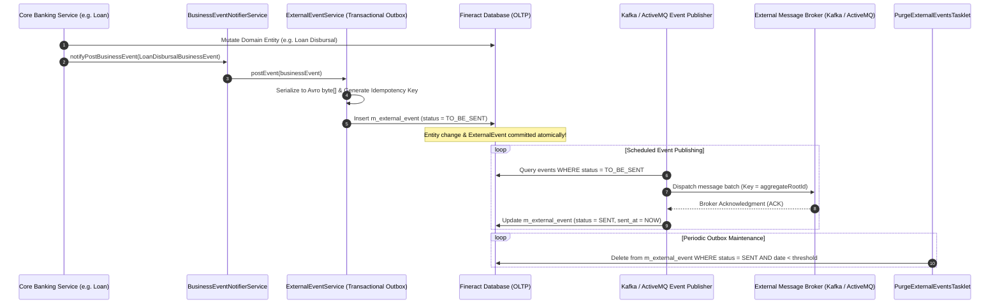

# سند استخراج نیازمندی‌های زیرساخت، رویدادها، یکپارچه‌سازی و وب‌هوک‌ها در Apache Fineract 1.15.0
## (Tier 5: Technical Infrastructure, Event Streaming, Webhooks & Extensibility Requirements Specification)

---

## ۱. نمای کلی حوزه، معماری دامنه و ناورداهای بنیادین (Executive Summary & Domain Invariants)

این سند مرجع رسمی و استخراج‌شده از سورس‌کد **Apache Fineract 1.15.0** جهت پوشش جامع نیازمندی‌های فنی، زیرساختی و تعاملی سامانه بانکداری شامل الگوی صندوق پیام‌های خروجی تراکنشی (Transactional Outbox Pattern)، انتشار و جریان‌پردازی رویدادهای کسب‌وکار به کارگزاران پیام (Apache Kafka و Apache ActiveMQ)، زیرسیستم فراخوانی‌های برون‌خط وب‌هوک (Webhooks)، مدیریت متمرکز اسناد و رسانه‌ها با مخازن ذخیره‌سازی محلی و ابری (Amazon S3)، موتور جداول داده‌ای داینامیک کاربرتعریف و کنترل‌های گردش‌کار (Entity-Datatable Checks)، موتور اعلان‌های درون‌برنامه‌ای، احراز هویت دومرحله‌ای (2FA) و درگاه‌های ارسال کمپین‌های پیامکی و ایمیلی در قالب استاندارد بین‌المللی **EARS (Easy Approach to Requirements Syntax)** به صورت دوزبانه (فارسی - انگلیسی) است.

### ارکان معماری و ماژول‌های فعال در این حوزه:
1. **موتور صندوق پیام تراکنشی و رویدادهای بیرونی (`fineract-core` / `fineract-provider`):** پیاده‌سازی الگوی Transactional Outbox جهت تضمین انتشار قطعی و بدون افت رویدادها (At-Least-Once Delivery)، ذخیره رویدادها در جدول `m_external_event` همزمان با تراکنش دیتابیس، سریال‌سازی به اسکیمای Apache Avro (`BulkMessagePayloadV1`)، و ارسال ناهمگام به کافکا (`KafkaExternalEventProducer.java`) یا اکتیوام‌کیو (`JMSMultiExternalEventProducer.java`).
2. **زیرسیستم وب‌هوک‌ها و ارتباطات HTTP برون‌سازمانی (`fineract-provider`):** مدیریت ثبت مقاصد وب‌هوک (`Hook.java`)، نگاشت رویدادها در `m_hook_registered_events`، فراخوانی ناهمگام مبتنی بر Retrofit2 (`WebHookService.java`)، تزریق سرآیندهای چندمستأجری (`Fineract-Platform-TenantId`)، و قالب‌بندی بار داده با الگوهای متنی (`HookTemplate.java`).
3. **مدیریت اسناد، پالایش رسانه‌ها و ذخیره‌سازی چندمستأجری (`fineract-document`):** ثبت متادیتای پیوست‌ها در جدول `m_document`، تفکیک استراتژی‌های ذخیره‌سازی بین سیستم‌فایل محلی (`FileContentStoreService.java`) و فضای ابری Amazon S3 (`S3ContentStoreService.java`)، اعتبارسنجی نوع محتوا با Apache Tika (`TikaContentDetector.java`)، و اعمال سیاست‌های امنیتی ضد پیمایش مسیر (`TraversalContentPolicy.java`) و سقف حجم مجاز (`SizeContentProcessor.java`).
4. **جداول داده‌ای داینامیک و دروازه‌های گردش‌کار (`fineract-provider`):** قابلیت ایجاد ساختار رابطه‌ای دلخواه در قالب جداول فیزیکی دیتابیس (`x_registered_table`)، ثبت فیلدهای سفارشی، و تعریف قواعد الزامی بودن تکمیل جدول داده‌ای قبل از تغییر وضعیت تسهیلات یا فعال‌سازی مشتری (`m_entity_datatable_check`) از طریق استثنای `DatatableEntryRequiredException`.
5. **موتور اعلان‌های درون‌برنامه‌ای (`notification`):** تولید خودکار اعلان برای رویدادهای کلیدی سامانه (`Notification.java` در `notification_generator`)، نگاشت مستقیم به کارتابل کاربران (`NotificationMapper.java` در `notification_mapper`)، مدیریت پرچم خوانده‌شدن پیام (`is_read`)، و انتشار رویدادها از طریق پیام‌رسان به کلاینت وب.
6. **احراز هویت دومرحله‌ای (2FA) و درگاه‌های کمپین ارتباطی (`fineract-security` / `campaigns`):** تولید رمزهای یکبارمصرف (OTP) مبتنی بر زمان و طول پیکربندی‌شده، تحویل از طریق پیامک یا ایمیل، صدور توکن‌های دسترسی معتبر زمانی (`TFAccessToken.java`)، و مدیریت چرخه حیات کمپین‌های دوره‌ای پیامکی و ایمیلی (`SmsCampaign.java` و `EmailCampaign.java`).

### ناورداهای ریاضی، سیستمی و امنیتی حاکم بر زیرساخت (Mathematical & Infrastructure Invariants):

* **اتومیسیته الگوی صندوق پیام تراکنشی (Transactional Outbox Atomicity Law):**
  رویداد خارجی $E$ در سامانه تنها و تنها در صورتی پایدار می‌گردد که تراکنش پایگاه داده‌ای تغییردهنده موجودیت دامنه با موفقیت به سرانجام برسد:
  $$E \in \text{Outbox} \iff \text{TxnCommit}(\text{DomainEntity}) = \text{true}$$
  و وضعیت اولیه رویداد اکیداً برابر با آماده ارسال است:
  $$\text{Status}(E_{\text{created}}) = \text{TO\_BE\_SENT} \quad \land \quad \text{SentAt}(E_{\text{created}}) = \text{null}$$

* **ناوردای گذار وضعیت و انقضای رویدادها (Outbox Lifecycle State Progression):**
  هر رویداد پس از ارسال موفق به کارگزار پیام، در وضعیت ارسال‌شده قرار گرفته و مهر زمانی ارسال آن ثبت می‌گردد:
  $$\text{Status}(E) = \text{SENT} \implies \text{SentAt}(E) \neq \text{null}$$
  و حذف دوره‌ای آن تنها پس از سپری شدن دوره نگهداری مجاز ($D_{\text{retention}}$) امکان‌پذیر است:
  $$\text{IsPurgeable}(E) \iff \text{Status}(E) = \text{SENT} \land (\text{CurrentBusinessDate} - \text{BusinessDate}(E) \ge D_{\text{retention}})$$

* **ناوردای ارضای شرط جدول داده‌ای در گردش‌کار (Datatable Workflow Precondition Invariant):**
  تغییر وضعیت یک موجودیت دامنه به وضعیت هدف $S$ مجاز است اگر و تنها اگر تمام جداول داده‌ای اجباری تعریف‌شده در `m_entity_datatable_check` حداقل دارای یک رکورد ثبت‌شده برای آن موجودیت باشند:
  $$\text{CanTransition}(e, S) \iff \forall c \in \text{Checks}(e, S), \quad \text{RecordCount}(\text{Datatable}(c), \text{Id}(e)) \ge 1$$

* **مرز زمانی اعتبار توکن احراز هویت دومرحله‌ای (Two-Factor Access Token Expiry Condition):**
  توکن دسترسی $T$ متعلق به کاربر $u$ تنها تا پایان پنجره زمانی مجاز ($\Delta t_{\text{valid}}$) معتبر بوده و پیش از ابطال صریح یا انقضا قابل استفاده است:
  $$\text{IsTokenValid}(T) \iff \text{CurrentTime} \le t_{\text{issued}}(T) + \Delta t_{\text{valid}} \quad \land \quad \text{IsRevoked}(T) = \text{false}$$

* **ناوردای ایمنی فایل و سلامت مسیر ذخیره‌سازی (Content Traversal & Size Safety Invariant):**
  فایل بارگذاری‌شده $F$ تنها در صورتی در مخزن فایل ذخیره می‌شود که مسیر نرمال‌شده آن خارج از دایرکتوری پایه مستأجر نباشد و حجم آن از سقف مجاز تجاوز نکند:
  $$\text{NormalizedPath}(F) \text{ startsWith } \text{BaseTenantDirectory} \quad \land \quad \text{Size}(F) \le \text{MaxAllowedUploadSize}$$

---

## ۲. خلاصه ماتریس نیازمندی‌ها (Requirements Index Matrix)

| شناسه نیازمندی | عنوان نیازمندی (فارسی) | الگوی EARS | کلاس و لایه سورس Fineract |
| :--- | :--- | :--- | :--- |
| **REQ-INF-EVT-001** | الگوی Outbox تراکنشی و تعهد همگام رویداد با تغییرات دیتابیس | Ubiquitous | `ExternalEventService.java` / `ExternalEvent.java` |
| **REQ-INF-EVT-002** | سریال‌سازی رویدادهای دامنه بر پایه اسکیمای Apache Avro | Event-Driven | `BusinessEventSerializer.java` / `BulkMessageItemFactory.java` |
| **REQ-INF-EVT-003** | انتشار دسته‌ای رویدادها به کارگزار پیام آپاچی کافکا | State-Driven | `KafkaExternalEventProducer.java` / `ExternalEventKafkaConfiguration.java` |
| **REQ-INF-EVT-004** | انتشار ناهمگام رویدادها به کارگزار پیام JMS / ActiveMQ | State-Driven | `JMSMultiExternalEventProducer.java` / `ActiveMQMessageFactory.java` |
| **REQ-INF-EVT-005** | پاکسازی دوره‌ای رویدادهای ارسال‌شده از جدول Outbox | Complex | `PurgeExternalEventsTasklet.java` / `PurgeExternalEventsConfig.java` |
| **REQ-INF-HOK-001** | ثبت وب‌هوک‌ها، پیکربندی URL مقصد و نگاشت به رویدادهای سیستم | Complex | `Hook.java` / `HookWritePlatformServiceImpl.java` |
| **REQ-INF-HOK-002** | ارسال ناهمگام وب‌هوک‌ها از طریق Retrofit2 و سرآیندهای امنیتی | Event-Driven | `WebHookProcessor.java` / `WebHookService.java` |
| **REQ-INF-HOK-003** | قالب‌بندی بار داده وب‌هوک‌ها و مدیریت خطای اتصال | Optional Feature | `HookTemplate.java` / `MessageGatewayHookProcessor.java` |
| **REQ-INF-DOC-001** | متادیتای اسناد، پیوند به موجودیت‌های بانکی و اعتبارسنجی رسانه | Event-Driven | `Document.java` / `DocumentWritePlatformServiceImpl.java` |
| **REQ-INF-DOC-002** | چندگانگی مخزن ذخیره‌سازی محلی و ابری در Amazon S3 | Complex | `FileContentStoreService.java` / `S3ContentStoreService.java` |
| **REQ-INF-DOC-003** | پالایش امنیتی فایل‌ها، ممانعت از پیمایش مسیر و کنترل اندازه | Unwanted Behavior | `TraversalContentPolicy.java` / `SizeContentProcessor.java` |
| **REQ-INF-DTB-001** | جداول داده‌ای داینامیک رابطه‌ای و ثبت فیلدهای توسعه‌پذیر | Complex | `DatatableWriteServiceImpl.java` / `DatatableReadServiceImpl.java` |
| **REQ-INF-DTB-002** | اعمال چک‌های الزامی جداول داده‌ای قبل از تغییر وضعیت موجودیت | State-Driven | `EntityDatatableChecksWritePlatformServiceImpl.java` |
| **REQ-INF-DTB-003** | پایش و انسداد حذف جداول پیوندیافته به چک‌های گردش‌کار | Unwanted Behavior | `EntityDatatableChecks.java` / `DatatableEntryRequiredException.java` |
| **REQ-INF-NTF-001** | تولید رویدادهای اعلان درون‌برنامه‌ای و انتشار به صف پیام | Event-Driven | `Notification.java` / `NotificationGeneratorWritePlatformServiceImpl.java` |
| **REQ-INF-NTF-002** | نگاشت اعلان به کاربران، پایش وضعیت خوانده‌شده و کارتابل | State-Driven | `NotificationMapper.java` / `NotificationMapperWritePlatformServiceImpl.java` |
| **REQ-INF-TFA-001** | احراز هویت دومرحله‌ای (2FA)، صدور رمز یکبارمصرف (OTP) و کانال‌ها | Complex | `TwoFactorServiceImpl.java` / `TwoFactorConfiguration.java` |
| **REQ-INF-TFA-002** | مدیریت چرخه حیات و اعتبارسنجی توکن‌های دسترسی امنیتی دومرحله‌ای | State-Driven | `TFAccessToken.java` / `TwoFactorServiceImpl.java` |
| **REQ-INF-COM-001** | کمپین‌های ارتباطی پیامکی و ایمیلی، زمان‌بندی ارسال و گزارش‌گیری | Complex | `SmsCampaign.java` / `EmailCampaign.java` |

---

## ۳. کاتالوگ تفصیلی کارت‌های نیازمندی به تفکیک حوزه‌ها

### بخش ۱: صندوق پیام تراکنشی و جریان‌پردازی رویدادها (Transactional Outbox & Event Streaming Engine)

#### REQ-INF-EVT-001: الگوی Outbox تراکنشی و تعهد همگام رویداد با تغییرات دیتابیس
* **الگوی EARS:** Ubiquitous
* **EARS Statement:**
  > The Fineract Transactional Outbox Engine shall intercept domain business events via the event notifier service, serialize each event into binary payload, persist an immutable event record into table `m_external_event` with initial status TO_BE_SENT within the exact active database transaction of the business operation, and rollback the event persistence if the enclosing domain transaction fails.
* **شرح نیازمندی و سناریوی بیزنس (فارسی):**
  در سامانه‌های توزیع‌شده بانکی، ایجاد هماهنگی میان وضعیت پایگاه داده و پیام‌های ارسالی به کارگزاران خارجی چالشی کلاسیک است. فاینراکت با پیاده‌سازی الگوی Transactional Outbox در کلاس `ExternalEventService`، پیش از کامیت شدن تراکنش دامنه (نظیر پرداخت وام یا افتتاح حساب)، متد `repository.save(externalEvent)` را فراخوانی می‌کند. از آنجا که این عملیات تحت انوتیشن `@Transactional` جاری سیستم انجام می‌شود، ثبت رویداد با وضعیت `TO_BE_SENT`، شناسه ریشه تجمیعی (`aggregate_root_id`) و کلید یکتایی (`idempotency_key`) در جدول `m_external_event` دقیقاً به همراه تغییرات موجودیت کامیت می‌گردد؛ لذا در صورت بروز هرگونه خطای دیتابیس، رویداد نیز ملغی شده و احتمال ایجاد رخدادهای نامعتبر به صفر می‌رسد.
* **رفتارهای ناخواسته و شروط خطا (EARS If-Then):**
  * `If the incoming BusinessEvent object is null, then the Fineract Transactional Outbox Engine shall throw an IllegalArgumentException with message "event cannot be null".`
  * `If serialization of the business event payload encounters an I/O failure, then the Fineract Transactional Outbox Engine shall abort the transaction and throw a RuntimeException wrapping the underlying IOException.`
* **ماتریس ردیابی به سورس‌کد (Traceability Matrix):**
  * **مسیر فایل و کلاس سورس:** `apache-fineract-src-1.15.0/fineract-core/src/main/java/org/apache/fineract/infrastructure/event/external/service/ExternalEventService.java`
  * **کلاس‌های مرتبط:** `ExternalEvent.java`, `ExternalEventRepository.java`, `BusinessEventNotifierService.java`
  * **متد اجرایی:** `ExternalEventService#postEvent(BusinessEvent<T> event)`
  * **کدهای خطا و انوتیشن‌ها:** `@Service`, `@Transactional`, `@RequiredArgsConstructor`
  * **پایگاه داده و جداول:** جدول `m_external_event` (ستون‌های `id`, `type`, `category`, `schema`, `data`, `status`, `idempotency_key`, `aggregate_root_id`, `created_at`)

---

#### REQ-INF-EVT-002: سریال‌سازی رویدادهای دامنه بر پایه اسکیمای Apache Avro
* **الگوی EARS:** Event-Driven
* **EARS Statement:**
  > When a domain business event is posted for external publication, the Fineract Event Serialization Pipeline shall look up the dedicated serializer registered for the event type via `BusinessEventSerializerFactory`, transform the business event DTO into an Avro binary payload compliant with Apache Avro specification, wrap multi-item transactions into `BulkMessagePayloadV1` structures, and assign the schema fully qualified name to the external event metadata.
* **شرح نیازمندی و سناریوی بیزنس (فارسی):**
  جهت تضمین سازگاری به عقب و جلو در سامانه‌های یکپارچه‌ساز و گزارش‌گیری سازمانی، پیام‌های برون‌سازمانی فاینراکت در قالب دودویی Apache Avro فشرده و استانداردسازی می‌شوند. اینترفیس `BusinessEventSerializer` پیاده‌سازی‌های متنوعی برای ماژول‌های وام، پس‌انداز، کلاینت، وثایق و حسابداری ارائه می‌دهد. داده‌های رویداد توسط متد `serializer.toAvroDTO(event)` تولید شده، توسط `DataEnricherProcessor` غنی‌سازی گردیده و در قالب باینری `byte[]` در دیتابیس ذخیره می‌شوند. همچنین در رویدادهای دسته‌ای یا تجمیعی پایان روز، اشیا در ساختار `BulkMessagePayloadV1` کپسوله‌سازی می‌گردند.
* **رفتارهای ناخواسته و شروط خطا (EARS If-Then):**
  * `If no registered serializer bean exists for the given business event type, then the Fineract Event Serialization Pipeline shall throw an IllegalArgumentException.`
  * `If the Avro schema definition is missing or corrupt during serialization, then the Fineract Event Serialization Pipeline shall throw a RuntimeException.`
* **ماتریس ردیابی به سورس‌کد (Traceability Matrix):**
  * **مسیر فایل و کلاس سورس:** `apache-fineract-src-1.15.0/fineract-core/src/main/java/org/apache/fineract/infrastructure/event/external/service/serialization/serializer/BusinessEventSerializer.java`
  * **کلاس‌های مرتبط:** `BusinessEventSerializerFactory.java`, `BulkMessageItemFactory.java`, `DataEnricherProcessor.java`
  * **متد اجرایی:** `BusinessEventSerializer#toAvroDTO` و `ExternalEventService#handleRegularBusinessEvent`
  * **پایگاه داده و جداول:** جدول `m_external_event` (ستون‌های `schema`, `data`)

---

#### REQ-INF-EVT-003: انتشار دسته‌ای رویدادها به کارگزار پیام آپاچی کافکا
* **الگوی EARS:** State-Driven
* **EARS Statement:**
  > While the Kafka external event producer profile is active, the Fineract Kafka Messaging Engine shall poll uncommitted events from table `m_external_event`, partition event records by `aggregateRootId` to preserve in-order delivery per business entity, publish message batches asynchronously to the configured Kafka topic, await broker acknowledgment within the configured timeout threshold, and transition event status to SENT upon successful acknowledgment.
* **شرح نیازمندی و سناریوی بیزنس (فارسی):**
  در استقرار با مقیاس کلان سازمانی، انتشار رخدادها به سیستم صف آپاچی کافکا واگذار می‌شود. کلاس `KafkaExternalEventProducer` فعال تحت شرط `fineract.events.external.producer.kafka.enabled = true`، رویدادها را بر مبنای کلید ریشه تجمیعی (`aggregateRootId` نظیر شناسه پرونده وام) افراز می‌کند؛ این افراز ترتیبی تضمین می‌کند که تمامی وقایع مربوط به یک پرونده اعتباری به یک پارتیشن کافکا ارسال شده و ترتیب تسلسل آن‌ها کاملاً حفظ شود. پیام‌ها ارسال شده و پس از تایید (ACK) کارگزار، وضعیت رکورد در دیتابیس به `SENT` و `sent_at = NOW()` به‌روزرسانی می‌شود.
* **رفتارهای ناخواسته و شروط خطا (EARS If-Then):**
  * `If the Kafka broker fails to acknowledge message reception within the configured timeout threshold, then the Fineract Kafka Messaging Engine shall throw an AcknowledgementTimeoutException.`
  * `If Kafka message transmission fails due to network unreachability, then the Fineract Kafka Messaging Engine shall leave the events in status TO_BE_SENT to be retried on the next execution cycle.`
* **ماتریس ردیابی به سورس‌کد (Traceability Matrix):**
  * **مسیر فایل و کلاس سورس:** `apache-fineract-src-1.15.0/fineract-provider/src/main/java/org/apache/fineract/infrastructure/event/external/producer/kafka/KafkaExternalEventProducer.java`
  * **کلاس‌های مرتبط:** `ExternalEventKafkaConfiguration.java`, `AcknowledgementTimeoutException.java`, `ExternalEventProducer.java`
  * **متد اجرایی:** `KafkaExternalEventProducer#sendEvents(Map<Long, List<byte[]>> partitions)`
  * **کدهای خطا و انوتیشن‌ها:** `@ConditionalOnProperty(value = "fineract.events.external.producer.kafka.enabled")`, `AcknowledgementTimeoutException`
  * **پایگاه داده و جداول:** جدول `m_external_event` (ستون‌های `status`, `sent_at`)

---

#### REQ-INF-EVT-004: انتشار ناهمگام رویدادها به کارگزار پیام JMS / ActiveMQ
* **الگوی EARS:** State-Driven
* **EARS Statement:**
  > While the JMS external event producer profile is active, the Fineract JMS Messaging Subsystem shall poll pending outbox events from table `m_external_event`, encapsulate binary event payloads into JMS BytesMessage structures, dispatch the messages to the designated ActiveMQ queue or virtual topic, and update event records in `m_external_event` to status SENT upon verified message dispatch.
* **شرح نیازمندی و سناریوی بیزنس (فارسی):**
  علاوه بر کافکا، فاینراکت از استاندارد پیام‌رسانی سازمانی JMS و آپاچی اکتیوام‌کیو (`Apache ActiveMQ`) از طریق کلاس `JMSMultiExternalEventProducer` و پیکربندی `ExternalEventJMSConfiguration` پشتیبانی می‌نماید. در این معماری، رویدادها از جدول Outbox خوانده شده و به عنوان پیام‌های دودویی JMS به صف‌های پیکربندی‌شده ارسال می‌گردند. این سازوکار اتصال آسان به سامانه‌های سنتی ESB (Enterprise Service Bus) را بدون وابستگی اجباری به زیرساخت کافکا میسر می‌سازد.
* **رفتارهای ناخواسته و شروط خطا (EARS If-Then):**
  * `If the JMS provider connection encounters a fatal transport failure during message dispatch, then the Fineract JMS Messaging Subsystem shall fail the publish batch and retain the outbox records in TO_BE_SENT status.`
  * `If the JMS destination queue cannot be resolved from the environment configuration, then the Fineract JMS Messaging Subsystem shall throw a RuntimeException.`
* **ماتریس ردیابی به سورس‌کد (Traceability Matrix):**
  * **مسیر فایل و کلاس سورس:** `apache-fineract-src-1.15.0/fineract-provider/src/main/java/org/apache/fineract/infrastructure/event/external/producer/jms/JMSMultiExternalEventProducer.java`
  * **کلاس‌های مرتبط:** `ExternalEventJMSConfiguration.java`, `ActiveMQMessageFactory.java`, `ExternalEventProducer.java`
  * **متد اجرایی:** `JMSMultiExternalEventProducer#sendEvents`
  * **کدهای خطا و انوتیشن‌ها:** `@ConditionalOnProperty(value = "fineract.events.external.producer.jms.enabled")`
  * **پایگاه داده و جداول:** جدول `m_external_event`

---

#### REQ-INF-EVT-005: پاکسازی دوره‌ای رویدادهای ارسال‌شده از جدول Outbox
* **الگوی EARS:** Complex
* **EARS Statement:**
  > While executing the scheduled outbox purge maintenance job, the Fineract External Event Maintenance Engine shall identify all records in table `m_external_event` whose status equals SENT and whose business date is older than the configured purge retention threshold, delete the obsolete records in partitioned batches, and record total purged record counts in the batch execution context.
* **شرح نیازمندی و سناریوی بیزنس (فارسی):**
  تجمع حجم انبوه رویدادهای ارسال‌شده در جدول `m_external_event` می‌تواند در طول زمان موجب کاهش کارایی ایندکس‌ها و افزایش حجم پایگاه داده گردد. تسک‌لت `PurgeExternalEventsTasklet` که در قالب جاب بهار (`PurgeExternalEventsConfig`) زمان‌بندی می‌شود، رکوردهایی را که وضعیت آن‌ها `SENT` بوده و تاریخ بیزنس آن‌ها از سقف نگهداری (`fineract.events.external.purge.retention-days`) فراتر رفته است، در تکه‌های اطلاعاتی مشخص واکشی کرده و به صورت ایمن حذف می‌نماید.
* **رفتارهای ناخواسته و شروط خطا (EARS If-Then):**
  * `If the purge tasklet encounters a database lock contention or timeout during batch deletion, then the Fineract External Event Maintenance Engine shall abort the chunk, rollback the current deletion batch, and log the failure without terminating the main scheduler.`
  * `If the retention period parameter is configured to zero or negative days, then the Fineract External Event Maintenance Engine shall reject the configuration with a validation error.`
* **ماتریس ردیابی به سورس‌کد (Traceability Matrix):**
  * **مسیر فایل و کلاس سورس:** `apache-fineract-src-1.15.0/fineract-core/src/main/java/org/apache/fineract/infrastructure/event/external/jobs/PurgeExternalEventsTasklet.java`
  * **کلاس‌های مرتبط:** `PurgeExternalEventsConfig.java`, `CustomExternalEventRepository.java`, `ExternalEvent.java`
  * **متد اجرایی:** `PurgeExternalEventsTasklet#execute(StepContribution contribution, ChunkContext chunkContext)`
  * **پایگاه داده و جداول:** جدول `m_external_event` (ستون‌های `status`, `business_date`)

---

### بخش ۲: وب‌هوک‌ها و فراخوانی‌های برون‌خط (Webhooks & Outbound HTTP Integrations)

#### REQ-INF-HOK-001: ثبت وب‌هوک‌ها، پیکربندی URL مقصد و نگاشت به رویدادهای سیستم
* **الگوی EARS:** Complex
* **EARS Statement:**
  > While registering or updating an outbound webhook, the Fineract Webhook Subsystem shall validate the target endpoint URL format, store the webhook definition in table `m_hook`, persist endpoint and authentication configurations in table `m_hook_configuration`, link the target entity and action subscriptions in table `m_hook_registered_events`, enforce webhook name uniqueness, and manage active and inactive webhook operational states.
* **شرح نیازمندی و سناریوی بیزنس (فارسی):**
  وب‌هوک‌ها امکان اطلاع‌رسانی بلادرنگ به سیستم‌های جانبی (نظیر سامانه‌های CRM، درگاه‌های پرداخت، و سیستم‌های حسابداری شخص ثالث) را به محض وقوع رخدادهای بانکی فراهم می‌سازند. کلاس `HookWritePlatformServiceImpl` با استفاده از جدول `m_hook`، وب‌هوک‌های ثبت‌شده را نگهداری می‌کند. فیلدهای پیکربندی نظیر آدرس مقصد (`payloadURL`) و نوع محتوا (`contentType` شامل JSON یا فرم) در جدول `m_hook_configuration` و جفت‌های مجاز رویداد (مانند `LOAN.DISBURSE` یا `CLIENT.ACTIVATE`) در جدول `m_hook_registered_events` ذخیره می‌شوند. سیستم تکراری نبودن نام وب‌هوک را اعتبارسنجی می‌کند.
* **رفتارهای ناخواسته و شروط خطا (EARS If-Then):**
  * `If a webhook creation request contains a name that already exists in the tenant, then the Fineract Webhook Subsystem shall throw a PlatformDataIntegrityException with error code "error.msg.hook.duplicate.name".`
  * `If the webhook identifier requested for modification or deletion cannot be found, then the Fineract Webhook Subsystem shall throw a HookNotFoundException with error code "error.msg.hook.identifier.not.found".`
* **ماتریس ردیابی به سورس‌کد (Traceability Matrix):**
  * **مسیر فایل و کلاس سورس:** `apache-fineract-src-1.15.0/fineract-provider/src/main/java/org/apache/fineract/infrastructure/hooks/domain/Hook.java`
  * **کلاس‌های مرتبط:** `HookWritePlatformServiceImpl.java`, `HookConfiguration.java`, `HookNotFoundException.java`
  * **متد اجرایی:** `HookWritePlatformServiceImpl#createHook` و `HookWritePlatformServiceImpl#updateHook`
  * **کدهای خطا و استثناها:** `error.msg.hook.duplicate.name`, `error.msg.hook.identifier.not.found`, `HookNotFoundException`
  * **پایگاه داده و جداول:** جدول `m_hook` (ستون‌های `id`, `name`, `is_active`), جدول `m_hook_configuration` (ستون‌های `hook_id`, `field_name`, `field_value`), جدول `m_hook_registered_events` (ستون‌های `hook_id`, `entity_name`, `action_name`)

---

#### REQ-INF-HOK-002: ارسال ناهمگام وب‌هوک‌ها از طریق Retrofit2 و سرآیندهای امنیتی
* **الگوی EARS:** Event-Driven
* **EARS Statement:**
  > When an audit event matching a registered webhook subscription is triggered, the Fineract Webhook Processor shall construct the payload, resolve target headers including `X-Fineract-Entity`, `X-Fineract-Action`, `Fineract-Platform-TenantId`, and `X-Fineract-Endpoint`, dispatch the HTTP request asynchronously using Retrofit2 client callback without blocking the originating business thread, and process responses via non-blocking callbacks.
* **شرح نیازمندی و سناریوی بیزنس (فارسی):**
  جهت جلوگیری از انسداد نخ‌های تراکنش بانکی (Worker Threads)، پردازشگر `WebHookProcessor` ارسال فراخوانی‌های HTTP را به صورت کاملاً غیرهمگام مدیریت می‌نماید. این کلاس از کلاینت `Retrofit2` و اینترفیس `WebHookService` بهره برده و با استفاده از متد `enqueue(callback)` درخواست را در پس‌زمینه به سرور مقصد ارسال می‌کند. همچنین سرآیندهای امنیتی و زمینه‌ای چندمستأجری شامل نام موجودیت، نام اکشن، شناسه مستأجر (`tenantIdentifier`) و آدرس پایه اندپوینت در سرآیند درخواست HTTP گنجانده می‌شوند تا سیستم گیرنده بتواند اصالت و مقصد داده‌ها را اعتبارسنجی کند.
* **رفتارهای ناخواسته و شروط خطا (EARS If-Then):**
  * `If the target webhook endpoint responds with an HTTP error code (4xx or 5xx), then the Fineract Webhook Processor shall execute the failure callback, log the destination status code, and record failure metrics.`
  * `If a network timeout occurs while dispatching the webhook request, then the Fineract Webhook Processor shall log a communication failure without interrupting the primary business operation.`
* **ماتریس ردیابی به سورس‌کد (Traceability Matrix):**
  * **مسیر فایل و کلاس سورس:** `apache-fineract-src-1.15.0/fineract-provider/src/main/java/org/apache/fineract/infrastructure/hooks/processor/WebHookProcessor.java`
  * **کلاس‌های مرتبط:** `WebHookService.java`, `ProcessorHelper.java`, `HookApiConstants.java`
  * **متد اجرایی:** `WebHookProcessor#process` و `WebHookProcessor#sendRequest`
  * **سرآیندهای شبکه:** `Fineract-Platform-TenantId`, `X-Fineract-Entity`, `X-Fineract-Action`, `X-Fineract-Endpoint`
  * **پایگاه داده و جداول:** جدول `m_hook`, جدول `m_hook_configuration`

---

#### REQ-INF-HOK-003: الگوهای بار داده وب‌هوک‌ها و مدیریت خطای اتصال
* **الگوی EARS:** Optional Feature
* **EARS Statement:**
  > Where a webhook registration defines an association with a payload template in `m_hook_templates`, the Fineract Webhook Engine shall merge runtime event attributes into the predefined mustache/json template, generate the customized payload string according to the configured content type, and disallow association of non-existent template identifiers.
* **شرح نیازمندی و سناریوی بیزنس (فارسی):**
  سیستم‌های شخص ثالث معمولاً قالب‌های JSON یا پارامترهای خاص خود را طلب می‌کنند. فاینراکت با استفاده از جدول `m_hook_templates` و موجودیت `HookTemplate` به مدیران سیستم اجازه می‌دهد الگوهای بار داده را سفارشی‌سازی نمایند. در زمان رخداد رویداد، مقادیر متغیرها در الگوی مربوطه ادغام شده و بار داده نهایی ساخته می‌شود. در صورت فعال بودن پردازشگرهای درگاه پیام (`MessageGatewayHookProcessor`)، داده‌ها به فرمت مورد نیاز درگاه تطبیق داده می‌شوند.
* **رفتارهای ناخواسته و شروط خطا (EARS If-Then):**
  * `If a template identifier referenced by a hook cannot be resolved, then the Fineract Webhook Engine shall throw a HookTemplateNotFoundException with error code "error.msg.template.identifier.not.found".`
  * `If payload templating encounters a parsing or formatting error, then the Fineract Webhook Engine shall throw a PlatformApiDataValidationException.`
* **ماتریس ردیابی به سورس‌کد (Traceability Matrix):**
  * **مسیر فایل و کلاس سورس:** `apache-fineract-src-1.15.0/fineract-provider/src/main/java/org/apache/fineract/infrastructure/hooks/domain/HookTemplate.java`
  * **کلاس‌های مرتبط:** `HookTemplateNotFoundException.java`, `MessageGatewayHookProcessor.java`, `HookWritePlatformServiceImpl.java`
  * **متد اجرایی:** `HookTemplate#fromJson`
  * **کدهای خطا و استثناها:** `error.msg.template.identifier.not.found`, `HookTemplateNotFoundException`
  * **پایگاه داده و جداول:** جدول `m_hook_templates` (ستون‌های `id`, `name`, `template`)

---

### بخش ۳: مدیریت اسناد و مخازن ذخیره‌سازی فایل (Document Management & Storage Subsystems)

#### REQ-INF-DOC-001: متادیتای اسناد، پیوند به موجودیت‌های بانکی و اعتبارسنجی رسانه
* **الگوی EARS:** Event-Driven
* **EARS Statement:**
  > When a file attachment upload is requested for a core banking entity, the Fineract Document Management Subsystem shall validate that the target parent entity (such as client, loan, or savings) exists, persist document metadata including file name, size, MIME type, and relative storage path in table `m_document`, and publish a `DocumentCreatedBusinessEvent` upon successful persistence.
* **شرح نیازمندی و سناریوی بیزنس (فارسی):**
  مشتریان و پرونده‌های تسهیلاتی نیازمند پیوست اسناد فیزیکی اسکن‌شده، قراردادها، وثایق و تصاویر هستند. سرویس `DocumentWritePlatformServiceImpl` با دریافت فایل چندبخشی (Multipart File)، ابتدا وجود پرونده والد (`parentEntityType` و `parentEntityId`) را احراز کرده، سپس با ایجاد یک کلید یکتا و تعیین مسیر ذخیره‌سازی، متادیتای سند شامل نام فایل، اندازه، فرمت و مکان را در جدول `m_document` ثبت می‌نماید. متعاقب ثبت، رویداد تجاری `DocumentCreatedBusinessEvent` در گذرگاه رخدادها منتشر می‌شود.
* **رفتارهای ناخواسته و شروط خطا (EARS If-Then):**
  * `If the specified document identifier cannot be found during retrieval, update, or deletion, then the Fineract Document Management Subsystem shall throw a DocumentNotFoundException with error code "error.msg.document.id.invalid".`
  * `If the parent entity type or parent entity identifier is invalid or missing, then the Fineract Document Management Subsystem shall throw a DocumentInvalidRequestException with error code "error.msg.document.request.invalid".`
* **ماتریس ردیابی به سورس‌کد (Traceability Matrix):**
  * **مسیر فایل و کلاس سورس:** `apache-fineract-src-1.15.0/fineract-document/src/main/java/org/apache/fineract/infrastructure/documentmanagement/domain/Document.java`
  * **کلاس‌های مرتبط:** `DocumentWritePlatformServiceImpl.java`, `DocumentNotFoundException.java`, `DocumentCreatedBusinessEvent.java`
  * **متد اجرایی:** `DocumentWritePlatformServiceImpl#createDocument` و `DocumentWritePlatformServiceImpl#deleteDocument`
  * **کدهای خطا و استثناها:** `error.msg.document.id.invalid`, `error.msg.document.request.invalid`, `DocumentNotFoundException`
  * **پایگاه داده و جداول:** جدول `m_document` (ستون‌های `id`, `parent_entity_type`, `parent_entity_id`, `name`, `file_name`, `size`, `type`, `location`)

---

#### REQ-INF-DOC-002: چندگانگی مخزن ذخیره‌سازی محلی و ابری در Amazon S3
* **الگوی EARS:** Complex
* **EARS Statement:**
  > While persisting binary document content across multi-tenant environments, the Fineract Content Store Subsystem shall dynamically route file storage streams to `FileContentStoreService` for local filesystem storage or to `S3ContentStoreService` for Amazon S3 object storage based on active content store configuration, isolating storage partitions by tenant identifier and generating secure unique storage identifiers.
* **شرح نیازمندی و سناریوی بیزنس (فارسی):**
  معماری ماژول `fineract-document` امکان جداسازی فیزیکی محتوا از پایگاه داده و استقرار چندابری را فراهم می‌سازد. از طریق اینترفیس `ContentStoreService`، دو پیاده‌سازی اصلی در دسترس است: `FileContentStoreService` که فایل‌ها را در دایرکتوری محلی سرور تحت پوشه مستأجر ذخیره می‌کند، و `S3ContentStoreService` که فایل‌ها را با استفاده از کتابخانه AWS SDK در باکت‌های S3 بارگذاری می‌نماید. مسیر فایل‌ها توسط `ContentPathRandomizer` به شکل تصادفی و رمزنگاری‌شده نام‌گذاری می‌شود تا از نشت اطلاعات یا بازنویسی ناخواسته فایل‌ها جلوگیری شود.
* **رفتارهای ناخواسته و شروط خطا (EARS If-Then):**
  * `If the storage backend encounters an unrecoverable I/O or S3 transmission error during file upload or download, then the Fineract Content Store Subsystem shall throw a ContentStoreException with error code "error.msg.content.store".`
  * `If the requested file does not exist on the underlying storage media during read, then the Fineract Content Store Subsystem shall throw a DocumentNotFoundException.`
* **ماتریس ردیابی به سورس‌کد (Traceability Matrix):**
  * **مسیر فایل و کلاس سورس:** `apache-fineract-src-1.15.0/fineract-document/src/main/java/org/apache/fineract/infrastructure/contentstore/service/FileContentStoreService.java`
  * **کلاس‌های مرتبط:** `S3ContentStoreService.java`, `ContentStoreService.java`, `ContentStoreException.java`
  * **متد اجرایی:** `FileContentStoreService#createContent` و `S3ContentStoreService#createContent`
  * **کدهای خطا و استثناها:** `error.msg.content.store`, `ContentStoreException`
  * **پایگاه داده و جداول:** جدول `m_document` (ستون `location`)

---

#### REQ-INF-DOC-003: پالایش امنیتی فایل‌ها، ممانعت از پیمایش مسیر و کنترل اندازه
* **الگوی EARS:** Unwanted Behavior
* **EARS Statement:**
  > If an uploaded document file exceeds the tenant configured maximum byte size, violates the allowed MIME type whitelist, or contains path traversal patterns (such as "../"), then the Fineract Content Security Engine shall reject the upload request immediately, purge temporary files, and throw a ContentPolicyException or ContentPathSanitizerException.
* **شرح نیازمندی و سناریوی بیزنس (فارسی):**
  بارگذاری فایل یکی از آسیب‌پذیرترین نقاط در سامانه‌های تحت وب است. ماژول ذخیره‌سازی فاینراکت یک خط‌لوله امنیتی سه‌مرحله‌ای پیاده‌سازی کرده است: ۱) کلاس `SizeContentProcessor` اندازه بایت‌های فایل را با حداکثر حجم مجاز مقایسه می‌کند. ۲) کلاس `TikaContentDetector` با تحلیل بایت‌های ابتدایی فایل (Magic Numbers)، فرمت واقعی را کشف کرده و `WhitelistContentPolicy` آن را با پسوندهای مجاز (مانند PDF، JPEG، PNG) تطبیق می‌دهد. ۳) کلاس `TraversalContentPolicy` و `DefaultContentPathSanitizer` بررسی می‌کنند که مسیر فایل حاوی کاراکترهای خرابکارانه برای خروج از دایرکتوری مستأجر (Directory Traversal Attack) نباشد.
* **رفتارهای ناخواسته و شروط خطا (EARS If-Then):**
  * `If an uploaded file contains directory traversal characters attempting to escape the tenant root directory, then the Fineract Content Security Engine shall throw a ContentPathSanitizerException.`
  * `If an uploaded file exceeds the maximum permissible upload size, then the Fineract Content Security Engine shall abort file processing and throw a ContentProcessorException.`
  * `If an uploaded file has a MIME type not included in the configured whitelist, then the Fineract Content Security Engine shall throw a ContentPolicyException.`
* **ماتریس ردیابی به سورس‌کد (Traceability Matrix):**
  * **مسیر فایل و کلاس سورس:** `apache-fineract-src-1.15.0/fineract-document/src/main/java/org/apache/fineract/infrastructure/contentstore/policy/TraversalContentPolicy.java`
  * **کلاس‌های مرتبط:** `WhitelistContentPolicy.java`, `SizeContentProcessor.java`, `TikaContentDetector.java`, `ContentPolicyException.java`
  * **متد اجرایی:** `TraversalContentPolicy#apply` و `SizeContentProcessor#process`
  * **کدهای خطا و استثناها:** `ContentPathSanitizerException`, `ContentPolicyException`, `ContentProcessorException`
  * **پایگاه داده و جداول:** جدول `m_document`

---

### بخش ۴: جداول داده‌ای داینامیک و دروازه‌های گردش‌کار (Dynamic Datatables & Entity Workflow Checks)

#### REQ-INF-DTB-001: جداول داده‌ای داینامیک رابطه‌ای و ثبت فیلدهای توسعه‌پذیر
* **الگوی EARS:** Complex
* **EARS Statement:**
  > While managing extensible custom domain schemas, the Fineract Dynamic Datatable Subsystem shall register user-defined relational tables in `x_registered_table`, execute DDL operations to create underlying database tables prefixed with `x_` or custom prefixes, enforce foreign key integrity against core entities (client, group, loan, savings), support single-row (one-to-one) and multi-row (one-to-many) data models, and manage column types (String, Number, Date, Dropdown CodeValue).
* **شرح نیازمندی و سناریوی بیزنس (فارسی):**
  مؤسسات مالی مختلف نیازمند جمع‌آوری فیلدهای اطلاعاتی خاص خود هستند که در ساختار پیش‌فرض فاینراکت وجود ندارد (مانند جزئیات کسب‌وکار، سوابق بیمه یا مشخصات زمین). سرویس `DatatableWriteServiceImpl` به مدیران اجازه می‌دهد جداول دلخواه فیزیکی با پیشوند `dt_` یا `x_` در دیتابیس ایجاد کنند. این جداول در متادیتا جدول `x_registered_table` ثبت شده و از طریق کلید خارجی به شناسه موجودیت اصلی متصل می‌شوند. سامانه از دو مدل ارتباطی پشتیبانی می‌کند: تک‌رکوردی (One-to-One) و چندرکوردی (One-to-Many).
* **رفتارهای ناخواسته و شروط خطا (EARS If-Then):**
  * `If a request attempts to register a datatable that already exists in the system catalog, then the Fineract Dynamic Datatable Subsystem shall throw a PlatformDataIntegrityException.`
  * `If a column definition contains invalid data types or unsupported constraints, then the Fineract Dynamic Datatable Subsystem shall reject the DDL command with a validation exception.`
* **ماتریس ردیابی به سورس‌کد (Traceability Matrix):**
  * **مسیر فایل و کلاس سورس:** `apache-fineract-src-1.15.0/fineract-provider/src/main/java/org/apache/fineract/infrastructure/dataqueries/service/DatatableWriteServiceImpl.java`
  * **کلاس‌های مرتبط:** `DatatableReadServiceImpl.java`, `DataTableApiConstant.java`, `DatatableCommandFromApiJsonDeserializer.java`
  * **متد اجرایی:** `DatatableWriteServiceImpl#createDatatable` و `DatatableWriteServiceImpl#updateDatatable`
  * **کدهای خطا و استثناها:** `error.msg.datatable.duplicate`, `PlatformApiDataValidationException`
  * **پایگاه داده و جداول:** جدول `x_registered_table` (ستون‌های `registered_table_name`, `application_table_name`, `entity_subtype`)

---

#### REQ-INF-DTB-002: اعمال چک‌های الزامی جداول داده‌ای قبل از تغییر وضعیت موجودیت
* **الگوی EARS:** State-Driven
* **EARS Statement:**
  > While processing entity state transition workflows (such as loan approval, loan disbursal, or client activation), the Fineract Entity-Datatable Validation Engine shall look up mandatory datatable checks registered in table `m_entity_datatable_check` matching the entity name and target status, query whether the datatable contains completed records for the entity identifier, and prohibit the state transition by throwing a DatatableEntryRequiredException whenever any mandatory datatable record is absent.
* **شرح نیازمندی و سناریوی بیزنس (فارسی):**
  یکی از قدرتمندترین ابزارهای حاکمیت داده در فاینراکت، گیت‌های گردش‌کار مبتنی بر جداول داده‌ای است (`m_entity_datatable_check`). یک مؤسسه مالی می‌تواند قانونی وضع کند که "هیچ وامی از نوع کشاورزی نباید پرداخت شود مگر آنکه جدول مشخصات زمین کشاورزی تکمیل شده باشد" یا "هیچ مشتری حقوقی نباید فعال شود مگر جدول ذی‌نفعان واقعی تکمیل باشد". پیش از تغییر وضعیت، متد `EntityDatatableChecksWritePlatformServiceImpl#runTheCheck` فراخوانی می‌شود؛ اگر جدول داده‌ای فاقد رکورد برای آن موجودیت باشد، فرآیند بلافاصله متوقف و استثنای `DatatableEntryRequiredException` صادر می‌گردد.
* **رفتارهای ناخواسته و شروط خطا (EARS If-Then):**
  * `If any mandatory datatable defined for the entity and status lacks an entry, then the Fineract Entity-Datatable Validation Engine shall abort the workflow and throw a DatatableEntryRequiredException with error code "error.msg.entry.required.in.datatable.{datatableName}".`
  * `If an administrator attempts to create a duplicate entity-datatable check with identical entity, status, and product parameters, then the Fineract Entity-Datatable Validation Engine shall throw an EntityDatatableCheckAlreadyExistsException with error code "error.msg.entityDatatableCheck.duplicate.entry".`
* **ماتریس ردیابی به سورس‌کد (Traceability Matrix):**
  * **مسیر فایل و کلاس سورس:** `apache-fineract-src-1.15.0/fineract-provider/src/main/java/org/apache/fineract/infrastructure/dataqueries/service/EntityDatatableChecksWritePlatformServiceImpl.java`
  * **کلاس‌های مرتبط:** `EntityDatatableChecks.java`, `DatatableEntryRequiredException.java`, `EntityDatatableCheckAlreadyExistsException.java`
  * **متد اجرایی:** `EntityDatatableChecksWritePlatformServiceImpl#runTheCheck` و `#runTheCheckForProduct`
  * **کدهای خطا و استثناها:** `error.msg.entry.required.in.datatable.{datatableName}`, `error.msg.entityDatatableCheck.duplicate.entry`, `DatatableEntryRequiredException`
  * **پایگاه داده و جداول:** جدول `m_entity_datatable_check` (ستون‌های `id`, `entity_name`, `status_enum`, `x_registered_table_name`, `product_id`)

---

#### REQ-INF-DTB-003: پایش و انسداد حذف جداول پیوندیافته به چک‌های گردش‌کار
* **الگوی EARS:** Unwanted Behavior
* **EARS Statement:**
  > If an operator attempts to delete a registered datatable or a datatable entry while an active entity-datatable check references the datatable in `m_entity_datatable_check`, then the Fineract Entity-Datatable Subsystem shall reject the deletion command, preserve referential integrity, and throw a DatatableEntryRequiredException.
* **شرح نیازمندی و سناریوی بیزنس (فارسی):**
  جهت ممانعت از ایجاد شکاف‌های امنیتی و نقص در فرآیندهای اعتبارسنجی، سامانه‌ای که برای فعال‌سازی یا پرداخت وام به یک جدول داده‌ای متکی است، نباید اجازه حذف آن جدول یا داده‌های ورودی را تا زمان حذف قاعده متناظر بدهد. کلاس `EntityDatatableChecksWritePlatformServiceImpl` با بررسی رکوردهای جدول `m_entity_datatable_check`، هرگونه درخواست حذف جدول داده‌ای را مسدود نموده و با پرتاب خطای وابستگی از بروز رفتار پیش‌بینی‌نشده در سیستم جلوگیری می‌کند.
* **رفتارهای ناخواسته و شروط خطا (EARS If-Then):**
  * `If an operator attempts to delete an entry belonging to a datatable attached to an active check rule, then the Fineract Entity-Datatable Subsystem shall throw a DatatableEntryRequiredException with error code "error.msg.entry.cannot.be.deleted.datatable.{datatableName}.attached.to.entity.datatable.check".`
  * `If a deletion request targets an entity-datatable check identifier that does not exist, then the Fineract Entity-Datatable Subsystem shall throw an EntityDatatableChecksNotFoundException with error code "error.msg.entity.datatable.check.not.found".`
* **ماتریس ردیابی به سورس‌کد (Traceability Matrix):**
  * **مسیر فایل و کلاس سورس:** `apache-fineract-src-1.15.0/fineract-provider/src/main/java/org/apache/fineract/infrastructure/dataqueries/domain/EntityDatatableChecks.java`
  * **کلاس‌های مرتبط:** `EntityDatatableChecksWritePlatformServiceImpl.java`, `DatatableEntryRequiredException.java`, `EntityDatatableChecksNotFoundException.java`
  * **متد اجرایی:** `EntityDatatableChecksWritePlatformServiceImpl#deleteCheck`
  * **کدهای خطا و استثناها:** `error.msg.entry.cannot.be.deleted.datatable.{datatableName}.attached.to.entity.datatable.check`, `error.msg.entity.datatable.check.not.found`
  * **پایگاه داده و جداول:** جدول `m_entity_datatable_check`, جدول `x_registered_table`

---

### بخش ۵: موتور اعلان‌های درون‌برنامه‌ای (In-App Notification Engine)

#### REQ-INF-NTF-001: تولید رویدادهای اعلان درون‌برنامه‌ای و انتشار به صف پیام
* **الگوی EARS:** Event-Driven
* **EARS Statement:**
  > When a significant business event occurs (such as loan approval or client assignment), the Fineract Notification Generator Subsystem shall capture the entity type, identifier, action, and triggering actor, persist the generated notification in table `notification_generator`, and publish a notification event message to the internal notification event publisher.
* **شرح نیازمندی و سناریوی بیزنس (فارسی):**
  سامانه فاینراکت دارای یک موتور بومی اعلان‌های کاربری است که کارکنان شعبه و مدیران را از رخدادهای کلیدی آگاه می‌سازد. موجودیت `Notification` در جدول `notification_generator` ذخیره می‌شود و مشخصات رویداد شامل نوع موجودیت (`object_type`)، شناسه موجودیت (`object_identifier`)، نام اقدام (`action`)، شناسه عامل رخداد (`actor`) و محتوای متنی اعلان (`notification_content`) را نگهداری می‌نماید. سرویس `NotificationGeneratorWritePlatformServiceImpl` سپس این رویداد را به ناشر صف پیام (`ActiveMQNotificationEventPublisher` یا `SpringNotificationEventPublisher`) ارسال می‌کند.
* **رفتارهای ناخواسته و شروط خطا (EARS If-Then):**
  * `If notification generator persistence fails due to database connectivity issues, then the Fineract Notification Generator Subsystem shall log the failure and allow the business transaction to complete without aborting core banking actions.`
  * `If the notification payload contains missing mandatory routing parameters, then the Fineract Notification Generator Subsystem shall discard the corrupted notification event.`
* **ماتریس ردیابی به سورس‌کد (Traceability Matrix):**
  * **مسیر فایل و کلاس سورس:** `apache-fineract-src-1.15.0/fineract-provider/src/main/java/org/apache/fineract/notification/domain/Notification.java`
  * **کلاس‌های مرتبط:** `NotificationGeneratorWritePlatformServiceImpl.java`, `ActiveMQNotificationEventPublisher.java`, `NotificationEvent.java`
  * **متد اجرایی:** `NotificationGeneratorWritePlatformServiceImpl#create`
  * **پایگاه داده و جداول:** جدول `notification_generator` (ستون‌های `id`, `object_type`, `object_identifier`, `action`, `actor`, `is_system_generated`, `notification_content`, `created_at`)

---

#### REQ-INF-NTF-002: نگاشت اعلان به کاربران، پایش وضعیت خوانده‌شده و کارتابل
* **الگوی EARS:** State-Driven
* **EARS Statement:**
  > While users interact with their in-app notification inbox, the Fineract Notification Delivery Subsystem shall maintain user-specific notification entries in table `notification_mapper`, track the boolean read state (`is_read`), support bulk and individual mark-as-read operations via `NotificationMapperWritePlatformServiceImpl`, and filter unread notifications for presentation through the user notification API.
* **شرح نیازمندی و سناریوی بیزنس (فارسی):**
  هر اعلان تولیدشده در سیستم ممکن است به یک یا چند کاربر (بر اساس شعبه یا نقش سازمانی آن‌ها) ارسال شود. کلاس `NotificationMapper` رابطه چندبه‌چند میان اعلان و کاربران را در جدول `notification_mapper` برقرار می‌کند. هر سطر شامل فیلد بولی `is_read` و تاریخ ایجاد است. کلاینت وب و اپلیکیشن موبایل از طریق `NotificationApiResource` لیست اعلان‌های کاربر را دریافت کرده و با فراخوانی سرویس علامت‌گذاری (`markAsRead`)، وضعیت اعلان‌ها را به‌روزرسانی می‌کنند.
* **رفتارهای ناخواسته و شروط خطا (EARS If-Then):**
  * `If a user attempts to update read status for a notification identifier mapped to a different user, then the Fineract Notification Delivery Subsystem shall reject the update command.`
  * `If a queried notification mapping record does not exist in the database, then the Fineract Notification Delivery Subsystem shall throw a PlatformApiDataValidationException.`
* **ماتریس ردیابی به سورس‌کد (Traceability Matrix):**
  * **مسیر فایل و کلاس سورس:** `apache-fineract-src-1.15.0/fineract-provider/src/main/java/org/apache/fineract/notification/domain/NotificationMapper.java`
  * **کلاس‌های مرتبط:** `NotificationMapperWritePlatformServiceImpl.java`, `NotificationApiResource.java`, `UserNotificationServiceImpl.java`
  * **متد اجرایی:** `NotificationMapperWritePlatformServiceImpl#markAsRead`
  * **پایگاه داده و جداول:** جدول `notification_mapper` (ستون‌های `id`, `notification_id`, `user_id`, `is_read`, `created_at`)

---

### بخش ۶: احراز هویت دومرحله‌ای (2FA) و کمپین‌های ارتباطی (Two-Factor Authentication & Campaigns)

#### REQ-INF-TFA-001: احراز هویت دومرحله‌ای (2FA)، صدور رمز یکبارمصرف (OTP) و کانال‌ها
* **الگوی EARS:** Complex
* **EARS Statement:**
  > While two-factor authentication is enforced by tenant policy in `twofactor_configuration`, the Fineract Two-Factor Authentication Engine shall generate cryptographically random numeric OTP tokens of configured length, dispatch OTP codes through user-selected delivery channels (SMS or Email), store active OTP requests with strict time-to-live expiration bounds, and reject invalid delivery channel requests.
* **شرح نیازمندی و سناریوی بیزنس (فارسی):**
  جهت بالابردن امنیت دسترسی کاربران به خصوص در عملیات حساس یا ورود اولیه، ماژول 2FA فاینراکت فعال می‌گردد. جدول `twofactor_configuration` پارامترهای اصلی شامل طول کد رمز یکبارمصرف (`tokenLength`) و مدت زمان اعتبار به ثانیه (`tokenLiveTime`) را تعیین می‌کند. کلاس `TwoFactorServiceImpl` با استفاده از `RandomOTPGenerator` کدی تصادفی تولید کرده و آن را بر اساس انتخاب کاربر به شماره موبایل کاربر (از طریق پیامک) یا آدرس ایمیل رسمی ارسال می‌نماید.
* **رفتارهای ناخواسته و شروط خطا (EARS If-Then):**
  * `If a user requests OTP dispatch via an unsupported delivery method, then the Fineract Two-Factor Authentication Engine shall throw an OTPDeliveryMethodInvalidException.`
  * `If a submitted OTP token does not match the active generated token or has expired, then the Fineract Two-Factor Authentication Engine shall throw an OTPTokenInvalidException.`
* **ماتریس ردیابی به سورس‌کد (Traceability Matrix):**
  * **مسیر فایل و کلاس سورس:** `apache-fineract-src-1.15.0/fineract-security/src/main/java/org/apache/fineract/infrastructure/security/domain/TwoFactorConfiguration.java`
  * **کلاس‌های مرتبط:** `TwoFactorServiceImpl.java`, `OTPDeliveryMethodInvalidException.java`, `OTPTokenInvalidException.java`
  * **متد اجرایی:** `TwoFactorServiceImpl#createNewOTPToken` و `#getDeliveryMethodsForUser`
  * **کدهای خطا و استثناها:** `OTPDeliveryMethodInvalidException`, `OTPTokenInvalidException`
  * **پایگاه داده و جداول:** جدول `twofactor_configuration` (ستون‌های `name`, `value`)

---

#### REQ-INF-TFA-002: مدیریت چرخه حیات و اعتبارسنجی توکن‌های دسترسی امنیتی دومرحله‌ای
* **الگوی EARS:** State-Driven
* **EARS Statement:**
  > While an authenticated user performs privileged API operations under 2FA protection, the Fineract Two-Factor Token Service shall validate the existence and expiration of the user's `TFAccessToken`, issue extended-lifetime tokens upon successful OTP verification, support explicit token revocation via `invalidateAccessToken`, and reject requests presenting expired or non-existent tokens with an AccessTokenInvalidException.
* **شرح نیازمندی و سناریوی بیزنس (فارسی):**
  پس از اعتبارسنجی موفقیت‌آمیز رمز یکبارمصرف (OTP)، سامانه یک توکن دسترسی اختصاصی (`TFAccessToken`) صادر می‌کند که به شناسه کاربر و زمان اعتبار پیوند می‌خورد. این توکن در جدول `twofactor_access_token` ثبت شده و در سرآیندهای درخواست‌های بعدی ارسال می‌گردد. متد `validateTwoFactorAccessToken` با فراخوانی متد جستجو، معتبر بودن و منقضی نشدن توکن را وارسی می‌نماید. در صورت خروج کاربر یا ابطال صریح از طریق `invalidateAccessToken`، توکن بی‌درنگ باطل می‌گردد.
* **رفتارهای ناخواسته و شروط خطا (EARS If-Then):**
  * `If an incoming API request presents an invalid or expired two-factor access token, then the Fineract Two-Factor Token Service shall throw an AccessTokenInvalidIException.`
  * `If a user attempts to invalidate a token that does not match their session, then the Fineract Two-Factor Token Service shall reject the invalidation command.`
* **ماتریس ردیابی به سورس‌کد (Traceability Matrix):**
  * **مسیر فایل و کلاس سورس:** `apache-fineract-src-1.15.0/fineract-security/src/main/java/org/apache/fineract/infrastructure/security/domain/TFAccessToken.java`
  * **کلاس‌های مرتبط:** `TwoFactorServiceImpl.java`, `TwoFactorApiResource.java`, `AccessTokenInvalidIException.java`
  * **متد اجرایی:** `TwoFactorServiceImpl#createAccessTokenFromOTP` و `TwoFactorServiceImpl#validateTwoFactorAccessToken`
  * **کدهای خطا و استثناها:** `AccessTokenInvalidIException`
  * **پایگاه داده و جداول:** جدول `twofactor_access_token` (ستون‌های `token`, `user_id`, `valid_to`)

---

#### REQ-INF-COM-001: کمپین‌های ارتباطی پیامکی و ایمیلی، زمان‌بندی ارسال و گزارش‌گیری
* **الگوی EARS:** Complex
* **EARS Statement:**
  > While managing customer outreach and notification campaigns, the Fineract Communication Campaign Engine shall support SMS campaigns via `sms_campaign` and email campaigns via `scheduled_email_campaign`, enforce campaign state machine transitions from PENDING to ACTIVE and CLOSED, execute recurring message dispatches based on cron-like recurrence schedules, prohibit modification or deletion of campaigns while in active state, and record trigger timestamps and message delivery metrics.
* **شرح نیازمندی و سناریوی بیزنس (فارسی):**
  ارتباط دوره‌ای با مشتریان در مناسبت‌ها یا اطلاع‌رسانی سررسید اقساط و بدهی‌ها از طریق موتور کمپین‌های ارتباطی مدیریت می‌شود. کلاس‌های `SmsCampaign` و `EmailCampaign` متناظر با جداول `sms_campaign` و `scheduled_email_campaign` چرخه حیات کمپین‌ها را هدایت می‌کنند. کمپین ابتدا در وضعیت در انتظار ایجاد شده و سپس فعال (`activate`) می‌گردد. جاب زمان‌بندی‌شده بر اساس قاعده تکرار (`recurrence`) در تاریخ‌های مقرر پیام‌ها را از طریق درگاه مخابراتی یا سرور SMTP ارسال کرده و فیلدهای `last_trigger_date` و `next_trigger_date` را به‌روزرسانی می‌کند. جهت حفظ سلامت فرآیند، هرگونه ویرایش یا حذف کمپین فعال ممنوع بوده و کاربر ابتدا باید کمپین را مختومه (`close`) سازد.
* **رفتارهای ناخواسته و شروط خطا (EARS If-Then):**
  * `If an operator attempts to update an active SMS campaign without first closing it, then the Fineract Communication Campaign Engine shall throw an SmsCampaignMustBeClosedToEditException with error code "error.msg.sms.campaign.cannot.be.updated".`
  * `If an operator attempts to delete an active SMS campaign, then the Fineract Communication Campaign Engine shall throw an SmsCampaignMustBeClosedToBeDeletedException with error code "error.msg.sms.campaign.cannot.be.deleted".`
  * `If an operator attempts to update or delete an active email campaign without closing it, then the Fineract Communication Campaign Engine shall throw an EmailCampaignMustBeClosedToEditException with error code "error.msg.email.campaign.cannot.be.updated".`
  * `If an SMS campaign creation request specifies a campaign name that already exists, then the Fineract Communication Campaign Engine shall throw an SmsCampaignNameAlreadyExistsException with error code "error.msg.sms.campaign.duplicate.name".`
* **ماتریس ردیابی به سورس‌کد (Traceability Matrix):**
  * **مسیر فایل و کلاس سورس:** `apache-fineract-src-1.15.0/fineract-provider/src/main/java/org/apache/fineract/infrastructure/campaigns/sms/domain/SmsCampaign.java`
  * **کلاس‌های مرتبط:** `EmailCampaign.java`, `SmsCampaignWritePlatformServiceJpaImpl.java`, `EmailCampaignWritePlatformCommandHandlerImpl.java`, `SmsCampaignMustBeClosedToEditException.java`
  * **متد اجرایی:** `SmsCampaign#activate`, `SmsCampaign#close`, `SmsCampaignWritePlatformServiceJpaImpl#create`
  * **کدهای خطا و استثناها:** `error.msg.sms.campaign.cannot.be.updated`, `error.msg.sms.campaign.cannot.be.deleted`, `error.msg.email.campaign.cannot.be.updated`, `error.msg.sms.campaign.duplicate.name`
  * **پایگاه داده و جداول:** جدول `sms_campaign` (ستون‌های `campaign_name`, `campaign_type`, `campaign_status_enum`, `recurrence`), جدول `scheduled_email_campaign`
