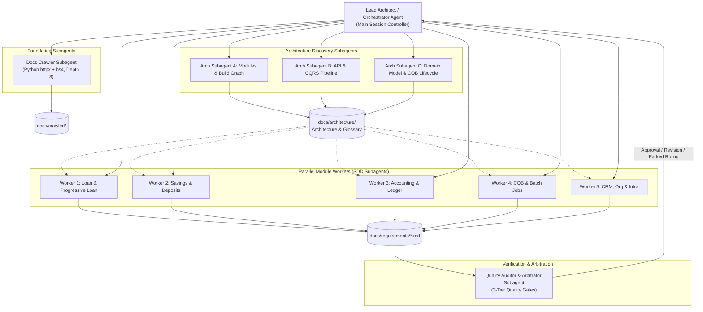
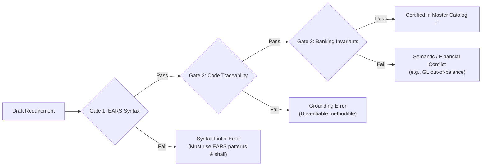
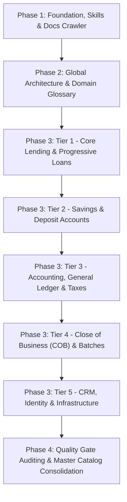

# Design Specification: Reverse-Engineering Apache Fineract into EARS Requirements

**Specification Date:** 2026-10-28  
**Project:** Apache Fineract 1.15.0 Reverse-Engineering & EARS Requirements Extraction  
**Target Architecture:** Multi-Agent Decoupled Knowledge Pipeline with Specialized File Skills, Recursive Docs Crawler, and 3-Tier Quality Arbitration Gates  
**Status:** Approved by User (Ready for Implementation Planning)

---

## 1. Executive Summary & Objectives

The primary objective of this project is to systematically reverse-engineer the core banking platform **Apache Fineract 1.15.0** (located in `apache-fineract-src-1.15.0`) and transform all implemented business capabilities, financial rules, state machines, and constraints into unambiguous, formally structured requirements using the **Easy Approach to Requirements Syntax (EARS)** standard.

### Key Deliverables:
1. **6 Specialized File-Parsing Skills:** Independent skill packages in `.skills/` tailored for reverse-engineering Java source code, Gradle build files, configuration properties/YAML, XML specifications, documentation/Markdown, and Flyway SQL migration scripts.
2. **Recursive Documentation Crawler Subagent:** An automated web scraper crawling `https://fineract.apache.org/docs/stable` up to depth 3, converting content into structured Markdown in `docs/crawled/` with a machine-readable `sitemap.json`.
3. **Tripartite Architecture Extraction Subagents:** Three specialized architectural subagents deriving the global module dependency graph, REST API/CQRS command pipeline, domain entity models, and Close-of-Business (COB) batch engine.
4. **Canonical Banking Domain Glossary:** A unified terminology repository (`docs/architecture/GLOBAL_DOMAIN_GLOSSARY.md`) preventing semantic discrepancies across agents.
5. **Bilingual Modular EARS Requirements Catalog:** Structured Markdown documents for each business module in `docs/requirements/<module>.md`, featuring strict English EARS statements alongside comprehensive Persian scenario descriptions and code traceability matrices.
6. **3 Quality & Arbitration Gates:** Automated and auditable validation ensuring 100% EARS syntax compliance, source-code grounding (zero hallucination), and cross-module double-entry accounting consistency.

---

## 2. Multi-Agent Team Architecture

The system utilizes an isolated, role-specialized multi-agent architecture orchestrated by a Lead Architect agent to eliminate context degradation and prevent task duplication.



### Agent Roles and Responsibilities:

| Agent / Subagent | Lifecycle & Host | Primary Responsibility | Input Resources | Primary Output |
| :--- | :--- | :--- | :--- | :--- |
| **Lead Architect Agent** | Root Session | Task planning, subagent dispatching, ledger tracking (`docs/sdd/progress.md`), cross-module conflict arbitration | Plan & Specs | Coordinated pipeline & rulings |
| **Docs Crawler Subagent** | Ephemeral Task | Recursive crawling of Fineract documentation up to depth 3 | Online docs URL | `docs/crawled/` & `sitemap.json` |
| **Architecture Subagent A** | Ephemeral Subagent | Reverse-engineering module boundaries, Gradle graph, and multi-tenancy model | Gradle files, configs | `01-system-modules-and-stack.md` |
| **Architecture Subagent B** | Ephemeral Subagent | Reverse-engineering REST APIs, CQRS pipelines, and RBAC permissions | Controllers, CommandHandlers | `02-api-cqrs-and-security.md` |
| **Architecture Subagent C** | Ephemeral Subagent | Reverse-engineering JPA domain entities, ERD, and COB state machines | `@Entity` classes, Flyway SQL | `03-domain-data-events-and-cob.md` |
| **Module Worker Subagents** | Fresh Per Task | Reverse-engineering assigned module into bilingual EARS requirements | Module source code, Skills, Glossary | `docs/requirements/<module>.md` |
| **Quality Auditor Subagent** | Ephemeral Per Task | Validating drafts against the 3 quality gates (Syntax, Traceability, Invariants) | Requirement drafts, Codebase | Audit review verdicts & fix lists |

---

## 3. Dedicated File-Parsing Skills Specification

To standardize how agents extract business semantics from heterogeneous source artifacts, 6 distinct skills are implemented under `.skills/<skill-name>/SKILL.md`:

### 3.1 `fineract-java-parser`
* **Path:** `.skills/fineract-java-parser/SKILL.md`
* **Trigger:** Invoked when reading any Java source file (`.java`) in `apache-fineract-src-1.15.0`.
* **Semantics Extraction Rules:**
  * **JAX-RS / Spring MVC Annotations (`@Path`, `@POST`, `@GET`, `@PreAuthorize`):**
    * Extracted to **Triggers** and **Preconditions**:
      * Role permission `@PreAuthorize("hasAuthority('DISBURSE_LOAN')")` $\to$ Precondition clause: `While the user possesses the "DISBURSE_LOAN" permission...`
      * Endpoint URI and HTTP Method $\to$ Event trigger: `When a POST request is received on "/v1/loans/{loanId}?command=disburse"...`
  * **Input Validation & Exception Blocks (`DataValidatorBuilder`, `if (...) throw ...`):**
    * Extracted to **Unwanted Behavior (If-Then)**:
      * Condition check: `if (disbursementAmount.compareTo(approvedPrincipal) > 0)` $\to$ `If the disbursement amount exceeds the approved principal amount, then the Fineract Loan Engine shall reject the transaction and return error code "error.msg.loan.amount.exceeds.approved".`
  * **State Transitions & Enums (`LoanStatus`, `SavingsAccountStatus`):**
    * Extracted to **State-Driven requirements**:
      * `While the loan account is in "APPROVED" state, when a disburse command is executed, the Fineract Loan Engine shall transition the account status to "ACTIVE".`
  * **CQRS Commands (`PortfolioCommandSourceWritePlatformService`, `CommandHandler`):**
    * Identifies state mutations, transaction boundaries, and entity history logging.

### 3.2 `fineract-gradle-parser`
* **Path:** `.skills/fineract-gradle-parser/SKILL.md`
* **Trigger:** Invoked when reading `build.gradle`, `settings.gradle`, or `gradle.properties`.
* **Semantics Extraction Rules:**
  * `project(':module-name')` dependencies define clear architectural capability boundaries.
  * External library imports extract third-party infrastructural requirements (e.g., ActiveMQ/Kafka $\to$ Asynchronous message streaming; Quartz $\to$ Scheduled job execution; Ehcache $\to$ Performance caching).

### 3.3 `fineract-config-parser`
* **Path:** `.skills/fineract-config-parser/SKILL.md`
* **Trigger:** Invoked when analyzing `application.properties`, `.yml`, Docker Compose, or environment variables.
* **Semantics Extraction Rules:**
  * Multi-tenant toggles $\to$ **Optional Feature (Where)** requirements:
    * `Where multi-tenancy is enabled, the Fineract Platform shall route queries to tenant-specific database schemas using the tenant identifier header.`
  * Default thresholds (pagination size, timeouts, retry counts) $\to$ **Ubiquitous** requirements.

### 3.4 `fineract-xml-parser`
* **Path:** `.skills/fineract-xml-parser/SKILL.md`
* **Trigger:** Invoked when reading `.xml` files (Spring bean configs, `logback.xml`, `ehcache.xml`, `persistence.xml`).
* **Semantics Extraction Rules:**
  * Logging layouts & audit patterns $\to$ Regulatory compliance requirements (capturing Tenant ID, User ID, and Transaction ID for all state-changing operations).
  * Cache TTL & eviction policies $\to$ Non-functional performance requirements.

### 3.5 `fineract-doc-parser`
* **Path:** `.skills/fineract-doc-parser/SKILL.md`
* **Trigger:** Invoked when reading local Markdown/AsciiDoc files or crawled HTML docs.
* **Semantics Extraction Rules:**
  * Extracts user-facing feature definitions, expected calculations, and operational workflows.
  * Reconciles documented expectations against actual implementation details found in code.

### 3.6 `fineract-db-schema-parser`
* **Path:** `.skills/fineract-db-schema-parser/SKILL.md`
* **Trigger:** Invoked when analyzing Flyway SQL scripts in `fineract-provider/src/main/resources/db/migration/`.
* **Semantics Extraction Rules:**
  * Table structures, columns, and foreign keys $\to$ Core entity models and domain invariants.
  * Unique constraints $\to$ Uniqueness requirements (e.g., `UNIQUE KEY (account_no, tenant_id)` $\to$ `The Fineract Platform shall ensure account numbers are unique within each tenant`).
  * Audit columns (`createdby_id`, `created_date`, `lastmodifiedby_id`) $\to$ Ubiquitous transaction audibility requirements.

---

## 4. Documentation Crawler Subagent & Crawled Corpus

### 4.1 Crawler Architecture
The crawler is engineered as a resilient Python script (`scripts/crawl_docs.py`) executed within an isolated subagent environment:
* **Target Root URL:** `https://fineract.apache.org/docs/stable`
* **Max Recursion Depth:** 3 levels (Level 0: Seed; Level 1: Sidebar & Primary Navigation; Level 2: Section Pages; Level 3: Detailed Technical Specs & Schemas).
* **Domain Whitelist:** Exclusively `fineract.apache.org/docs/` (outbound external links recorded without recursion).
* **HTML Processing & Sanitization:**
  * Drops redundant headers, footers, navigation trees, and script tags using `BeautifulSoup`.
  * Extracts main semantic article tags (`<main>`, `<article>`, `.content`).
  * Converts HTML structure to clean, standard GitHub-Flavored Markdown.
  * Injects canonical metadata frontmatter into each saved file.

### 4.2 Storage Layout
All crawled documentation is saved under `docs/crawled/`:
```text
docs/crawled/
├── sitemap.json             # Comprehensive crawl manifest with URL, depth, status, and local path
├── SUMMARY.md               # Hierarchical Table of Contents for rapid agent lookup
└── pages/                   # Mirrored URL path hierarchy
    ├── architecture/
    ├── user-manual/
    ├── modules/
    └── api/
```

---

## 5. Architecture Extraction Subagents & Global Domain Glossary

Three subagents analyze the codebase and crawled documentation in parallel to produce the global architectural baseline in `docs/architecture/`:

1. **`01-system-modules-and-stack.md` (Arch Subagent A):**
   * Multi-module dependency graph (Mermaid).
   * Framework and library technology matrix.
   * Multi-tenancy database isolation and routing architecture.
2. **`02-api-cqrs-and-security.md` (Arch Subagent B):**
   * Complete REST API inventory categorized by domain.
   * Command execution pipeline (`CommandWrapper` $\to$ Queue/Disruptor $\to$ `CommandHandler` $\to$ Audit).
   * RBAC permissions dictionary and authorization gates.
3. **`03-domain-data-events-and-cob.md` (Arch Subagent C):**
   * Core banking entity-relationship diagrams (ERD).
   * State machines for accounts (Loans, Savings, Shares).
   * Close-of-Business (COB) batch engine architecture and day-end accrual pipelines.
4. **`GLOBAL_DOMAIN_GLOSSARY.md` (Consolidated):**
   * Canonical English banking definitions mapped to Persian equivalents.
   * Single source of truth for terminology (Principal, Interest, Accrual, Grace Period, Moratorium, Amortization, Delinquency, NPA, Write-Off, Recovery).

---

## 6. The 3 Quality & Arbitration Gates

Every generated requirement must pass three mandatory gates before being certified into the master catalog:



### Gate 1: EARS Syntactic Conformance Gate
* **Strict Keyword Conformance:** Must match one of the 6 canonical EARS templates:
  1. **Ubiquitous:** `The <system name> shall <system response>`
  2. **State-Driven:** `While <precondition(s)>, the <system name> shall <system response>`
  3. **Event-Driven:** `When <trigger>, the <system name> shall <system response>`
  4. **Optional Feature:** `Where <feature is included>, the <system name> shall <system response>`
  5. **Unwanted Behavior:** `If <trigger/condition>, then the <system name> shall <system response>`
  6. **Complex:** Combining preconditions, triggers, and/or unwanted behaviors.
* **Mandatory Normative Verb:** Must strictly use `shall`. The words `should`, `will`, `can`, or `must` are strictly prohibited in the English EARS clause.
* **Verifiability:** Must define measurable criteria without ambiguous adjectives ("fast", "reasonable", "appropriate").

### Gate 2: Code-to-Requirement Traceability Gate
* Every requirement must cite:
  * Exact relative file path in `apache-fineract-src-1.15.0/`.
  * Class name, method name, or REST resource.
  * Pertinent database tables and error code constants.
* An auditor subagent cross-references the cited symbols against the actual repository to prevent hallucinated requirements.

### Gate 3: Banking Domain Invariant & Consistency Gate
* **Accounting Invariant:** Every financial transaction must correspond to balanced debit and credit entries in General Ledger (GL) rules.
* **State Machine Invariant:** Transitions must strictly match legal domain state flows.
* **Cross-Module Deduplication:** Common rules (such as charges or interest calculations) are referenced canonically rather than duplicated with conflicting rules.

---

## 7. Standard Requirement Output Format (Bilingual)

Each module's requirement file in `docs/requirements/<module>.md` follows this exact template:

```markdown
### REQ-[MODULE]-[ACTION]-[NUM]: [Short Descriptive Title in Persian]
* **الگوی EARS:** [Ubiquitous | State-Driven | Event-Driven | Optional Feature | Unwanted Behavior | Complex]
* **EARS Statement:**
  > While <preconditions>, when <trigger>, the <system name> shall <system response>.
* **شرح نیازمندی و سناریوی بیزنس (فارسی):**
  [توضیح کامل سناریوی بانکی، منطق بیزنس و اهداف مالی به زبان فارسی روان]
* **رفتارهای ناخواسته و شروط خطا (EARS If-Then):**
  * `If <error condition 1>, then the <system name> shall reject the request and return error code "<CODE_1>".`
  * `If <error condition 2>, then the <system name> shall <error response>.`
* **ماتریس ردیابی به سورس‌کد (Traceability Matrix):**
  * **مسیر فایل و کلاس سورس:** `apache-fineract-src-1.15.0/.../ClassName.java`
  * **متد اجرایی:** `#methodName()`
  * **کدهای خطا و انوتیشن‌ها:** `@PreAuthorize(...)`, `error.msg....`
  * **پایگاه داده و انتیتی‌ها:** جداول `m_...`, انتیتی `@Entity ...`
```

---

## 8. Module Prioritization & Execution Roadmap

Reverse-engineering tasks are partitioned by business domain priority across 5 sequential tiers:



### Detailed Breakdown:
* **Tier 1: Lending & Progressive Loans (`docs/requirements/01-loan-portfolio.md`):**
  * Modules: `fineract-loan`, `fineract-progressive-loan`, `fineract-loan-origination`.
  * Scope: Loan products, approval workflows, schedule calculation algorithms (Flat, Declining Balance, Equal Installments), interest accruals, disallowances, repayments, rescheduling, write-off, and delinquency aging.
* **Tier 2: Savings & Deposits (`docs/requirements/02-savings-and-deposits.md`):**
  * Modules: `fineract-savings`.
  * Scope: Savings products, fixed deposits, recurring deposits, daily interest calculation, interest posting jobs, account holds, and withdrawal charges.
* **Tier 3: Accounting & Fiscal Rules (`docs/requirements/03-accounting-and-financial-ledger.md` & `04-charges-taxes-and-rates.md`):**
  * Modules: `fineract-accounting`, `fineract-charge`, `fineract-tax`, `fineract-rates`.
  * Scope: Chart of Accounts, manual and automated journal entries, Cash vs Accrual accounting, financial activity mappings, fee calculations, and withholding tax groups.
* **Tier 4: Close of Business & Batches (`docs/requirements/05-cob-and-batch-operations.md`):**
  * Modules: `fineract-cob`, batch execution jobs, day-end loans/savings processing, holiday handling, locking mechanisms.
* **Tier 5: Organization, CRM & Security (`docs/requirements/06-crm-organization-and-security.md` & `07-infrastructure-and-integrations.md`):**
  * Modules: `client`, `group`, `organisation`, `useradministration`, `fineract-document`, Kafka/ActiveMQ messaging events.

---

## 9. Progress Ledger and Recovery Guarantees

All project activity is recorded in a tamper-resistant progress ledger at `docs/sdd/progress.md`:
1. **Ledger Header:** `# SDD Ledger: Apache Fineract EARS Reverse-Engineering`
2. **Task Entries:** Every completed task registers its status, verified commits, and auditor verdicts:
   `Task <ID>: complete (commits <base>..<head>, review clean)`
3. **Arbitration Rulings:** Any edge case or ambiguous business rule is formally documented in the ledger:
   `Ruling: <decision> - Reason: <rationale> - Cost if wrong: <impact>`
4. **Zero Context Loss:** In the event of session restarts or compaction, the Lead Architect recovers exact pipeline state directly from `docs/sdd/progress.md` and `git log`.
